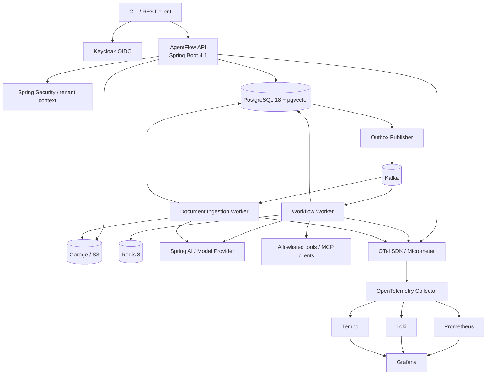
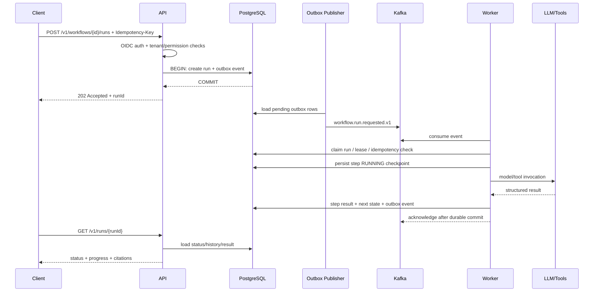

# AgentFlow — архитектура и план разработки

**Версия документа:** 1.2  
**Актуальность стека:** 15 октября 2026 года  
**Горизонт:** 16 недель (2–4 месяца)  
**Формат:** pet-проект backend/system design, один основной разработчик с AI-ассистентом; backlog из 277 атомарных задач с acceptance criteria  

## 1. Цель проекта

AgentFlow — платформа для создания и надёжного выполнения AI-workflow. Она принимает задачу, формирует или загружает план, вызывает разрешённые инструменты, при необходимости обращается к пользовательским документам через RAG, проверяет результат и сохраняет историю выполнения.

Это **не чат-обёртка над LLM**. Главный инженерный результат — собственный небольшой durable workflow engine, который умеет переживать рестарт worker'а, повторно обрабатывать сообщения, соблюдать tenant isolation, ограничивать стоимость AI-вызовов и объяснять ход выполнения по трассам, метрикам и audit trail.

### 1.1. Демонстрационный бизнес-сценарий

Пользователь загружает несколько PDF с финансовыми или техническими отчётами и запускает workflow «Подготовить сравнение».

1. Сервис принимает запрос и возвращает `runId`.
2. Workflow фиксируется в PostgreSQL и ставится в очередь через transactional outbox.
3. Worker получает событие и атомарно захватывает выполнение.
4. RAG-модуль ищет релевантные фрагменты с учётом `tenantId` и ACL.
5. Planner создаёт ограниченный типизированный план; Executor вызывает только зарегистрированные инструменты.
6. Critic проверяет полноту ответа и наличие цитат. При необходимости workflow ждёт подтверждения человека.
7. Результат, шаги, стоимость, ошибки и ссылки на исходные фрагменты сохраняются.
8. Пользователь может запросить статус, историю событий, результат или отменить запуск.

### 1.2. Что входит в MVP

- OIDC-аутентификация и tenant-aware авторизация.
- Версионированные agent/workflow definitions.
- Durable execution: состояния запусков и шагов, retries, таймауты, checkpoints, восстановление после сбоя, cancel и human approval.
- Асинхронное выполнение через Kafka с transactional outbox и inbox/idempotency.
- Инструменты с явным allowlist; никакого произвольного исполнения кода.
- RAG для PDF и текстовых документов, embeddings, гибридный поиск и цитаты.
- Учёт токенов/стоимости, ограничения запуска и аудит действий.
- Метрики, трассировка и структурированные логи.
- Интеграционные тесты на реальных инфраструктурных контейнерах.
- CI/CD, контейнеризация и локальное развёртывание в Kubernetes.

### 1.3. Что сознательно не входит в MVP

- Полноценный SaaS-биллинг и платёжные интеграции.
- Распределённое исполнение произвольного пользовательского кода.
- Автоматическое создание новых инструментов или изменение политик безопасности агентом.
- Высокодоступный production-кластер с несколькими зонами и десятками реплик.
- Multi-region, multi-cluster, сложная организационная UI-панель.
- Обещание exactly-once delivery между PostgreSQL и Kafka. Используем at-least-once delivery плюс идемпотентные бизнес-операции.

---

## 2. Технологический стек

Версии ниже — базовый согласованный набор на дату документа. Перед стартом следует проверить patch-релизы и уязвимости, затем зафиксировать версии через Gradle Wrapper, version catalog и lock-файлы. Не использовать `latest` в Docker Compose и Kubernetes manifests.

| Область | Базовый выбор | Почему |
|---|---|---|
| JDK | **Java 25 LTS** | Современная LTS-база для серверного проекта; даёт возможность применять современный язык/JVM и виртуальные потоки там, где они полезны. |
| Framework | **Spring Boot 4.1.1** | Стабильный релиз на дату документа; 4.2.0 находится в milestone-ветке, её не берём для базовой платформы. |
| AI | **Spring AI 2.0.1** | Стабильная 2.0.x; официальная документация указывает совместимость с Spring Boot 4.0.x и 4.1.x. Поддерживает model API, tool calling, vector stores, RAG и MCP. |
| Архитектура модулей | Spring Modulith 2.1.x, после smoke-test совместимости | Проверка границ модулей и публикаций событий. Не строим микросервисы только ради количества сервисов. |
| Build | Gradle Wrapper, Kotlin DSL, version catalog | Воспроизводимый build и единое управление версиями; обновления только через PR. |
| Основная БД | **PostgreSQL 18.6** | Source of truth для workflow state, транзакций, аудита и метаданных; поддерживает SQL, JSONB и подходит для pgvector. |
| Vector search | pgvector + PostgreSQL full-text search | На старте меньше инфраструктуры, единые tenant-фильтры и транзакционная модель. Отдельный Qdrant — опциональное сравнение в конце. |
| Очередь / events | Apache Kafka 4.3.x; Spring Kafka без ручного override версии клиента | Durable event log, consumer groups, replay и отдельное масштабирование API/worker. Проверить broker/client compatibility при создании проекта. |
| Cache / ephemeral coordination | **Redis Open Source 8.10.x** | Кэш, rate-limit state, короткоживущие distributed coordination данные. PostgreSQL остаётся источником истины для workflow. |
| Файлы | Garage с S3 API | Документы и артефакты хранятся вне PostgreSQL; в БД — метаданные и object key. |
| Identity | Keycloak 26.x + Spring Security OAuth2 Resource Server | OIDC, роли, локальные тестовые пользователи и отделение identity от бизнес-домена. Выбрать конкретный стабильный patch при старте. |
| AI model provider | Один облачный provider + Ollama как локальная опция | Изолировать провайдера интерфейсом и не привязывать доменную логику к одному SDK. Локальная модель не должна быть обязательна для CI. |
| Document parsing | Apache Tika + PDFBox; OCR оставить расширением | Достаточно для извлечения текста и метаданных из типовых PDF/DOCX; OCR — отдельная задача. |
| Observability | Micrometer + OpenTelemetry OTLP + OTel Collector + Prometheus + Grafana + Loki + Tempo | Корреляция API/DB/Kafka/LLM-вызовов, графики и поиск ошибок без привязки к одному коммерческому APM. |
| Test | JUnit 6 (BOM-managed by Spring Boot 4.1.1; the Sprint 1 plan's "JUnit 5" is superseded — see `CHANGELOG.md`), AssertJ, Mockito, Spring Boot Test, **Testcontainers 2.0.5**, ArchUnit/Spring Modulith tests | Изолированные тесты домена плюс интеграционные тесты с настоящими PostgreSQL/Kafka/Redis/Keycloak-контейнерами. |
| Load test | k6 | Воспроизводимый профиль нагрузки и p95/p99, а не субъективное «кажется быстро». |
| Security / supply chain | Trivy, OWASP Dependency-Check или эквивалент, SBOM CycloneDX, secret scanning | Поиск уязвимостей в зависимостях, контейнерах и случайно закоммиченных секретах. |
| Runtime | Docker Compose для локальной разработки; Kubernetes (kind или k3d) для локального production-like профиля | Дешёвый старт и постепенный переход к реальному deployment model. |
| Packaging / GitOps | Helm 4 и Argo CD версии с поддержкой Helm 4; зафиксировать актуальные stable patches | Версионируемые manifests, декларативный deployment и rollback. Проверить поддержку выбранных версий до интеграции. |
| API contracts | OpenAPI для HTTP; JSON Schema/AsyncAPI для событий; Avro + Apicurio Registry как расширение | Эволюция контрактов без тихих несовместимых изменений. Для MVP можно начать с версионированного JSON Schema. |

### 2.1. Совместимость и управление версиями

- Не устанавливать Spring Framework, Spring Security, Spring Kafka и Jackson вручную поверх Spring Boot BOM без конкретной причины.
- Spring AI вести через официальный BOM, подходящий версии Boot; не брать milestone/snapshot версии для основного пути.
- Версию Kafka broker можно обновлять независимо от Spring Kafka, но каждый upgrade должен проходить smoke-test producer/consumer, retry, headers, shutdown и rebalance.
- PostgreSQL и pgvector должны быть проверены одним интеграционным тестом на том же Docker image, который используется локально и в CI.
- Зафиксировать immutable Docker tags или digests для критичных зависимостей; Dependabot/Renovate поднимает PR, а не автоматически меняет production manifests.

---

## 3. Архитектурные решения

### ADR-001. Modular monolith first

На первом этапе доменные модули находятся в одном приложении и одном репозитории. Модули имеют явные API и не обращаются к внутренним классам друг друга. Границы проверяются автоматическими architecture tests.

Это даёт настоящую модульность без преждевременной распределённой сложности. В production-like окружении API и worker запускаются разными Kubernetes Deployments из одного image и с разными профилями/ролями. Позже тяжёлый ingestion worker можно выделить физически без изменения доменной модели.

### ADR-002. PostgreSQL — источник истины для workflow

Kafka доставляет уведомления и команды, но не является единственным хранилищем актуального статуса workflow. Каждый переход состояния фиксируется транзакционно в PostgreSQL.

### ADR-003. At-least-once + idempotency

Сообщение может прийти повторно. Обработчик использует `eventId`/`idempotencyKey` и `inbox_messages`, а переходы защищаются optimistic locking и условными update-запросами. Внешний вызов LLM не считается exactly-once: при падении в неоднозначный момент возможен повторный вызов, поэтому у workflow есть cost budget и журнал попыток.

### ADR-004. Outbox между PostgreSQL и Kafka

Состояние и запись в `outbox_events` создаются одной транзакцией. Отдельный publisher публикует неотправленные события и помечает результат; повторная публикация допустима. В базовом пути используем polling publisher. CDC/Debezium можно добавить как отдельный эксперимент после того, как outbox-механика работает.

### ADR-005. Версионированный workflow DSL, но без произвольного кода

План — JSON-граф типизированных шагов. Допускаются только заранее определённые типы, например `RETRIEVE_CONTEXT`, `LLM_PLAN`, `TOOL_CALL`, `HUMAN_APPROVAL`, `LLM_EVALUATE`, `FINALIZE`. Циклы в пользовательском графе не разрешать в MVP; retry и повторные попытки обрабатывает движок. Валидатор проверяет DAG, обязательные поля, лимиты и доступность инструментов.

### ADR-006. AI — недоверенный планировщик, не исполнитель привилегий

Модель может предложить план, но не может добавлять инструмент в allowlist, менять права, читать секреты или обходить бюджет. Сервер проверяет структурированный вывод модели и каждое действие отдельно.

### ADR-007. Tenant isolation по умолчанию

Все доменные записи содержат `tenant_id`, где это применимо. Tenant определяется из проверенного security context, а не из произвольного JSON тела. Все запросы к документам, chunks, workflow, результатам и audit events обязаны применять tenant filter. В интеграционных тестах проверяется невозможность чтения данных другого tenant.

---

## 4. Архитектура компонентов



### 4.1. Deployables

1. **`agentflow-app` / API deployment** — REST API, аутентификация, валидация, каталог агентов, определений workflow, документов и запрос статуса.
2. **`agentflow-app` / workflow-worker deployment** — consumer событий workflow, исполнение шагов, retries, checkpoints, таймауты и восстановление lease.
3. **`agentflow-app` / ingestion-worker deployment** — извлечение текста, chunking, embeddings, индексация документов. В первом релизе можно запускать эту роль как worker profile того же image.
4. **`agentflow-mcp-lab` — опциональный отдельный сервис** — пара безопасных демонстрационных инструментов по MCP для изучения tool discovery и transport. Не должен иметь прямого доступа к внутренней БД приложения.
5. **Infrastructure containers** — PostgreSQL, Kafka, Redis, Garage, Keycloak, OTel Collector, Prometheus, Grafana, Loki, Tempo и, опционально, Schema Registry/Ollama.

Не все контейнеры должны запускаться в обычном цикле разработки. Использовать профили Compose: `core`, `messaging`, `ai-local`, `observability`, `full`.

### 4.2. Логические модули приложения

| Модуль | Ответственность | Зависимости наружу |
|---|---|---|
| `identity` | tenant context, authorization policy mapping | Spring Security, Keycloak claims |
| `agentcatalog` | agent profiles, model policy, tool allowlist | identity, PostgreSQL |
| `workflowdefinition` | versioned workflow graph, validation, activation | agentcatalog |
| `workflowexecution` | run/step state machine, checkpoints, cancellation | workflowdefinition, messaging ports |
| `toolexecution` | typed tool registry, timeout, permission check, result schema | agentcatalog, audit |
| `knowledgebase` | document metadata, access policy, chunk search | object storage, embedding port |
| `ingestion` | extract, chunk, embed, index, retry | knowledgebase, messaging |
| `ai` | model provider adapter, prompts, structured outputs, evaluation hooks | Spring AI, tool ports |
| `usage` | token/cost metering, budgets, quotas | ai, workflowexecution |
| `audit` | security and business audit events, immutable append-only history | identity |
| `messaging` | outbox, inbox, event schemas, publisher/consumer configuration | PostgreSQL, Kafka |
| `observability` | domain meters, trace attributes, correlation helpers | Micrometer, OTel |

**Правило зависимостей:** доменные модули не импортируют web-контроллеры, Kafka listener'ы или инфраструктурные классы других модулей. События между модулями — через публичные типы или application services, а между процессами — через версионированные event contracts.

---

## 5. Ключевые пользовательские сценарии

### 5.1. Запуск workflow



Критический момент: запись `run` и `outbox event` создаются одной DB-транзакцией. Сообщение подтверждается только после сохранения результата обработки. При падении между DB commit и Kafka ack событие придёт повторно, а `inbox_messages` и состояние шага предотвратят повторное изменение бизнес-состояния.

### 5.2. Ingestion документа


Для ingestion нужна идемпотентность по `tenant_id + sha256 + pipeline_version`. Повторная загрузка одинакового файла может вернуть существующую версию документа или создать явную новую версию согласно выбранной продуктовой политике.

---

## 6. Workflow state machine и гарантии

### 6.1. Статусы run

- `QUEUED` — запись сохранена, ожидает worker.
- `RUNNING` — worker захватил lease и выполняет шаги.
- `WAITING_FOR_APPROVAL` — workflow остановлен до решения человека.
- `RETRY_WAIT` — запуск ждёт времени следующей попытки.
- `SUCCEEDED` — все обязательные шаги завершены.
- `FAILED` — исчерпаны разрешённые попытки или произошла неисправимая ошибка.
- `CANCEL_REQUESTED` — получен запрос отмены; worker должен остановиться на безопасной границе.
- `CANCELLED` — отмена подтверждена и состояние сохранено.

Переходы валидируются централизованно в доменной state machine. Нельзя напрямую обновлять status из контроллера.

### 6.2. Статусы step

`PENDING → READY → RUNNING → SUCCEEDED`; возможные альтернативы: `RETRY_WAIT`, `WAITING_FOR_APPROVAL`, `FAILED`, `SKIPPED`, `CANCELLED`.

Для каждого шага сохраняются `attempt`, `input_hash`, `output_ref` или безопасный output payload, `started_at`, `finished_at`, `error_code`, `next_retry_at`, `worker_id` и `lease_epoch`. Большие результаты лучше хранить в object storage, а в PostgreSQL — ссылку и checksum.

### 6.3. Lease и recovery

- Worker захватывает запуск атомарным условным update и получает `lease_until`, `worker_id`, увеличенный `lease_epoch`.
- Heartbeat продлевает lease только текущему владельцу.
- Любая запись результата дополнительно проверяет ожидаемый `lease_epoch`; старый worker после потери lease не должен перезаписывать состояние.
- Recovery job периодически выбирает просроченные lease и переводит соответствующие шаги в `RETRY_WAIT` или снова публикует ready event.
- Интервал recovery и lease задаются конфигурацией; пример для локального профиля: heartbeat каждые 10 секунд, lease 45 секунд, recovery каждые 15 секунд. Это стартовые параметры, их нужно проверить тестом и нагрузкой.

### 6.4. Retry policy

- Retry только для классифицированных transient ошибок: временная ошибка сети/provider, rate limit, временная недоступность зависимости.
- Exponential backoff с jitter и верхней границей; значения конфигурируемы.
- Validation errors, запрет инструмента, превышение бюджета и некорректный структурированный ответ после лимита попыток — permanent error либо отдельная повторная попытка по явно определённой политике.
- DLQ предназначена для расследования, не для бесконечного повторения.
- Повторная обработка не должна создавать вторую запись результата, повторно списывать учётную единицу или продвигать state machine дважды.

---

## 7. Kafka topics и контракты событий

Для всех событий использовать envelope с минимумом полей:

```json
{
  "eventId": "uuid",
  "eventType": "workflow.run.requested",
  "schemaVersion": 1,
  "occurredAt": "2026-10-15T12:00:00Z",
  "tenantId": "uuid",
  "aggregateType": "workflow_run",
  "aggregateId": "uuid",
  "correlationId": "uuid",
  "causationId": null,
  "payload": {}
}
```

`tenantId` в событии нужен для корреляции и маршрутизации, но worker всё равно обязан подтвердить права и ownership по данным PostgreSQL. Нельзя считать Kafka message доверенным источником авторизации.

| Topic | Key | Производитель → потребитель | Назначение |
|---|---|---|---|
| `agentflow.workflow.run-requested.v1` | `tenantId:runId` | API/outbox → workflow worker | Новый запуск готов к обработке |
| `agentflow.workflow.step-ready.v1` | `tenantId:runId` | workflow engine → workflow worker | Следующий шаг готов |
| `agentflow.workflow.run-cancelled.v1` | `tenantId:runId` | API/outbox → worker | Запрос отмены |
| `agentflow.document.ingestion-requested.v1` | `tenantId:documentId` | API/outbox → ingestion worker | Индексация документа |
| `agentflow.document.indexed.v1` | `tenantId:documentId` | ingestion worker → API/workflow consumers | Документ готов к поиску |
| `agentflow.workflow.run-finished.v1` | `tenantId:runId` | workflow worker → downstream | Успешное/неуспешное завершение |

Правила:

- Имена и схемы версионируются; breaking change создаёт новую major version topic/contract или версию schema по принятой стратегии.
- В Kafka нельзя помещать API keys, access tokens, полные документы, секреты или полный prompt по умолчанию.
- Correlation/trace context переносится в headers; размер сообщений ограничен.
- Partition key обеспечивает порядок событий одного run, а не всех событий одного tenant.
- Для MVP достаточно 3–6 partitions локально; реальное количество определяется нагрузочным тестом и ключами распределения.
- На первом этапе события хранятся в JSON с JSON Schema validation в тестах. Schema Registry (Avro + Apicurio) — отдельный инкремент после стабильного event envelope, а не блокер основного workflow.

---

## 8. Модель данных PostgreSQL

Использовать миграции Flyway или Liquibase — выбрать один инструмент и не смешивать оба. Для этого проекта разумен Flyway, если нет необходимости сохранять привычную командную практику Liquibase. Все timestamps — `timestamptz`; цены/стоимость не хранить в `float`; идентификаторы — UUID; изменения схемы — только миграциями.

### 8.1. Основные таблицы

| Таблица | Ключевые поля | Ограничения и индексы |
|---|---|---|
| `tenants` | `id`, `slug`, `status`, `created_at` | unique `slug`; только администратор меняет status |
| `agent_profiles` | `id`, `tenant_id`, `name`, `model_provider`, `model_name`, `system_prompt_ref`, `tool_policy`, `budget_policy`, `version`, `status` | unique `(tenant_id, name, version)`; активная версия неизменяема |
| `tool_definitions` | `id`, `tenant_id` nullable для global tools, `name`, `version`, `input_schema`, `output_schema`, `required_scopes`, `timeout_ms`, `enabled` | уникальность имени/версии; запрещён неявный доступ к tools |
| `workflow_definitions` | `id`, `tenant_id`, `name`, `description`, `created_at` | unique `(tenant_id, name)` |
| `workflow_definition_versions` | `id`, `workflow_id`, `version`, `graph_json`, `checksum`, `status`, `created_by`, `created_at` | unique `(workflow_id, version)`; immutable после activation |
| `workflow_runs` | `id`, `tenant_id`, `workflow_version_id`, `status`, `input_ref/json`, `result_ref/json`, `idempotency_key`, `attempt`, `lease_owner`, `lease_until`, `lease_epoch`, `next_action_at`, `version`, timestamps | unique `(tenant_id, idempotency_key)` where not null; индексы `(tenant_id, created_at)`, `(status, next_action_at)`, `(lease_until)` |
| `workflow_step_runs` | `id`, `run_id`, `step_key`, `status`, `attempt`, `input_hash`, `output_ref/json`, `error_code`, `error_summary`, timestamps, `lease_epoch` | unique `(run_id, step_key, attempt)`; индекс `(run_id, status)` |
| `workflow_events` | `id`, `tenant_id`, `run_id`, `step_run_id`, `event_type`, `payload_redacted`, `occurred_at` | append-only; индекс `(run_id, occurred_at)` |
| `outbox_events` | `event_id`, `aggregate_type`, `aggregate_id`, `topic`, `event_key`, `payload`, `headers`, `created_at`, `published_at`, `publish_attempts`, `last_error` | индекс частичной выборки неотправленных записей; публикация идемпотентна по `event_id` |
| `inbox_messages` | `consumer_name`, `event_id`, `processed_at`, `outcome` | primary key `(consumer_name, event_id)` |
| `knowledge_bases` | `id`, `tenant_id`, `name`, `embedding_model`, `chunking_config`, `status` | unique `(tenant_id, name)` |
| `documents` | `id`, `tenant_id`, `knowledge_base_id`, `object_key`, `filename`, `mime_type`, `size_bytes`, `sha256`, `version`, `status`, `pipeline_version`, `page_count`, timestamps | unique согласно политике версий; индекс `(tenant_id, knowledge_base_id, status)` |
| `document_chunks` | `id`, `tenant_id`, `document_id`, `chunk_index`, `page_from`, `page_to`, `content`, `content_hash`, `embedding`, `metadata_json` | unique `(document_id, chunk_index, pipeline_version)`; vector index плюс FTS index; фильтр tenant обязателен |
| `usage_records` | `id`, `tenant_id`, `run_id`, `step_run_id`, `provider`, `model`, `input_tokens`, `output_tokens`, `estimated_cost`, `currency`, `recorded_at` | индекс `(tenant_id, recorded_at)`, Decimal/Numeric для стоимости |
| `tenant_budgets` | `tenant_id`, `period`, `max_runs`, `max_tokens`, `max_cost`, `updated_at` | budget check транзакционен либо использует отдельный атомарный reservation mechanism |
| `audit_events` | `id`, `tenant_id`, `actor_subject`, `action`, `resource_type`, `resource_id`, `outcome`, `correlation_id`, `metadata_redacted`, `created_at` | append-only; индекс `(tenant_id, created_at)`; не писать секреты и полные prompts |

### 8.2. Практические решения по данным

- `workflow_definition_versions.graph_json` хранит декларативный граф и checksum; опубликованная версия immutable.
- Большие входы/выходы хранить в Garage, ссылку и checksum — в БД. Не превращать `jsonb` в объектное хранилище.
- Для RAG хранить source document, chunk ID, page number и offsets, чтобы отвечать с цитатой. Удаление документа должно исключать его chunks из retrieval и инициировать очистку индекса.
- Векторный индекс строить отдельно от FTS; для небольшого объёма можно начать с точного поиска, затем добавить HNSW и измерить trade-off качества/latency.
- Tenant фильтр применяется до выдачи результатов, а не пост-фильтром по top-k. Проверять это автоматическими тестами.
- Не использовать Redis как единственное место хранения workflow state, прав доступа или счётчиков финансового учёта.

---

## 9. API-контракты

Базовый prefix: `/api/v1`. Все endpoints защищены OAuth2/OIDC, кроме liveness и минимального readiness, где это оправдано.

### 9.1. Agent и workflow definitions

- `POST /api/v1/agents` — создать agent profile.
- `GET /api/v1/agents` — список доступных текущему tenant агентов.
- `POST /api/v1/workflows` — создать workflow definition.
- `POST /api/v1/workflows/{workflowId}/versions` — добавить draft-версию.
- `POST /api/v1/workflows/{workflowId}/versions/{version}/validate` — validate graph/schema/tool permissions.
- `POST /api/v1/workflows/{workflowId}/versions/{version}/activate` — активировать immutable версию.
- `GET /api/v1/workflows/{workflowId}` — получить workflow с доступными версиями.

### 9.2. Запуски

- `POST /api/v1/workflows/{workflowId}/runs` — создать run; заголовок `Idempotency-Key`, ответ `202 Accepted` с `runId`.
- `GET /api/v1/runs/{runId}` — статус, прогресс, временные метки и безопасный summary.
- `GET /api/v1/runs/{runId}/steps` — состояние шагов и ошибки без секретных payload.
- `GET /api/v1/runs/{runId}/events` — постраничная история событий.
- `GET /api/v1/runs/{runId}/result` — результат при наличии права.
- `POST /api/v1/runs/{runId}/cancel` — запросить отмену.
- `POST /api/v1/runs/{runId}/approvals/{approvalId}` — approve/reject, с idempotency и audit event.

### 9.3. Knowledge base

- `POST /api/v1/knowledge-bases` — создать базу.
- `POST /api/v1/knowledge-bases/{id}/documents` — multipart upload с ограничениями.
- `GET /api/v1/documents/{documentId}` — статус ingestion.
- `POST /api/v1/knowledge-bases/{id}/search` — debug-search только при нужном scope; response включает chunk ID, страницу, score и ограниченный snippet.

### 9.4. Общие требования к API

- OpenAPI — генерируемый контракт, проверяемый в CI.
- Ошибки в RFC 9457 Problem Details формате.
- Pagination для коллекций; max page size ограничен.
- `Idempotency-Key` нужен для create-run, upload-finalize и human approval.
- Не принимать `tenantId` как источник авторизации из тела запроса.
- Применять request size limit, rate limit и timeout.
- Для запуска workflow возвращать `202`, а не удерживать HTTP-соединение до завершения LLM.

---

## 10. AI orchestration и RAG

### 10.1. Путь исполнения agent

1. Загружаем immutable agent profile и workflow version.
2. Проверяем модель, budget, разрешённые tools и политики tenant.
3. Формируем ограниченный контекст из пользовательского ввода и RAG chunks.
4. Planner получает schema-constrained запрос и возвращает JSON-план из допустимых node types.
5. Валидатор проверяет план, лимит шагов, типы аргументов, ссылки на доступные инструменты и budget reservation.
6. Executor запускает шаги через tool registry; tool args проходят JSON Schema validation.
7. Результат инструмента нормализуется, редактируется для логирования и записывается как checkpoint.
8. Critic может проверить полноту/цитаты один раз; ограничить число reflection-циклов, например одним дополнительным проходом.
9. Finalizer формирует результат с ссылками на источники, записывает метрики стоимости и terminal state.

**Запрещено:** давать модели SQL shell, JavaScript/Python eval, filesystem shell или неограниченный HTTP fetch. Для сетевых инструментов нужен allowlist доменов/IP, блокировка private/link-local адресов и повторная DNS/IP-проверка во избежание SSRF.

### 10.2. Tool registry

Каждый tool definition определяет:

- имя и версию;
- input/output JSON Schema;
- необходимые scopes;
- timeout и retry policy;
- класс риска (`READ_ONLY`, `WRITE`, `EXTERNAL_SIDE_EFFECT`);
- необходимость human approval;
- максимальный размер результата;
- правила redaction для логов.

Для MVP реализовать 3 инструмента: `document.search`, `calculator.evaluate` (не eval, а ограниченный парсер арифметики) и `report.format`. Дополнительно — демо MCP tool `ticket.lookup`, возвращающий фиктивные данные.

### 10.3. RAG ingestion

1. Проверить MIME, размер, расширение и SHA-256.
2. Сохранить оригинал в Garage в tenant-scoped object key.
3. Создать document row и outbox event транзакционно.
4. Worker извлекает текст через Tika/PDFBox и сохраняет диагностику ошибок.
5. Chunking: начальный вариант 500–800 токенов с overlap 80–120 токенов; затем измерить на тестовом корпусе.
6. Рассчитать embedding через provider adapter; пакетировать запросы и ограничивать concurrency.
7. Сохранить chunk content, page metadata, embedding и FTS representation.
8. Перевести документ в `INDEXED` только после завершения всех обязательных этапов.
9. Поиск комбинирует PostgreSQL full-text и vector similarity; затем при необходимости добавить простой reranking.
10. Ответ содержит citations `documentId`, `chunkId`, page/section и score; отсутствие источников не маскировать выдуманными цитатами.

### 10.4. Eval для AI

Создать небольшой фиксированный набор из 20–40 вопросов по двум-трём документам и ожидаемых фактов/цитат. На PR гонять deterministic tests с fake ChatModel; реальный provider eval запускать вручную/по расписанию с ограниченным бюджетом. Измерять retrieval hit rate, наличие корректных ссылок, структурную валидность и долю ответов без подтверждения источником. Не использовать только LLM-as-a-judge как единственный критерий качества.

---

## 11. Security model

### 11.1. Authentication and authorization

- Keycloak — OIDC provider; API — OAuth2 Resource Server с проверкой issuer, audience и подписи JWT.
- Использовать scopes/roles, например `workflow:read`, `workflow:write`, `workflow:approve`, `knowledge:read`, `tenant:admin`.
- Роль не заменяет tenant check: каждый запрос проверяет resource ownership.
- Для worker использовать отдельную service identity, без пользовательских токенов в Kafka payload.
- Актор и correlation ID фиксируются в audit trail для чувствительных действий.

### 11.2. AI-specific security

- Все загруженные документы и найденные RAG-фрагменты считать недоверенным содержимым; текст документа не может менять tool policy или system constraints.
- Доступные tool calls определяются backend policy, а не тем, что модель попросила вызвать.
- Human approval обязателен для потенциально необратимых side effects.
- Ограничить максимальное число шагов, токены на run, длительность и общую стоимость.
- Secrets хранить вне БД и prompts; применять allowlist секретов, которые можно передавать конкретному tool adapter, а не модели целиком.
- Редактировать Authorization headers, API keys, персональные поля и чувствительные fragments из логов.

### 11.3. Infrastructure security

- Контейнеры запускаются не от root; filesystem read-only, где возможно.
- Никаких секретов в Git или в Docker build args; локально использовать `.env` вне репозитория, deployment — Kubernetes Secret/external secret mechanism.
- NetworkPolicy по мере готовности kind-кластера; ограничить egress tool/worker'ов.
- Ограничить размер загружаемых файлов и архивов; защищаться от zip bombs и чрезмерного числа страниц.
- Trivy scan образов и зависимостей в CI; устранение critical/high findings или документированный waiver с датой истечения.
- Actuator endpoints и dashboards не публиковать наружу без authentication/network policy.

---

## 12. Observability: metrics pipeline as code

### 12.1. Signals

- **Metrics:** Micrometer + Prometheus scrape; OTel Collector при необходимости экспорта OTLP метрик.
- **Traces:** OTLP в Collector, затем Tempo; propagation через HTTP headers и Kafka record headers.
- **Logs:** JSON logs в stdout, traceId/spanId в каждом сообщении; сбор Loki агентом/Collector.
- **Dashboards/alerts:** хранить JSON/YAML provisioning и alert rules в репозитории. Изменение dashboard — обычный PR.

### 12.2. Обязательные метрики

**HTTP/API**
- request count/error rate/latency buckets по route template и status class;
- число 401/403/429, размер upload и ошибки валидации.

**Workflow**
- `agentflow_workflow_runs_total{status}`;
- `agentflow_workflow_run_duration_seconds`;
- `agentflow_workflow_queue_delay_seconds`;
- `agentflow_workflow_steps_total{step_type,status}`;
- `agentflow_workflow_retry_total{error_class}`;
- число истёкших lease и время recovery.

**AI/RAG**
- вызовы и ошибки provider по модели;
- latency, input/output tokens, estimated cost;
- tool calls/duration/error class;
- ingestion queue lag, extracted pages, embedding batch latency;
- retrieval latency и количество найденных chunks.

**Infrastructure**
- Kafka consumer lag;
- DB pool utilization, query latency и connection errors;
- Redis command latency/errors;
- JVM heap, GC, thread/virtual-thread related indicators, CPU/memory.

Не ставить `tenantId`, `userId`, `runId`, prompt или document ID в labels метрик: это создаёт высокую кардинальность и утечку. Для корреляции использовать traces/log fields.

### 12.3. Базовые SLO для локальной демо-системы

- `POST /runs` p95 ≤ 500 ms при 50 concurrent clients на зафиксированном локальном профиле, если запрос только сохраняет run и ставит outbox event.
- `GET /runs/{id}` p95 ≤ 250 ms на том же профиле при тёплом cache и небольших таблицах.
- Для тестовой нагрузки 20 событий/сек p95 от DB commit до publish в Kafka ≤ 2 s.
- После принудительного убийства worker'а незавершённый run должен быть восстановлен в течение 60 s после истечения lease.
- Для 100 дубликатов одного event ID должен произойти один доменный переход состояния и одна бизнес-запись результата.

Это **учебные цели для измеряемого локального стенда**, не универсальные обещания производительности. Зафиксировать CPU/RAM/версии контейнеров/количество partitions вместе с отчётом k6.

---

## 13. Тестовая стратегия

| Уровень | Что проверяем | Инструменты |
|---|---|---|
| Unit | state machine, retry calculations, schema validation, cost budgets, permissions | JUnit, AssertJ, Mockito |
| Module/architecture | запрещённые зависимости и публичные границы | Spring Modulith verification, ArchUnit |
| MVC/API | validation, Problem Details, OIDC claims, pagination, idempotency | Spring Boot Test, MockMvc/WebTestClient по выбранному MVC стэку |
| Integration | migrations, outbox, repository queries, pgvector/FTS, Kafka headers, Redis | Testcontainers 2.x |
| Contract | OpenAPI diff, JSON Schema compatibility, event envelope, consumer expectations | OpenAPI validation, JSON Schema/AsyncAPI checks; Pact при необходимости |
| AI deterministic | tool policy, invalid model output, retries, citation construction | fake model/provider, curated fixture corpus |
| AI evaluation | retrieval/citation quality, structured output, groundedness | versioned eval dataset; реальные LLM-вызовы вне каждого PR |
| Security | cross-tenant leakage, privilege escalation, SSRF, prompt injection, upload limits | integration tests + scanners + ручные abuse cases |
| Failure/recovery | worker kill, broker restart, duplicate event, DB outage, stale lease, model timeout | Testcontainers, fault injection scripts |
| Load | throughput, p95/p99, DB pool pressure, Kafka lag, JVM memory | k6, dashboards, JFR/async-profiler по необходимости |
| E2E | upload → index → run → citations → result | Compose/Kind environment + smoke tests |

Для доменных модулей целиться в ≥80% line coverage как инженерную цель, но критичнее прямое покрытие state transitions, tenant checks и failure paths. Глобальный coverage percentage не заменяет сценарные тесты.

### Обязательные негативные сценарии

1. Пользователь tenant A запрашивает run/document tenant B → `404` или `403` согласно единой политике, данные не раскрываются.
2. Два worker'а одновременно пытаются захватить один run → владельцем становится только один.
3. Kafka публикует дубликат → состояние и бизнес side effect не дублируются.
4. Worker умирает после вызова модели, но до сохранения результата → попытка фиксируется как ambiguous/retryable; возможный повтор provider call не скрывается из учёта.
5. Документ содержит prompt injection → tool permissions остаются неизменными.
6. Tool пытается обратиться на private IP/metadata endpoint → соединение блокируется.
7. Vector search не нашёл релевантных данных → ответ сообщает об отсутствии достаточных источников, а не выдумывает citations.
8. Redis недоступен → критичное состояние workflow продолжает жить в PostgreSQL; cache miss не приводит к потере run.
9. Kafka недоступна в момент создания run → API не сообщает успешный запуск, если outbox transaction не зафиксирован; после commit publisher должен доставить событие позднее.
10. Запрос отмены поступает в середине шага → отмена обрабатывается на безопасной границе и не теряет уже зафиксированные checkpoints.

---

## 14. CI/CD и репозиторий

### 14.1. Структура репозитория

```text
agentflow/
  apps/
    agentflow-app/              # один Spring Boot artifact, несколько runtime profiles
    agentflow-mcp-lab/           # необязательный изолированный MCP demo server
  infra/
    compose/
    docker/
    helm/
    argocd/
    observability/
      otel-collector/
      prometheus/
      grafana/dashboards/
      grafana/alerting/
      loki/
      tempo/
  contracts/
    openapi/
    events/json-schema/
    asyncapi/
  docs/
    adr/
    runbooks/
    threat-model/
    load-tests/
  scripts/
  build.gradle.kts
  settings.gradle.kts
  gradle/libs.versions.toml
  README.md
  DEVELOPMENT_PLAN.md
  SECURITY.md
```

Внутри `agentflow-app` — package-by-feature/module, например `com.example.agentflow.workflow`, `...knowledgebase`, `...tool`, `...audit`. Не начинать с десятков Gradle subprojects. Вынести отдельную Gradle-модель только если модуль реально должен иметь самостоятельный lifecycle/публикацию.

### 14.2. Pull request pipeline

1. Checkout + JDK toolchain 25 + Gradle Wrapper validation.
2. `./gradlew clean check` (compile, unit, architecture, module tests).
3. Интеграционные Testcontainers tests.
4. OpenAPI и event schema compatibility check.
5. Coverage report и проверка минимального уровня по доменным модулям.
6. Dependency vulnerability scan и secret scan.
7. Build OCI image и Trivy scan.
8. Генерация SBOM CycloneDX и сохранение как artifact.
9. Для main/tag — publish image с immutable tag; развёртывание в тестовое окружение.
10. Smoke/E2E test; promotion в следующую среду выполняется после успешной проверки.

### 14.3. GitOps / Helm

- Отдельные values для `local`, `staging` и `demo`; никаких секретов в values files.
- Liveness/readiness/startup probes и graceful shutdown.
- Requests/limits для CPU/memory; HPA для API и worker отдельно — только после измерения.
- API Deployment не должен запускать consumers; worker deployments не должны публиковать контроллеры как публичный вход.
- Alembic-like migration ordering не требуется; миграции выполняются контролируемым Job/init phase, исключить одновременный старт migration с нескольких replica.
- Argo CD применяет состояние из Git; rollback/forward-fix process документирован.
- Убедиться в совместимости выбранного Argo CD и Helm 4 до того, как делать их обязательным блокером проекта.

---

## 15. Подробный план разработки на 16 недель: атомарные задачи

Раздел представляет собой backlog, задачи имеют стабильные ID `S01-01`, `S01-02` и т. д. Каждая задача должна давать один проверяемый результат и занимать ориентировочно от 30 минут до половины рабочего дня. Если задача больше — разложи её на issue по этапам: схема/контракт, реализация, тест, telemetry, документация.

### Правила выполнения

- В начале спринта проверь Definition of Ready: понятны входы, результат, способ проверки и зависимости.
- В конце дня приложение должно оставаться запускаемым; инфраструктуру проверяй на чистом запуске.
- `P0` — обязательный путь MVP, `P1` — желательно, `P2` — после MVP. При отставании откладывай P2, затем P1; не выкидывай tenant isolation, recovery и ключевые security tests.
- Для каждого issue используй разделы `Контекст`, `Изменения`, `Тесты`, `Acceptance criteria`, `Риски/ADR`. PR должен решать один вопрос и содержать команды проверки.
- Задача закрывается после автоматической проверки и документации, а не только после написания кода.
- Документация развивается по принципу **Documentation as Code**: меняется код — в том же PR обновляется относящаяся к нему документация; документация хранится в Git и проходит review.
- `README.md` — входная точка и карта проекта, а не хранилище всех подробностей. Подробности размещаются в `docs/`, OpenAPI — в `contracts/openapi/`, event schemas — в `contracts/events/`, решения — в `docs/adr/`.
- `CHANGELOG.md` обновляется при каждом значимом пользовательском, API-, event-, security- или operational-изменении в секции `Unreleased`. Не добавляй запись ради чистого рефакторинга, если поведение и контракт не изменились.
- Документ считается готовым, если содержит актуальный пример/команду, ссылки на связанные документы и критерий проверки. Не документировать секреты, токены или реальные значения credentials.

### Последовательность разработки документации по спринтам

Документация создаётся постепенно, сразу после появления соответствующего контракта или поведения. У каждой темы есть основной документ-источник; README ссылается на него, а не копирует весь текст.

| Спринт | Документация, которую создаём или обновляем | Проверка готовности |
|---|---|---|
| 1 | README skeleton и quickstart, `docs/README.md`, `CONTRIBUTING.md`, `CHANGELOG.md`, шаблоны PR/issue | Новый разработчик запускает проект по README с чистого checkout |
| 2 | Domain glossary, context/module map, архитектурные диаграммы, ADR index и шаблон | Диаграммы и ADR согласованы с реальными границами модулей |
| 3 | Database/migration guide, API conventions, OpenAPI и примеры ошибок | Миграции и API-контракты проверяются автоматизированно |
| 4 | Authentication/authorization guide, tenant claims, local login runbook | Инструкция проверяется OIDC и cross-tenant тестами |
| 5 | Workflow DSL reference, schema examples, state-machine diagram | Все примеры графов проходят validator |
| 6 | Kafka topic/event catalog, event envelope, delivery/idempotency guarantees | Имена, schemas и описания совпадают с тестами и конфигурацией |
| 7 | Durable execution design, lease/fencing explanation, recovery runbook | Runbook проверяется тестом kill/restart worker |
| 8 | Tool authoring guide, schemas, permission, timeout и audit contract | Документированный пример зарегистрирован и проходит tool tests |
| 9 | Provider configuration, prompt versioning, budgets и Planner evaluation | Fake-provider tests и eval command воспроизводимы без реального API key |
| 10 | RAG pipeline, ingestion lifecycle, retrieval filters, citations и eval corpus | Описанный сценарий upload → index → retrieve повторяется локально |
| 11 | Agent security/threat model, MCP setup, human approval lifecycle | Документированы threat boundaries, allowlist и проверка approval |
| 12 | Usage/cost model, quotas, audit events, DLQ/redrive runbooks | Операции бюджета и DLQ имеют проверяемые инструкции и ограничения доступа |
| 13 | Observability handbook, metric catalogue, dashboards/alerts-as-code и runbooks | Полный telemetry stack восстанавливается из Git |
| 14 | Test strategy, failure matrix, benchmark methodology и отчёт измерений | Все утверждения о надёжности/производительности имеют evidence |
| 15 | Deployment guide, configuration reference, secrets/rollback/upgrade runbooks | Развёртывание выполняется по документации на чистом локальном кластере |
| 16 | README/release notes/CHANGELOG finalization, broken-link и docs build checks, release readiness | Quickstart и критические инструкции проверены на clean-room окружении |

**Ритм обновления:** по ходу спринта автор меняет профильный документ и `CHANGELOG.md` вместе с кодом; в конце спринта ответственный за задачу проверяет README, ссылки и примеры, а review подтверждает совпадение документа с реализацией. Финальная документационная работа в Sprint 16 — это верификация и выпуск, а не написание документации с нуля.

---

## Sprint 1 — фундамент репозитория и воспроизводимая локальная среда

**Цель:** чистый checkout собирается, базовые зависимости запускаются, приложение стартует без IDE-specific настроек.

### S01-01 — определить границы MVP (P0)
Действия: описать пользователя и сценарий `login → upload → index → run → approval → result`; перечислить, что не входит в MVP; ограничить первую версию одним model provider и одним основным workflow.
Результат: `docs/product-scope.md`.
Приёмка: границы позволяют отделить must-have от идей второй версии.

### S01-02 — создать репозиторий и правила PR (P0)
Действия: создать Git repository, установить `main` как default branch, включить branch protection, добавить PR template и issue template.
Результат: управляемый repository workflow.
Приёмка: изменения можно провести через PR; шаблон просит description, tests и риски.

### S01-03 — создать структуру каталогов (P0)
Действия: создать `apps/`, `infra/compose/`, `infra/helm/`, `infra/observability/`, `contracts/openapi/`, `contracts/events/`, `docs/adr/`, `docs/runbooks/`, `docs/threat-model/`, `scripts/`.
Результат: начальная структура репозитория.
Приёмка: код, инфраструктура, контракты и документация разделены.

### S01-04 — добавить Gradle Wrapper (P0)
Действия: создать `settings.gradle.kts`, root `build.gradle.kts` и Wrapper; закоммитить wrapper scripts и `gradle/wrapper`; выбрать совместимую Gradle stable version.
Результат: воспроизводимый build entry point.
Приёмка: `./gradlew --version` работает из чистого checkout без системного Gradle.

### S01-05 — настроить Java 25 toolchain (P0)
Действия: зафиксировать toolchain 25, UTF-8 и compiler settings; исключить неявное использование системного JDK.
Результат: единая JDK configuration.
Приёмка: сборка компилируется на Java 25; несовместимый runtime обнаруживается явно.

### S01-06 — завести version catalog (P0)
Действия: создать `gradle/libs.versions.toml`; вынести версии плагинов и библиотек; применять BOM для Spring-managed зависимостей.
Результат: единая версия зависимостей.
Приёмка: нет случайно размноженных версий одной библиотеки в build-файлах.

### S01-07 — подключить Spring Boot приложение (P0)
Действия: создать `apps/agentflow-app`; подключить Boot 4.1.x и минимальный application class; пока не добавлять consumers и AI вызовы.
Результат: стартующий skeleton app.
Приёмка: `./gradlew :apps:agentflow-app:bootRun` запускается на чистой машине.

### S01-08 — проверить Spring BOM compatibility (P0)
Действия: подключить Spring AI BOM совместимой stable версии; не переопределять вручную Spring Framework/Jackson/Security без ADR; сохранить dependency insight report.
Результат: предсказуемый dependency graph.
Приёмка: конфликтующих Spring versions нет, транзитивные версии можно объяснить.

### S01-09 — закрепить Gradle Wrapper и dependency locking (P0)
Действия: настроить проверку Wrapper checksum; включить dependency locking там, где применимо; сгенерировать locks; описать процесс обновления.
Результат: build воспроизводим между машинами.
Приёмка: dependency update создаёт понятный diff и проходит тесты.

### S01-10 — добавить formatter и статические проверки (P0)
Действия: выбрать один Java formatter; добавить Gradle verification task; стандартизировать imports, whitespace и line endings.
Результат: единый code style.
Приёмка: неверное форматирование ломает `check`; команда auto-format есть в README.

### S01-11 — защитить repository от секретов (P0)
Действия: заполнить `.gitignore`, `.editorconfig`; добавить `.env.example` только с placeholders; проверить весь initial commit на tokens/keys.
Результат: безопасные Git defaults.
Приёмка: реальные credentials и локальные env files не tracked.

### S01-12 — настроить PostgreSQL Compose service (P0)
Действия: выбрать pinned PostgreSQL 18.x image; добавить volume, healthcheck, отдельную dev database и конфигурацию через env.
Результат: рабочий PostgreSQL container.
Приёмка: сервис healthy после старта и сохраняет данные между рестартами volume.

### S01-13 — настроить Redis Compose service (P0)
Действия: добавить pinned Redis 8.x image, healthcheck, dev credentials при необходимости и persistence policy для local profile.
Результат: Redis в контейнерной сети.
Приёмка: доступность подтверждается redis-cli ping; пароль не захардкожен в app code.

### S01-14 — настроить Kafka KRaft (P0)
Действия: выбрать pinned Kafka 4.x image; описать internal listener и advertised listeners; добавить readiness check уровня broker.
Результат: один локальный Kafka broker.
Приёмка: пробный producer публикует, consumer читает сообщение из Compose network.

### S01-15 — добавить Garage и Keycloak profiles (P0)
Действия: добавить Garage S3 API и Keycloak с realm import; разделить profiles так, чтобы базовые зависимости можно было запускать без всех сервисов; хранить dev credentials локально.
Результат: object storage и IdP конфигурации.
Приёмка: оба сервиса стартуют повторяемо из конфигурации в Git; production secrets не в репозитории.

### S01-16 — определить Compose profiles (P0)
Действия: определить `core`, `messaging`, `identity`, `ai-local`, `observability`, `full`; проверить зависимости между профилями и итоговую конфигурацию.
Результат: Compose profiles.
Приёмка: `docker compose config` проходит, каждый профиль поднимает ожидаемый набор сервисов.

### S01-17 — добавить typed configuration (P0)
Действия: разделить local/test/kubernetes config; использовать `@ConfigurationProperties` и validation; убрать адреса localhost, закреплённые в коде.
Результат: конфигурация по окружениям.
Приёмка: отсутствующий обязательный параметр вызывает понятный startup failure.

### S01-18 — включить безопасные health endpoints (P0)
Действия: подключить Actuator; открыть только нужные health/info endpoints; отдельно определить liveness/readiness; закрыть env/config/beans.
Результат: минимальная runtime диагностика.
Приёмка: sensitive actuator endpoints недоступны анонимно.

### S01-19 — стандартизировать логи (P0)
Действия: определить log format и поля service/environment; запретить печать JWT, API keys и secrets; настроить уровни логирования для local profile.
Результат: базовая logging convention.
Приёмка: startup/shutdown диагностируемы, secrets не попадают в logs.

### S01-20 — написать quickstart и smoke script (P0)
Действия: описать prerequisites, ports, start/stop, env vars и troubleshooting; создать скрипт health check; проверить шаги с чистого checkout.
Результат: README quickstart и `scripts/smoke-local.sh`.
Приёмка: разработчик без устных инструкций запускает базовый стек.

### S01-21 — определить структуру и правила документации (P0)
Действия: создать `docs/README.md` как индекс документации; зафиксировать назначение корневого README и каталогов `docs/`, `docs/adr/`, `docs/runbooks/`, `contracts/openapi/`, `contracts/events/`; описать Mermaid conventions, правила примеров/команд и требования к актуализации документации в PR.
Результат: `docs/README.md` и короткие contribution conventions.
Приёмка: новый автор понимает, где должен жить каждый тип документа; нет дублирующих источников истины; индекс содержит ссылки на текущие документы и будущие разделы с пометкой planned.

### S01-22 — инициализировать CHANGELOG и CONTRIBUTING (P0)
Действия: создать `CHANGELOG.md` с секцией `[Unreleased]` и категориями `Added`, `Changed`, `Fixed`, `Security`; создать `CONTRIBUTING.md` с branch/PR/test/doc rules; расширить PR template чек-листом `docs updated / N/A`, `CHANGELOG updated / N/A`, `contracts updated / N/A`.
Результат: единые правила работы с изменениями и документацией.
Приёмка: есть первая запись о bootstrap репозитория; PR template требует оценить необходимость обновить документацию и changelog; секреты и внутренние токены запрещено добавлять в примеры.

**Gate Sprint 1:** воспроизводимый build, Compose health, отсутствие секретов, работающий smoke test.

---

## Sprint 2 — bounded contexts и автоматические архитектурные ограничения

**Цель:** определить ownership данных и зависимостей, чтобы не получить монолит со случайными связями.

### S02-01 — составить domain glossary (P0)
Действия: определить tenant, agent, workflow definition/version, run, step, tool, document, chunk, approval, usage record и audit event; закрепить названия для кода/API.
Результат: `docs/domain-glossary.md`.
Приёмка: одно понятие не называется по-разному в таблицах, DTO и коде.

### S02-02 — нарисовать context diagram (P0)
Действия: отобразить client, AgentFlow, Keycloak, model provider, object storage и внешние tools; выделить trust boundaries и потоки секретов/документов.
Результат: Mermaid/C4 context diagram.
Приёмка: все внешние зависимости и направления доверия отражены.

### S02-03 — определить bounded contexts (P0)
Действия: распределить ответственность между `identity`, `agentcatalog`, `workflowdefinition`, `workflowexecution`, `toolexecution`, `knowledgebase`, `ingestion`, `ai`, `usage`, `audit`, `messaging`; назначить owner каждой таблице.
Результат: `docs/architecture/module-map.md`.
Приёмка: каждой таблице и бизнес-правилу назначен один основной модуль.

### S02-04 — описать public API модулей (P0)
Действия: для каждого модуля определить public application services, опубликованные event types и разрешённые DTO; отметить internal packages.
Результат: module API map.
Приёмка: другим модулям не требуется импортировать repositories/entities напрямую.

### S02-05 — оформить ADR modular monolith first (P0)
Действия: сравнить modular monolith и microservices-first; определить условия физического выделения worker deployment; записать последствия решения.
Результат: `docs/adr/ADR-001-modular-monolith.md`.
Приёмка: ADR содержит context, alternatives, decision и consequences.

### S02-06 — оформить ADR consistency model (P0)
Действия: закрепить PostgreSQL как source of truth; описать at-least-once delivery, outbox/inbox и отсутствие общей транзакции PostgreSQL/Kafka.
Результат: ADR consistency/delivery.
Приёмка: в документах нет необоснованного обещания end-to-end exactly-once.

### S02-07 — создать package-by-feature skeleton (P0)
Действия: создать пакеты модулей; не размещать бизнес-логику в широком `common`; общие primitives ограничить действительно общими типами.
Результат: skeleton packages.
Приёмка: у каждой новой функции есть явный module owner.

### S02-08 — подключить Spring Modulith verification или ArchUnit (P0)
Действия: проверить compatibility с Boot; добавить architecture test; при несовместимости временно использовать ArchUnit без блокировки остального build.
Результат: автоматическая проверка границ.
Приёмка: искусственное нарушение dependency rule роняет тест.

### S02-09 — запретить циклические зависимости (P0)
Действия: ввести архитектурное правило no-cycles; задокументировать допустимое направление зависимостей; для обратной связи использовать application port/event.
Результат: cycle detection test.
Приёмка: тест обнаруживает специально созданный цикл.

### S02-10 — определить error taxonomy (P0)
Действия: перечислить validation, authentication, authorization, conflict, transient infra, permanent infra, provider rate limit/timeout, tool policy denial и cancellation; определить retryability.
Результат: `docs/architecture/error-taxonomy.md`.
Приёмка: у каждого класса определены HTTP mapping, retry decision и пример.

### S02-11 — определить conventions времени и ID (P0)
Действия: выбрать UUID, UTC timestamps/`timestamptz`, инжектируемый `Clock`, naming conventions для identifiers.
Результат: engineering conventions.
Приёмка: time-dependent unit tests могут использовать fixed Clock.

### S02-12 — создать ADR template (P1)
Действия: добавить шаблон Context/Decision/Alternatives/Consequences/Status и правила, когда нужен ADR.
Результат: `docs/adr/000-template.md`.
Приёмка: все новые существенные решения записываются единообразно.

### S02-13 — встроить architecture tests в `check` (P0)
Действия: подключить проверку модулей в стандартный Gradle lifecycle; определить быстрые и полные test tasks.
Результат: автоматический architecture gate.
Приёмка: `./gradlew check` падает при нарушении заявленных границ.

### S02-14 — добавить PR architecture checklist (P1)
Действия: включить вопросы об ownership, tenant scope, retries, side effects, audit, telemetry и необходимости ADR.
Результат: checklist в PR template.
Приёмка: применимые архитектурные риски рассматриваются в review.

### S02-15 — опубликовать архитектурный индекс (P0)
Действия: собрать `docs/architecture/README.md`; связать context diagram, module map, glossary, error taxonomy и ADR; указать текущие архитектурные ограничения и список отложенных решений; сверить названия модулей и внешних систем с build/repository.
Результат: единая навигационная страница по архитектуре.
Приёмка: от README до каждой актуальной архитектурной диаграммы/ADR можно дойти по ссылкам; нет противоречащих описаний владельцев модулей.

### S02-16 — завести реестр ADR и процесс жизненного цикла решений (P1)
Действия: создать `docs/adr/README.md` с таблицей ID, названием, статусом и ссылкой; описать статусы Proposed/Accepted/Superseded/Deprecated; связать ADR-001 и consistency ADR с архитектурным индексом; определить, как отмечать заменённые решения.
Результат: навигационный ADR register.
Приёмка: каждое принятое существенное архитектурное решение имеет ID и статус; superseded ADR не удаляется и ссылается на замену.

**Gate Sprint 2:** модули имеют владельцев, границы защищены тестами, первые ADR отражают фактическую архитектуру.

---

## Sprint 3 — PostgreSQL, миграции, persistence и REST API

**Цель:** создать управляемую схему хранения и первые API для workflow definitions.

### S03-01 — выбрать один migration tool (P0)
Действия: выбрать Flyway либо Liquibase; проверить support PostgreSQL 18; задать naming convention; не использовать сразу два инструмента.
Результат: миграционный plugin/config.
Приёмка: migration task работает локально и в CI.

### S03-02 — записать правила миграций (P0)
Действия: описать forward-only migrations, expand/contract при несовместимых изменениях и forward-fix вместо ручного изменения применённой миграции.
Результат: `docs/architecture/database-migrations.md`.
Приёмка: новая миграция добавляется по единому процессу.

### S03-03 — создать tenants table (P0)
Действия: добавить UUID PK, name/status и timestamps; определить уникальности, FK и обязательные поля.
Результат: migration `tenants`.
Приёмка: пустая БД принимает миграцию; required constraints находятся в PostgreSQL.

### S03-04 — создать workflow_definitions table (P0)
Действия: добавить tenant, stable definition ID, name, description, status, creator и timestamps; установить tenant-scoped uniqueness.
Результат: migration `workflow_definitions`.
Приёмка: нельзя сохранить definition без tenant и обязательных атрибутов.

### S03-05 — создать workflow_definition_versions table (P0)
Действия: сохранять version number, graph JSONB, schema version, checksum и activation metadata; добавить unique `(definition_id, version)`.
Результат: versioned definition schema.
Приёмка: каждая версия адресуема однозначно и не перезаписывается другой версией.

### S03-06 — зафиксировать database conventions (P0)
Действия: использовать `timestamptz`, единый audit timestamps, имена constraints/indexes и optimistic versioning; написать короткий reference.
Результат: `docs/architecture/database-conventions.md`.
Приёмка: первая миграция соответствует стилю, добавление новых таблиц не требует новых соглашений.

### S03-07 — проверить индексы tenant queries (P0)
Действия: индексировать реальные lookup paths, а не все поля; проверить tenant/id и version lookups через `EXPLAIN`; задокументировать ожидаемый запрос.
Результат: минимальный набор индексов.
Приёмка: основные запросы используют разумные планы на representative data.

### S03-08 — выбрать persistence approach (P0)
Действия: для основного write/read path выбрать один из Spring Data JDBC/JPA или jOOQ; документировать trade-off; не смешивать подходы для одной модели без причины.
Результат: persistence adapter.
Приёмка: ownership transactions и mapping rules понятны.

### S03-09 — реализовать JSONB graph mapping (P0)
Действия: написать round-trip mapping для graph JSON; ограничить payload size; отделить API DTO от persistence object.
Результат: mapper и tests.
Приёмка: сериализация сохраняет значимые поля, invalid payload отклоняется до сохранения active version.

### S03-10 — добавить optimistic locking (P0)
Действия: добавить version field/conditional update; переводить stale update в `409 Conflict`; тестировать конкурентные изменения.
Результат: concurrent update protection.
Приёмка: одно из двух конкурирующих обновлений не перетирает другое молча.

### S03-11 — реализовать RFC 9457 Problem Details (P0)
Действия: стандартизировать error DTO; исключить stack traces и internals; добавить correlation identifier.
Результат: global error handler.
Приёмка: validation/not-found/conflict/internal error имеют стабильную структуру.

### S03-12 — подключить OpenAPI (P0)
Действия: выбрать совместимую интеграцию; описать security schemes, request/response schemas и errors; сохранять спецификацию в `contracts/openapi/` или генерировать детерминированно.
Результат: API contract.
Приёмка: OpenAPI доступна локально, изменения видны в diff.

### S03-13 — реализовать create workflow definition (P0)
Действия: сделать `POST /v1/workflows`; валидировать DTO; брать tenant из доверенного application context (временно только для локального скелета, убрать bypass в Sprint 4).
Результат: create endpoint.
Приёмка: валидный запрос возвращает `201`, некорректный — Problem Details 400.

### S03-14 — реализовать list/get definitions (P0)
Действия: добавить pagination, стабильную сортировку, max page size и чтение по tenant/id; не загружать unbounded collection.
Результат: list/get endpoints.
Приёмка: API не возвращает записи другого tenant, страницы имеют предсказуемый порядок.

### S03-15 — написать миграционные Testcontainers tests (P0)
Действия: создать пустой PostgreSQL container; выполнить все миграции; проверить constraints/indexes; проверить старт приложения на уже migrated schema.
Результат: database integration suite.
Приёмка: тест использует PostgreSQL, а не H2 как замену PostgreSQL-specific behavior.

### S03-16 — добавить OpenAPI compatibility gate (P1)
Действия: сохранить baseline; сравнивать contracts в CI; определить, как одобряется breaking change; стабилизировать порядок генерации.
Результат: contract check.
Приёмка: непреднамеренное удаление обязательного поля ломает CI.

### S03-17 — собрать справочник API и persistence для разработчика (P0)
Действия: обновить разделы README `API`, `Database`, `Migrations`, `Tests`; создать или связать `docs/architecture/api-conventions.md` и migration guide; документировать pagination, Problem Details, optimistic locking, tenant-scoped lookup и процедуру изменения OpenAPI; привести обезличенные request/response примеры.
Результат: developer guide для API и PostgreSQL.
Приёмка: все примеры соответствуют OpenAPI; инструкции миграций соответствуют выбранному Flyway/Liquibase; документация не описывает неподдерживаемые endpoints.

**Gate Sprint 3:** schema строится с нуля, API работает, errors и OpenAPI стабильны; временный local identity bypass удаляется в следующем спринте.

---

## Sprint 4 — OIDC, роли, tenant context и авторизация

**Цель:** пользовательская поверхность защищена, tenant isolation подтверждена негативными тестами.

### S04-01 — декларативно создать Keycloak realm (P0)
Действия: описать realm, clients, roles и mapper в import config; исключить ручные изменения, которых нет в Git.
Результат: realm import file.
Приёмка: чистый Keycloak создаёт одинаковую конфигурацию при повторном запуске.

### S04-02 — разделить user и machine-to-machine clients (P0)
Действия: выбрать grant types; не использовать password grant; хранить test credentials локально; ограничить client scopes.
Результат: client configuration.
Приёмка: ненужные grant types выключены, secrets не в Git.

### S04-03 — настроить Spring Security Resource Server (P0)
Действия: проверить signature, issuer и audience; использовать стандартный JWT decoder; закрыть API по умолчанию.
Результат: security filter chain.
Приёмка: missing/invalid/expired JWT и неверный issuer/audience отклоняются.

### S04-04 — определить permission catalogue (P0)
Действия: перечислить `workflow:read`, `workflow:write`, `workflow:activate`, `document:read/write`, `run:execute`, `run:approve`, `ops:dlq`; централизованно преобразовать claims в authorities.
Результат: permissions mapping.
Приёмка: контроллеры не реализуют parsing JWT по-разному.

### S04-05 — определить доверенный tenant claim (P0)
Действия: выбрать Keycloak claim; проверить его подпись; определить поведение для пользователя без membership; не считать `tenantId` из body/query авторитетным.
Результат: tenant claim contract.
Приёмка: подстановка чужого tenant ID не меняет scope доступа.

### S04-06 — реализовать TenantContext abstraction (P0)
Действия: читать tenant из SecurityContext; передавать явно по application services; для async workers проверять tenant из сохранённого run/event против БД.
Результат: единый tenant resolver.
Приёмка: параллельные запросы разных tenant не смешивают контекст.

### S04-07 — внедрить tenant-scoped access (P0)
Действия: получать resource по паре `(tenantId, resourceId)`; проверять tenant ownership дочерних ресурсов; не полагаться на UUID как на authorization.
Результат: tenant-safe service/repository path.
Приёмка: знание чужого UUID не даёт чтение или изменение.

### S04-08 — применить least privilege к endpoints (P0)
Действия: задать permission на каждый endpoint; включить default-deny; выделить admin/operator operations отдельно.
Результат: access matrix.
Приёмка: разрешённые/запрещённые role-endpoint пары покрыты тестами.

### S04-09 — определить 403/404 policy (P0)
Действия: выбрать единый способ маскировать существование чужих ресурсов; устранить разные error messages для ID guessing.
Результат: security response policy.
Приёмка: нельзя определить существование чужого ресурса по различию ошибок.

### S04-10 — удалить local auth bypass (P0)
Действия: вынести тестовую аутентификацию в test-only config; убедиться, что production/kubernetes profile не включает permissive principal.
Результат: отсутствие скрытого bypass.
Приёмка: production profile никогда не стартует с mock authentication.

### S04-11 — ограничить Actuator endpoints (P0)
Действия: оставить необходимые health/info endpoints; закрыть env/configprops/beans/mappings и прочие диагностические endpoint.
Результат: безопасная диагностика.
Приёмка: sensitive endpoint не доступен анонимно.

### S04-12 — добавить audit на definition mutations (P0)
Действия: сохранять actor, tenant, action, resource, timestamp и outcome; не сохранять token; делать запись транзакционно либо через согласованный outbox.
Результат: audit trail для CRUD/activation.
Приёмка: mutation можно связать с actor без утечки credentials.

### S04-13 — покрыть security integration tests (P0)
Действия: добавить tests missing/expired/invalid token, wrong audience, insufficient role, cross-tenant read/write и body tenant spoofing.
Результат: security regression suite.
Приёмка: все сценарии проходят через HTTP boundary в CI.

### S04-14 — описать local login runbook (P1)
Действия: добавить curl/token examples без настоящих секретов и troubleshooting issuer/audience; проверить команды на local environment.
Результат: `docs/runbooks/local-auth.md`.
Приёмка: новый разработчик тестирует защищённый API без изменения кода.

### S04-15 — документировать authentication, authorization и tenant context (P0)
Действия: создать `docs/security/authentication-authorization.md`; описать OIDC user flow, machine-to-machine flow, разрешённые claims, permission catalogue, tenant resolution, 401/403/404 policy и ограничения Actuator; связать документ с `docs/runbooks/local-auth.md`.
Результат: security/authentication guide.
Приёмка: примеры конфигурации не содержат секретов; роли/claims совпадают с кодом и тестами; локальный login/runbook проверен на свежем realm.

**Gate Sprint 4:** все API защищены OIDC, tenant берётся из доверенного контекста, cross-tenant regression suite проходит. Это блокирующее условие следующих спринтов.

---

## Sprint 5 — workflow DSL, versioning и state machine

**Цель:** исполнимый workflow описывается типизированным DAG, версия становится immutable после активации, состояния меняются только валидными переходами.

### S05-01 — определить состояния run (P0)
Действия: задать `QUEUED`, `RUNNING`, `WAITING_FOR_APPROVAL`, `RETRY_WAIT`, `SUCCEEDED`, `FAILED`, `CANCEL_REQUESTED`, `CANCELLED`; отметить terminal states.
Результат: state diagram и таблица переходов.
Приёмка: для каждого перехода указан инициирующий event/command и условие.

### S05-02 — определить состояния step (P0)
Действия: задать `PENDING`, `READY`, `RUNNING`, `RETRY_WAIT`, `SUCCEEDED`, `FAILED`, `SKIPPED`, `CANCELLED`; записать правила агрегации run state из состояний шагов.
Результат: step-state specification.
Приёмка: порядок повторных событий не меняет конечный результат агрегации.

### S05-03 — спроектировать schema workflow graph (P0)
Действия: задать `schemaVersion`, `nodes`, `edges`, ID, type, config и input/output mapping; ограничить размер и количество nodes; добавить valid/invalid fixtures.
Результат: JSON Schema.
Приёмка: graph можно проверить внешним schema validator.

### S05-04 — реализовать parser в typed model (P0)
Действия: разобрать JSON в typed DTO; отклонить неизвестную schema version; валидировать типы до создания domain object.
Результат: graph parser.
Приёмка: неизвестная версия и неверные типы дают контролируемые validation errors.

### S05-05 — проверить node IDs и edges (P0)
Действия: обеспечить непустые уникальные node IDs; проверить все edge endpoints; запретить dangling edges, duplicate edges и недопустимые self-reference.
Результат: structural graph validator.
Приёмка: каждая структурная ошибка указывает JSON path.

### S05-06 — запретить циклы DAG (P0)
Действия: реализовать DFS cycle detection/topological sort; ограничить graph size; протестировать линейный граф, branching DAG и циклы.
Результат: DAG validation.
Приёмка: valid graph получает детерминированный topological order; cyclic graph не активируется.

### S05-07 — создать registry node types (P0)
Действия: разрешить только `RETRIEVE_CONTEXT`, `LLM_PLAN`, `TOOL_CALL`, `HUMAN_APPROVAL`, `LLM_EVALUATE`, `FINALIZE`; неизвестные типы отклонять до записи active version.
Результат: node type registry.
Приёмка: клиент/LLM не может динамически зарегистрировать собственный executable type.

### S05-08 — создать таблицы runs и steps (P0)
Действия: добавить `workflow_runs`, `workflow_step_runs`; хранить tenant, definition/version, state, attempt, timestamps, output reference и optimistic version; не помещать большие outputs без лимита в обычные строки.
Результат: migrations.
Приёмка: foreign keys, required fields и tenant access path проверены integration tests.

### S05-09 — создать append-only workflow_events (P0)
Действия: сохранять prior/new status, reason/event type, run/step reference, timestamp и redacted metadata; не добавлять обычный update/delete API для истории.
Результат: event history migration/adapter.
Приёмка: переход run можно восстановить по истории.

### S05-10 — реализовать чистую state machine (P0)
Действия: вынести логику allowed transitions в domain layer; запретить произвольное присваивание статуса через setter; возвращать domain error при запрещённом переходе.
Результат: state machine без Spring/DB dependencies.
Приёмка: unit tests покрывают allowed и forbidden transitions.

### S05-11 — реализовать state transition service (P0)
Действия: прочитать текущую версию; проверить переход; выполнить conditional update; записать workflow event в той же транзакции; отобразить concurrent update как conflict.
Результат: единая точка смены state.
Приёмка: обычный application service не может обойти state machine.

### S05-12 — сделать definition versions immutable после activation (P0)
Действия: поддержать draft editing; при activation закреплять номер версии и checksum; последующие изменения оформлять новой версией; run всегда ссылается на конкретную version ID.
Результат: immutable activated versions.
Приёмка: обновление definition не влияет на уже созданный run.

### S05-13 — реализовать workflow validate endpoint (P0)
Действия: добавить `POST /v1/workflows/{id}/validate`; вернуть структурированные ошибки и пути; не создавать side effects при validation-only запросе.
Результат: API валидации.
Приёмка: invalid graph возвращает errors; valid graph подтверждается без активации.

### S05-14 — реализовать activation endpoint (P0)
Действия: активировать только валидную draft version; требовать `workflow:activate`; записать activation/audit event атомарно; определить идемпотентность повторной активации.
Результат: `POST /v1/workflows/{id}/activate` или эквивалентный version endpoint.
Приёмка: invalid graph нельзя активировать; повторная команда имеет документированное поведение.

### S05-15 — покрыть transitions табличными тестами (P0)
Действия: использовать таблицу статусов для run и step; проверить terminal state, retry, cancel, approval pause и resume; зафиксировать инварианты.
Результат: полный unit test suite state machine.
Приёмка: у каждого указанного перехода есть тест.

### S05-16 — проверить конкурентное изменение state/version (P0)
Действия: в двух транзакциях одновременно обновить один объект; проверить optimistic conflict и отсутствие duplicate history event.
Результат: concurrency integration test.
Приёмка: гонка завершается по документированному правилу, silent lost update невозможен.

### S05-17 — опубликовать Workflow DSL v1 reference (P0)
Действия: создать `docs/workflows/dsl-v1.md`; описать допустимые node types, IDs/edges, входные и выходные схемы, DAG ограничения, versioning/activation/immutability и примеры валидного/невалидного workflow; связать документ с machine-readable schema.
Результат: reference для авторов workflow definitions.
Приёмка: каждый пример проходит текущий validator; причины отказа для циклов, unknown node types и некорректных edges показаны явно.

**Gate Sprint 5:** граф валидируется, активная версия immutable, state transitions формальны и покрыты тестами.

---

## Sprint 6 — outbox, Kafka contracts и inbox idempotency

**Цель:** команда запуска переживает сбой между commit в PostgreSQL и публикацией события в Kafka.

### S06-01 — определить event envelope v1 (P0)
Действия: задать `eventId`, `eventType`, `eventVersion`, `occurredAt`, `tenantId`, `aggregateType`, `aggregateId`, `correlationId`, `causationId`, `payload`; зафиксировать required/optional поля.
Результат: JSON Schema и пример.
Приёмка: envelope проходит schema validation; секреты и полный prompt не входят в payload/headers.

### S06-02 — закрепить Kafka topic catalogue (P0)
Действия: определить topic names, purpose, key strategy, retention, partition count для dev и consumer groups; ключом событий состояния run сделать стабильный aggregate key.
Результат: `docs/architecture/kafka-topics.md`.
Приёмка: каждый topic имеет документированную семантику и consumer owner.

### S06-03 — создать outbox_events migration (P0)
Действия: хранить event ID, aggregate key, type/version, payload, createdAt, attempts, nextAttemptAt, status, publishedAt и безопасную last error; добавить индекс pending rows.
Результат: outbox table.
Приёмка: pending records читаются по индексу и могут быть захвачены конкурентными publishers.

### S06-04 — создать inbox_messages migration (P0)
Действия: установить unique `(consumer_name, event_id)`; определить processed status/time и поведение для transient errors.
Результат: inbox table.
Приёмка: DB constraint предотвращает параллельную обработку одного event одним consumer.

### S06-05 — реализовать атомарный createRun command (P0)
Действия: проверить tenant и активную version; создать run и `workflow.run.requested.v1` в outbox в одной транзакции; вернуть ID только после commit.
Результат: create-run application service.
Приёмка: нельзя зафиксировать run без outbox event и наоборот.

### S06-06 — добавить Idempotency-Key к POST /runs (P0)
Действия: хранить ключ в tenant/requester scope, fingerprint payload и run ID; определить поведение одинакового ключа с одинаковым и другим payload.
Результат: idempotent API request handling.
Приёмка: повтор возвращает прежний run; несовпадающий payload с тем же ключом даёт 409.

### S06-07 — реализовать polling outbox publisher (P0)
Действия: выбирать ограниченный batch; атомарно claim rows; не держать transaction во время сетевого publish; реализовать bounded retry и backoff.
Результат: publisher service.
Приёмка: два publisher instances не блокируют друг друга постоянно и не теряют pending events.

### S06-08 — помечать published только после broker ack (P0)
Действия: ждать producer confirmation; при timeout считать исход неопределённым; повторную публикацию считать допустимой; не делать delete pending row до подтверждения.
Результат: publish state handling.
Приёмка: crash после publish, но до DB update может дать duplicate, но не потерю события.

### S06-09 — настроить producer reliability (P0)
Действия: выбрать client settings по документации совместимой Spring Kafka; настроить delivery timeout/acks; описать batching; не считать Kafka transaction заменой общей Postgres/Kafka транзакции.
Результат: producer properties.
Приёмка: integration test проверяет key, headers и обработку broker failure.

### S06-10 — реализовать inbox dedup helper (P0)
Действия: регистрировать event ID в одной транзакции с business state change; выполнять обработчик только при первом успешном claim; не маркировать transient failure processed.
Результат: idempotency application helper.
Приёмка: concurrent duplicate delivery создаёт только один domain transition.

### S06-11 — настроить consumer retry/error policy (P0)
Действия: классифицировать transient/permanent errors; ограничить immediate retries; определить DLQ path; подтверждать сообщение только после durable outcome.
Результат: consumer error handling.
Приёмка: malformed permanent event не зацикливает consumer, transient fault имеет ограниченный retry.

### S06-12 — перенести correlation metadata (P0)
Действия: передавать traceparent, correlation ID и causation ID в headers; проверять, что tenant берётся из сохранённого run/security context, а не доверяется внешнему header.
Результат: correlation propagation.
Приёмка: producer/consumer tests сохраняют цепочку; trace headers не влияют на authorization.

### S06-13 — добавить event contract tests (P0)
Действия: валидировать producer fixtures; проверить required fields и совместимость добавления optional fields; определить правила bump event version.
Результат: event schema test suite.
Приёмка: breaking schema change ломает CI без explicit baseline update.

### S06-14 — смоделировать outage/duplicate/crash (P0)
Действия: выключить Kafka после createRun; восстановить; опубликовать одинаковый event дважды; остановить publisher между broker ack и update DB.
Результат: Testcontainers integration tests.
Приёмка: run в итоге обработан, duplicates не создают повторный бизнес-переход.

### S06-15 — описать ограничения polling outbox (P1)
Действия: измерить publish delay и poll load; записать критерии возможного перехода к Debezium CDC; не подключать CDC до завершения базового outbox.
Результат: ADR/benchmark note.
Приёмка: выбор polling/CDC можно обосновать численно.

### S06-16 — оформить каталог событий и гарантии доставки (P0)
Действия: создать или обновить `docs/architecture/events/README.md`; перечислить topics, producers/consumers, key/partition strategy, envelope fields, schema version, retry/DLQ behavior, outbox/inbox semantics и допустимые изменения контракта; привести один безопасный пример каждого основного события.
Результат: актуальный event catalog, связанный с `contracts/events/`.
Приёмка: имена topic и поля envelope совпадают с кодом и contract tests; прямо указано at-least-once и обязательность идемпотентности; нет необоснованного exactly-once claim.

**Gate Sprint 6:** create-run transactionally durable, outbox retryable, inbox idempotent, Kafka outage tests pass.

---

## Sprint 7 — worker leasing, checkpoints и recovery

**Цель:** workflow возобновляется после kill/restart и stale worker не может затереть результат нового владельца.

### S07-01 — зафиксировать lease model (P0)
Действия: описать `lease_owner`, `lease_until`, `lease_epoch`; определить duration, heartbeat frequency и recovery interval; использовать injected Clock в тестах.
Результат: lease ADR/design note.
Приёмка: описано, кто вправе сохранять прогресс и как выявляется stale owner.

### S07-02 — добавить lease columns/indexes (P0)
Действия: мигрировать owner/expiry/epoch/heartbeat; добавить индекс по expired leases; не смешивать lease state с business state.
Результат: database schema update.
Приёмка: можно эффективно найти stale runs и атомарно claim их.

### S07-03 — реализовать atomic claim (P0)
Действия: claim выполнять conditional update/locking; разрешить QUEUED/RETRY_WAIT или expired lease; инкрементировать epoch при новом владельце.
Результат: `RunLeaseService`.
Приёмка: concurrency test подтверждает одного claim owner.

### S07-04 — реализовать heartbeat (P0)
Действия: продлевать lease только при совпадающих run, owner и epoch; прекращать продление согласно cancel policy; считать heartbeat failures.
Результат: lease heartbeat service.
Приёмка: старый owner не продлевает lease после reclaim.

### S07-05 — внедрить fencing token (P0)
Действия: перед каждым persistence write сверять lease epoch; отказывать старым workers; не полагаться на local JVM locks.
Результат: stale-owner guard.
Приёмка: worker A не может сохранить результат после claim worker B.

### S07-06 — сохранять attempt до внешнего вызова (P0)
Действия: до side effect сохранить RUNNING, attempt ID и timestamp; после завершения записать outcome; различать незапущенный шаг и неопределённый исход вызова.
Результат: attempt lifecycle.
Приёмка: состояние и история позволяют диагностировать crash window.

### S07-07 — реализовать checkpoints (P0)
Действия: сохранять output reference и schema version после шага; лимитировать размер в строке; большие outputs хранить в object storage; redact sensitive fields.
Результат: checkpoint adapter.
Приёмка: завершённые pure steps не выполняются заново после рестарта.

### S07-08 — реализовать worker event loop (P0)
Действия: принять command, проверить inbox, claim run, загрузить pinned definition version, выбрать ready step, выполнить и сохранить transition/checkpoint.
Результат: первый workflow worker.
Приёмка: deterministic workflow на 2–3 шага завершается и статус доступен через API.

### S07-09 — реализовать recovery scheduler (P0)
Действия: искать expired leases, атомарно повторно claim, пропускать terminal states, соблюдать concurrency limits; публиковать метрику recoveries.
Результат: stale-run recovery loop.
Приёмка: после kill run восстанавливается в заданный recovery target.

### S07-10 — реализовать retry policy value object (P0)
Действия: определить max attempts, base delay, multiplier, max delay и jitter; хранить next attempt time вместо busy loop; инжектировать time/random для тестов.
Результат: retry policy.
Приёмка: расчет задержек воспроизводим и ограничен max attempts.

### S07-11 — разделить retryable и permanent failure (P0)
Действия: классифицировать DB/Kafka/provider/tool errors; permanent validation/policy errors не retry; записывать failure class и safe reason.
Результат: retry classifier.
Приёмка: каждый класс даёт ожидаемый retry decision и terminal state.

### S07-12 — реализовать cancel request (P0)
Действия: создать `CANCEL_REQUESTED`; worker проверяет cancel между шагами; сохранить завершённые checkpoints; описать поведение незавершённого внешнего вызова.
Результат: cooperative cancellation.
Приёмка: cancel не стирает завершённый результат и не отменяет уже terminal run.

### S07-13 — обработать graceful shutdown (P0)
Действия: перестать claim новых run; дать bounded time на завершение текущего шага; корректно остановить heartbeat; безопасно отпустить/истечь lease и ack/nack сообщение.
Результат: lifecycle hooks.
Приёмка: termination не оставляет навечно RUNNING без recovery.

### S07-14 — добавить attempt history (P1)
Действия: записывать attempt number, start/finish, worker instance, safe error category и duration; tenant-scope чтение истории.
Результат: диагностируемые попытки.
Приёмка: retry можно расследовать без просмотра секретного payload.

### S07-15 — написать worker kill/restart test (P0)
Действия: запустить blocking test step; дождаться сохранения RUNNING; убить worker; дождаться expiry; поднять второй worker; проверить claim и результат.
Результат: fault-injection test/script.
Приёмка: run возобновляется не позднее 60 секунд после истечения lease в тестовой конфигурации.

### S07-16 — проверить неоднозначный результат внешнего вызова (P0)
Действия: fake provider выполняет действие, но ответ теряется по timeout; пометить attempt ambiguous; определить retry для idempotent/non-idempotent tools отдельно.
Результат: ambiguous outcome policy.
Приёмка: документация не обещает exactly-once для внешних side effects; неоднозначная попытка видна в history.

### S07-17 — написать durable execution и recovery guide (P0)
Действия: создать `docs/architecture/durable-execution.md` и `docs/runbooks/workflow-recovery.md`; описать lease/heartbeat, fencing token, checkpoints, attempt history, retryability, cancel, ambiguous external calls и действия оператора при зависшем run.
Результат: инженерный guide и runbook восстановления.
Приёмка: runbook ссылается на реальные метрики/логи и SQL/API диагностику; сценарии подтверждаются kill/restart test; процедуры не предлагают ручное изменение БД без контролируемого пути.

**Gate Sprint 7:** lease/fencing/checkpoint/retry/cancel/recovery проверены автоматически.

---

## Sprint 8 — Tool Registry и DAG executor

**Цель:** workflow исполняет только типизированные разрешённые действия с лимитами и аудитом.

### S08-01 — определить ToolDescriptor (P0)
Действия: задать ID/version, description, input/output schema, permissions, risk class, timeout и retry policy; описание не является механизмом авторизации.
Результат: `ToolDescriptor` contract.
Приёмка: каждый tool имеет machine-readable schema и risk metadata.

### S08-02 — собрать in-memory registry (P0)
Действия: регистрировать adapters при старте; отклонять duplicate ID/version; запретить динамическую регистрацию со стороны LLM/user.
Результат: deterministic tool registry.
Приёмка: unknown tool никогда не вызывается; duplicate registration ясно ломает старт.

### S08-03 — валидировать input schema (P0)
Действия: проверять типы и required fields до вызова; ограничить payload size/depth; в строгих contracts отклонять unknown properties.
Результат: input validation.
Приёмка: invalid payload блокируется до любого side effect.

### S08-04 — валидировать output schema (P0)
Действия: проверять tool result перед передачей следующему шагу; ограничить размер; различать schema mismatch и transient execution error.
Результат: output validation.
Приёмка: invalid output не маркируется как успешный результат шага.

### S08-05 — реализовать безопасный calculator (P0)
Действия: принимать типизированные операнды/арифметическое выражение; использовать безопасный parser; запретить `eval`, shell, reflection и выполнение произвольного кода.
Результат: `calculator.evaluate`.
Приёмка: operations, division-by-zero, overflow и invalid tokens покрыты tests.

### S08-06 — реализовать report formatter (P0)
Действия: принимать структурированные факты/citations; формировать Markdown/JSON без исполняемого HTML; ограничить длину result.
Результат: `report.format`.
Приёмка: schema стабильна для empty, valid и oversized inputs.

### S08-07 — добавить deterministic fake lookup (P1)
Действия: сделать `ticket.lookup` на fixture dataset; моделировать not-found, transient failure и success без внешней сети.
Результат: демонстрационный read-only tool.
Приёмка: все исходы воспроизводятся тестом.

### S08-08 — создать ToolExecutionContext (P0)
Действия: передавать tenant, actor, run, step, correlation ID и минимальные capabilities; не раздавать секреты всем tool adapters.
Результат: call context.
Приёмка: аргументы модели не могут подменить actor/tenant context.

### S08-09 — проверять permission перед каждым вызовом (P0)
Действия: повторно проверить tool scope, risk class и current permissions непосредственно перед invocation; не доверять проверке во время activation workflow.
Результат: invocation policy guard.
Приёмка: отозванное после activation право блокирует вызов.

### S08-10 — добавить timeout и concurrency cap (P0)
Действия: установить per-tool timeout; ограничить global/per-tenant concurrency; определить безопасное поведение при timeout, учитывая, что interrupt не отменяет удалённый side effect автоматически.
Результат: bounded executor.
Приёмка: tool не занимает worker бесконечно, overload даёт контролируемый outcome.

### S08-11 — реализовать DAG readiness resolver (P0)
Действия: шаг готов только после успешных predecessors; определить propagation для failure/skip/cancel; сначала исполнять ready steps последовательно.
Результат: dependency resolver.
Приёмка: порядок соответствует graph edges и не зависит от случайной сортировки коллекций.

### S08-12 — реализовать step input mapping (P0)
Действия: разрешить references к output предыдущих steps; валидировать path/type/nullability; запретить доступ к произвольным полям entity.
Результат: mapping engine.
Приёмка: неизвестный path/type отклоняется до вызова tool.

### S08-13 — сохранять tool invocation metadata (P0)
Действия: хранить tool ID/version, attempt, latency, outcome class и output reference; redact sensitive values; side-effect calls аудировать.
Результат: invocation history.
Приёмка: можно определить, какой tool исполнялся и чем завершился вызов, не раскрывая секреты.

### S08-14 — покрыть tool error matrix (P0)
Действия: тестировать unknown tool, invalid input/output, timeout, transient/permanent failure, denied permission и approval-required action.
Результат: полный error matrix suite.
Приёмка: каждый класс даёт правильный retry/state/audit result.

### S08-15 — создать руководство по добавлению инструментов (P0)
Действия: создать `docs/tools/README.md`; описать регистрацию ToolDescriptor, input/output schemas, permission checks, tenant context, timeout/concurrency cap, audit, идемпотентность и правила обработки ошибок; добавить calculator/report formatter как образцовые инструменты.
Результат: tool authoring guide.
Приёмка: разработчик может добавить новый безопасный tool по инструкции; примеры соответствуют фактическим schema и проходят tool tests; произвольное выполнение кода не предлагается.

**Gate Sprint 8:** DAG выполняется детерминированно, схемы проверяются, неизвестные инструменты не исполняются.

---

## Sprint 9 — Spring AI, Planner, structured output и model budgets

**Цель:** LLM предлагает типизированный план, который валидируется сервером и не может менять свои привилегии.

### S09-01 — определить provider port (P0)
Действия: определить интерфейс planning/evaluation/embedding calls; изолировать домен от SDK конкретного provider; не строить чрезмерный generic abstraction до появления второй реализации.
Результат: application port и ADR.
Приёмка: доменный код не зависит от provider-specific DTO.

### S09-02 — подключить Spring AI stable BOM/provider (P0)
Действия: подключить Spring AI 2.0.x через BOM, совместимый с выбранным Boot; создать conditional provider config; ключи читать из environment/secrets.
Результат: один рабочий ChatModel adapter.
Приёмка: opt-in smoke call работает при наличии ключа; без provider профиля core app запускается.

### S09-03 — закрыть provider secrets (P0)
Действия: документировать локальное хранение ключа; проверить конфигурационные логи, stack traces и Actuator; не передавать secret через image build args.
Результат: secrets handling note и тест.
Приёмка: canary API key не встречается в Git, логах и diagnostic endpoints.

### S09-04 — версионировать prompts (P0)
Действия: хранить prompt templates в resources; назначать version/hash; отделить policy от user prompt; запретить полное логирование document content.
Результат: prompt catalogue.
Приёмка: каждый model attempt указывает prompt version/hash.

### S09-05 — определить schema ответа Planner (P0)
Действия: ограничить допустимые node types/tool IDs; описать dependencies и typed arguments; не включать chain-of-thought; задать max steps и max output size.
Результат: structured plan schema.
Приёмка: schema не допускает arbitrary code или новых capabilities.

### S09-06 — реализовать PlannerService (P0)
Действия: передать задачу и минимальный allowed tool catalog; запросить structured response; распарсить typed plan; сохранить model/version/usage metadata.
Результат: planner adapter.
Приёмка: успешный ответ преобразуется в typed plan, но не исполняется до валидации.

### S09-07 — поставить validation gate после Planner (P0)
Действия: проверить DAG, tool registry, permissions, tenant scope, output schema, step limit и budget; отклонять extra/unknown fields.
Результат: policy validation stage.
Приёмка: unknown tool, cycle и over-limit plan не достигают executor.

### S09-08 — обработать malformed output/refusal (P0)
Действия: отличать malformed JSON, schema mismatch, provider refusal и transport failure; разрешать не более одного corrective retry при наличии budget.
Результат: bounded repair policy.
Приёмка: invalid output не создаёт бесконечный цикл model calls.

### S09-09 — настроить timeout, rate limit и retries (P0)
Действия: задать connect/read/overall timeout; классифицировать 429/5xx; применить bounded backoff с jitter; ограничить параллельные обращения.
Результат: provider resilience config.
Приёмка: тесты доказывают конечное число попыток и верхнюю границу длительности.

### S09-10 — реализовать pre-call budget reservation (P0)
Действия: ограничить calls/tokens/estimated cost; резервировать лимит перед потенциально дорогим вызовом; при неизвестной цене использовать консервативную оценку; после call выполнять settlement.
Результат: model budget guard.
Приёмка: истощённый budget блокирует вызов до отправки запроса.

### S09-11 — реализовать FakeModelProvider (P0)
Действия: поддержать deterministic valid plan, invalid plan, malformed response, timeout, 429 и refusal fixtures; подключить к стандартному CI.
Результат: fake adapter.
Приёмка: `./gradlew check` не требует API key/интернет-соединения.

### S09-12 — добавить opt-in real provider contract test (P1)
Действия: проверить mapping response, token usage и timeout на реальном provider; запускать вручную или по расписанию, не на каждом PR.
Результат: smoke test profile и отчёт.
Приёмка: обычный CI остаётся бесплатным и детерминированным.

### S09-13 — добавить AI redaction tests (P0)
Действия: очищать API keys, authorization headers, document body и чувствительные prompt fields; логировать модель, latency, token count и безопасную error category.
Результат: redaction filter/unit tests.
Приёмка: test canary secret не появляется в logs/trace attributes.

### S09-14 — создать baseline eval cases для Planner (P1)
Действия: добавить фиксированный набор задач с ожидаемым plan shape; измерять schema validity, allowed tools, шаги и ограничения, а не только текстовую похожесть.
Результат: planner evaluation fixtures.
Приёмка: prompt/model change можно сравнить с baseline.

### S09-15 — описать настройку AI-провайдера, prompts и evaluation (P0)
Действия: создать `docs/ai/README.md` и `docs/ai/provider-configuration.md`; описать подключение provider через environment variables, fake provider для CI, prompt versioning, structured output validation, refusal/malformed response, timeout/rate-limit, budget reservation и запуск Planner eval cases.
Результат: AI integration guide без привязки к одному локальному окружению.
Приёмка: весь тестовый сценарий работает без реального API key; реальные credentials передаются только через secret/env configuration; eval-команда и ожидаемые поля результата задокументированы.

**Gate Sprint 9:** LLM outputs всегда проходят server-side validation; тесты независимы от провайдера; ограничение расходов работает.

---

## Sprint 10 — document ingestion, pgvector, hybrid retrieval и citations

**Цель:** загружать PDF, индексировать документы асинхронно и выдавать ответы со ссылками на реальные фрагменты.

### S10-01 — определить document lifecycle (P0)
Действия: задать `UPLOADED`, `QUEUED`, `PROCESSING`, `INDEXED`, `FAILED`, `DELETE_REQUESTED`, `DELETED`; определить retry и terminal states.
Результат: lifecycle diagram.
Приёмка: каждый переход явно описан и проверяется.

### S10-02 — создать Garage bucket и key convention (P0)
Действия: создать bucket; генерировать object key из серверного document ID; не использовать filename как путь; выдать worker только нужные credentials.
Результат: storage config.
Приёмка: объект доступен через internal API, но не через публичный URL без авторизации.

### S10-03 — реализовать upload API limits (P0)
Действия: ограничить размер, MIME/type и duration; проверить magic bytes; посчитать SHA-256; очистить filename; вернуть document ID/status.
Результат: `POST /v1/documents`.
Приёмка: oversized/unsupported file отклоняется без dangling metadata/object.

### S10-04 — обеспечить tenant-safe file upload (P0)
Действия: создавать object key сервером; связать document row с tenant из security context; писать audit event; не выдавать постоянные публичные ссылочные URL.
Результат: secure upload flow.
Приёмка: path traversal и доступ к чужому документу покрыты negative tests.

### S10-05 — создать knowledge/documents schema (P0)
Действия: добавить `knowledge_bases`, `documents`, hash/version, object key, status, parser metadata, retention и tenant indexes; определить duplicate upload policy.
Результат: migration.
Приёмка: ownership и lifecycle поля имеют нужные constraints.

### S10-06 — ставить ingestion через outbox (P0)
Действия: зафиксировать document metadata и event в одной транзакции; не запускать parser из HTTP request; вернуть async status.
Результат: ingestion enqueue flow.
Приёмка: upload response не ждёт завершения parsing/embedding.

### S10-07 — реализовать PDF/text extraction adapter (P0)
Действия: подключить Tika/PDFBox; извлекать текст, страницы и metadata; лимитировать количество страниц/текст; обработать corrupt/encrypted PDFs.
Результат: parser adapter.
Приёмка: fixtures обычного, пустого, corrupt и encrypted PDF дают предсказуемые states.

### S10-08 — записывать safe parsing diagnostics (P0)
Действия: сохранять error code, parser version, page count и extracted char count; не логировать полный документ; различать partial success и failure.
Результат: ingestion diagnostics.
Приёмка: причину failure можно определить без stack trace или raw file dump.

### S10-09 — реализовать deterministic chunking (P0)
Действия: выбрать базовый paragraph/token/character strategy; настроить chunk size/overlap; сохранять page range, chunk index, content hash и pipeline version.
Результат: chunker.
Приёмка: один input + одна версия pipeline дают тот же chunk set.

### S10-10 — создать document_chunks schema (P0)
Действия: связать chunk с document/version; сохранить text, page refs, hash и embedding metadata; добавить tenant-safe access path, uniqueness и delete behavior.
Результат: chunk migration.
Приёмка: duplicate chunk в рамках версии запрещён constraints/логикой.

### S10-11 — включить pgvector (P0)
Действия: выбрать совместимый PostgreSQL/pgvector image; включить extension migration; зафиксировать размерность и embedding model version.
Результат: pgvector persistence adapter.
Приёмка: Testcontainers query выполняет nearest-neighbour search на том же типе image, что и Compose.

### S10-12 — реализовать embeddings adapter и batching (P0)
Действия: определить embeddings port; batch chunks; обрабатывать provider rate limit и retries; подготовить fake embeddings для CI.
Результат: embedding generation service.
Приёмка: embeddings pipeline проверяется без реальной модели.

### S10-13 — сделать indexing идемпотентным (P0)
Действия: привязать индекс к document hash/version и pipeline version; на redelivery обновлять или пропускать существующую индексацию по политике; запрещать несовпадающую embedding dimensionality.
Результат: indexing worker.
Приёмка: повтор одного ingestion event не создаёт дубли logical chunks.

### S10-14 — реализовать tenant/ACL filtered vector search (P0)
Действия: включить tenant/access predicate в retrieval query; ограничить topK и threshold; проверить две коллекции похожих документов у разных tenant.
Результат: vector retrieval service.
Приёмка: retrieval никогда не возвращает чужие chunks даже при максимально близких embeddings.

### S10-15 — добавить PostgreSQL full-text search (P1)
Действия: построить lexical index; выбрать language config; добавить tenant-scoped keyword query и tests на точные термины/IDs.
Результат: lexical retrieval adapter.
Приёмка: точные обозначения находятся в sample corpus.

### S10-16 — объединить semantic и lexical ranking (P1)
Действия: применить простую rank fusion; убрать duplicate chunks; лимитировать итог; записывать retrieval latency/counts без document text.
Результат: hybrid retrieval.
Приёмка: fixed eval queries возвращают релевантный набор без дублей.

### S10-17 — собирать citations из retrieved evidence (P0)
Действия: сформировать `documentId`, display name, page, chunk ID и snippet; разрешать citations только из реального set retrieved chunks.
Результат: citation builder/DTO.
Приёмка: каждая citation разрешается в tenant-owned source fragment.

### S10-18 — обрабатывать отсутствие evidence (P0)
Действия: задать empty/low relevance policy; при нехватке источников явно возвращать insufficient evidence либо просить уточнение; не генерировать вымышленные citations.
Результат: no-evidence policy.
Приёмка: empty retrieval не приводит к уверенно сформулированному выдуманному source-backed ответу.

### S10-19 — определить duplicate upload и reindex flow (P0)
Действия: выбрать поведение одинакового SHA-256; реализовать ручной retry FAILED ingestion; при изменении embedding/chunking version определить reindex strategy.
Результат: duplicate/retry handling.
Приёмка: повторная загрузка и reindex имеют предсказуемый результат.

### S10-20 — подготовить RAG evaluation corpus (P1)
Действия: добавить 2–3 разрешённых sample documents и 10–20 вопросов с эталонными pages/chunks; измерять recall@k и citation correctness.
Результат: `docs/evaluation/rag/`.
Приёмка: retrieval изменения сравниваются на фиксированном наборе.

### S10-21 — задокументировать RAG pipeline и проверку качества (P0)
Действия: создать `docs/rag/pipeline.md`; описать upload validation, object storage, extraction, chunking, embedding versioning, index lifecycle, tenant/ACL filtering, hybrid retrieval, citation construction, duplicate upload/reindex и отсутствие evidence; добавить команду запуска RAG evaluation corpus.
Результат: RAG developer guide и воспроизводимый evaluation workflow.
Приёмка: схема pipeline соответствует runtime; пример ответа ссылается на реальные chunk/page metadata; документ объясняет как проверить отсутствие cross-tenant retrieval и как интерпретировать eval results.

**Gate Sprint 10:** upload и indexing асинхронны, retrieval tenant-safe, citations берутся только из возвращённого evidence.

---

## Sprint 11 — human approval, MCP и безопасность agent actions

**Цель:** опасные действия требуют подтверждения, MCP endpoints ограничены allowlist, prompt injection не расширяет полномочия.

### S11-01 — классифицировать tools по риску (P0)
Действия: добавить `READ_ONLY`, `WRITE`, `EXTERNAL_SIDE_EFFECT`; неизвестную risk class считать запрещённой по умолчанию.
Результат: tool risk policy.
Приёмка: новый tool не доступен, пока не классифицирован.

### S11-02 — создать approvals schema (P0)
Действия: сохранять run/step, action summary, payload fingerprint, requester, status, decision actor/time/comment и expiry; исключить секреты из текста approval.
Результат: migration.
Приёмка: два активных conflicting approvals на один шаг не возникают случайно.

### S11-03 — реализовать WAITING_FOR_APPROVAL (P0)
Действия: создать approval и checkpoint; остановить workflow на границе side effect; освободить worker lease во время ожидания.
Результат: durable approval pause.
Приёмка: restart worker не пропускает approval и не оставляет занятой worker thread.

### S11-04 — реализовать approve endpoint (P0)
Действия: требовать `run:approve`; проверить tenant, approval status/expiry и step; записывать decision/audit атомарно; сделать повторное решение идемпотентным.
Результат: approval API.
Приёмка: unauthorized user/другой tenant не может одобрить шаг.

### S11-05 — реализовать reject/expiry (P0)
Действия: добавить reject; определить следующий run state; обрабатывать expiry; продолжение/отказ публиковать только через outbox.
Результат: полный lifecycle approval.
Приёмка: rejected/expired request никогда не запускает side effect.

### S11-06 — связать approval с неизменяемым payload (P0)
Действия: вычислить fingerprint точных arguments/tool/version; при execution сверить fingerprint; при изменении параметров запросить новое approval.
Результат: payload-bound approval.
Приёмка: нельзя approve один набор аргументов и исполнить другой.

### S11-07 — проверить актуальный MCP API/transport (P1)
Действия: свериться со стабильной Spring AI 2.0.x документацией; выбрать один transport для demo; зафиксировать protocol/client/server compatibility.
Результат: ADR и MCP configuration.
Приёмка: решение не опирается на deprecated API или экспериментальный transport.

### S11-08 — создать отдельный MCP demo server (P1)
Действия: создать отдельный process/service с одним-двумя безопасными read-only tools; не давать ему прямые DB credentials от основного приложения.
Результат: `agentflow-mcp-lab`.
Приёмка: сервис запускается независимо и изолирован от business database.

### S11-09 — подключить MCP client по allowlist (P1)
Действия: ограничить endpoints/tool names; валидировать schemas; задать timeout и response limit; отказывать неизвестным server/tools.
Результат: MCP client adapter.
Приёмка: модель не может вызвать MCP target вне конфигурации allowlist.

### S11-10 — внедрить SSRF guard (P0, если появится URL-fetch tool)
Действия: блокировать loopback/private/link-local/metadata IP; контролировать redirects и DNS resolution; ограничить protocols/ports; избегать произвольного URL fetch в MVP, если нет необходимости.
Результат: outbound destination policy.
Приёмка: private/metadata endpoint и redirect на него блокируются tests.

### S11-11 — создать prompt-injection fixtures (P0)
Действия: включить документы, пытающиеся отменить system rules, раскрыть secrets и вызвать tool; запускать planner/executor на этих fixtures.
Результат: red-team cases.
Приёмка: policy/permission set не меняется из-за текста документа.

### S11-12 — проверять policy до и после планирования (P0)
Действия: давать модели только минимальный tool catalogue; после ответа повторно проверять tool ID, scopes, tenant, approval и budget; никогда не исполнять сырой provider tool call напрямую.
Результат: double policy gate.
Приёмка: malicious plan не обходит tool permissions.

### S11-13 — установить per-run hard limits (P0)
Действия: ограничить шаги, tool calls, retries, wall-clock duration, output size и parallel calls; причины stop записывать в state/history.
Результат: execution limits.
Приёмка: каждое превышение заканчивается документированным controlled state.

### S11-14 — выполнить threat model review (P0)
Действия: описать assets, trust boundaries, attacker goals и mitigation для prompt injection, SSRF, tenant leakage, malicious documents, token exposure и overprivileged tools.
Результат: `docs/threat-model/agent-execution.md`.
Приёмка: каждый high-risk threat имеет test/mitigation или явно зафиксированный residual risk.

### S11-15 — описать безопасное исполнение agent actions и MCP (P0)
Действия: обновить `docs/threat-model/agent-execution.md`; добавить `docs/security/agent-actions.md` с trust boundaries, tool allowlist, policy checks до/после planner, approval bound to immutable payload, expiry/rejection, MCP endpoint allowlist, SSRF controls и prompt-injection mitigations.
Результат: понятная security guide для agent execution.
Приёмка: каждое критичное ограничение сопоставлено с кодом или тестом; явно перечислены остаточные риски; инструкция не предполагает, что модель является доверенной.

**Gate Sprint 11:** approval привязан к payload, MCP ограничен, prompt injection не повышает privileges.

---

## Sprint 12 — usage metering, budgets, audit и DLQ

**Цель:** расходы ограничены и учтены, критичные действия аудируются, сообщения из DLQ нельзя повторить без контроля.

### S12-01 — создать usage_records schema (P0)
Действия: сохранять tenant/run/step/attempt, usage type, model/tool, input/output tokens, estimated cost, unit/currency и provider metadata; различать estimated и provider-reported usage.
Результат: migration.
Приёмка: usage record связан с конкретной попыткой, raw prompt не хранится.

### S12-02 — реализовать UsageRecorder port (P0)
Действия: единообразно записывать model/tool usage; неизвестные token values отмечать unknown, не придумывать; тестировать fake providers.
Результат: usage application service.
Приёмка: usage воспроизводим в тестах.

### S12-03 — версионировать price catalogue (P1)
Действия: хранить model/version price and unit, effective timestamp и pricing revision; документировать точность estimated bill.
Результат: pricing config.
Приёмка: historical estimate объясним через версию цены.

### S12-04 — внедрить per-run budget (P0)
Действия: ограничить max steps, calls, tokens и estimated cost; проверять до дорогого вызова; выполнять reservation/settlement идемпотентно.
Результат: budget guard.
Приёмка: budget exceeded блокирует следующую операцию до её старта.

### S12-05 — внедрить per-tenant quotas (P1)
Действия: установить limits параллельных runs и usage; конкурентные reservations считать в PostgreSQL; Redis использовать только для вспомогательного rate limit/cache, не единственного durable usage state.
Результат: quota service.
Приёмка: race test доказывает, что конкурентные runs не обходят tenant quota.

### S12-06 — реализовать settlement/reconciliation (P0)
Действия: записывать actual/estimated usage и освобождать unused reservation; искать stale reservations после crash; использовать attempt ID для idempotency.
Результат: reconciliation flow.
Приёмка: повторный settlement не увеличивает usage дважды; зависшая reservation восстанавливается.

### S12-07 — завершить audit action catalogue (P0)
Действия: перечислить definition mutations, run start/cancel, document upload/read, approval, tool allow/deny/execute и ops actions; задать обязательные actor/tenant/resource/outcome поля.
Результат: audit contract.
Приёмка: каждое security-sensitive действие оставляет audit entry.

### S12-08 — обеспечить append-only audit (P0)
Действия: отделить append API, ограничить update/delete privilege в production-like config, определить retention и redaction.
Результат: audit write adapter/DB policy.
Приёмка: обычная application role не может переписать старую audit record.

### S12-09 — централизовать redaction (P0)
Действия: удалять bearer tokens, API keys, provider headers, raw document text и full prompts из logs/events/errors; добавить canary tests.
Результат: redaction utility.
Приёмка: секреты не появляются в logs, audit metadata или DLQ description.

### S12-10 — определить DLQ contract (P0)
Действия: сохранять source event reference, consumer, error class, attempts, timestamps и safe reason; определить, хранится ли payload или pointer.
Результат: DLQ schema/topic contract.
Приёмка: оператор получает достаточную диагностику без лишнего disclosure.

### S12-11 — реализовать DLQ inspection (P1)
Действия: добавить paginated read-only endpoint/CLI; требовать `ops:dlq`; не показывать raw payload by default; аудитировать sensitive detail view.
Результат: DLQ inspection interface.
Приёмка: обычный tenant principal не имеет доступа к ops API.

### S12-12 — реализовать controlled redrive (P1)
Действия: создавать новую попытку с ссылкой на original event; повторно валидировать schema/current run state; требовать operator reason; не повторять завершённый side effect автоматически.
Результат: redrive command.
Приёмка: redrive idempotent/auditable и не дублирует terminal business result.

### S12-13 — защитить административные операции (P0)
Действия: отдельная operator role; reason для redrive/override; rate limit и correlation ID; не публиковать ops endpoints через внешний ingress по умолчанию.
Результат: secured ops surface.
Приёмка: authorization integration tests проходят.

### S12-14 — протестировать ambiguous provider billing (P0)
Действия: симулировать provider timeout после фактического выполнения запроса; записывать ambiguous outcome; проверить reservation settlement и reconciliation.
Результат: failure tests для usage accounting.
Приёмка: одна попытка не учитывается дважды при retries/redelivery.

### S12-15 — документировать бюджеты, аудит и DLQ operations (P0)
Действия: создать `docs/usage-and-costs.md` и `docs/runbooks/dlq-redrive.md`; описать usage records, price catalogue versioning, reservations/settlement, quota failure behavior, audit event catalogue, redaction, права на DLQ inspection и процедуру controlled redrive.
Результат: справочник usage/cost и безопасная инструкция DLQ.
Приёмка: описаны причины возможного расхождения предварительной и финальной стоимости; redrive требует authorization и audit; секреты/личные данные не раскрываются в диагностике.

**Gate Sprint 12:** бюджеты работают, audit append-only, DLQ защищён и повторная обработка контролируема.

---

## Sprint 13 — Observability: metrics pipeline as code

**Цель:** метрики, логи, traces, dashboards и alerts поднимаются из Git; один run прослеживается от API до worker/model/tool.

### S13-01 — зафиксировать telemetry conventions (P0)
Действия: определить naming/units, bounded labels, trace attributes и redaction; назначить Micrometer для application metrics и OpenTelemetry/OTLP для traces.
Результат: `docs/observability/standards.md`.
Приёмка: разработчик знает, куда добавлять каждый тип signal и чего нельзя отправлять.

### S13-02 — подключить Micrometer/Actuator metrics (P0)
Действия: включить HTTP/JVM/DB pool metrics; ограничить exposure scrape endpoint внутренней сетью; отключить ненужные instrument groups.
Результат: базовые application metrics.
Приёмка: Prometheus может scrape endpoint, внешний anonymous client — нет.

### S13-03 — включить OTLP tracing exporter (P0)
Действия: настроить service name, environment, endpoint и sampling; принимать exporter settings из конфигурации; не добавлять raw request body в spans.
Результат: traces из API.
Приёмка: тестовый HTTP request виден в backend со стабильными service attributes.

### S13-04 — создать OTel Collector config as code (P0)
Действия: описать receivers/processors/exporters/pipelines; ограничить batch и memory; добавить redaction/attribute filtering; добавить config validation/healthcheck.
Результат: `infra/observability/otel-collector/`.
Приёмка: Collector принимает OTLP и направляет сигналы в локальные backends.

### S13-05 — настроить Prometheus as code (P0)
Действия: versionировать `prometheus.yml`, scrape configs, retention и scrape intervals; добавить targets API/Collector; закрепить image tag.
Результат: `infra/observability/prometheus/`.
Приёмка: после удаления контейнера config восстанавливается из Git без ручной настройки.

### S13-06 — настроить Grafana provisioning as code (P0)
Действия: хранить datasources, dashboard providers, dashboard UIDs и alert definitions в Git; запретить зависимость от ручных UI-only изменений.
Результат: provisioning configs.
Приёмка: чистый Grafana instance автоматически загружает datasource и dashboards.

### S13-07 — добавить Loki в observability profile (P1)
Действия: закрепить image/config; настроить local storage/retention; использовать service/environment и другие bounded labels; не использовать run/user/document IDs как index labels.
Результат: Loki service/config.
Приёмка: логи можно фильтровать, не создавая high-cardinality labels.

### S13-08 — добавить Tempo в observability profile (P1)
Действия: принять OTLP traces, настроить storage и Grafana datasource; задокументировать sampling policy.
Результат: Tempo service/config.
Приёмка: end-to-end trace открывается из Grafana без ручного datasource setup.

### S13-09 — стандартизировать JSON logs (P0)
Действия: включить timestamp, severity, service, environment, traceId/spanId и correlation ID; маскировать sensitive values до сериализации.
Результат: JSON logging configuration.
Приёмка: лог по trace ID находится в Loki/консольных logs; canary secret отфильтрован.

### S13-10 — протянуть trace context через Kafka (P0)
Действия: переносить W3C trace context headers; сохранять correlation/causation IDs; настроить producer/consumer instrumentation.
Результат: messaging trace propagation.
Приёмка: trace view связывает API request, outbox publication и worker processing.

### S13-11 — инструментировать workflow metrics (P0)
Действия: измерять runs по state, run/step duration, retries, expired lease, recoveries и cancellations; использовать только bounded category labels.
Результат: workflow meters.
Приёмка: dashboards показывают stuck runs и retry spikes без метрики на каждый run ID.

### S13-12 — инструментировать Kafka/outbox (P0)
Действия: измерять pending event count/age, publish failures, retries, consumer lag и processing failure count; определить alert thresholds по baseline.
Результат: messaging metrics.
Приёмка: выключение Kafka приводит к росту pending age/count и видимому alert condition.

### S13-13 — инструментировать AI/RAG/usage (P0)
Действия: измерять provider latency/errors, input/output tokens, estimated cost, tool duration, retrieval latency, chunks returned и ingestion failures; исключить secrets/text/high-cardinality IDs.
Результат: AI/RAG metrics.
Приёмка: fake provider timeout виден в правильной категории и trace.

### S13-14 — собрать dashboard API/JVM/DB (P0)
Действия: показать request rate/errors, p95 latency, heap/GC, CPU, threads/virtual threads где доступны, DB pool saturation; подписать единицы.
Результат: dashboard JSON.
Приёмка: dashboard provisioned автоматически и все queries работают.

### S13-15 — собрать dashboard Workflow/Kafka (P0)
Действия: визуализировать runs by state, queue age, consumer lag, outbox age, retries, lease recovery и p95/p99; добавить ссылки на logs/traces.
Результат: operational dashboard.
Приёмка: injected stuck worker виден по метрикам до ручного просмотра БД.

### S13-16 — собрать dashboard AI/RAG/cost (P1)
Действия: визуализировать provider errors/latency, tokens/cost estimate, retrieval latency и ingestion status; отдельно показывать provider errors и application validation errors.
Результат: AI dashboard.
Приёмка: сценарии fake provider и empty retrieval отражаются отдельно.

### S13-17 — добавить alert rules as code (P0)
Действия: определить правила API error rate, DB saturation, outbox age, Kafka lag, expired leases/stuck runs, provider failures и ingestion failures; задать severity и `for` duration.
Результат: versioned alert rules.
Приёмка: правила валидируются, test alert срабатывает по заранее заданному сценарию.

### S13-18 — написать runbooks для alerts (P0)
Действия: указать impact, диагностические queries, вероятные причины, безопасные mitigations и recovery criteria; любые redrive/rollback шаги должны учитывать idempotency.
Результат: runbooks в `docs/runbooks/`.
Приёмка: по инструкции можно расследовать alert без устных подсказок.

### S13-19 — проверить cardinality/privacy telemetry (P0)
Действия: найти ID/user values в metric labels; проверить trace attributes и log fields; исключить prompts, document bodies и secrets; добавить запрещённые attribute names check.
Результат: telemetry privacy tests.
Приёмка: labels bounded, sensitive data не попадает в telemetry.

### S13-20 — проверить восстановление dashboards из пустого состояния (P0)
Действия: удалить состояние Grafana в тестовом окружении; перезапустить stack; убедиться, что dashboards/alerts/datasources provisioned из Git; приложить evidence.
Результат: observability clean-start test.
Приёмка: ручное редактирование Grafana UI не требуется.

### S13-21 — собрать observability handbook (P0)
Действия: создать `docs/observability/README.md`; описать telemetry path, service/resource attributes, trace propagation через Kafka, каталог метрик и их labels, SLO/alerts, dashboard provisioning, data retention и команды восстановления стека; связать каждый alert с runbook.
Результат: единая инструкция эксплуатации observability stack.
Приёмка: dashboard/alert identifiers и файлы provisioning соответствуют Git; у каждого P0 alert есть владелец/действие/runbook; запрещённые high-cardinality labels и чувствительные поля документированы.

**Gate Sprint 13:** end-to-end trace виден; metrics pipeline, dashboards, alerts и datasources versioned; telemetry stack восстанавливается из Git.

---

## Sprint 14 — отказоустойчивость, security testing и нагрузочный baseline

**Цель:** доказать заявленные гарантии сценарными тестами и измерениями.

### S14-01 — составить failure matrix (P0)
Действия: перечислить component, failure injection, expected behavior, recovery target, metric/alert и evidence для PostgreSQL, Kafka, Redis, object storage, provider и worker.
Результат: `docs/testing/failure-matrix.md`.
Приёмка: каждая критическая зависимость имеет outage scenario.

### S14-02 — стабилизировать Testcontainers suite (P0)
Действия: разделить unit и integration test tasks; ждать readiness condition, не использовать произвольные sleeps; обеспечить data isolation и cleanup.
Результат: стабильный integration test profile.
Приёмка: suite проходит несколько раз подряд на чистой машине/CI без flaky timing failures.

### S14-03 — расширить cross-tenant regression tests (P0)
Действия: проверить definitions/runs/results/documents/chunks/approvals/usage/audit; протестировать nested resources и случайное раскрытие через ошибки.
Результат: full tenant-boundary test suite.
Приёмка: чужой tenant resource нельзя получить ни через endpoint, ни через retrieval.

### S14-04 — протестировать duplicates и reordered events (P0)
Действия: доставить один event ID многократно; перемешать события одного run; проверить inbox uniqueness и transition guards.
Результат: messaging consistency tests.
Приёмка: нет двойных business effects и запрещённых transitions.

### S14-05 — протестировать broker restart/publisher crash (P0)
Действия: перезапустить Kafka в момент публикации; остановить publisher после broker ack до database update; восстановить сервис и проверить eventual delivery.
Результат: automated broker outage test.
Приёмка: событие в итоге доставлено, а повтор обработан идемпотентно.

### S14-06 — протестировать concurrent lease claims (P0)
Действия: запустить две worker replicas; одновременно claim один run; задержать heartbeat старого owner; проверить fencing epoch на write.
Результат: worker concurrency tests.
Приёмка: только current lease owner может зафиксировать результат.

### S14-07 — протестировать PostgreSQL outage/unknown commit (P0)
Действия: оборвать connections во время create-run и worker update; повторить запрос с тем же idempotency key; проверить наличие/отсутствие run и outbox вместе.
Результат: database failure tests.
Приёмка: не появляется принятого run без durable state/outbox и не появляется дубликат при retry.

### S14-08 — проверить Redis outage (P1)
Действия: остановить Redis; проверить cache bypass и поведение функций, которым Redis обязателен; убедиться, что durable workflow state остаётся в PostgreSQL.
Результат: Redis outage test/note.
Приёмка: сбой Redis не приводит к потере workflow или ослаблению tenant authorization.

### S14-09 — проверить provider error matrix (P0)
Действия: fake provider возвращает timeout, 429, 5xx, invalid structured output и refusal; сверить retry count, status, usage reservation и metrics.
Результат: provider resilience tests.
Приёмка: retries ограничены, расходы учитываются, runaway calls отсутствуют.

### S14-10 — протестировать upload/parser abuse (P0)
Действия: oversized file, неверный MIME, corrupt/encrypted PDF, path traversal filename, чрезмерный размер extracted text и parser timeout.
Результат: upload security regression pack.
Приёмка: неподдерживаемый файл не становится INDEXED и не обходит resource limits.

### S14-11 — добавить dependency/secret/container scanning (P0)
Действия: запускать vulnerability scanner, secret scan и Trivy; задать блокирующую severity policy; для ложных срабатываний требовать срок/обоснование waiver.
Результат: security CI tasks.
Приёмка: critical findings ломают CI либо имеют явное одобренное исключение.

### S14-12 — создать k6 create-run/status polling scenario (P0)
Действия: использовать фиксированный dataset и уникальные idempotency keys; не обращаться к платной LLM на каждый итерационный запрос; сохранять machine-readable output.
Результат: k6 script и команды запуска.
Приёмка: нагрузочный прогон воспроизводим из README.

### S14-13 — зафиксировать baseline environment (P0)
Действия: описать CPU/RAM, OS, Docker image versions, DB pool, Kafka partitions, worker replicas и cache state; повторить эксперимент несколько раз.
Результат: benchmark environment report.
Приёмка: цифры сопровождаются конфигурацией окружения и variability.

### S14-14 — измерить p50/p95/p99 и saturation (P0)
Действия: измерить latency, throughput, errors, heap/GC, DB pool, Kafka lag и outbox age; разделить HTTP acceptance latency и полное workflow duration.
Результат: benchmark report/dashboard snapshots.
Приёмка: bottleneck определяется метриками, а не субъективными ощущениями.

### S14-15 — исправить несколько измеренных bottlenecks (P1)
Действия: проверить EXPLAIN, N+1, poll frequency, batch sizes, payload size и pool tuning; сформулировать гипотезу до исправления и сравнить до/после.
Результат: performance improvement PR.
Приёмка: изменение улучшает или объяснимо меняет метрику без regressions.

### S14-16 — сверить SLO с реальными результатами (P0)
Действия: проверить targets раздела 12.3; записать достигнутое и недостигнутое, причину и следующую гипотезу; не подгонять threshold ради зелёного отчёта.
Результат: SLO assessment.
Приёмка: нет неподтверждённых claims о производительности.

### S14-17 — оформить тестовую стратегию и методику измерений (P0)
Действия: создать `docs/testing/README.md`; описать уровни unit/module/contract/Testcontainers/E2E/failure/security/load tests, быстрые и полные Gradle-команды, правила фикстур и fake provider; в `docs/performance/benchmarking.md` описать профиль k6, окружение, warm-up, duration, метрики и способ сравнения результатов.
Результат: test strategy и воспроизводимая benchmark methodology.
Приёмка: каждый обязательный gate связан с тестом/командой; отчёт содержит точную конфигурацию окружения и raw output/ссылку на артефакты; целевые значения не выдаются за достигнутые без измерений.

**Gate Sprint 14:** отказоустойчивость покрыта automated tests, baseline воспроизводим, critical/high security findings устранены или задокументированы.

---

## Sprint 15 — hardening контейнеров, Helm, Kubernetes и GitOps

**Цель:** API и worker roles запускаются как независимые Deployments из одного артефакта; deployment воспроизводим.

### S15-01 — создать multi-stage OCI build (P0)
Действия: разделить build/runtime stages; копировать только необходимые artifacts; закрепить base image; не передавать secrets через build args/layers.
Результат: Dockerfile и `.dockerignore`.
Приёмка: image не содержит build caches или локальных секретов.

### S15-02 — запускать runtime non-root (P0)
Действия: создать non-root user; проверить права на temp/cache folders; по возможности включить read-only root filesystem.
Результат: hardened runtime image.
Приёмка: приложение стартует без root privileges и пишет только в разрешённые paths.

### S15-03 — проверить SIGTERM/graceful shutdown (P0)
Действия: настроить shutdown timeout; передать SIGTERM API/worker; убедиться, что новые jobs не claim'ятся и текущие шаги безопасно сохраняются/отпускаются.
Результат: container lifecycle test.
Приёмка: stop не теряет результат и не оставляет бесконечно RUNNING state.

### S15-04 — автоматизировать kind/k3d cluster setup (P0)
Действия: выбрать один локальный Kubernetes tool; создать script up/down; описать минимальные CPU/RAM; настроить ingress только при необходимости.
Результат: local cluster scripts.
Приёмка: кластер создаётся и удаляется командами из README.

### S15-05 — создать Helm chart API (P0)
Действия: описать Deployment/Service/ConfigMap/Secret references; добавить values schema; настроить probes; не хранить секреты в values files.
Результат: chart в `infra/helm/agentflow`.
Приёмка: `helm lint` и template render проходят на local values.

### S15-06 — разделить API/workflow/ingestion Deployments (P0)
Действия: использовать один image с разными roles/profiles; исключить consumers из API pods; определить отдельные replicas/requests/limits.
Результат: три workload definitions.
Приёмка: API pods не consume worker topics, worker можно масштабировать отдельно.

### S15-07 — определить resource requests/limits (P0)
Действия: задать CPU/memory requests/limits; проверить JVM heap sizing в containers; не ставить экстремально маленький memory limit до measurement.
Результат: ресурсы для каждого Deployment.
Приёмка: smoke scenario проходит без OOM/restart loop в пределах заявленных ресурсов.

### S15-08 — настроить startup/readiness/liveness probes (P0)
Действия: различать медленный startup, способность принимать traffic и признак зависшего процесса; не делать liveness зависимым от временного отказа необязательного provider.
Результат: корректные probes.
Приёмка: краткий provider outage не вызывает массовый restart loop API pods.

### S15-09 — вынести секреты в Secret references (P0)
Действия: values содержат только refs; local credentials держать вне Git; проверить rendered manifests и release artifacts; задокументировать future external secret manager.
Результат: secret-safe deployment config.
Приёмка: Git и rendered manifests не содержат реальные credentials.

### S15-10 — запускать migrations одним контролируемым Job (P0)
Действия: создать Kubernetes Job/release step; запретить миграции из каждого app replica; обработать failed migration и диагностику.
Результат: migration Job.
Приёмка: параллельный rollout не приводит к конкурентным миграциям.

### S15-11 — открыть наружу только API (P0)
Действия: публиковать API через ingress; DB/Kafka/Redis/Garage и worker endpoints оставить internal; определить TLS handling для local/prod-like profiles.
Результат: service/ingress configuration.
Приёмка: infrastructure services не доступны через внешний ingress.

### S15-12 — применить least-privilege service accounts (P1)
Действия: отдельные ServiceAccounts по ролям; отключить token automount, если Kubernetes API не нужен; не выдавать cluster-admin приложению.
Результат: ServiceAccount policy.
Приёмка: приложение стартует с минимальными K8s permissions.

### S15-13 — ограничить сетевые маршруты (P1)
Действия: добавить NetworkPolicy для ingress/API и egress к нужным зависимостям; отдельно ограничить outbound tools; проверить поддержку policy выбранным CNI.
Результат: NetworkPolicy manifests.
Приёмка: разрешённый traffic работает; запрещённый traffic тестируется там, где cluster это поддерживает.

### S15-14 — настроить Argo CD GitOps (P1)
Действия: проверить совместимость Argo CD/Helm stable versions; описать Application; вынести environment values; не разрешать опасное удаление stateful resources без явного решения.
Результат: Argo CD manifests.
Приёмка: desired state воспроизводится из Git, версии зафиксированы.

### S15-15 — проверить rollout/rollback (P0)
Действия: развернуть baseline; обновить image tag; проверить readiness/smoke; смоделировать failed rollout; выполнить rollback/forward fix по runbook.
Результат: deployment evidence.
Приёмка: failed deployment не считается успешным и процедура rollback проверена.

### S15-16 — протестировать scale-out worker replicas (P0)
Действия: запустить минимум две worker replicas; нагрузить runs; рестартовать одну реплику во время consume/rebalance; проверить fencing, inbox и business result uniqueness.
Результат: scale-out test report.
Приёмка: один шаг не сохраняется как два независимых успешных результата.

### S15-17 — добавить Kubernetes smoke job (P0)
Действия: проверить API, readiness, DB access, worker startup и простое deterministic workflow; при failure собирать pod logs/events.
Результат: smoke script/CI stage.
Приёмка: smoke test блокирует продвижение неисправного релиза.

### S15-18 — написать deployment/upgrade runbook (P1)
Действия: описать image update, migration ordering, rollback limitations и forward fixes; не предлагать удаление stateful volumes как стандартный fix.
Результат: `docs/runbooks/deployment.md`.
Приёмка: runbook проверен на тестовом rollout.

### S15-19 — опубликовать deployment guide и справочник конфигурации (P0)
Действия: создать `docs/deployment/README.md` и `docs/deployment/configuration.md`; описать Compose profiles, Helm values, API/worker roles, обязательные env/config keys, secret references, migrations Job, probes, resource requests/limits, rollout/rollback, upgrade order и локальные URLs; связать с deployment runbook.
Результат: инструкция развёртывания и таблица конфигурации.
Приёмка: значения обязательных параметров, defaults и секретные поля отмечены точно; чистый deployment проходит по документации; production credentials не документируются и не коммитятся.

**Gate Sprint 15:** clean Kubernetes deploy проходит, секреты скрыты, API/worker roles отделены, rollback и scale-out протестированы.

---

## Sprint 16 — E2E, документация и release candidate

**Цель:** связный проект воспроизводится другим разработчиком на чистом окружении.

### S16-01 — создать безопасный demo dataset (P0)
Действия: добавить sample PDFs и ожидаемые результаты, tool fixtures и тестовые accounts; проверить license/redistribution и отсутствие PII/secrets.
Результат: `docs/demo/`.
Приёмка: демонстрация не требует пользовательских или конфиденциальных документов.

### S16-02 — выполнить happy-path E2E (P0)
Действия: login; upload; дождаться INDEXED; создать/validate/activate workflow; стартовать run; прочитать progress/history/result/citations.
Результат: E2E script/test.
Приёмка: вся последовательность проходит без ручного изменения БД.

### S16-03 — выполнить approval E2E (P0)
Действия: запустить workflow, который требует approval; проверить WAITING state; одобрить уполномоченным actor; повторить с reject/expiry.
Результат: approval E2E tests.
Приёмка: side effect запускается только после корректного approval, решение аудируется.

### S16-04 — выполнить recovery E2E (P0)
Действия: kill worker во время run; поднять worker; проверить attempts/checkpoints и отсутствие overwrite старого владельца.
Результат: recovery demo script.
Приёмка: сценарий проходит минимум два раза подряд.

### S16-05 — выполнить tenant isolation E2E (P0)
Действия: создать два tenant; создать documents/definitions/runs; попытаться прочитать чужие IDs, results, citations и approvals.
Результат: cross-tenant E2E test.
Приёмка: нет утечки через API, nested resources и RAG retrieval.

### S16-06 — проверить сквозной trace (P0)
Действия: запустить run; найти trace по correlation ID; проверить API, outbox, consumer, step, model/tool и persistence spans; приложить screenshot/query ссылки.
Результат: tracing walkthrough.
Приёмка: один сбой можно расследовать без временных println.

### S16-07 — провести clean-room Compose test (P0)
Действия: удалить тестовые containers/volumes; поднять стек с нуля; выполнить migrations, smoke и happy path; записать известные caveats.
Результат: clean-room Compose report.
Приёмка: запуск не зависит от скрытого локального state.

### S16-08 — провести clean-room Kubernetes test (P0)
Действия: удалить локальный cluster; пересоздать; применить Helm/Argo CD; выполнить smoke/E2E и сохранить diagnostics.
Результат: Kubernetes clean-room report.
Приёмка: manifests и README достаточны для нового deployment.

### S16-09 — проверить TODO/FIXME и development bypasses (P0)
Действия: найти TODO/FIXME, mock auth, permissive CORS, disabled TLS checks и hardcoded credentials; удалить или пометить оставшиеся ограничения отдельными issues.
Результат: cleanup commit/known limitations.
Приёмка: нет незапланированных security bypass в prod-like profiles.

### S16-10 — финализировать API/event contracts (P0)
Действия: пересобрать OpenAPI и event schemas; проверить auth/idempotency/pagination/error examples; запустить compatibility check.
Результат: опубликованные API/event contracts.
Приёмка: примеры совпадают с фактическим поведением endpoints.

### S16-11 — актуализировать архитектурные диаграммы (P0)
Действия: сверить context/module/deployment diagrams, state machine, lease/outbox/inbox/RAG/security boundaries с runtime code; убрать устаревшие flows.
Результат: architecture docs.
Приёмка: диаграммы описывают реализованную, а не только запланированную систему.

### S16-12 — закрыть/обновить ADR (P0)
Действия: актуализировать решения по modular monolith, persistence, outbox polling, lease, provider port, vector search и observability; отметить экспериментально проверенные trade-offs.
Результат: финальные ADR.
Приёмка: ADR не противоречат фактической реализации.

### S16-13 — проверить runbooks (P0)
Действия: проверить процедуру Kafka lag/outbox growth, stuck run recovery, provider outage, DLQ redrive, DB outage и deployment rollback; отметить непроверенные шаги.
Результат: runbooks.
Приёмка: каждая critical procedure либо протестирована, либо явно помечена unverified.

### S16-14 — завершить benchmark/SLO report (P0)
Действия: сохранить k6 config, окружение, p50/p95/p99, throughput/error rate, resource usage и bottleneck notes; указать выполненные/невыполненные цели.
Результат: `docs/load-tests/final-report.md`.
Приёмка: результаты можно воспроизвести по указанным командам.

### S16-15 — обновить README quickstart (P0)
Действия: описать value proposition, stack, diagrams, prerequisites, setup, demo, tests, API docs, observability URLs и troubleshooting; проверить каждую команду.
Результат: финальный README.
Приёмка: все команды quickstart проходят clean-room test.

### S16-16 — подготовить release tag и release notes (P0)
Действия: записать features, known limitations, breaking changes и security notes; создать immutable image tag; приложить SBOM к релизным артефактам.
Результат: release candidate.
Приёмка: image однозначно соответствует commit и build artifacts.

### S16-17 — вынести optional work в roadmap v2 (P1/P2)
Действия: отдельно перечислить Debezium CDC, Qdrant comparison, reranker/eval expansion, multi-model routing, semantic cache, workflow UI и advanced autoscaling.
Результат: backlog v2 с priority и hypothesis.
Приёмка: optional enhancements не блокируют P0 MVP.

### S16-18 — выполнить Release Readiness review (P0)
Действия: пройти итоговую matrix из раздела 20; для каждого пункта привести command/evidence; перечислить accepted gaps.
Результат: `docs/release-readiness.md`.
Приёмка: готовность опирается на доказательства, а не субъективное мнение.

### S16-19 — автоматизировать проверку документации перед релизом (P0)
Действия: добавить в CI Markdown lint и broken-link check; проверить наличие/актуальность OpenAPI и event schemas; проверить Mermaid blocks, если используемый renderer поддерживает это; добавить checklist для README, changelog, ADR index, runbooks и release notes. Если отдельную проверку нельзя автоматизировать, задокументировать воспроизводимую ручную проверку.
Результат: documentation verification gate.
Приёмка: ошибочные локальные ссылки и форматные нарушения ловятся автоматически; quickstart и обязательные runbooks проверены на чистом окружении; `CHANGELOG.md` содержит итоговые изменения версии.

**Release gate Sprint 16:** другой разработчик запускает проект с чистого состояния, воспроизводит сценарий, проверяет security/recovery и видит end-to-end trace.

---

## 15.1. Контрольные gates

| Gate | Что проверить | Что блокирует продвижение |
|---|---|---|
| G1 — Sprint 1 | clean checkout, Gradle, Compose health, smoke script | невоспроизводимая среда или секреты в Git |
| G2 — Sprint 2 | module map, ADR, architecture tests | циклические/непонятные boundaries |
| G3 — Sprint 3 | migrations from empty DB, OpenAPI, persistence tests | нестабильная схема/API |
| G4 — Sprint 4 | OIDC и cross-tenant tests | любой tenant leak/auth bypass |
| G5 — Sprint 5 | DAG validation и state transitions | activation invalid graph или invalid transition |
| G6 — Sprint 6 | broker outage, duplicate event, outbox replay | потеря command или двойной business transition |
| G7 — Sprint 7 | worker kill/restart, fencing/checkpoints | stale worker может переписать результат |
| G8 — Sprint 8 | schema/policy tests tools | вызов unknown tool или unvalidated payload |
| G9 — Sprint 9 | fake provider, budgets, malformed output | CI зависит от реальной модели или policy bypass |
| G10 — Sprint 10 | upload/index/retrieval/citations | cross-tenant chunks или выдуманные citations |
| G11 — Sprint 11 | approval/MCP/SSRF/prompt injection tests | side effect без approval/policy |
| G12 — Sprint 12 | budget races, audit, DLQ permissions | quota bypass или открытый DLQ |
| G13 — Sprint 13 | trace continuity и telemetry restored from Git | ручной UI config или нет end-to-end trace |
| G14 — Sprint 14 | fault suite, security scan, benchmark report | critical gaps или недоказанные claims |
| G15 — Sprint 15 | clean K8s deployment, rollback, scale-out | secrets/ingress problems или race при scale-out |
| G16 — release | clean-room E2E и evidence | основной сценарий невоспроизводим |

## 15.2. Правило оценки micro-tasks

Ориентир по неделе: около 60% implementation, 25% tests, 10% docs/ADR и 5% review/regression fixes; для security/recovery спринтов тестированию может требоваться больше времени. Это плановый ориентир, не квота.

Минимальный board workflow: `Backlog → Ready → In Progress → In Review → Verified → Done`. `Verified` означает, что acceptance criteria проверены автоматической командой/тестом или воспроизводимым ручным сценарием. Не дроби работу на пустые файлы и механические действия, не дающие отдельно проверяемой ценности.

---

## 16. Definition of Done для каждой задачи

Задача считается завершённой, когда:

1. Код компилируется на Java 25 toolchain и проходит форматирование/lint.
2. Есть unit tests для логики и негативного сценария.
3. Для DB/Kafka/Redis/security изменений есть integration test, если его можно автоматизировать.
4. Публичный API или event contract отражён в OpenAPI/JSON Schema/AsyncAPI.
5. Ошибки классифицированы; retry/timeout не добавлены вслепую.
6. Метрики и логи добавлены там, где это полезно, без секретов и high-cardinality labels.
7. Security/tenant isolation не обходятся новым путём.
8. Есть короткое описание изменения и, если изменился trade-off, ADR.
9. Обновлены профильная документация и `README.md`, когда меняются setup/usage/архитектурно значимые возможности; для значимого изменения добавлена запись в `CHANGELOG.md` либо указан `N/A` с причиной.
10. OpenAPI/event schemas обновлены при изменении контрактов; примеры и команды проверены.
11. `./gradlew clean check` проходит локально и в CI.
12. Для инфраструктурной задачи проверен запуск из чистого окружения.

---

## 17. Scope management: что делать, если времени не хватает

### P0 — обязательный MVP

- Java/Spring skeleton, Postgres migrations, Keycloak/OIDC, tenant isolation.
- Workflow state machine + outbox + Kafka + worker leasing/recovery.
- Typed tool registry, один model provider, structured planner output.
- Document ingestion + pgvector/FTS + citations.
- Usage/cost budget и audit.
- OTel/Prometheus/Grafana dashboards как code.
- CI, Testcontainers, security tests, Docker Compose и Kubernetes smoke deploy.

### P1 — делать, если P0 стабилен

- MCP server/client.
- Human approval и расширенные policies.
- DLQ admin/redrive, AsyncAPI и schema compatibility gate.
- Kubernetes GitOps через Argo CD.
- k6 load test и отчёт по p95/p99.

### P2 — только после завершения MVP

- Debezium CDC вместо polling outbox.
- Отдельный Qdrant benchmark против pgvector.
- Reranker и расширенный eval framework.
- Multi-model routing, semantic cache, multi-agent negotiation.
- Полноценная UI-панель, multi-region и autoscaling based on queue lag.

Не надо одновременно внедрять WebFlux, virtual threads, R2DBC, JPA и jOOQ. Для основного API выбрать Spring MVC + JDBC/JPA и виртуальные потоки только после измерения; reactive stack добавлять лишь ради отдельного сравнения, а не по умолчанию.

---

## 18. Основные риски и смягчение

| Риск | Почему опасно | Смягчение |
|---|---|---|
| Слишком много инфраструктуры | Время уходит на настройки вместо доменной логики | Compose profiles, P0/P1/P2, один image для нескольких ролей |
| LLM нестабилен и дорог | Сложно воспроизводить тесты и контролировать время | Fake provider в CI, лимиты, один reflection pass, кэширование не раньше измерений |
| Exactly-once ожидания | PostgreSQL и Kafka не имеют общей транзакции в этом дизайне | Outbox/inbox, idempotency, replay tests; явно документировать at-least-once |
| Потеря/дублирование workflow | Worker может упасть после внешнего вызова | Durable checkpoints, lease epochs, ambiguous attempts, audit и budget reservations |
| Prompt injection | Документы могут содержать инструкции злоумышленника | Tool allowlist, строгие schemas, approval, egress policy, red-team tests |
| Cross-tenant leakage | RAG особенно опасен из-за поиска по общему индексу | Tenant filters до retrieval, ACL tests и единый tenant context |
| Высокая cardinality метрик | Prometheus становится дорогим/нестабильным | Никаких run/user/document ID в labels; IDs остаются в logs/traces |
| Версионные конфликты | Spring Boot 4/Spring AI 2 экосистема быстро меняется | Использовать BOM, только stable release, PR-based dependency updates и smoke-tests |
| Преждевременные микросервисы | Увеличиваются локальная сложность и стоимость изменений | Модули сначала, deployments разделять только по runtime-профилю и нагрузке |

---

## 19. Команды и сценарии, которые должны быть в README

Точные имена Gradle tasks и Compose profiles следует привести к фактической конфигурации, но для пользователя должно существовать примерно следующее:

```bash
# поднять базовые зависимости
./gradlew composeUpCore

# подготовить БД/проверить миграции
./gradlew flywayMigrate

# запустить API локально
./gradlew bootRun

# весь набор быстрых тестов
./gradlew clean check

# интеграционные tests с Testcontainers
./gradlew integrationTest

# инфраструктура наблюдаемости
./gradlew composeUpObservability

# полный локальный stack
./gradlew composeUpFull

# остановить зависимости
./gradlew composeDown
```

Если задачи-обёртки в Gradle нецелесообразны, задокументировать эквивалентные команды Docker Compose. Команды в README должны быть проверены в CI или скриптом smoke test, а не существовать только как текст.

---

## 20. Матрица итоговой готовности

| Область | Как доказать готовность |
|---|---|
| Java/Spring | Java 25 toolchain, стабильные Spring Boot 4.1.x и Spring AI 2.0.x, воспроизводимый Gradle build |
| System design | C4/context diagram, ADR, module boundaries, state machine, API/event contracts |
| Durable execution | kill/restart worker, stale lease fencing, retry, cancel, checkpoints, duplicate-event tests |
| Event-driven | transactional outbox, inbox deduplication, versioned events, Kafka lag dashboard |
| Data engineering | PostgreSQL migrations, indexes, pgvector/FTS, object storage, ingestion pipeline |
| AI | structured planning, tool allowlist, RAG citations, evaluation dataset, budget cap |
| Security | OIDC, tenant isolation, authorization tests, prompt-injection tests, SSRF defense, secret scan |
| Observability | traces across API/Kafka/worker/model calls; metrics, logs, dashboards, alert rules as code |
| Testing | unit, module, Testcontainers integration, contract, E2E, fault injection, k6 baseline |
| Delivery | CI pipeline, SBOM, image scan, Helm manifests, Kubernetes deployment and rollback |
| Documentation | README quickstart, API docs, ADR, threat model, runbooks, benchmark report |

**Итоговый критерий:** за 16 недель должен получиться небольшой, но связный production-like backend, в котором можно показать не только happy path, но и доказать тестами, что повторные Kafka-события, отказ worker'а, недоступность provider и tenant boundary обрабатываются предсказуемо.

---

## 21. Официальные источники по версиям и возможностям

Проверено 15 октября 2026 года; непосредственно перед реализацией повторно проверить patch versions и security advisories.

- Oracle Java SE Support Roadmap (Java 25 обозначена LTS): https://www.oracle.com/java/technologies/java-se-support-roadmap.html
- Spring Boot reference — стабильная ветка 4.1.1, 4.2.x пока preview: https://docs.spring.io/spring-boot/reference/
- Spring Boot 4.1.1 release announcement: https://spring.io/blog/2026/08/20/spring-boot-4-1-1-available-now/
- Spring AI 2.0.1 release announcement: https://spring.io/blog/2026/08/21/spring-ai-2-0-1-available-now/
- Spring AI getting started / compatibility with Spring Boot 4.0.x and 4.1.x: https://docs.spring.io/spring-ai/reference/getting-started.html
- PostgreSQL 18.6 release notes: https://www.postgresql.org/docs/release/18.6/
- Apache Kafka release announcements: https://kafka.apache.org/blog/releases/
- Redis 8.10 announcement: https://redis.io/blog/announcing-redis-810-compact-hash-jsonpath-extensions-performance-improvements-and-more/
- Testcontainers Java releases: https://github.com/testcontainers/testcontainers-java/releases
- Spring Modulith reference: https://docs.spring.io/spring-modulith/reference/
- Spring Boot observability reference: https://docs.spring.io/spring-boot/reference/actuator/observability.html
- OpenTelemetry graduated status: https://opentelemetry.io/blog/2026/otel-graduates/
- Argo CD releases / Helm 4 support: https://github.com/argoproj/argo-cd/releases
