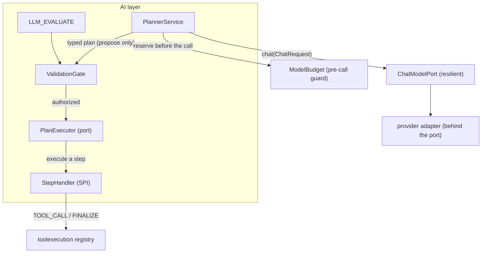

# AI integration guide (S09-15)

The `ai` module is the platform's **AI layer**: it asks the model for a typed plan, authorizes that
plan server-side before any step runs, runs the model bounded in time and cost, and scores prompt or
model changes against a fixed baseline. It is the live half of the **untrusted-planner** stance
[`ADR-006`]: the model *proposes*, the backend *authorizes and executes*, and every model output is
validated, classified and bounded server-side before it can drive control flow.

This guide is the integration overview. Provider wiring, secrets, resilience and the fake provider for
CI are in [`provider-configuration.md`](provider-configuration.md); the Planner baseline eval cases
and the opt-in live-provider contract test are linked at the bottom.



## The security premise

The model is an **untrusted planner** (`ADR-006`, invariant 7). Its output is never executed or
trusted as-is:

1. The model *proposes* a typed, schema-constrained plan — nothing more (`PlanStep` / `PlannerPlan`
   — the component set is exactly `id / type / toolId / dependsOn / arguments`, so there is nowhere
   for a chain-of-thought, reasoning or an executable payload to hide, S09-05).
2. The backend **authorizes before executing**: a plan is rejected — not partially executed — if it
   references an unknown tool/node, forms a cycle, or exceeds `PlanLimits`. Permissions, the tool
   allowlist and the tenant scope are decided by the backend, never by the model (S09-07).
3. Every model *call* is **bounded** — a finite number of attempts, an upper-bound wait, an overall
   timeout and a parallel-call cap — and only transient faults are retried (S09-09); see
   [provider configuration](provider-configuration.md).
4. A model call is **never sent against an exhausted budget**: the estimate is reserved *before* the
   call and an over-budget plan refuses loudly, permanently, never retried (S09-10).

The model is never an authorization authority, and an unknown tool, a cycle or an over-limit plan
never reaches the executor (the S09-07 / S09-15 acceptance).

## The provider, behind a port

The domain depends on the neutral `ChatModelPort` contract, never on a provider DTO (S09-01). The
concrete provider is opt-in behind the port; with no `agentflow.ai.provider` set the app boots with no
provider and no key.

- **`openai`** — the Spring AI (OpenAI) adapter, wrapped with the S09-09 resilience layer (the
  production `ChatModelPort` bean). See [provider configuration](provider-configuration.md).
- **`fake`** — a deterministic fixture provider in the test source set, so `./gradlew check` needs no
  key and no network (S09-11). The acceptance: **the whole test scenario runs without a real API key.**

A real provider API key is injected **only** through the environment / secret management, never written
to the repository, build arguments, logs or the report (invariant 8). See [provider configuration](provider-configuration.md).

## Prompts — versioned, hashed policy files

Prompts ship as **bundled, hashed policy files** in `resources/ai/`, separated from untrusted user
content (S09-04):

- The policy is a fixed `SYSTEM` message loaded from `resources/ai/<name>.txt` (the source of truth for
  the prompt hash); the task plus any retrieved document fragments are appended by the backend as a
  single, untrusted `USER` message. Policy and user content never share one message, so the model can
  never read its own policy as user content (the prompt-injection surface).
- Each prompt has a `PromptVersion` (`name / version / hash`) — the observable surface of the prompt.
  The `version` is assigned in configuration and bumped on a content change; the `hash` is the
  SHA-256 of the file bytes, so a content change is always detectable. An incomplete declaration fails
  boot fast (a missing template throws at construction).
- Each model attempt carries the `PromptVersion` it planned against, so the prompt a model planned
  against is recorded and traceable. The `PromptVersion` holds no prompt text and no user/document
  content, so the untrusted content stays out of observability (invariant 8).

```yaml
# application.yml
ai:
  prompt:
    prompts:
      - name: planner   # matched against resources/ai/planner.txt
        version: "1"    # bump whenever the template content changes
```

## Structured output validation

The schema a Planner (or an `LLM_EVALUATE`) asks for as structured output rides on
`ChatOptions.outputSchemaJson` as a **neutral JSON string** that the provider adapter renders into the
provider's structured-output form *behind the port* — so the contract knows nothing about the SDK
behind it (S09-01). The model's response is parsed into the typed `PlannerPlan` and rejected by the
validation gate if it does not conform.

## Refusal, malformed and empty responses

A model that returns nothing usable is **one clear signal**, never a silent `null` plan or a guessed
one (S09-06 / S09-08):

- **Refusal** — `null` content with a `content_filter` finish reason — is permanent and never retried;
  retrying a refusal only burns the budget.
- **Malformed JSON** — content that is not JSON — and a **schema mismatch** — well-formed JSON that is
  not a structurally valid plan (a duplicated / dangling / self dependency) — are the three *repairable*
  failures: the Planner re-asks the model at most once, only while the budget permits.
- **Empty content** — a `null` completion — is treated as malformed output, never an empty string.

Provider faults are classified separately, by
[`ProviderExceptionClassifier`](apps/agentflow-app/src/main/java/com/example/agentflow/ai/provider/ProviderExceptionClassifier.java)
into a neutral `ProviderFailureReason`, so a retryable provider fault (429 / 5xx / timeout / connection)
is retried within the S09-09 bound while a permanent one (4xx client error) is not.

## Timeout, rate limit and resilience

Every model call is bounded — see [provider configuration](provider-configuration.md) for the
configuration keys. In short: an overall wall-clock timeout aborts a hung call (classified `TIMEOUT`),
a 429 is classified `RATE_LIMIT` and retried, and a concurrency cap rejects overload immediately with a
retryable backpressure signal instead of growing a queue. The bounded retry with full jitter keeps the
total wait finite (S09-09).

## The untrusted-planner seam

The boundary is enforced purely and DB-free, so it is testable without a registry or a security
context, while every authorization decision stays on the backend (S09-07):

- The value type checks only what is true of the type regardless of the running system (shape,
  uniqueness, well-formed wiring).
- The `ValidationGate` re-checks what needs the closed node vocabulary, the registered tools, the
  configured budget, or the caller's tenant — the real security checks.
- The `ai` module boundary is unchanged: `ai` compiles only against `ai`, `toolexecution`,
  `workflowexecution`; the `PlanExecutor` port is injected opt-in (`@Autowired(required = false)`), so a
  missing executor is a loud, call-time failure, not a boot failure.

## Evaluation — scoring prompt / model changes on structure

A prompt or model change is compared against a **fixed, structurally scored baseline**, never on text
similarity (S09-14). The Planner is a typed graph to validate, not prose to eyeball:

```bash
# offline gate: no key, no network
./gradlew :apps:agentflow-app:test --tests 'com.example.agentflow.ai.evaluation.*'
```

The baseline set scores four per-case metrics — `schemaValid`, `toolsWithinAllowlist`,
`expectedShapeMet`, `withinLimits` — and renders a byte-stable report, so two Planner configurations
diff directly and any regression names the case, the metric and the gate violations. The four cases
exercise the plan shapes the Planner must produce reliably: `calc-then-finalize`,
`calc-report-finalize`, `finalize-only` and `parallel-calc-finalize` (using the built-in
`calculator` / `report` registry names).

An opt-in run against a real provider follows the same runner with a provider-backed `PlannerService`
(the provider wiring and its opt-in contract test are documented in
[real-provider-contract-test.md](real-provider-contract-test.md); the same runner drives the eval).

## The opt-in live-provider contract test

The OpenAI adapter contract — response mapping, token usage, structured output and timeout
classification — is verified against a **live** provider on demand by `RealProviderContractTest`
(`@Tag("real-provider")`, opt-in via `OPENAI_API_KEY`), so the mapping can never silently drift from the
real API shape the fake stands in for. It is **excluded** from the standard gate and runs only through
the dedicated Gradle task, so `./gradlew check` stays free, offline and deterministic. Guide,
configuration and report format: [real-provider-contract-test.md](real-provider-contract-test.md).

## Verification

- The acceptance — *the whole scenario runs without a real API key; real credentials come only through
  secret/env configuration; the eval command and expected fields are documented* — is verified by:
  - `./gradlew :apps:agentflow-app:check` green, including the architecture / no-cycles / provider-port
    gates (JUnit XML `tests>0, skipped=0`); the standard gate exercises the Planner against the fake
    fixtures with no key and no network.
  - `./gradlew :apps:agentflow-app:test --tests 'com.example.agentflow.ai.evaluation.*'` green — the
    baseline, the per-case metrics and the deterministic report.
  - `./gradlew :apps:agentflow-app:test --tests '*ai.security.CanaryLeakScanTest'` — a canary API key
    is not found in Git, logs or diagnostic endpoints (invariant 8).

## Docs

- [`provider-configuration.md`](provider-configuration.md) — provider wiring, secrets, resilience, the
  fake provider for CI, budget reservation.
- [`docs/ai/real-provider-contract-test.md`](real-provider-contract-test.md) — opt-in live-provider
  contract test.
- [`docs/evaluation/README.md`](../evaluation/README.md) — Planner baseline eval cases, metrics, run/
  compare.
- [`CHANGELOG.md`](../CHANGELOG.md) — the S09-01 … S09-15 entries under `Unreleased`.
- [`docs/devlog/sprint-09-ai-planner.md`](../devlog/sprint-09-ai-planner.md) — the per-sprint record.
