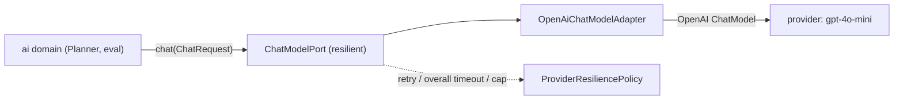

# AI provider configuration (S09-15)

The AI layer calls the model through the neutral application port
[`ChatModelPort`](../../apps/agentflow-app/src/main/java/com/example/agentflow/ai/application/ChatModelPort.java)
(S09-01). The concrete provider is **opt-in** behind the port: with no
`agentflow.ai.provider` set, the core app boots exactly as before — with **no** provider bean, **no**
API key on the classpath and **no** network dependency (the S09-02 contract). This document is the
operator and developer guide to wiring a provider, the resilience bounds around every model call, and
the deterministic fake provider every CI run uses.

Two modes are available:

| `agentflow.ai.provider` | What it wires | Where it lives | For |
|---|---|---|---|
| `openai` | Spring AI (OpenAI) adapter, wrapped with the S09-09 resilience layer | production source set | real inference |
| `fake` | deterministic fixture provider — no key, no network | **test** source set | CI / offline development |

The default, local and kubernetes profiles never set `agentflow.ai.provider`, so a real deployment is
never accidentally pointed at the fake. See the safety model below.

## The port, not the provider

The `ai` domain never imports a provider SDK. It calls the one-method port `chat(ChatRequest)`; the
concrete adapter (the only class in the module that imports the provider SDK, S09-02) renders the
neutral request into the provider shape *behind* the port. The production `ChatModelPort` bean is
therefore the **resilient wrapper** around the adapter — the domain sees only the port, never a
timeout, a retry or a provider type.



## Choosing the provider

The provider is selected with a single property, matched by a `@ConditionalOnProperty` config:

```yaml
# application.yml (production / kubernetes)
agentflow:
  ai:
    provider: openai
```

```bash
# local development, the offline fake for booting the real context without a key
./gradlew :apps:agentflow-app:bootRun -Dspring.profiles.active=local -Dagentflow.ai.provider=fake
```

| `agentflow.ai.provider` | Beans created | Key required? | Network required? |
|---|---|---|---|
| *(unset / not set by the profile)* | none — no provider wired | no | no |
| `openai` | `ChatModel` → adapter → resilient `ChatModelPort` | yes (from env/secret) | yes |
| `fake` | resilient `ChatModelPort` over a fixture | no | no |

A value other than `openai` or `fake` is not a configuration error at boot — the condition simply does
not match and no provider bean is created (the same "no provider" outcome as leaving it unset).

## The OpenAI provider (production)

The API key and base URL come from the environment / secret management only — never from the
repository, build arguments, logs or the report (invariant 8). The model id defaults to a documented
placeholder, never a credential.

| Setting | `application.yml` key | Environment variable | Default |
|---|---|---|---|
| Provider API key | `agentflow.ai.provider.openai.api-key` | `OPENAI_API_KEY` | — (resolved at call time) |
| Model id | `agentflow.ai.provider.openai.model` | — | `gpt-4o-mini` |
| Base URL (compatible gateway) | `agentflow.ai.provider.openai.base-url` | — | OpenAI public endpoint |

```yaml
# production / kubernetes — secrets injected at runtime, never written here
agentflow:
  ai:
    provider: openai
    provider:
      openai:
        # api-key: from OPENAI_API_KEY (secret store / env), not committed
        model: gpt-4o-mini
        # base-url: left unset -> OpenAI public endpoint; set only for a compatible gateway
```

The connect/read timeouts below are applied to the underlying OpenAI SDK HTTP client (the single
place the SDK client is constructed, `OpenAiChatModelConfiguration`); the overall timeout, the
bounded retry and the parallel-call cap are enforced by the resilient wrapper, not the client.

## Resilience around every model call

A model call is **bounded**: a finite number of attempts, an upper bound on the total wait, a
per-attempt wall-clock timeout and a parallel-call cap — and only transient faults (429 / 5xx /
timeout / connection) are retried. This is the S09-09 contract, enforced by
[`ResilientChatModel`](../../apps/agentflow-app/src/main/java/com/example/agentflow/ai/provider/ResilientChatModel.java)
behind the port.

| Bound | `application.yml` key | Default | Meaning |
|---|---|---|---|
| Connect timeout (s) | `agentflow.ai.timeout.connect-seconds` | `10` | SDK connect, before a connection is established |
| Read timeout (s) | `agentflow.ai.timeout.read-seconds` | `120` | SDK read, for the server to produce a response |
| Overall timeout (s) | `agentflow.ai.timeout.overall-seconds` | `150` | whole call from the wall clock; the wrapper aborts the call once exceeded |
| Max attempts | `agentflow.ai.retry.max-attempts` | `3` | initial attempt plus retries before the call fails permanently |
| Base delay (s) | `agentflow.ai.retry.base-delay-seconds` | `1` | delay before the first retry (`multiplier^0`) |
| Multiplier | `agentflow.ai.retry.multiplier` | `2.0` | exponential growth factor (constant at `1.0`) |
| Max delay (s) | `agentflow.ai.retry.max-delay-seconds` | `60` | every backoff is capped to this |
| Jitter | `agentflow.ai.retry.jitter` | `true` | full jitter applied to the computed backoff |
| Max parallel calls | `agentflow.ai.max-parallel-calls` | `4` | concurrency cap (a `Semaphore`); overload is rejected immediately, not queued |

The connect/read timeouts are the SDK's own HTTP-client bounds; the overall timeout, the bounded
retry and the concurrency cap are the resilient wrapper's bounds.

### Retry decisions

A fault is classified by [`ProviderExceptionClassifier`](../../apps/agentflow-app/src/main/java/com/example/agentflow/ai/provider/ProviderExceptionClassifier.java)
into a neutral, SDK-free [`ProviderFailureReason`](../../apps/agentflow-app/src/main/java/com/example/agentflow/ai/application/ProviderFailureReason.java):

- **Retryable:** `RATE_LIMIT` (HTTP 429), `SERVER_ERROR` (HTTP 5xx), `TIMEOUT`, `CONNECTION`.
- **Permanent (never retried):** `CLIENT_ERROR` (other 4xx — a contract failure, retrying it would
  only burn tokens), `UNKNOWN` (an unknown fault fails loudly instead of a retry storm).

An untrusted-planner response (a malformed or structurally invalid plan) is **not** a provider fault —
it is a `PlannerFailure` handled by the Planner's bounded repair (S09-08), retrying the *model* at
most once for a repairable failure, never a refusal (S09-08). The refusal is permanent and never
retried (invariant 12).

## The fake provider for CI (offline, deterministic)

The standard `./gradlew check` gate must need **neither an API key nor an internet connection**.
`FakeModelProvider`
([test source set](../../apps/agentflow-app/src/test/java/com/example/agentflow/ai/provider/FakeModelProvider.java),
wired by `FakeModelConfiguration`) is a `ChatModelPort` that reproduces every provider outcome the
platform must survive — one deterministic fixture per behaviour, each flowing through the *real* seams
(parser, classifier, Planner bounded repair) rather than a parallel fake implementation:

| `agentflow.ai.provider.fake.mode` | Fixture behaviour |
|---|---|
| `valid-plan` *(default)* | A fixed, structurally valid two-step plan (a tool call, then a finalize on it) that parses through the real parser. |
| `invalid-plan` | Well-formed JSON that is not a valid plan (a duplicated step id) → `SCHEMA_MISMATCH`. |
| `malformed-response` | Content that is not JSON at all → `MALFORMED_JSON`. |
| `timeout` | A fault carrying a `TimeoutException` cause → classified `TIMEOUT`. |
| `429` | A 429 service fault (accepted as an alias for `rate-limit`) → classified `RATE_LIMIT`. |
| `refusal` | A completion with `null` content and a `content_filter` stop → never retried. |

```bash
# boot the real application context with the fake provider — no key, no network
./gradlew :apps:agentflow-app:bootRun -Dspring.profiles.active=local -Dagentflow.ai.provider=fake

# exercise a specific fixture
./gradlew :apps:agentflow-app:bootRun -Dspring.profiles.active=local \
  -Dagentflow.ai.provider=fake -Dagentflow.ai.provider.fake.mode=timeout
```

An unknown mode fails the context at **bean creation** (fail fast), not mid-run. The fixture set is
exhaustive and explicit, so the acceptance — *every fixture is exercised offline, and a misconfigured
profile can never point a real deployment at the fake* — holds.

### Safety: the fake is compiled into no production jar

The fake provider and its configuration live in the **test** source set (the S04-10 pattern, shared
with the permissive local-auth chain). The `@ConditionalOnProperty` gate is `matchIfMissing = false`,
so the beans exist **only** when `agentflow.ai.provider=fake` is explicitly set, and the default,
local and kubernetes profiles never set it. A misconfigured production profile therefore cannot point
at the fake — there is no production bean to point at.

## Budget reservation (pre-call)

A model call is never sent against an exhausted budget. The Planner reserves a **conservative
(upper-bound) estimate before the call** and refuses — loudly and permanently, never retried — when the
reservation would exceed the limit, so an over-budget plan fails at call time and never burns the model
on a doomed call (S09-10). This in-memory guard is the `ai`-module mirror of the durable budget: the
durable reservation / metering lives in the `usage` module (`tenant_budgets` / `usage_records`), the
durable settlement is `S12`; the compile edge `ai → usage` is forbidden by the boundary gate, so each
module owns its seam.

## Configuration summary

All `agentflow.ai.*` keys are bound, Jakarta-validated, and never hard-coded in the adapter. Secrets
(`api-key`) are read from the environment / secret store; every other value has a documented default in
`application.yml`. No key, credential or connection string is written in the repository.

- Provider selection: `agentflow.ai.provider` (`openai` | `fake`, unset = no provider).
- OpenAI secret + endpoint: `agentflow.ai.provider.openai.{api-key|model|base-url}` (+ `OPENAI_API_KEY`).
- Fake fixture: `agentflow.ai.provider.fake.mode` (default `valid-plan`).
- Resilience: `agentflow.ai.timeout.*`, `agentflow.ai.retry.*`, `agentflow.ai.max-parallel-calls`.
- Prompts: `ai.prompt.prompts[]` — the versioned prompt catalogue (below and in `../ai/README.md`).

## Verification

- `./gradlew :apps:agentflow-app:check` — the standard gate runs the Planner against the fake fixtures
  with no key and no network; the architecture / no-cycles / provider-port gates ran green (JUnit XML
  `tests>0, skipped=0`).
- `./gradlew :apps:agentflow-app:test --tests 'com.example.agentflow.ai.provider.FakeModelProviderTest'`
  — every fixture through the real parser / classifier / Planner bounded repair, determinism, call
  counting, config parsing (incl. the `429` alias and fail-fast unknown modes).
- `./gradlew :apps:agentflow-app:test --tests 'com.example.agentflow.ai.provider.FakeModelConfigurationTest'`
  — the port is wired only for `agentflow.ai.provider=fake`, the configured mode is honored, an unknown
  mode fails the context, no port without the property.

## Docs

- `docs/ai/README.md` — the AI integration guide (prompts, structured output, refusal / malformed,
  eval cases, the untrusted-planner stance).
- `CHANGELOG.md` — the S09-15, S09-11, S09-12 and S09-09 entries under `Unreleased`.
- `docs/devlog/sprint-09-ai-planner.md` — the per-sprint record.
- [`docs/ai/real-provider-contract-test.md`](real-provider-contract-test.md) — the opt-in live-provider
  contract test (never on the standard gate).
