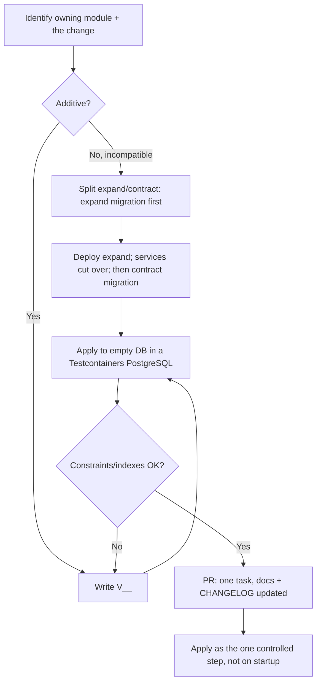

# Database migrations — rules and process — AgentFlow

> **Status:** Accepted
> **Owner:** engineering (cross-cutting; every module applies these — the migrations
> directory is shared application resource, not a single domain module)
> **Task:** `S03-02`
> **Upstream reference:** `AGENTFLOW_ARCHITECTURE_AND_PLAN.md` (Sprint 3, `S03-01`…`S03-06`) ·
> `docs/adr/ADR-008` (single migration tool: Flyway) ·
> `apps/agentflow-app/src/main/resources/migrations/README.md` (file-level rules) ·
> `docs/architecture/engineering-conventions.md` (identifiers, time, naming) ·
> `docs/adr/ADR-002`, `ADR-003`, `ADR-004` (consistency) · root `AGENTS.md` (invariants 2, 8, 10, 13)
> **Purpose:** the rules and the single process for changing the AgentFlow
> PostgreSQL schema. It says *how* a migration is authored, versioned, applied and,
> when it cannot be additive, reverted forward — and pins the invariant that an
> applied migration is never edited.

---

## Why migration rules matter

AgentFlow keeps its workflow state (runs, steps, events, approvals, usage) in
PostgreSQL (`ADR-002`), and PostgreSQL is the single source of truth for that
state. The schema therefore changes rarely, but each change is durable and, once
shipped, is part of every environment's history. Loose schema changes produce the
classic distributed-systems failures out of band: a worker on an old image reads a
column a new migration renamed, a rollback recreates a table mid-incident, or a
migration edited after apply makes a rebuild diverge from the running schema.

The rules below turn "change the schema" into one predictable, reviewable,
reversible-forward process. Exactly-once schema evolution is never claimed
(`ADR-003`); incompatible changes go expand/contract so a running service is not
broken by a single step.

---

## The rules

### 1. Forward-only — never edit, reorder or delete an applied migration

Every `.sql` file under `classpath:migrations` is a **forward-only** migration: it
is applied once, recorded in `flyway_schema_history`, and then immutable.

- **Never edit, delete, rename or re-order** a migration that has been applied in
  any environment (local, test, staging, production).
- If a migration was *never applied* (for example a typo on a feature branch that
  has not yet run against a database), it may be corrected in place — the moment
  it lands in `flyway_schema_history` that safety net closes.
- Flyway enforces this for you: a changed applied migration fails the migrate
  step with a **checksum mismatch** (`V3_3_0__…` now hashes differently than the
  recorded row), so editing an applied migration fails loudly rather than drifting
  the schema silently.

Reason: forward-only keeps `flyway_schema_history` a faithful, append-only audit
of the schema, makes every environment rebuild deterministically from the same set
of files, and makes the "what does production's schema look like?" question
answerable from Git alone.

### 2. Expand / contract for incompatible changes

An **incompatible** change is one that cannot be made additive without breaking a
running service — for example renaming or changing the type of a column that is
read and written concurrently, or changing a `NOT NULL` constraint on a populated
column. Do not perform it in one breaking step; split it into two ordered
migrations:

1. **Expand.** Add the new artifact (new column/table, new index), backfill it,
   and make both the old and the new valid at once (dual-read/dual-write). Every
   running service keeps working on the old shape while the new one comes online.
2. **Contract.** After the services that consume the new shape are deployed and
   verified, add a second migration that removes the old artifact (drop the
   deprecated column, drop the old index, tighten the constraint).

Between the two steps the schema legitimately contains both the old and the new
shape; that overlap is intentional and bounded by the two migrations.

### 3. Forward-fix instead of manually editing an applied migration

If an applied migration is found to be wrong (bad SQL, missing index, wrong
constraint), the fix is **forward**, never an edit to the applied file:

- Add a new migration that brings the schema to the correct state and comments
  why (the task id and the defect). A corrected `flyway_schema_history` row is
  always better than a rewritten one.
- Do not use `flyway clean` / `flyway rollback` as a recovery path on a real
  database — see *Applying, rollback and recovery* below.
- For a migration that was never applied, fixing it in place is acceptable (rule 1);
  record in the PR that the pre-apply file was corrected.

### 4. One owning module per migration

Every migration belongs to **exactly one** owning module. The migration filename
and a SQL `COMMENT` state the owner so ownership is obvious from the file, not from
a lookup (`migrations/README.md`). Business tables live in the owning module's
migrations; the shared `migrations/` folder is not the place for a table that
belongs to another module.

```sql
-- S03-03 · tenants · owner: identity
CREATE TABLE IF NOT EXISTS tenants (
    id         UUID        PRIMARY KEY,
    slug       TEXT        NOT NULL UNIQUE,
    status     TEXT        NOT NULL DEFAULT 'ACTIVE',
    created_at TIMESTAMPTZ NOT NULL DEFAULT now()
);
```

### 5. Idempotent where practical

Schema history is append-only, but a migration should be safe to re-run against a
schema that already has its effect. Use `IF NOT EXISTS` on `CREATE TABLE` /
`CREATE INDEX` and guard destructive/unique operations. Idempotency keeps
Testcontainers rebuilds and the controlled apply step quiet and repeatable.

---

## Versioning and ordering

- **Versioned migrations** follow `V<version>__<snake_case_description>.sql`, for
  example `V3_3_0__create_tenants.sql`. The version uses underscore-separated
  major.minor.patch so ordered, semver-style history is readable in Git and in
  `flyway_schema_history`.
- **Repeatable migrations** use `R<description>.sql`. They re-run only when their
  content changes and are reserved for schema that has no release semantics of its
  own (for example a shared view). Prefer a versioned migration for anything
  tied to a release or a task.
- Flyway applies versioned migrations **in ascending version order**; ties on the
  same version are broken by filename. Never rely on filesystem order.
- Do not reuse a version number; a second migration with the same version is a
  conflict, not a fix.

See `migrations/README.md` for the file layout and comment conventions.

---

## Adding a migration — the single process

This is the unified procedure the `S03-02` acceptance criterion requires: every new
migration enters the same way, so a reader always knows where to look and what to
do.



1. **Scope the change.** Identify the owning module and whether the change is
   additive (a new table/column/index) or incompatible (must touch data that is
   read/written concurrently — use expand/contract, rule 2).
2. **Write the migration.** `apps/agentflow-app/src/main/resources/migrations/V<version>__<snake_case_description>.sql`,
   with an `IF NOT EXISTS` where practical and a leading `-- S<task> · <table> ·
   owner: <module>` comment. Match the glossary's canonical column/table names and
   the engineering conventions (`engineering-conventions.md`).
3. **If incompatible, split it.** Author the *expand* migration first; the
   *contract* migration follows after the consuming services are deployed.
4. **Verify.** Apply the migration to a fresh PostgreSQL in a Testcontainers test
   (S03-15); confirm the constraints and indexes are present and that the schema
   round-trips. A migration that only works by hand is not verified.
5. **Review.** One task per PR (`S##-##`). Update the owning doc
   (`docs/architecture/database-conventions.md`, S03-06) and `CHANGELOG.md`
   `[Unreleased]`, and link the migration from the task.
6. **Apply.** As the single controlled step (`./gradlew flywayMigrate`, later a
   Helm Job) — never on application startup and never concurrently from several
   replicas (`ADR-008`).

### Applying, rollback and recovery

- Migrations apply as **one explicit, ordered step** (`./gradlew flywayMigrate`
  now; a Helm Job from S05+). They never run on Spring Boot startup
  (`spring.flyway.enabled=false`) and never concurrently between replicas — a
  startup auto-migrate race between replicas is a reliability hazard.
- **Rollback is a new forward migration or a restore from backup, not
  `flyway rollback`.** Because migrations are forward-only and the schema is the
  source of truth, the safe recovery is: fix forward with a new migration
  (rule 3), or restore the database from a known-good backup. The runbook records
  which. `flyway clean` is never used against a real database.
- A migration failure classifies as `transient_infra` (503) if the database or
  connection is at fault (retry a transient failure), otherwise `internal`
  (500) — see `docs/architecture/error-taxonomy.md`. Do **not** retry a
  checksum-mismatch or constraint failure; that is a permanent, human-actionable
  error.

---

## Related

- [`ADR-008`](../adr/ADR-008-database-migrations.md) — the single migration tool
  (Flyway) and why the alternatives were rejected.
- [`migrations/README.md`](../../apps/agentflow-app/src/main/resources/migrations/README.md)
  — the file layout, naming and `COMMENT` conventions in `classpath:migrations`.
- [`engineering-conventions.md`](./engineering-conventions.md) — identifiers,
  time (`timestamptz`) and naming that migrations must match.
- [`database-conventions.md`](./database-conventions.md) — tables, columns,
  indexes, and optimistic versioning (`S03-06`).
- [`ADR-002`](../adr/ADR-002-postgresql-source-of-truth.md),
  [`ADR-003`](../adr/ADR-003-at-least-once-idempotency.md),
  [`ADR-004`](../adr/ADR-004-transactional-outbox.md) — PostgreSQL is the source of
  truth; at-least-once + idempotency; transactional outbox.
- root `AGENTS.md` — invariants 2 (PostgreSQL source of truth), 8 (secrets),
  10 (data conventions) and 13 (an applied version never changes).

---

## Acceptance

A new migration is added by the single process above: forward-only, one owning
module per migration, expand/contract for any incompatible change, forward-fix for
a defect in an applied migration, verified against a real PostgreSQL, and applied
as the one controlled step.
