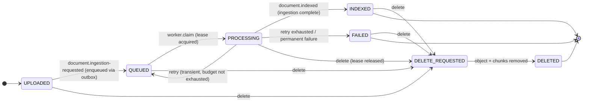

# Document Lifecycle — AgentFlow

> **Status:** Accepted
> **Owner:** `knowledgebase` — the `documents.status` state machine and its single transition service. The `ingestion` worker leases the document and publishes `document.indexed`; the `knowledgebase` `DocumentService` drives the upload enqueue (`UPLOADED → QUEUED`) and the delete command (`… → DELETE_REQUESTED`).
> **Task:** `S10-01`
> **Upstream reference:** `AGENTFLOW_ARCHITECTURE_AND_PLAN.md` (Sprint 10, `S10-01`) ·
> `docs/domain-glossary.md` §7 (canonical document lifecycle: `UPLOADED → QUEUED → PROCESSING → INDEXED`, with `FAILED`, `DELETE_REQUESTED`, `DELETED`) ·
> `docs/architecture/module-map.md` (`knowledgebase` owns the `documents` table; `ingestion` indexes into it, driven through `messaging` events) ·
> `docs/architecture/events/README.md` (the `ingestion-requested` / `indexed` topics, partition key `tenantId:documentId`) ·
> `docs/architecture/error-taxonomy.md` (transient vs. permanent) and `docs/architecture/durable-execution.md` (lease / fencing).
> **Purpose:** the document-level state machine of `knowledgebase` — the set of `documents.status` values, which of them are terminal, the transitions between them, and the event or command that triggers each one with its guard condition. This is `S10-01`'s deliverable (the lifecycle diagram). The downstream code tasks implement it: the Java enum + transition service in `knowledgebase` (owned by `knowledgebase`, the document-layer mirror of the run transition service of `S05-11`) and the upload / ingestion / delete API.

---

## 1. Document states

A document is an uploaded object plus its metadata (`docs/domain-glossary.md` §7). The original bytes live in object storage under a server-generated, tenant-scoped `object_key`; the `documents` row in PostgreSQL is the source of truth for its status (`ADR-002`). Its lifecycle is
`UPLOADED → QUEUED → PROCESSING → INDEXED`, with `FAILED`, `DELETE_REQUESTED` and `DELETED` as the failure, deletion-requested and deletion-complete states.

| State | Terminal | Meaning |
|---|---|---|
| `UPLOADED` | No | The object is stored in object storage and the `documents` metadata row is committed, but ingestion has not been enqueued yet. The upload API returns `202 Accepted` with this status. |
| `QUEUED` | No | The `ingestion-requested` event is enqueued via the outbox; the document awaits an ingestion worker to claim it. |
| `PROCESSING` | No | An ingestion worker holds the lease and is extracting → chunking → embedding → indexing. |
| `INDEXED` | **Yes** | Every chunk is indexed (pgvector + FTS). The document is ready for tenant-scoped search. |
| `FAILED` | **Yes** | Processing failed permanently, or a retryable failure exhausted its bounded retry budget. |
| `DELETE_REQUESTED` | No | Deletion was requested; the document is drained (its lease is released) before the object and its chunks are physically removed. |
| `DELETED` | **Yes** | The object was removed from object storage and its chunks deleted from PostgreSQL. |

Three terminal states: `INDEXED`, `FAILED`, `DELETED`. A document never leaves a terminal state (the transition table has no outgoing edge from any of them).

## 2. State diagram

A plain-language caption: *an uploaded document starts `UPLOADED`; once the upload enqueues the `ingestion-requested` event it becomes `QUEUED`, and an ingestion worker claims it (`worker.claim`, a lease) and moves it to `PROCESSING`. `PROCESSING` ends in one of three ways — `INDEXED` when every chunk is indexed, `QUEUED` again on a bounded transient retry, or `FAILED` on a permanent failure or an exhausted retry budget.* Any non-terminal or `FAILED` document can be deleted: a delete command moves it to `DELETE_REQUESTED` (releasing the lease of a `PROCESSING` document cooperatively), and once the object and its chunks are removed it completes to the terminal `DELETED`.

## 3. Transition table

Each transition below names the triggering **event/command** and the **condition** (guard) that permits it. This is the `S10-01` acceptance criterion — every transition is driven by an explicit event or command, never by an assignment, and every terminal state is absorbing.

| # | From | To | Triggering event / command | Condition (guard) |
|---|---|---|---|---|
| 1 | `UPLOADED` | `QUEUED` | `document.ingestion-requested` (event; the upload enqueues it via the outbox) | The upload validated the file (size, MIME/type + magic bytes, `sha256`), stored the object under a server-generated `object_key`, and committed the metadata row + the outbox record in one transaction (S10-06). The tenant comes from the verified security context (`document:write`), not the request body. |
| 2 | `QUEUED` | `PROCESSING` | `worker.claim` (event; the ingestion worker leases the document) | A worker atomically claims a `QUEUED` document and receives `lease_owner`, `lease_until` and an incremented `lease_epoch`; tenant ownership is re-checked against PostgreSQL (invariants 1/2). Applied through `knowledgebase`'s single transition service — the worker never sets status directly. |
| 3 | `PROCESSING` | `INDEXED` | `document.indexed` (event; the ingestion worker publishes it) | Every chunk was persisted (page refs, `content_hash`, `embedding`, `pipeline_version`) with the tenant filter, and the `indexed` event payload carries `status = INDEXED`. `knowledgebase` applies the transition when it consumes the event through its inbox (deduplicated). |
| 4 | `PROCESSING` | `QUEUED` | retry — the worker releases the lease on a transient failure | The failure is a retryable transient class and the retry count is below the document retry policy's `maxAttempts`; the lease is released. At-least-once redelivery: a duplicate `ingestion-requested` is deduplicated (inbox, same transaction as the business change) and never re-drives the document (S10-13 idempotency keyed by `tenant_id + sha256 + pipeline_version`). |
| 5 | `PROCESSING` | `FAILED` | retry exhausted / permanent failure | A permanent failure (unsupported MIME, corrupt/encrypted PDF beyond partial success, embedding-dimensionality mismatch — the `S10-08` error code), or a transient failure with `retry_count >= maxAttempts`. Permanent classes go straight to `FAILED` (invariant 12 / error taxonomy). |
| 6 | `UPLOADED` / `QUEUED` / `PROCESSING` / `INDEXED` / `FAILED` | `DELETE_REQUESTED` | `delete` (command; `DELETE /api/v1/documents/{documentId}`) | The caller holds the permission for this tenant-scoped document; the document exists and is tenant-owned, so another tenant's document and a missing one are indistinguishable (`403`/`404`). From `PROCESSING` the lease is released cooperatively and any in-flight indexing is abandoned without overwriting a completed result (like the run cancellation that preserves completed steps). |
| 7 | `DELETE_REQUESTED` | `DELETED` | object + chunks removed | The object was deleted from object storage and its `document_chunks` rows removed (tenant-scoped); the `documents` row is removed (or tombstoned). |

### Design notes on the transitions

- **Deletion is two-phase and one-way.** A delete never completes instantly; it first moves to `DELETE_REQUESTED` (a visible "deletion in flight" signal, and the drain point for a `PROCESSING` document) and then to the terminal `DELETED`. `DELETE_REQUESTED` has a single outgoing edge (`→ DELETED`); there is no un-delete in the MVP, so a requested-deletion document is final — the mirror of the run's `CANCEL_REQUESTED → CANCELLED`.
- **A `PROCESSING` delete drains cooperatively.** Releasing the lease lets the worker stop; an already-completed chunk set is never overwritten mid-write (the row's `version` is the optimistic lock, `lease_epoch` the fencing token, invariant 4). The partial result of an abandoned indexing is preserved as a diagnostic (error code, page count, extracted char count — `S10-08`), never re-indexed.
- **Terminal states are absorbing.** Guards 1–7 list no transition out of `INDEXED`, `FAILED` or `DELETED`; the enum models them as terminal, so a second transition on the same document is a domain error — the same guarantee the run state machine gives `SUCCEEDED`/`FAILED`/`CANCELLED` (`S05-10`).
- **Retry is bounded, and the retry edge is the only backward edge.** `PROCESSING → QUEUED` re-queues a document for another attempt; when the budget is exhausted the next `PROCESSING` outcome is `FAILED`. This keeps forward progress: a document can revisit `QUEUED`, but each `QUEUED → PROCESSING` is a fresh lease, fenced by `lease_epoch`.
- **Idempotent redelivery.** Because delivery is at-least-once (invariant 3), the same `ingestion-requested` can arrive more than once; the inbox dedups it in the same transaction as the business change, so a duplicate never restarts or duplicates indexing (S10-13).

## 4. Interaction with the wider system

- **State changes through one service.** Every document transition is applied by `knowledgebase`'s single transition service — a conditional update (`UPDATE documents SET status = :new, version = version + 1, lease_owner = :leaseOwner, lease_until = :leaseUntil WHERE id = :id AND tenant_id = :tenantId AND status = :expected`) whose zero-row outcome is a `409 Conflict` (optimistic lock / stale owner) plus one append-only record, in the same transaction (`ADR-002`…`ADR-004`). A controller or Kafka listener never sets the status directly (`S05-11`).
- **Each transition is a durable, observable fact.** A transition appends an append-only audit record (the `audit` module) and is visible on `GET /api/v1/documents/{documentId}` and its history, so a document's status can be replayed (the run-equivalent of the `workflow_events` replay, `S05-09`). `tenantId` and the document id appear only in traces/logs, never in metric labels (invariant 9).
- **Lease and fencing govern the working transitions.** Only the current lease owner may move a document out of `QUEUED`/`PROCESSING` (`lease_epoch` check on every write, `durable-execution.md`). A stale worker's `PROCESSING → INDEXED` / `PROCESSING → FAILED` is fenced.
- **The worker and the transition owner are separate.** The `ingestion` worker leases the document, indexes it, and publishes `document.indexed` — it never writes `documents.status`. `knowledgebase` consumes `document.indexed` (deduplicated via its inbox) and applies `PROCESSING → INDEXED`. The upload enqueue (`UPLOADED → QUEUED`) and the delete command (`… → DELETE_REQUESTED`) are also `knowledgebase` `DocumentService` operations, so the status machine has exactly one writer per event (`knowledgebase`).
- **Idempotent indexed event.** A redelivered `document.indexed` is deduplicated; a second one is a no-op on an already-`INDEXED` document (the terminal state is absorbing).
- **Retry and classification** follow the error taxonomy (invariant 12): only transient classes route through `PROCESSING → QUEUED`; permanent classes go straight to `FAILED`. The document parsing error codes (`S10-08`) live in `ingestion`.

## 5. Related

- **Run state machine** — the analogous run-level machine is in [`run-state-machine.md`](run-state-machine.md) (`S05-01`); the two share the same one-transition-service, lease/fencing, absorbing-terminal and two-phase-cancellation shape.
- **Step states** — the analogous step-level state machine is documented in [`step-state-machine.md`](step-state-machine.md).
- **Events catalog** — the `ingestion-requested` / `indexed` topics that drive the `QUEUED` / `INDEXED` transitions are in [`events/README.md`](events/README.md).
- **Durable execution** — lease, heartbeat and fencing are in [`durable-execution.md`](durable-execution.md).
- **The downstream code** — the Java enum and transition service (`knowledgebase.domain` / `knowledgebase.application`, DB-free, unit tested), the upload / delete API (`knowledgebase.web`) and the ingestion worker (`ingestion.worker`) are implemented by `S10-03` … `S10-13`; this document is the design they implement.
