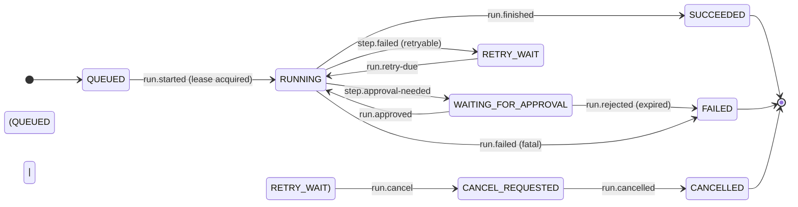
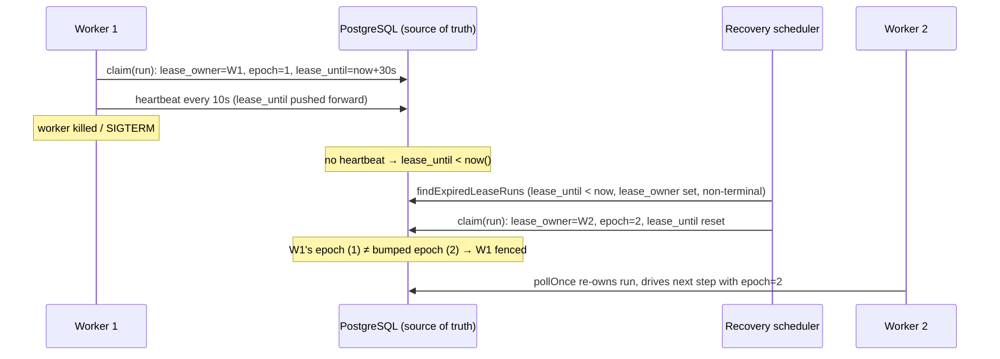

# Durable Execution — AgentFlow

> **Status:** Accepted
> **Owner:** `workflowexecution`
> **Task:** `S07-17`
> **Upstream reference:** `AGENTFLOW_ARCHITECTURE_AND_PLAN.md` (S07-01…S07-17) ·
> `docs/domain-glossary.md` §5 (canonical run/step/lease/checkpoint/attempt vocabulary) ·
> `docs/adr/ADR-011-workflow-run-lease.md` (the lease model) ·
> `run-state-machine.md` (`S05-01`) and `step-state-machine.md` (`S05-02`) (the machine the lease guards) ·
> `error-taxonomy.md` (retryable vs permanent) ·
> `docs/runbooks/workflow-recovery.md` (the operator recovery runbook)
> **Purpose:** the durable-execution engineering guide. It ties together the parts Sprint 7 built —
> the run/step state machines, the lease + fencing that owns a run, the heartbeat that keeps the
> lease alive, the recovery scan that re-claims a dead worker's run, the per-step checkpoint, the
> attempt history, the retry policy and classifier, the two-phase cancel, and the ambiguous-external-
> outcome policy — and explains how they cooperate so a run is *paused, never lost* across a worker
> crash. It records the decisions `ADR-011` made and the `S07-02`…`S07-16` work that implements them.

---

## 1. The promise (and the limit)

AgentFlow runs workflows on **ephemeral, restartable workers** (`workflow-worker` role, one process
per run/step, no shared in-memory state). A worker can be killed at any point — an OOM kill, a
`SIGTERM` on graceful shutdown, a node crash, a network partition — **while a step is `RUNNING`**.
Durable execution is the set of mechanisms that make the run survive that: PostgreSQL is the source
of truth (`ADR-002`, invariant 2), so the run's state, its lease, its checkpoint and its attempt
history all live in the database, and a fresh worker can take over exactly where the dead one left
off.

The one thing durable execution does **not** promise is *exactly-once* side effects (`ADR-003`,
invariant 6). An external call (an `LLM_*` node, a `TOOL_CALL`, a `RETRIEVE_CONTEXT` retrieval)
performs a side effect on a system outside the engine; the engine can only *observe* the response,
never fully trust that the side effect completed. A call whose response was lost but whose side
effect *may* have completed therefore has an **ambiguous outcome**. The durable model makes
**ownership** (the lease) and **recovery** explicit precisely so that ambiguity is visible and
resolvable — not so it can be pretended away.

Three invariants drive every mechanism below:

1. **Exactly one live owner.** Only the current lease owner advances a run; a second worker's
   write is fenced to a `409 conflict` (invariant 5). The append-only `workflow_events` log can
   never record two divergent outcomes for one run.
2. **A dead owner is reclaimed, never waited on forever.** A crashed worker's run is `RUNNING`
   until its lease expires, then the recovery scan re-claims it (invariant 2 — the run is paused,
   not lost).
3. **Reclamation is unforgeable.** A monotonic `lease_epoch` fence is bumped on every re-claim, so
   a stale worker's in-flight write matches zero rows and is refused (`ADR-011`).

---

## 2. State: the run and the step

The durable state is a run (top-level aggregate) with a list of steps, both managed by the single
transition service (`S05-11`). This section is a pointer; the full state sets, terminal states,
diagrams and transition tables are authoritative in their own docs.

- **Run states** — `QUEUED → RUNNING → SUCCEEDED`/`FAILED`/`CANCELLED`, with `WAITING_FOR_APPROVAL`,
  `RETRY_WAIT` and `CANCEL_REQUESTED` as intermediate states. Terminal: `SUCCEEDED`, `FAILED`,
  `CANCELLED`. See [`run-state-machine.md`](run-state-machine.md) (`S05-01`).
- **Step states** — `PENDING → READY → RUNNING → SUCCEEDED`, with `RETRY_WAIT`,
  `WAITING_FOR_APPROVAL`, `FAILED`, `SKIPPED`, `CANCELLED` as the alternative/terminal paths.
  Terminal: `SUCCEEDED`, `FAILED`, `SKIPPED`, `CANCELLED`. See
  [`step-state-machine.md`](step-state-machine.md) (`S05-02`).

The run's terminal states are also **derived from step aggregation**: a run cannot be `SUCCEEDED`
while a step is `RUNNING`, and cannot be `FAILED` while a step can still be retried. The single
transition service keeps both consistent (`S05-11`).

Every transition goes through the transition service as one conditional update (`AND status =
:expectedState AND version = :expectedVersion [AND lease_epoch = :expectedLeaseEpoch on the run
write]`) plus one `workflow_events` row, in the same transaction (`ADR-002`…`ADR-004`). A
controller or Kafka listener never sets a status directly.



*Plain language: a new run is `QUEUED`; a worker claims it and moves it to `RUNNING`. `RUNNING`
branches into the two working pauses — a human-approval gate (`WAITING_FOR_APPROVAL`) and a retry
backoff (`RETRY_WAIT`) — and into the two terminal outcomes, then into `CANCEL_REQUESTED` from any
non-terminal state, which closes to `CANCELLED` once the run has drained.*

---

## 3. The lease — who may run the next step

The lease is the ownership mechanism that answers the crash-recovery question: when two (or more)
workers can act on the same run, who is allowed to advance it *right now*, and how does recovery
recognise that the current owner has stopped heartbeating? `ADR-011` fixes the model; the columns
are declared in migration [`V3_3_6__create_workflow_runs_and_steps.sql`](../../apps/agentflow-app/src/main/resources/migrations/V3_3_6__create_workflow_runs_and_steps.sql)
(`S05-08`) and the services are Sprint 7 (`S07-03`…`S07-09`).

The lease is three columns on `workflow_runs`, all owned by `workflowexecution`:

| Column | Type | Meaning | Owner / writer |
|---|---|---|---|
| `lease_owner` | `UUID` (nullable) | The worker **instance** holding the lease. Set on claim, cleared at a terminal state or at a `HUMAN_APPROVAL` pause (the run-level lease is released while it waits). | `RunLeaseService` (S07-03) |
| `lease_until` | `TIMESTAMPTZ` (nullable) | The instant the lease expires without a heartbeat. `clock.instant().plusSeconds(duration-seconds)` on claim; pushed forward by each heartbeat. Never read from the system clock in domain/application code — always through the injected `Clock` (engineering-conventions.md). | `RunLeaseService` / heartbeat (S07-03, S07-04) |
| `lease_epoch` | `INTEGER NOT NULL DEFAULT 0` | A **monotonic fencing counter**. Bumped on every re-claim; every worker write re-checks the expected epoch, and a mismatch is a `409 conflict`. This is what makes reclamation unforgeable. | every write; `RunLeaseService` on claim |

### 3.1 Claim (`RunLeaseService`, S07-03)

A worker claims a run before executing it. `RunLeaseService#claim` computes `lease_until` through
the injected `Clock` and performs one atomic conditional `UPDATE … RETURNING lease_epoch` through
`WorkflowRunRepository#claim`:

```sql
UPDATE workflow_runs
SET lease_owner = ?, lease_until = ?, lease_epoch = lease_epoch + 1
WHERE id = ? AND tenant_id = ?
  AND status NOT IN ('SUCCEEDED', 'FAILED', 'CANCELLED')
  AND (lease_owner IS NULL OR lease_until < now())
RETURNING lease_epoch
```

The `WHERE` makes it atomic and **tenant-scoped** (invariant 1): it only matches a run that is
claimable — not terminal, and whose lease is absent or expired. Because the conditional update holds
the row lock for its duration, two workers racing on the same run end up with exactly one winner;
the loser re-evaluates against the committed owner/epoch and matches zero rows. A zero-row match
(terminal run, owned by a live worker, or a cross-tenant id) returns `Optional.empty()` —
indistinguishable from a missing run. The caller stores the returned `lease_epoch` as the fence to
send on every subsequent write; a configured `agentflow.worker.instance-id` (a `UUID`) identifies
this worker on `lease_owner`, or a generated UUID is used so `lease_owner` is never blank on the
recovery scan.

### 3.2 Heartbeat (`RunHeartbeatService`, S07-04)

A worker heartbeats while actively executing a run, so its `lease_until` stays ahead of the recovery
scan and the run is not mistaken for a crashed owner. `RunHeartbeatService#heartbeat` is a fenced
conditional update that renews `lease_until` only while the run still belongs to the tenant, is still
owned by this worker, and still holds the `lease_epoch` the claim returned:

```sql
UPDATE workflow_runs SET lease_until = ?
WHERE id = ? AND tenant_id = ? AND lease_owner = ? AND lease_epoch = ?
```

A heartbeat never bumps the epoch (only the claim does) and never clears the lease. A `0` matched
rows means the heartbeat was **rejected** (an old owner, a re-claimed run, or a run that released its
lease) — an old owner cannot extend its lease after it is taken (the S07-04 acceptance criterion).
Rejected heartbeats are counted on a per-process counter (`RunHeartbeatService#failedHeartbeats`) so
the worker loop can surface them; the counter carries no tenant/run identifier (invariant 9).

A heartbeat that arrives with a different `lease_owner` or `lease_epoch` (the owner was re-claimed)
is rejected: an old owner cannot extend its lease after it is taken.

### 3.3 Fencing, not JVM state

The fence lives in PostgreSQL (`lease_epoch`), not in in-process state (invariant 5). Both the run
write (`WorkflowRunRepository#transition`, fenced on `lease_epoch` since S07-05) and the step write
(`WorkflowStepRunRepository#transition`, fenced on `lease_epoch` since S05-08) re-check the epoch on
every conditional update, so a stale owner matches zero rows and becomes a `409 conflict`. Two
workers on one run are fenced at the row, so a `synchronized` block or an in-memory counter on a
worker provides **no** protection — a restart loses it. The run-level lease selects *which worker
may run the next step*; the per-write `lease_epoch` fences *the write itself*. These are
complementary, not duplicated.

### 3.4 Configuration (not magic numbers)

The lease tuning is bound through `AgentFlowProperties.Worker` (`@ConfigurationProperties`, from
`agentflow.worker.*`) with validated defaults chosen so the relationships hold:

| Parameter (key) | Default | Rule |
|---|---|---|
| `lease.duration-seconds` (`agentflow.worker.lease.duration-seconds`) | `30` | Lease lifetime without a heartbeat. Above a normal step, below the crash-detection horizon. |
| `lease.heartbeat-interval-seconds` (`agentflow.worker.lease.heartbeat-interval-seconds`) | `10` | ≈ `duration / 3`. A live worker extends the lease three times per TTL, so a single lost heartbeat (or a GC pause) never expires a healthy lease. `interval ≤ duration / 3`. |
| `lease.recovery-interval-seconds` (`agentflow.worker.lease.recovery-interval-seconds`) | `5` | Documentation of the recovery cadence; worst-case resume is bounded by `duration + recovery-interval`. |
| `recovery-fixed-rate-ms` (`agentflow.worker.recovery-fixed-rate-ms`) | `5000` | The recovery scheduler's `@Scheduled` cadence (at least 1 s; below 1 fails startup). |
| `max-concurrent-runs` (`agentflow.worker.max-concurrent-runs`) | `8` | Runs re-claimed per recovery pass (at least 1; below 1 fails startup). |
| `recovery-enabled` (`agentflow.worker.recovery-enabled`) | `false` | Whether the recovery scheduler runs. Enabled by the `workflow-worker` role, not "everywhere by default". |
| `instance-id` (`agentflow.worker.instance-id`) | *generated UUID* | This worker's identity on `lease_owner`; a configured value must be a valid `UUID`. |
| `loop-enabled` (`agentflow.worker.loop-enabled`) | `true` (worker role) | Whether the worker poll loop drives runs. |
| `poll-interval-ms` (`agentflow.worker.poll-interval-ms`) | `5000` | The worker poll-loop cadence (at least 100 ms). |
| `shutdown.timeout-seconds` (`agentflow.worker.shutdown.timeout-seconds`) | `30` | Bounded drain on shutdown; a stale run is reclaimed after it. |

---

## 4. Recovery — re-claiming a dead worker's run

When a worker stops (crash / `SIGTERM`), no heartbeat extends its `lease_until`; once
`lease_until < now()` **and** `lease_owner` still names the dead worker, the lease is expired and
the run is recoverable. The recovery scan selects those rows (skipping terminal states, and bounded
by the concurrency limit) and re-claims them atomically — implemented in
`WorkflowRecoveryScheduler` (`workflowexecution.worker`, S07-09):

```sql
SELECT id, tenant_id FROM workflow_runs
WHERE lease_owner IS NOT NULL AND lease_until < now()
  AND status NOT IN ('SUCCEEDED', 'FAILED', 'CANCELLED')
  ORDER BY lease_until ASC LIMIT ?
```

Each pass:

1. **Scans** expired leases through `WorkflowRunRepository#findExpiredLeaseRuns(limit)`, ordered
   oldest-expiry-first and bounded by `max-concurrent-runs` so one scan owns a limited batch rather
   than table-scanning every run.
2. **Re-claims** each atomically through `RunLeaseService#claim` (bumping `lease_epoch`); a claim
   that matches no row (terminal, just taken by another worker, or a cross-tenant id) returns `-1`
   and is skipped — so a duplicate re-claim is a no-op, not a lost run (invariant 3).
3. **Publishes** the `agentflow.workflow.recoveries` counter once per reclaimed run (invariant 9 —
   the counter carries no tenant/run identifier).

The bean is enabled explicitly by the `workflow-worker` role (`agentflow.worker.recovery-enabled=true`),
is `@ConditionalOnBean(DataSource.class)`, and needs a `@Autowired(required = false)` repository
dependency so it fails loudly (`IllegalStateException`) rather than doing nothing silently when no
database is configured (S01-02). A failing pass is logged and swallowed so one transient error (a
busy database, a dead connection) does not break the schedule — the next cadence retries the scan,
and recovery is idempotent, so a re-run after a crash re-claims nothing new.

The scan is backed by the `lease_until` index (`workflow_runs_lease_until_idx`,
[`V3_3_13__add_lease_until_index.sql`](../../apps/agentflow-app/src/main/resources/migrations/V3_3_13__add_lease_until_index.sql),
S07-02). Without it the recovery loop would table-scan every run, which the operational
consequences in `ADR-011` forbid. The index is on `lease_until` alone (the scan is a
`lease_until < now()` range predicate) and keeps the lease columns separate from the run's business
state (`status` / `input_ref` / `result_ref` / …) — the S07-02 "do not mix lease state with
business state" rule.

Recovery latency is bounded by `duration-seconds + recovery-fixed-rate-ms` (in test config
`3 s + 5 s`, well under the `S07-15` "resume within 60 s of expiry" SLA). Production widens the TTL;
the relationships still bound the worst case.



---

## 5. Checkpoints — reusing a completed step's result on recovery

When a step reaches `SUCCEEDED`, its result is persisted as a **checkpoint** so recovery can answer
"is this step's result still valid?" without re-executing it (the idempotency-key pattern of
`S07-01` extended to the *output* instead of the input; `S07-07`). Two columns on
`workflow_step_runs` carry it (migration [`V3_3_15__add_step_checkpoint_outputs.sql`](../../apps/agentflow-app/src/main/resources/migrations/V3_3_15__add_step_checkpoint_outputs.sql)):

- `output_schema_version` (nullable `TEXT`) — the version of the step's output schema when the
  output was produced. It is the "is the output still valid?" key.
- `output_inline` (nullable `TEXT`) — the redacted output itself, stored inline when small.

Redaction happens before the write (invariant 8 — secrets never land in a column); the length is
bounded to `agentflow.checkpoint.max-inline-bytes` (256 KiB by default); a value larger than that
is written to object storage and only `output_ref` is kept (the large-payload path, `S15-06`). A
`CHECK (output_inline IS NULL OR output_ref IS NULL)` enforces that the two are mutually exclusive
for a row. On recovery the seam (`workflowexecution.application.CheckpointAdapter`) reuses the
checkpoint only when the stored `output_schema_version` matches the step's current output-schema
version (invariant 13); a mismatch re-executes the step rather than serving a stale value. Reuse is
a recovery-time decision, independent of the transition itself.

---

## 6. Attempt history — the crash window made diagnosable

An external call is not exactly-once, so the window between "the side effect began" and "the outcome
was recorded" is a zone of ambiguity. Two layers make it diagnosable without viewing the secret
payload (invariant 8):

- **`attempt_started_at` on `workflow_step_runs`** (migration [`V3_3_14__add_step_attempt_timestamps.sql`](../../apps/agentflow-app/src/main/resources/migrations/V3_3_14__add_step_attempt_timestamps.sql),
  S07-06): set to `now()` when the step enters `RUNNING` (before the side effect), cleared to
  `NULL` on a terminal outcome, and left unchanged across a non-terminal working transition
  (`RUNNING → RETRY_WAIT`, `RUNNING → WAITING_FOR_APPROVAL`). A step row still `RUNNING` with a
  non-null marker but no terminal `workflow_events` row after the `RUNNING` transition is the
  **crash window**: the worker died mid-attempt, so the outcome is ambiguous and the attempt is
  re-claimed, never assumed to have failed.
- **`workflow_step_attempt_history`** (migration [`V3_3_16__create_step_attempt_history.sql`](../../apps/agentflow-app/src/main/resources/migrations/V3_3_16__create_step_attempt_history.sql),
  S07-14): one durable row per `(run_id, step_key, attempt)` — the `attempt` number (monotonic,
  `MAX + 1` on each retry), the `worker_instance`, the `outcome` (NULL while in flight),
  `started_at`/`finished_at`, the safe `error_class` token and a redacted `error_summary`. The table
  stores no `tenant_id`: tenant isolation flows through the parent run, so every read and write
  joins `workflow_runs` and filters by the parent's `tenant_id` (invariant 1). Writes join the single
  `@Transactional` step-writer (`RunStateMachineService`), so an attempt begins and concludes in the
  same transaction as the state change (invariant 3).

What the history shows (S07-16): an **in-flight** attempt has `outcome = NULL` (ambiguous, unknown);
a **concluded** ambiguous attempt (`RETRY_WAIT` / `provider_timeout`, or `FAILED` once the budget is
exhausted) carries its safe `error_class` and a redacted reason; the `attempt` counter,
`attempt_started_at` and the append-only `workflow_events` let an operator see *how many times* and
*when* the step ran — so a retry that re-executed the side effect is visible, and nothing is asserted
to have run exactly once.

---

## 7. Retryability — when a step is retried

A step failure is routed by the **error classifier** (`S07-11`) against the canonical `ErrorClass`
taxonomy (`common.ErrorClass`; `error-taxonomy.md`), which splits faults into **transient** (retry
with bounded backoff) and **permanent** (terminate):

| `ErrorClass` | HTTP | Retryable | Worker action |
|---|---|---|---|
| `transient_infra` | 503 | **Yes** | retry |
| `provider_rate_limit` | 429 | **Yes** | retry |
| `provider_timeout` | 504 | **Yes** | `RUNNING → RETRY_WAIT`, recorded as an ambiguous attempt |
| `validation` | 400 | No | terminate (`FAILED`) |
| `authentication` | 401 | No | terminate |
| `authorization` | 403 | No | terminate (tool-policy denial, S08) |
| `conflict` | 409 | No | terminate (stale lease / optimistic version) |
| `internal` | 500 | No | terminate (operator attention) |

Only transient classes route through `RETRY_WAIT` (`RUNNING → RETRY_WAIT → RUNNING`); permanent
classes go straight to `FAILED`. The **retry policy** (`workflowexecution.domain.RetryPolicy`,
`S07-10`) computes the capped, optionally-jittered exponential backoff and the next retry instant;
it never sleeps — the worker stores `nextAttemptTime` and checks `now >= it` instead of busy-looping
(invariant 10: the reference instant and jitter source are injected, so backoff is reproducible in
tests). The classifier decides *whether* to retry against the policy's *how*.

Configuration (all validated; an invalid combination fails boot via `RetryPolicy.of`):

| Parameter (key) | Default | Meaning |
|---|---|---|
| `retry.max-attempts` (`agentflow.worker.retry.max-attempts`) | `3` | Initial attempt plus retries before a permanent failure. |
| `retry.base-delay-seconds` | `1` | Delay before the first retry (`multiplier^0`). |
| `retry.multiplier` | `2.0` | Exponential growth factor (≥ 1.0). |
| `retry.max-delay-seconds` | `60` | Every backoff is capped to this (≥ base delay). |
| `retry.jitter` | `true` | Full jitter applied (reduces a thundering herd). |

---

## 8. Cancel — two-phase, cooperative, one-way

Cancellation is **two-phase and one-way** (invariant 4): a cancel never completes the run instantly.
It first moves the run to `CANCEL_REQUESTED` (a visible "cancellation in flight" signal for the
worker and recovery job) and then to the terminal `CANCELLED`. Any of the four non-terminal states
can cancel into `CANCEL_REQUESTED`, which has a single outgoing edge (`→ CANCELLED`).

**Draining is cooperative, and a completed result is preserved.** When `CANCEL_REQUESTED` completes
to `CANCELLED`, the worker drains rather than interrupting mid-flight: it cancels only the
not-yet-started steps (`PENDING`/`READY`/`RETRY_WAIT` → `CANCELLED`, including the
`RETRY_WAIT → CANCELLED` edge so a run parked in retry-backoff can still be cancelled) and **leaves
every already-completed step untouched** — a completed step is terminal and its result/output is
never overwritten. The run closes to `CANCELLED` once every step is terminal. This backs the
`S07-12` acceptance: cancellation never erases a completed result.

A `HUMAN_APPROVAL` gate **releases the run's lease** while it waits (run-state-machine.md §3,
step-state-machine.md §3), so a paused run is not a live owner and its lease does not need a
heartbeat; when it resumes (`run.approved`, idempotent, keyed by `Idempotency-Key`) a worker
re-claims it.

---

## 9. Ambiguous external calls — no exactly-once

An **external call** whose side effect *may have completed but whose response was lost* has an
**ambiguous outcome**: neither a clean `SUCCEEDED` nor a decided `FAILED`. `S07-16` makes the policy
explicit — the engine does **not** treat such a call as exactly-once (`ADR-003`, invariant 6); it
**marks the attempt, keeps it visible in `workflow_step_attempt_history`, and re-claims it** rather
than assuming it failed. Two distinct causes, both recorded in history:

1. **Handler-observed timeout** — the side effect *may* have completed, the call exceeded its
   timeout, and the handler surfaced `ErrorClass#PROVIDER_TIMEOUT`. The classifier treats it as
   transient/retryable, so the worker concludes `RUNNING → RETRY_WAIT` with `error_class =
   provider_timeout` — that recorded row *is* the ambiguous attempt made visible (safe category,
   never the secret payload).
2. **Worker crash mid-attempt** (the crash window, S07-06) — the step stays `RUNNING` with
   `attempt_started_at` set and no terminal `workflow_events` row; the attempt-history row has
   `outcome = NULL` (in flight). The stale-run recovery scheduler re-claims the run (`ADR-011`) and
   a fresh, monotonic attempt (`MAX + 1`) begins (`S07-14`).

**Retry is defined per the tool's idempotency** (resolved by the tool layer, `S08`). An idempotent
external call (a read, or a write deduped by a stable `Idempotency-Key`) is safe to re-run; a
non-idempotent external call (a debit, an approve, any state-changing action without a dedup key)
has an ambiguous outcome that must be **resolved, not blindly retried** — via the tool's own
idempotency key / checkpoint / operator decision. Until the tool registry carries per-tool
idempotency metadata (`ToolDescriptor.retryPolicy` / idempotency, risk class `EXTERNAL_SIDE_EFFECT`,
`S08`), the worker marks the attempt and surfaces it in history; the operator inspects the attempt
before deciding.

---

## 10. Verification — the kill/restart test

The whole model is verified by a controlled real-PostgreSQL fault-injection test,
`WorkflowWorkerCrashRecoveryIT` (`integrationTest`, `S07-15`): one Testcontainers
`pgvector/pgvector:0.8.6-pg18` instance, the project migrations applied, and the beans the worker
path touches wired against real SQL with real lease/fencing — no Kafka, Keycloak or Spring context.

The scenario: a run with a single `BLOCK` node; **worker 1** claims it and blocks inside the step
handler (its heartbeat keeps `lease_until` alive); the persisted `RUNNING` run plus the `RUNNING`
step are the crash window; the worker is then **killed** by stopping its heartbeat scheduler
(`WorkflowWorker#destroy`), so `lease_until` stops advancing and expires `duration-seconds` later;
**worker 2** is raised and its `pollOnce` re-claims the expired lease. The test asserts the
fault-injection result — `lease_owner` moved to worker 2, `lease_epoch` fenced (bumped), `lease_until`
renewed into the future, the run still `RUNNING` (not lost) — and the `S07-15` acceptance: the
re-claim happens within 60 s of the lease expiry. The assertion is a **lease re-claim** (ownership
transfer fenced by `lease_epoch`), not a re-drive to completion: the state machine has no
`RUNNING → RUNNING` edge, so the run's ownership — not a second forward transition — is what
recovery proves.

---

## 11. Related

- **Lease model (the decision)** — [`ADR-011-workflow-run-lease.md`](../adr/ADR-011-workflow-run-lease.md)
  (`S07-01`); the `S07-02`…`S07-09` work that implements it.
- **Run / step state machines** — [`run-state-machine.md`](run-state-machine.md) (`S05-01`),
  [`step-state-machine.md`](step-state-machine.md) (`S05-02`).
- **Single transition service** — [`error-taxonomy.md`](error-taxonomy.md) (retry vs permanent) and
  the `workflowexecution.application` transition service (`S05-11`).
- **Canonical vocabulary** — [`docs/domain-glossary.md`](../domain-glossary.md) §5 (run, step,
  lease, checkpoint, attempt).
- **Operator recovery** — [`docs/runbooks/workflow-recovery.md`](../runbooks/workflow-recovery.md)
  (stuck runs, diagnostics, safe recovery).
- **Module public API** — [`module-api.md`](module-api.md); **module ownership** —
  [`module-map.md`](module-map.md).
- **Migration** — [`V3_3_6__create_workflow_runs_and_steps.sql`](../../apps/agentflow-app/src/main/resources/migrations/V3_3_6__create_workflow_runs_and_steps.sql),
  [`V3_3_13__add_lease_until_index.sql`](../../apps/agentflow-app/src/main/resources/migrations/V3_3_13__add_lease_until_index.sql),
  [`V3_3_14__add_step_attempt_timestamps.sql`](../../apps/agentflow-app/src/main/resources/migrations/V3_3_14__add_step_attempt_timestamps.sql),
  [`V3_3_15__add_step_checkpoint_outputs.sql`](../../apps/agentflow-app/src/main/resources/migrations/V3_3_15__add_step_checkpoint_outputs.sql),
  [`V3_3_16__create_step_attempt_history.sql`](../../apps/agentflow-app/src/main/resources/migrations/V3_3_16__create_step_attempt_history.sql).
