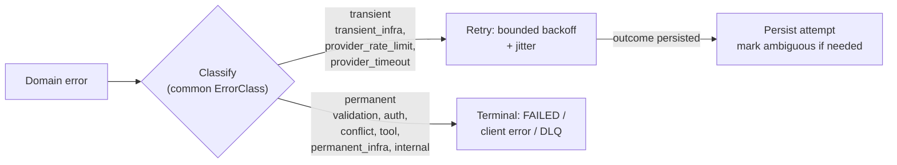

# Error Taxonomy — AgentFlow

> **Status:** Accepted
> **Owner:** `common` (cross-cutting error taxonomy; every module classifies by it)
> **Task:** `S02-10`
> **Upstream reference:** `AGENTFLOW_ARCHITECTURE_AND_PLAN.md` (§6.4 retry policy,
> §11 authn/authz, §13 mandatory negative scenarios, §9.4 API conventions,
> §8 data model) · `docs/architecture/module-map.md` (§Cross-cutting, `common`) ·
> root `AGENTS.md` (error taxonomy + retryability, invariant 12) ·
> `docs/adr/ADR-002`…`ADR-004` (consistency/outbox) · `docs/domain-glossary.md`
> **Purpose:** the canonical set of error *classes* every AgentFlow module
> classifies by, each with a stable `error_class` identifier, an HTTP mapping
> (RFC 9457 Problem Details), a retry decision, and an example. The identifiers
> are the contract shared by the global error handler, the worker retry
> classifier, and the `error_class` metric label.

---

## Why a taxonomy

Two consumers must agree on what an error *is*, or they disagree on what to do:

1. **The HTTP layer** returns a status + an RFC 9457 Problem Details body to the
   caller. The status tells a well-behaved client whether a retry is even
   permitted (only safe/idempotent methods may be retried on `5xx`).
2. **The worker retry classifier** (`S07-11`) decides whether a domain failure
   during execution is *transient* (retry with exponential backoff + jitter) or
   *permanent* (terminal state / DLQ).

A single taxonomy feeds both, and the same class names the `agentflow_*_retry_total{error_class}`
metric label. Classifying before returning or retrying is rule 12 in the root
`AGENTS.md` ("errors are classified by the error taxonomy; retry only for
transient ones").

---

## Error classes

Canonical classes. The `error_class` identifier is lower-case with underscores so
it is a valid Prometheus label; the same token is the canonical domain error name
for code (`enum ErrorClass` in `common`).

| `error_class` | Class | HTTP (RFC 9457) | Retry decision | Example |
|---|---|---|---|---|
| `validation` | Validation | `400` · `code: validation_failed` | **No** — permanent. Retrying identical input cannot succeed. | A workflow graph with an unknown node type `FOOBAR`, or a missing required field. |
| `authentication` | Authentication | `401` · `code: authentication_failed` | **No** — fix the credential/token; never retry blind. | Missing/expired/invalid JWT, wrong issuer or audience, unsigned token. |
| `authorization` | Authorization | `403` · `code: authorization_failed` | **No** — permanent; the caller lacks the scope. | Caller holds `workflow:read` but calls `approve` needing `run:approve`. |
| `conflict` | Conflict | `409` · `code: conflict` | **No** (permanent for this request; re-fetch and re-issue with fresh state). | Optimistic `version` stale on a conditional update; duplicate run under a reused `Idempotency-Key` with a different payload. |
| `transient_infra` | Transient infrastructure | `503` · `code: service_unavailable` | **Yes** — transient. Retry with bounded exponential backoff + jitter. | PostgreSQL connection pool exhausted, Kafka briefly unreachable, Redis down. |
| `provider_rate_limit` | Provider rate limit | `429` · `code: rate_limit_exceeded` | **Yes** — transient. Retry with backoff; respects the provider `Retry-After`. | Model provider returns HTTP 429. |
| `provider_timeout` | Provider timeout | `504` · `code: provider_timeout` | **Yes** — transient. Retry with backoff; the attempt is persisted and the outcome marked (never exactly-once). | Model call exceeds its timeout; the response is lost. |
| `tool_policy_denial` | Tool policy denial | `403` · `code: tool_denied` | **No** — permanent. Unknown tool, disallowed risk class, or missing approval. | `shell` is not in the allowlist, or a `WRITE` tool runs without `HUMAN_APPROVAL`. |
| `cancellation` | Cancellation | `202` · `code: cancellation_requested` | **n/a** — not an error; the opposite of retry. | A `CANCEL_REQUESTED` event is processed on a safe boundary → `CANCELLED`. |
| `internal` | Internal (catch-all) | `500` · `code: internal_error` | **No** — operator. Unexpected, unclassified failure after the classifier runs. | Any error not matching a known class. |

> **Not-found mapping.** A missing resource (including another tenant's resource,
> which is indistinguishable from a missing one per the `401/403/404` policy
> below) is reported with `404` / `code: not_found`, not as a separate class.
> It is permanent and never retried; the response never reveals that a foreign
> resource exists.

---

## Retry policy

Retry exists only for **transient** classes. This is rule 12 and the plan's
`§6.4` retry policy:

- **Transient only.** `transient_infra`, `provider_rate_limit`, `provider_timeout`.
  Every other class is permanent for the request.
- **Backoff.** Exponential with full jitter and a ceiling (per the retry policy
  value object, `S07-10`); values are configurable.
- **Permanent → terminal.** `validation`, `authentication`, `authorization`,
  `conflict`, `tool_policy_denial`, `permanent_infra`, `internal` do not retry:
  they end the step as `FAILED` (or the request as a client error) and, for
  workers, route to the DLQ for investigation — never a retry loop.
- **Ambiguous external calls.** `provider_timeout` retries are bounded; a lost
  response after a side effect is recorded as an **ambiguous** attempt in
  usage/history (`ADR-003`), never claimed as exactly-once.
- **No duplicate side effects.** Retrying must not write a second result, spend
  the budget twice, or advance the state machine twice (`inbox` dedup,
  `event_id`, optimistic locking).
- **`cancellation`** short-circuits retries: a safe-boundary cancel wins over a
  pending retry.

### Classification flow



---

## The `401 / 403 / 404` policy

The three identity-related responses share one behaviour so a caller cannot tell
whether a foreign resource exists:

- `401` — the caller is **unknown** (missing/invalid/expired credential).
- `403` — the caller is **known but not authorised** for the action or resource
  (missing scope, tool policy denial).
- `404` — the resource is **not present in the caller's tenant** (this includes
  another tenant's resource, which is masked as missing, not `403`).

The tenant comes only from the verified security context (`ADR-007`), never from the request
body/query — so spoofing `tenantId` changes nothing.

The tenant-masking behaviour in detail — why a foreign resource is `404 not_found` (never
`403`), the write-path invariant, and the capability/resource distinction — is the single source in
[`docs/security/response-policy.md`](../security/response-policy.md) (S04-09).

---

## HTTP body (RFC 9457 Problem Details)

Every `4xx`/`5xx` response uses the Problem Details envelope with the domain
`error_class` and a correlation id added (the global handler, `S03-11`):

```json
{
  "type": "about:blank",
  "title": "Service unavailable",
  "status": 503,
  "error_class": "transient_infra",
  "detail": "PostgreSQL connection pool exhausted",
  "instance": "/api/v1/workflows/123/runs",
  "correlation_id": "5f1c…",
  "retryable": true
}
```

`retryable` mirrors the retry decision above so a client does not have to infer
it from the status alone.

---

## Application

- **`common` owns the taxonomy.** The canonical `ErrorClass` enum (and the RFC
  9457 mapping) lives in the `common` package — the cross-cutting home for shared
  primitives. No module invents its own class names; every module classifies its
  errors by this taxonomy.
- **The worker** maps a domain failure to one class and applies the retry policy
  (transient → retry; permanent → `FAILED` / DLQ), recording the class in
  `workflow_step_runs.error_code` and the `error_class` metric.
- **The retry classifier** (`S07-11`) consumes these classes to decide retry vs.
  terminal; permanent validation/policy errors never retry.
- **The HTTP handler** maps the class to the status in the table above and writes
  the Problem Details body.
- **Metric labels** use the class identifier (`error_class`); never
  `tenantId`, `runId`, or `userId` (rule 9).

---

## Related

- [`module-map.md`](./module-map.md) — `common` is the cross-cutting owner of this taxonomy; every module classifies by it.
- [`domain-glossary.md`](../domain-glossary.md) — canonical names for the concepts these errors describe (run, step, tool, approval, …).
- **`durable-execution.md`** — state machine, lease, recovery; where `FAILED`/`RETRY_WAIT`/`CANCELLED` transitions are defined (`⚠ planned`, `S07-17`).
- **`kafka-topics.md` / `events/README.md`** — outbox/inbox, delivery and idempotency guarantees behind `transient_infra` and provider errors (`⚠ planned`, `S06`).
- **`database.md`** — migrations and conventions behind `permanent_infra` (`⚠ planned`, `S03-16`).
- **`security/authentication-authorization.md`** — authn/authz and the `401/403/404` policy (`⚠ planned`, `S04`).
- `AGENTFLOW_ARCHITECTURE_AND_PLAN.md` — Sprint 2, `S02-10`.
