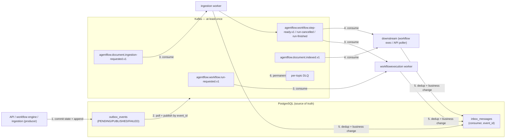

# Events and delivery guarantees — AgentFlow

> **Status:** Accepted
> **Owner:** `messaging` — the envelope, the `agentflow.*` topic namespace, topic/versioning, the
> transactional-outbox publisher, the per-topic consumer contract and the DLQ — with one consuming
> module per topic (`workflowexecution` for the workflow topics, `ingestion` for the ingestion
> topic). The consumer re-checks ownership against PostgreSQL, so the envelope `tenantId` is routing
> only, never authorization.
> **Task:** `S06-16`
> **Upstream reference:** `AGENTFLOW_ARCHITECTURE_AND_PLAN.md` (§7 Kafka topics and event contracts;
> §8.1 `outbox_events`/`inbox_messages`) · `docs/domain-glossary.md` (§6 Events and messaging; the
> canonical topic names and the at-least-once + idempotency guarantee) ·
> `docs/architecture/kafka-topics.md` (the canonical topic catalogue) ·
> `docs/architecture/module-map.md` (owners, dependency direction) ·
> `docs/architecture/module-api.md` (the `messaging` public API: `EventEnvelope`, `EventKey`,
> `TopicName`/`EventType`) · `contracts/events/json-schema/envelope-v1.json` (the envelope every
> record carries) · `docs/adr/ADR-002`, `ADR-003`, `ADR-004` (PostgreSQL source of truth;
> at-least-once + idempotency; transactional outbox) · root `AGENTS.md` (invariants 1, 3, 6, 7, 8,
> 9, 12)
> **Purpose:** the human-readable event catalog — the topics, their producers and consumers, the
> partition key, the envelope, the delivery guarantee and the safe-contract-change rules — so a
> producer, a consumer, a reviewer and CI all agree on the *same* topic name, envelope and guarantee.
> It is the companion to the machine-readable contract family in
> [`contracts/events/`](../../../contracts/events/) and the topic catalogue in
> [`kafka-topics.md`](../kafka-topics.md).

---

## How the pieces fit

AgentFlow publishes a **Kafka event** whenever a durable domain state change commits. The event is
not sent directly to the broker; it is first pinned to a **transactional outbox** in PostgreSQL, and
a polling publisher forwards it (`ADR-004`). A consumer applies it through a transactional **inbox**
and only then commits the Kafka offset (`ADR-003`). This is what makes the flow survive a crash, a
duplicate delivery or a broker outage.



> A producer writes state **and** its outbox row in one transaction, so a run is never accepted
> without its event and an event is never published without durable state (`S06-05`, invariant 3).
> A consumer applies its inbox dedup **and** its business change in one transaction, then commits
> the offset — so there is no ack gap and no lost or double work (`S06-10`, invariant 3).

---

## The envelope

Every record on every topic carries the **same** envelope
([`contracts/events/json-schema/envelope-v1.json`](../../../contracts/events/json-schema/envelope-v1.json),
`S06-01`). It is identical for every event; only `eventType` and `payload` differ.

| Field | Required | Meaning |
|---|---|---|
| `eventId` | yes | Unique, immutable id assigned by the producer. The idempotency/dedup key across outbox and inbox. Exactly-once is never promised (at-least-once, `ADR-003`). |
| `eventType` | yes | Event name, e.g. `workflow.run-requested.v1`. Maps to a topic (fixed by the topic catalogue, `S06-02`). New event types are additive; a field never changes an existing event's meaning. |
| `schemaVersion` | yes | Version of **this envelope schema** (`const "1.0.0"`). Bump only on a breaking envelope-shape change (removed/renamed field, or a change to the required set) — a new major schema (`contracts/AGENTS.md`). |
| `occurredAt` | yes | ISO-8601 UTC instant, assigned by the producer, written with the `timestamptz` outbox column (invariant 10). |
| `tenantId` | yes | Owning tenant. **CORRELATION AND ROUTING ONLY — never an authorization source.** The producer scopes the event to the tenant of the verified security context / stored run; the consumer re-checks `(tenantId, resourceId)` against PostgreSQL before acting (invariant 1). |
| `aggregateType` | yes | The aggregate the event is about (`run`, `document`, …). |
| `aggregateId` | yes | The aggregate instance the event is scoped to: a `runId`, a `stepRunId` or a `documentId`. |
| `correlationId` | yes | The operation/correlation chain shared by every event of one run. Propagated in the Kafka headers alongside the trace parent (`S06-12`). Not an authorization input. |
| `causationId` | no | The id of the event that caused this one (replay/diagnostics). `null` for the first event of a chain; the triggering event's `eventId` otherwise. Propagated in the headers (`S06-12`). |
| `payload` | yes | Event-specific **redacted** data — never a secret, API key, full prompt, full model output, full document or untrusted content treated as data (invariants 7/8). A typed object with an explicit field allowlist, defined per event below. An empty object is valid. |

- `additionalProperties: false` on the envelope; an unauthorized property is rejected.
- The envelope is versioned **independently** of the per-event payload vocabulary: breaking envelope
  changes create a new `schemaVersion` (new major schema), while new event types are additive and
  never change this file (`contracts/AGENTS.md`).
- **No secret, full prompt, full document, API key or access token** travels in the payload or the
  headers by default (invariant 8). Correlation / trace context (`traceparent`, correlation id,
  causation id) travels in the **headers**; message size is bounded.

---

## The topics, producers and consumers

Six topics, all owned by the `messaging` module (envelope + topic namespace). The *producer* column
names the module that publishes it through the outbox; the *consumer* column names the module whose
worker applies it. The canonical catalogue is [`kafka-topics.md`](../kafka-topics.md); the table here
summarizes it for the catalog.

| Topic | Aggregate · key | Producer → Consumer | Purpose |
|---|---|---|---|
| `agentflow.workflow.run-requested.v1` | `workflow_run` (`runId`) · `tenantId:runId` | API/outbox → **workflow execution** worker | A run was created and committed; it is ready to be scheduled (`S06-05`). |
| `agentflow.workflow.step-ready.v1` | `workflow_run` (`runId`) · `tenantId:runId` | workflow engine → **workflow execution** worker | The next step of a run is ready to execute. |
| `agentflow.workflow.run-cancelled.v1` | `workflow_run` (`runId`) · `tenantId:runId` | API/outbox → **workflow execution** worker | A cancellation was requested and committed; the run must stop on a safe boundary. |
| `agentflow.workflow.run-finished.v1` | `workflow_run` (`runId`) · `tenantId:runId` | workflow execution worker → downstream | A run reached a terminal state (`SUCCEEDED` / `FAILED`), including an ambiguous external-call outcome. |
| `agentflow.document.ingestion-requested.v1` | `document` (`documentId`) · `tenantId:documentId` | API/outbox → **ingestion** worker | A document is committed and ready to be extracted → chunked → embedded → indexed (`S06-05`). |
| `agentflow.document.indexed.v1` | `document` (`documentId`) · `tenantId:documentId` | **ingestion** worker → downstream (workflow execution / API) | A document finished ingestion and is ready for tenant-scoped search. |

**Consumer groups (one independent group per consumer; a record reaches only one group member):**

| Consumer group | Consumes | Owning module | Re-checks ownership against PostgreSQL |
|---|---|---|---|
| `agentflow.workflow-worker` | `run-requested`, `step-ready`, `run-cancelled`, `run-finished` | `workflowexecution` (the worker role) | yes |
| `agentflow.ingestion-worker` | `ingestion-requested` | `ingestion` (the worker role) | yes |
| `agentflow.run-await` / API poller | `indexed` (downstream) | `workflowexecution` / API | yes |
| `agentflow.dlq` (S06-11) | per-topic dead letters | `messaging` (`DlqService`) | n/a — investigation only |

Notes:

- The `workflowexecution` worker advances the run/step state machine through the single transition
  service (`S05-11`), publishing the next event back through the outbox.
- `run-finished` and `indexed` are **downstream** triggers — a step awaiting a document, or a client
  polling document status, reacts to them. They carry no side effect of their own; the consumer
  performs its own tenant-scoped work.
- **Workers are a separate runtime role from the API.** The API pods never consume worker topics
  (`infra` / deployment rule); the worker Deployment is scaled independently.
- The `messaging` module owns every `agentflow.*` topic's contract — no other module publishes or
  consumes a topic directly.

---

## Partition key (a stable aggregate key)

The partition key is `tenantId:<aggregateId>` — a **stable aggregate key**: the aggregate and its id
do not change for the life of the aggregate.

| Aggregate | Key | Applied to |
|---|---|---|
| `workflow_run` | `tenantId:runId` | `run-requested`, `step-ready`, `run-cancelled`, `run-finished` |
| `document` | `tenantId:documentId` | `ingestion-requested`, `indexed` |

Consequences:

- **Per-aggregate ordering.** All state events of one run hash to the same partition, so they are
  seen by one consumer in one group and arrive in order —
  `run-requested → step-ready → … → run-finished`. `runId` is fixed at run creation
  (`outbox_events.event_key = tenantId:runId`), so a re-published or retried record of the same run
  still lands in the same partition.
- **Not per-tenant.** The key orders a **run**, not a tenant. A tenant with many runs is spread
  across partitions for parallelism — one tenant does not monopolize one partition
  (`AGENTFLOW_ARCHITECTURE_AND_PLAN.md` §7).
- **Tenant isolation travels with the key, but the key is not authorization.** The consumer still
  re-checks `(tenantId, resourceId)` against PostgreSQL before it applies anything (invariant 1); the
  envelope `tenantId` is routing/correlation only.

---

## Per-event payloads (one safe instance each)

The payload is a typed object with an explicit field allowlist (`additionalProperties: false`).
The concrete per-event **JSON Schema** (formalizing the exact allowlist) is not yet committed — it is
planned under
[`contracts/events/json-schema/`](../../../contracts/events/json-schema/) (see the "Pending" note in
[`contracts/events/README.md`](../../../contracts/events/README.md)). Below is **one representative,
secret-free instance** of each main event's envelope — the routing fields (`eventId`, `eventType`,
`aggregateId`, …) plus a minimal `payload`. They are illustrative instances of the redacted payload;
every example uses a placeholder UUID and a zero UUID — never a real id, tenant or secret.

### `workflow.run-requested.v1`

```json
{
  "eventId": "3fa85f64-5717-4562-b3fc-2c963f66afa6",
  "eventType": "workflow.run-requested.v1",
  "schemaVersion": "1.0.0",
  "occurredAt": "2026-10-29T10:00:00Z",
  "tenantId": "00000000-0000-0000-0000-000000000001",
  "aggregateType": "run",
  "aggregateId": "7f3e2c1a-9b4d-4e6a-8c0f-1a2b3c4d5e6f",
  "correlationId": "11111111-2222-3333-4444-555566667777",
  "causationId": null,
  "payload": {
    "definitionId": "8a1b2c3d-4e5f-6a7b-8c9d-0e1f2a3b4c5d",
    "version": 1
  }
}
```

### `workflow.step-ready.v1`

```json
{
  "eventId": "3fa85f64-5717-4562-b3fc-2c963f66afa6",
  "eventType": "workflow.step-ready.v1",
  "schemaVersion": "1.0.0",
  "occurredAt": "2026-10-29T10:00:05Z",
  "tenantId": "00000000-0000-0000-0000-000000000001",
  "aggregateType": "run",
  "aggregateId": "7f3e2c1a-9b4d-4e6a-8c0f-1a2b3c4d5e6f",
  "correlationId": "11111111-2222-3333-4444-555566667777",
  "causationId": "3fa85f64-5717-4562-b3fc-2c963f66afa6",
  "payload": {
    "stepKey": "llm-plan-1",
    "nodeType": "LLM_PLAN"
  }
}
```

### `workflow.run-cancelled.v1`

```json
{
  "eventId": "3fa85f64-5717-4562-b3fc-2c963f66afa6",
  "eventType": "workflow.run-cancelled.v1",
  "schemaVersion": "1.0.0",
  "occurredAt": "2026-10-29T10:00:10Z",
  "tenantId": "00000000-0000-0000-0000-000000000001",
  "aggregateType": "run",
  "aggregateId": "7f3e2c1a-9b4d-4e6a-8c0f-1a2b3c4d5e6f",
  "correlationId": "11111111-2222-3333-4444-555566667777",
  "causationId": "3fa85f64-5717-4562-b3fc-2c963f66afa6",
  "payload": {}
}
```

### `workflow.run-finished.v1`

```json
{
  "eventId": "3fa85f64-5717-4562-b3fc-2c963f66afa6",
  "eventType": "workflow.run-finished.v1",
  "schemaVersion": "1.0.0",
  "occurredAt": "2026-10-29T10:00:30Z",
  "tenantId": "00000000-0000-0000-0000-000000000001",
  "aggregateType": "run",
  "aggregateId": "7f3e2c1a-9b4d-4e6a-8c0f-1a2b3c4d5e6f",
  "correlationId": "11111111-2222-3333-4444-555566667777",
  "causationId": "3fa85f64-5717-4562-b3fc-2c963f66afa6",
  "payload": {
    "outcome": "SUCCEEDED"
  }
}
```

### `document.ingestion-requested.v1`

```json
{
  "eventId": "3fa85f64-5717-4562-b3fc-2c963f66afa6",
  "eventType": "document.ingestion-requested.v1",
  "schemaVersion": "1.0.0",
  "occurredAt": "2026-10-29T10:01:00Z",
  "tenantId": "00000000-0000-0000-0000-000000000001",
  "aggregateType": "document",
  "aggregateId": "a1b2c3d4-5e6f-7a8b-9c0d-1e2f3a4b5c6d",
  "correlationId": "11111111-2222-3333-4444-555566667777",
  "causationId": null,
  "payload": {}
}
```

### `document.indexed.v1`

Published by the `ingestion` indexing worker (S10-13) when a pass completes — the `PROCESSING →
INDEXED` transition and this outbox record commit in the same transaction. The payload is
correlation metadata only: opaque ids, the status, the pipeline version and the chunk count — never
a secret, a prompt or a document fragment (invariant 8).

```json
{
  "eventId": "3fa85f64-5717-4562-b3fc-2c963f66afa6",
  "eventType": "document.indexed.v1",
  "schemaVersion": "1.0.0",
  "occurredAt": "2026-10-29T10:01:20Z",
  "tenantId": "00000000-0000-0000-0000-000000000001",
  "aggregateType": "document",
  "aggregateId": "a1b2c3d4-5e6f-7a8b-9c0d-1e2f3a4b5c6d",
  "correlationId": "11111111-2222-3333-4444-555566667777",
  "causationId": "3fa85f64-5717-4562-b3fc-2c963f66afa6",
  "payload": {
    "documentId": "a1b2c3d4-5e6f-7a8b-9c0d-1e2f3a4b5c6d",
    "knowledgeBaseId": "9b2c...",
    "status": "INDEXED",
    "pipelineVersion": "character-boundary:500:50",
    "chunkCount": 12
  }
}
```

---

## Delivery guarantee: at-least-once + idempotency

**Delivery is at-least-once, never exactly-once, between PostgreSQL and Kafka.** A crash between the
PostgreSQL commit and the broker confirmation can re-deliver a record, so the code, docs and tests
state at-least-once and make repeated side effects idempotent — they never promise exactly-once
(invariant 6 / `ADR-003`).

The guarantee is built from five boundaries, all closed in PostgreSQL (the source of truth,
invariant 2):

1. **Transactional outbox (`ADR-004`, `S06-05`).** State and its `outbox_events` row are written in
   **one transaction**; the publisher polls `outbox_events` and publishes — it never writes the row
   and publishes later. Publish is **idempotent by `event_id`** (`outbox_events.event_id`), so a
   publisher restart after a crash is safe.
2. **Ack-bound publish (`S06-08`).** The publisher stamps `published_at` and records the row as
   delivered only when the broker **confirms** the envelope (`acks=all` → every in-sync replica
   holds it). A send that does not confirm within `delivery-timeout-seconds` is **ambiguous** (the
   broker may or may not hold the envelope): it is re-published at a bounded-backoff instant, never
   treated as delivered — a duplicate, never a loss. No row is ever marked published before the broker
   confirms.
3. **At-least-once, never exactly-once.** A crash between the PostgreSQL commit and the broker `ack`
   can re-deliver a record. Consumers **deduplicate** with `(consumer_name, event_id)` in
   `inbox_messages`, written in the **same transaction** as the business change (`S06-10`), so a
   duplicate changes business state only once.
4. **Ack only after durable commit.** The consumer commits the Kafka offset only after the inbox dedup
   + business change commit. No ack gap means no lost or double work.
5. **Ambiguous external calls are honest.** A step that calls a model/tool and crashes before
   recording the outcome may be retried; the attempt and its ambiguous outcome are marked in
   usage/history (`ADR-003`, invariant 6). `run-finished` therefore records success **and** an
   ambiguous/failed completion.

The per-run partition key supports all of this: a run's records stay ordered in one partition, so a
duplicate `step-ready` arrives behind the original and is dropped by the inbox dedup before the step
re-executes.

---

## Retry and DLQ behavior

Transient and permanent faults are handled differently, so a stuck broker drains slowly instead of
looping forever, and a malformed message is never retried unboundedly (`S06-11`):

- **Transient fault** (e.g. a DB / provider / broker outage): retried with a **bounded** immediate
  retry — exponential backoff `min(baseDelaySeconds shl (attempts-1), maxDelaySeconds)`, capped at
  `maxDelaySeconds`, bounded by `maxAttempts`. The partial change is rolled back on each attempt;
  nothing is ever marked `PROCESSED` on a failure (invariant 3). When the bound is exhausted the
  disposition is `RETRY` for the consumer retry / DLQ.
- **Permanent or malformed event** (bad input / contract violation, e.g. `IllegalArgumentException` /
  `IllegalStateException` / `NullPointerException`): short-circuits straight to a per-topic
  **DLQ** for investigation, **not** unbounded retry. The disposition is `DEAD_LETTER`.
- **DLQ (`S06-11`).** The `messaging` `DlqService` records one `dlq_messages` row per
  `(consumer_name, event_id)` — the **same** dedup key as the inbox — so a duplicate append is a no-op
  (at-least-once, `ADR-003`): an event is never dead-lettered twice. `dlq_messages` carries no
  `tenant_id` (the inbox/DLQ are keyed by `(consumer, event)`; tenant isolation is enforced by the
  consumer, invariant 1), `last_error` is redacted (invariant 8), and the rows are evidence for
  investigation, not reprocessed by default.

---

## Outbox / inbox semantics

| Side | Store | Owner | Key invariant |
|---|---|---|---|
| **Outbox** | `outbox_events` (`event_id`, `aggregate_type`, `aggregate_id`, `topic`, `event_key`, `payload`, `headers`, `created_at`, `published_at`, `publish_attempts`, `last_error`, `status`, `next_attempt_at`) | `messaging` | State + the row commit in one transaction; `tenant_id` → `tenants` so `messaging` scopes its own pending reads; publish is idempotent by `event_id` (`ADR-004`, `S06-05`). |
| **Inbox** | `inbox_messages` (`consumer_name`, `event_id`, `status`, `attempts`, `next_attempt_at`, `last_error`, `outcome`, `processed_at`, `created_at`); PK `(consumer_name, event_id)` | `messaging` | Dedup claim + business change commit in one transaction; a duplicate `(consumer, event_id)` delivery changes business state only once (`S06-10`, `ADR-003`). |

The inbox stores no `tenant_id` / FK: it is keyed by `(consumer, event)`, not by tenant, and tenant
isolation is enforced by the consumer processing in its own tenant context (invariant 1). The DLQ
(`dlq_messages`) is the PostgreSQL side of the error policy (invariant 2 — the consumer's
authoritative disposition); records are evidence, not to be reprocessed by default.

---

## Contract versioning and permissible changes

Topics and partition keys are versioned (`topic.vN`). The rule (`contracts/AGENTS.md`):

- **Compatible (no version bump).** Adding an **optional** field to a published envelope/payload.
  New **event types** are additive and never change an existing event's meaning.
- **Breaking — requires a new major version (`...v<N+1>`), an explicit baseline update, a
  `CHANGELOG.md` entry and an ADR when needed.** Changing or removing a field, changing a field's
  meaning, changing the **partition key**, or changing the **required set** of the envelope (bump
  `schemaVersion`). A published contract is never changed silently (invariant 13).
- **MVP uses JSON + JSON Schema validation in tests** (`EventContractTest`). A Schema Registry
  (Avro + Apicurio) is a later, separate increment after a stable envelope — not a blocker for the
  durable workflow.

The `EventContractTest` suite loads the committed schema once and asserts, against the canonical
producer fixture and mutated variants, that the fixture is accepted; every required field is enforced;
an unauthorized property is rejected (`additionalProperties: false`); the `schemaVersion` `const` is
enforced as the version-bump gate; and a non-object payload / non-UUID `tenantId` is rejected. A
breaking schema change fails `./gradlew check` in CI.

---

## Security

- **Tenant isolation is enforced at the consumer, not the partition key.** The key carries the
  tenant, but the consumer re-checks `(tenantId, resourceId)` against PostgreSQL before applying the
  record (invariant 1); a foreign tenant's resource is indistinguishable from a missing one
  (`404`/`403` policy, `ADR-007`).
- **The model is an untrusted planner, not an authorization authority** (invariant 7). A topic's
  presence or a payload's contents never grant a permission; the allowlist and permissions are decided
  by the backend before any tool/step runs.
- **No secrets or high-cardinality identifiers in telemetry.** Metrics and logs use the topic name and
  `error_class` only — never `tenantId`, `runId`, `documentId` or a payload (invariant 9).

---

## Related

- [`kafka-topics.md`](../kafka-topics.md) — the canonical topic catalogue (purpose, partition key,
  consumer owner, retention/partition count) that this document summarizes.
- [`../../../contracts/events/json-schema/envelope-v1.json`](../../../contracts/events/json-schema/envelope-v1.json)
  — the envelope every record carries (`S06-01`), and the per-event payload JSON Schemas (planned
  under [`contracts/events/json-schema/`](../../../contracts/events/json-schema/); pending — see
  [`contracts/events/README.md`](../../../contracts/events/README.md)).
- [`../../../contracts/events/README.md`](../../../contracts/events/README.md) — the event contract family
  and its compatibility rule.
- [`../module-map.md`](../module-map.md) — the module that owns each topic (`messaging`) and each consumer
  (`workflowexecution`, `ingestion`) and the allowed dependency edges.
- [`../module-api.md`](../module-api.md) — the `messaging` public API boundary (`EventEnvelope`,
  `EventKey`, `TopicName`/`EventType`); `worker.*` listeners are internal, not part of the public API.
- [`domain-glossary.md`](../../domain-glossary.md) §6 — the canonical topic names and the at-least-once
  + idempotency guarantee.
- [`../../../contracts/AGENTS.md`](../../../contracts/AGENTS.md) — the compatibility rule (compatible vs.
  breaking) and the "no secret / real data in fixtures" rule.
- [`ADR-002`](../../adr/ADR-002-postgresql-source-of-truth.md),
  [`ADR-003`](../../adr/ADR-003-at-least-once-idempotency.md),
  [`ADR-004`](../../adr/ADR-004-transactional-outbox.md) — PostgreSQL is the source of truth,
  at-least-once + idempotency, transactional outbox.
