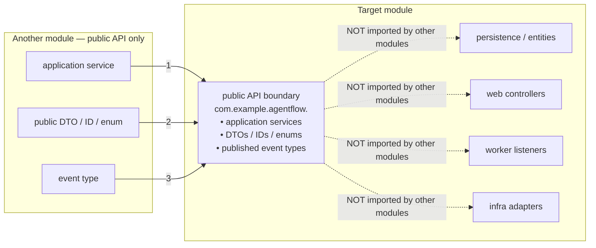

# Module API Map — AgentFlow bounded contexts

> **Status:** Accepted
> **Owner:** engineering
> **Task:** `S02-04`
> **Upstream reference:** `AGENTFLOW_ARCHITECTURE_AND_PLAN.md` (§4.2, §5, §6, §7,
> §9) · `docs/architecture/module-map.md` (owners, dependency direction) ·
> `docs/domain-glossary.md` (canonical concept → shape → module) · root
> `AGENTS.md` (dependency rules, package layout, invariants) ·
> `apps/agentflow-app/AGENTS.md` (one module per table, `com.example.agentflow.<module>`)
> **Purpose:** the *public API* of every module — the application services,
> published event types and permitted DTOs through which modules, and the
> external clients, talk to AgentFlow; and the **internal packages** that must
> never be imported by another module. It is the concrete counterpart to the
> module map (`docs/architecture/module-map.md`): that document says *who owns*
> each table and rule, this one says *how another module reaches it* — only
> through the public boundary listed here.

---

## Scope

This document answers the Sprint 2 acceptance criterion for `S02-04`:

> Other modules must not need to import repositories or entities directly.

Every module exposes a **public API boundary** (its root package): the
application services (use cases), the event types it publishes, and the DTOs /
IDs / enums other modules and clients may reference. Everything else —
`persistence` repositories and entities, `web` controllers, Kafka `worker`
listeners, and infrastructure adapters — lives in an **internal package** that is
listed explicitly and is **not** part of the public API.

The package layout that enforces this (root `AGENTS.md`, applied by
`S02-07`) is:

```
com.example.agentflow.<module>/            ← public API boundary (this map)
├── domain/          pure model + invariants        internal
├── application/     use cases, transactions         PUBLIC application services + DTOs
├── web/             controllers + API DTOs          internal (public only via contracts/openapi)
├── persistence/     repositories, mappers, SQL       internal
└── worker/          Kafka listeners                 internal
```

A consumer of a module uses **only** its `application` services and public DTOs
/ events. Importing another module's `persistence`, `web`, `worker` or
`domain` types is the dependency-rule breach the architecture test
(`S02-08`/`S02-09`) rejects.

---

## Module public APIs

Each table lists:

- **Public application services** — the use cases other modules/clients invoke.
- **Published event types** — the versioned topics/envelopes this module
  produces (`agentflow.*.vN`); cross-referenced to `docs/architecture/events/README.md`.
- **Permitted public types** — DTOs, IDs and enums other modules may reference.
- **Internal packages** — the packages of this module that are **not** part of
  its public API and must not be imported.

### `identity` — tenant context, authorization policy

| Section | Contents |
|---|---|
| Public application services | `TenantContextResolver` — resolve tenant + verified actor **only** from the verified security context (HTTP `SecurityContext`) or a stored event re-checked against PostgreSQL; never from body/query/Kafka headers; then verify the claimed tenant exists and carries the `ACTIVE` status in the `tenants` table (S04-19) — any other outcome — no claim, unknown tenant, non-ACTIVE tenant, or no database — is denied with the identical `401`. `ClaimsToAuthoritiesMapper` — S04-04, the single place that maps the verified JWT's role claims into Spring Security authorities, validated against the `Permission` catalogue (deny-by-default, idempotent). `AccessMatrix` — S04-08, the endpoint access matrix (`EndpointRule`: HTTP `method` + Ant `pathPattern` under `/api/v1` → single required `Permission`); the single source of truth for the endpoint↔permission mapping consumed by `SecurityConfiguration` (least privilege, default-deny). |
| Published event types | none (the tenant is the trusted source; the `audit` module records the verified actor). |
| Permitted public types | `TenantContext` (`tenantId`, `actor` — the immutable value threaded explicitly through
  application services; `requiredScopes` is layered on by `TenantScope` in S04-07), `Permission` (S04-04 catalogue, the single source of truth for authority ids
  used by `ClaimsToAuthoritiesMapper`, the S04-08 endpoint access matrix and the Keycloak realm roles):
  `workflow:read`, `workflow:write`, `workflow:activate`, `document:read`, `document:write`,
  `run:execute`, `run:approve`, `ops:dlq`. |
| Internal packages | `persistence.TenantRepository` (S04-19 — the read-side existence/status probe over the
  `tenants` table; `identity` is the only module that reads or writes that table), security
  `KeycloakOidcAdapter`, `web` controllers. |

> A tenant-lifecycle service (`TenantService`: create tenant / get tenant / set tenant `status`) is
> **not yet implemented** — the only read path today is the internal `TenantRepository` probe the
> resolver uses; the administrator-side lifecycle is a later task and is not part of the public API yet.

### `agentcatalog` — agents, model policy, tool allowlist

| Section | Contents |
|---|---|
| Public application services | `AgentProfileService` — create/activate agent profiles, pin the active version (`unique (tenant_id, name, version)`; active version immutable). `ToolPolicyService` — model policy, tool allowlist, tool risk classes; the allow/deny check. `ToolRegistryService` — deterministic in-memory registry; reject duplicate `id`/`version` and any dynamic registration by the LLM or user. |
| Published event types | none. |
| Permitted public types | `AgentProfileDto` (`id`, `tenantId`, `name`, `modelProvider`, `modelName`, `toolPolicyRef`, `budgetPolicyRef`, `version`, `status`), `ToolDescriptorDto` (`id`, `name`, `version`, `requiredScopes`, `timeoutMs`, `riskClass`, `approvalRequired`), `ToolRiskClass` (enum: `READ_ONLY`, `WRITE`, `EXTERNAL_SIDE_EFFECT`), `PolicyRef`. |
| Internal packages | `persistence.AgentProfileRepository`, `persistence.ToolDefinitionRepository`, model-policy internals. |

### `workflowdefinition` — versioned graph, validation, activation

| Section | Contents |
|---|---|
| Public application services | `WorkflowDefinitionService` — create/list/get a definition (`unique (tenant_id, name)`). `WorkflowVersionService` — create a version (`graph_json` + checksum), get version; activated version is immutable. `GraphValidationService` — validate the DSL/graph: allowed typed node types, no cycles, no arbitrary user code (`ADR-005`). |
| Published event types | none (activation is local; the mutation is audited). |
| Permitted public types | `WorkflowDefinitionDto` (`id`, `tenantId`, `name`, `description`), `WorkflowDefinitionPageDto` (`items[]`, `page`, `size`, `totalElements`, `totalPages`, `hasNext`, `hasPrevious`) — the list page (S03-14), `WorkflowVersionDto` (`id`, `workflowId`, `version`, `graphJson`, `checksum`, `status`), `GraphValidationResult` (`valid`, `violations[]`), node-type enum (`RETRIEVE_CONTEXT`, `LLM_PLAN`, `TOOL_CALL`, `HUMAN_APPROVAL`, `LLM_EVALUATE`, `FINALIZE`). |
| Internal packages | `persistence.WorkflowDefinitionRepository`, `persistence.WorkflowVersionRepository`, graph-model internals. |

### `workflowexecution` — run/step state machine, lease, approvals

| Section | Contents |
|---|---|
| Public application services | `RunService` — create run (idempotent via `idempotencyKey`), get run (status/history/result/events), cancel. `RunStateMachineService` — the **single** transition service: conditional update + optimistic lock + `workflow_events` record in one transaction; transitions never set from a controller/listener. `RunLeaseService` — atomic claim (set `lease_owner`/`lease_until`, bump `lease_epoch`). `RunHeartbeatService` — S07-04, renew `lease_until` only while the run is still owned by this worker with the matching `lease_epoch` (fencing, ADR-011); a stale owner cannot renew after a re-claim. The run write is fenced by the same `lease_epoch` (`S07-05`): a stale owner's conditional update matches zero rows and becomes a `409 Conflict` (ADR-011). The lease is released at a `HUMAN_APPROVAL` pause / cancel, and the expired-lease recovery job (`S07-09`, `WorkflowRecoveryScheduler`, `worker`) re-claims those runs on a fixed cadence — enabled by `agentflow.worker.recovery-enabled`, bounded by `max-concurrent-runs`, and publishing the `agentflow.workflow.recoveries` counter (no `tenantId`/`runId` label). `ApprovalService` — the human-approval decision service: the decision half of the approval lifecycle (S11-04 approve, S11-05 reject + expiry), idempotent by state and by `Idempotency-Key`, the decision, its audit row (`ADR-018`), the run/step completion and the outbox continuation/refusal (`workflow.run.resumed.v1` / `workflow.run.rejected.v1`, `ADR-004`) in one transaction; the expiry sweep (`worker.ApprovalExpiryScheduler`, `S11-05`) drives the same refusal completion under the stable service-principal actor `agentflow-worker` (`ServiceIdentity`, `S07-18`, ADR-023) with the new `EXPIRE` audit verb and the `agentflow.workflow.approvals.expired` counter (no tenant/run label, invariant 9). The worker side of S11-05: a poll never steals a `WAITING_FOR_APPROVAL` run back to `RUNNING` (only the decision moves a paused run) and a run already `RUNNING` when claimed is driven without a second `run.started`. The S11-06 payload binding: the pause pins `ApprovalPayloadFingerprint` (canonical-JSON SHA-256 of the step plus the node's exact config — the tool / arguments / version it carries) on the approval row, and `approve` re-validates the stored digest against the run's pinned graph before deciding — a mismatch or an unverifiable binding is a `409` that writes nothing, so an approved argument set can never execute a different one. `IdempotencyKeyService` — create-run idempotency. `ServiceIdentity` (`S07-18`) — the stable service-principal actor every transition, row and audit record the worker writes carries (`agentflow-worker`); the per-instance lease identity stays on `lease_owner` and never doubles as an actor; the machine-to-machine client decision is validated up front (`agentflow.worker.service-client-enabled`) with a clear startup failure on a missing secret. `CheckpointAdapter` (`S07-07`) — the single seam that turns a completed step's output into a reusable checkpoint: it redacts the output before persist (invariant 8), bounds it to `agentflow.checkpoint.max-inline-bytes`, persists it inline through `persistence.WorkflowStepRunRepository` (guarded by the tenant, `lease_epoch` fence and a `SUCCEEDED` step), and answers the reuse decision (stored `output_schema_version` matches the step's current output-schema version, and the output is stored inline) — a schema-version mismatch is not a hit, so recovery re-executes. `StepHandler` — the execution SPI **port** owned by this module (`S02-03` edge 14–17). `BudgetGuard` (S12-04) / `RunQuotaGuard` (S12-05) — the run-start gates owned by this module as ports, the same execution-SPI shape: `RunService` checks the budget and acquires the parallel-run quota slot before the run row is written, and the transition service releases the slot at the terminal state; the `usage` module supplies the `UsageBudgetGuard` / `UsageRunQuotaGuard` adapters (the sanctioned `usage → workflowexecution` edge, the durable state lives in `usage`). |
| Published event types | `agentflow.workflow.run-requested.v1` (key `tenantId:runId`, API/outbox → worker) · `agentflow.workflow.step-ready.v1` (key `tenantId:runId`, engine → worker) · `agentflow.workflow.run-cancelled.v1` (key `tenantId:runId`) · `agentflow.workflow.run-finished.v1` (key `tenantId:runId`, worker → downstream) · `agentflow.workflow.run-resumed.v1` (key `tenantId:runId`, approval decision → downstream, S11-05) · `agentflow.workflow.run-rejected.v1` (key `tenantId:runId`, approval decision / expiry sweep → downstream, S11-05). |
| Permitted public types | `RunDto` (`id`, `workflowVersionId`, `status`, `attempt`, `createdAt`) — the tenant-scoped status snapshot returned by the create and the `GET /runs/{runId}` endpoints (S06-05 / S07-08); tenant is contextual, not a field (invariant 1), `StepDto` (`runId`, `stepKey`, `status`, `attempt`, `inputHash`), `RunStatus` / `StepStatus` enums, `CreateRunRequest` (`idempotencyKey`), `CancelRunRequest`, `ApprovalStatus` (enum mirroring the `approvals_status_check` set: `PENDING`/`APPROVED`/`REJECTED`/`EXPIRED`/`CANCELLED`), `ApprovalDecisionRequest` (`decision` — `"approve"` (S11-04) or `"reject"` (S11-05); `comment`), `ApprovalDecisionDto` (`approvalId`, `runId`, `stepKey`, `status`, `decisionActor`, `decisionAt`, `decisionComment` — the S11-04 decision snapshot returned by `POST /api/v1/runs/{runId}/approvals/{approvalId}`; never the payload or the fingerprint preimage, invariant 8); the run-start gate outcome vocabulary — `BudgetCheckResult` (`allowed`, `reason` — S12-04) and `QuotaCheckResult` (`allowed`, `reason` — S12-05), the `domain`-package return values of the `BudgetGuard` / `RunQuotaGuard` ports, so `usage` implements the ports without `workflowexecution` compiling against `usage` (the sanctioned `usage → workflowexecution` edge). |
| Internal packages | `persistence.RunRepository`, `persistence.StepRepository`, `persistence.ApprovalRepository`, `persistence.WorkflowRunRepository#findExpiredLeaseRuns` (S07-09, the platform-wide expired-lease scan), `worker.*` Kafka listeners, `worker.WorkflowRecoveryScheduler` (S07-09 expired-lease recovery scan). |

### `toolexecution` — typed tool registry, permission/budget check, results

| Section | Contents |
|---|---|
| Public application services | `ToolExecutionService` — permission/budget check → invoke → JSON Schema result validation; never dynamic registration; resolves a tool's risk class and required scopes through the registry. `ToolRegistry` — the deterministic in-memory registry (register at startup, deduplicate on `name`/`version`, resolve by `name`/`version`); the single source of *which tools are registered*. `BoundedToolExecutor` (S08-10) — the bounded executor every tool call runs through: the call's own `ToolDescriptor#timeout()` frees the pool thread when the bound elapses, and the global / per-tenant concurrency caps (configured under `agentflow.tools.executor.*`) reject overload immediately with a `concurrency_limited` outcome instead of queueing; a timeout is reported as the ambiguous `tool_timeout` outcome (invariant 6: interrupting the pool thread does not undo a remote side effect). Since S08-13 every concluded call — success, throttle rejection, ambiguous timeout or tool fault — is reported to the `ToolInvocationListener` seam (implemented by `ToolInvocationHistoryService`): one append-only metadata row in the `tool_invocations` table the module owns (tool `(name, version)`, attempt, latency, bounded `ToolInvocationOutcome`, `step-run:<step-id>` output reference; never arguments or payload — structural redaction, invariant 8), plus an `audit_events` record for every started non-`READ_ONLY` call. |
| Published event types | none (tool allow/deny/execute is written to the audit trail, not published as a domain event). |
| Public registry types | `ToolRegistry` — the in-memory registry (register at startup, deduplicate on `name`/`version`, resolve by `name`/`version`). `DuplicateToolRegistrationException` — extends `IllegalStateException`; thrown on a duplicate `name`/`version` (a startup error). `BuiltInTools` — the startup-seeded built-in descriptors. The `(name, version)` value key `ToolKey` is package-private. |
| Permitted public types | `ToolExecutionContext` (minimal, tenant-scoped call context — `tenantId`, `actor`, `runId`, `stepRunId`, `correlationId`, `capabilities`; no secrets, immutable with an unmodifiable capability set; built server-side from the verified context so the model can never replace the actor/tenant — the S08-08 acceptance), `ToolExecutionResultDto` (validated result + schema version), `ToolExecutionOutcome` (enum: `ALLOWED`, `DENIED`, `EXECUTED`) — the invocation vocabulary; the invocation policy guard (`ToolInvocationPolicy`, a `@Service`; `PermissionDecision`; `ToolExecutionOutcome`) re-checks the permission immediately <em>before</em> the call, not at activation: a scoped tool is denied when the <em>current</em> permission set no longer holds a required scope (S08-09 acceptance: a permission revoked after activation blocks the call) and the guard is unknown-tool/absent-scope aware. Implements the `StepHandler` port (depends on `workflowexecution` only to implement that port). The bounded-executor vocabulary (S08-10): `ToolExecutionThrottleException` (stable `reason()` `concurrency_limited` / `tool_timeout`, both `retryable()`) and `ToolExecutionError` (a tool's checked fault rewrapped so it can cross the pool boundary); `ToolInvocation` is the single-call port the executor bounds. |
| Internal packages | `application` — `ToolRegistry` and its value key `ToolKey`. per-tool adapters, tool infrastructure adapters. `mcp` (S11-09) — the MCP client seam: `McpClientAdapter` (the only invocation path, fail-closed against the `McpAllowlist`), `McpAllowlist`/`McpServerPolicy` (pure policy values) and `McpAccessDeniedException`; wired from `agentflow.mcp.*` by `config.McpClientConfiguration` (no DataSource/Kafka — safe in every profile). The outbound destination policy (S11-10) is the SSRF guard: `OutboundDestinationPolicy` classifies a connection's host + protocol before any socket opens (HTTP/HTTPS only; loopback, unspecified, private RFC-1918, link-local incl. the cloud metadata endpoint 169.254.169.254, unique-local IPv6 and reserved/future ranges refused) and `McpClientAdapter` enforces it in both `invoke` and `isReachable` — a refusal is `OutboundPolicyViolationException`, and the destination is only ever observed as a protocol + classification label, never the URL (invariants 7/8/9). The adapter is not yet routed through a workflow `TOOL_CALL` step: exposing allowlisted MCP tools as `ToolDescriptor`s is a separate task, not part of S11-10. |
| Domain (pure values) | `ToolExecutionContext` (S08-08) — the minimal, tenant-scoped call context a tool is executed with: `tenantId`, `actor`, `runId`, `stepRunId`, `correlationId`, `capabilities`. No secrets, immutable (the capability set is stored as an unmodifiable defensive copy), with canonical-constructor validation rejecting a null tenant/run/capabilities, built server-side from the verified context so a model argument can never replace the actor/tenant (the S08-08 acceptance). No Spring/I/O, reads neither time nor randomness (invariant 10). `Calculator` — safe dependency-free recursive-descent arithmetic evaluator (`toolexecution.domain`, S08-05) plus `CalculationException` (stable `reason()` codes: `invalid-token`, `empty-expression`, `division-by-zero`, `overflow`); the report formatter `ReportFormatter` (S08-06) renders structured `StructuredFact`s and their `Citation`s into an HTML-escaped `ReportFormat` MARKDOWN/JSON report capped at a fixed length — its output schema is stable for empty, valid and oversized input (oversized input drops whole facts, flagged `ReportResult#truncated()`); `SchemaValidator` / `SchemaValidationException` — the JSON Schema input/output gate (S08-03/04); `TicketLookup` (S08-07) — the demonstrative read-only `ticket.lookup`: answers a ticket id against a fixed, in-memory fixture (rows `TKT-1001` open, `TKT-1002` on hold, `TKT-1003` closed), reproducing all three plan outcomes — {@code NOT_FOUND} for an absent id (deterministic, never flaps), {@code SUCCESS} on the first clean attempt returning the found `TicketRecord`, and {@code TRANSIENT_FAILURE} when a flapping backend retries to no avail — the per-attempt flap draw injected as a {@code Supplier<Double>} in `[0, 1)` (the same `RetryPolicy` jitter seam), no external network. `TicketStatus` (OPEN/ON_HOLD/CLOSED), `TicketOutcome` (three outcome classes) and `TicketResult` (outcome, `ticketId`, `attemptsUsed`, `record`) are its supporting values. No Spring/I/O, reads neither time nor randomness (invariant 10). |

### `knowledgebase` — documents, access policy, tenant/ACL-filtered search, citations

| Section | Contents |
|---|---|
| Public application services | `KnowledgeBaseService` — create/list/get a knowledge base (`unique (tenant_id, name)`). `DocumentService` — upload (store object to object storage + outbox `object_key` + `sha256`), get document, lifecycle (`UPLOADED → QUEUED → PROCESSING → INDEXED`; full state machine, terminal/retry states and per-transition guards in [`document-lifecycle.md`](document-lifecycle.md)). `RetrievalService` (S10-14) — tenant/ACL-filtered vector (pgvector) search with the tenant/collection predicate **inside** the query (before top-k: `WHERE c.tenant_id = ? AND d.knowledge_base_id = ?`, NULL embeddings excluded) and the top-k / relevance-threshold bounds configured under `agentflow.retrieval.*`; the query is embedded with the collection's own pinned model through the `ai` `EmbeddingPort`. The FTS lexical half (`S10-15`) and the hybrid fusion (`S10-16`) are implemented on top of it; the **citation** layer (`S10-17`) is implemented on top of it too — {@link CitationBuilder#cite(SearchResult)} builds one {@link CitationDto} per real retrieved chunk, so a citation can never point at another tenant's or a non-retrieved chunk (an empty result yields no citation); the **implemented** no-evidence policy (`S10-18`) — the {@link GroundingPolicy} decides, from the real citations, whether the retrieval grounds the answer or is an evidence gap, and {@link RetrievalService#groundedAnswer} is the entry point that runs the hybrid retrieval + citation layer + policy as one tenant-scoped call: an empty (or below the `minimum-citations` bar) retrieval reports {@link GroundedAnswer#InsufficientEvidence}, never an invented citation. Indexing-facing public API (S10-13, consumed by the `ingestion` worker — which never touches this persistence): `DocumentQueryService` (the `(tenant_id, id)` read returning `DocumentView`, status as a plain `String`), `DocumentTransitionService` (the **sole writer** of `documents.status` on the indexing path — conditional `UPDATE` with status guard + optimistic `version`, zero rows → `false`), `ChunkIndexingService` (the SKIP/UPDATE `ON CONFLICT` upsert on the `(document_id, chunk_index, pipeline_version)` unique key). |
| Published event types | none (the `indexed` event is published by `ingestion`). |
| Permitted public types | `KnowledgeBaseDto` (`id`, `tenantId`, `name`, `status`), `DocumentDto` (`id`, `tenantId`, `objectKey`, `mimeType`, `sizeBytes`, `sha256`, `status`, `pipelineVersion`), the S10-14 vector-search vocabulary: `SearchRequest` (`query` + optional `topK`; tenant and knowledge base are context, never body), `SearchResult` (`chunks[]` in ascending cosine-distance order), `ChunkDto` (`id`, `documentId`, `documentName` display name, `pageFrom`, `pageTo`, `score`, `content` — untrusted document text, never logged); the citation vocabulary: the **implemented** citation layer (`S10-17`) — `CitationDto` (`documentId`, `chunkId`, `documentName` display name, `pageFrom`, `pageTo`, `score`, `snippet` — one per real chunk, built by the pure `CitationBuilder.cite(SearchResult)`); the **implemented** no-evidence policy (`S10-18`) — the sealed `GroundedAnswer` (either `Grounded` in the real citations, or an `InsufficientEvidence` evidence gap carrying the call's `searchId`), decided by the pure `GroundingPolicy` (any non-empty retrieval grounds by default; the `minimum-citations` bar can require more) through `RetrievalService#groundedAnswer`; the indexing vocabulary (S10-13): `DocumentView` (the read model incl. `embeddingModel`), `ChunkToIndex` (chunk + validated 768-d embedding, defensive copy), `ChunkIndexingResult` (`written`, `skipped`), and the opt-in outbound read port `DocumentPayloadStore` (`ADR-014` — no Garage client yet, fails loudly at call time). |
| Internal packages | `persistence.*` repositories, the `evaluation.*` RAG evaluation corpus and runner (fixed synthetic sample documents, questions with reference pages/chunks, recall@k + citation-correctness scoring; internal). Object bytes are stored/read through the `storage` contract — the `Garage`/AWS client is not this module's; it lives in the `storage` module (`S02-18`). |

### `storage` — provider-neutral object storage contract, Garage adapter

> **The contract is defined** (`S02-19`, [`object-storage.md`](./object-storage.md)) — the five operations (`put` / `get(openStream)` / `head` / paginated `list` / `delete`), `ObjectReference` and the request/response views, the stream-ownership and idempotency rules, the provider-neutral error taxonomy and the contract test suite (§9 there). The **consistency/security/lifecycle policy is fixed** ([`ADR-024`](../adr/ADR-024-object-storage.md), `S02-20`) — PostgreSQL owns metadata/ownership, Garage owns bytes, tenant-scoped server-generated keys, no public buckets, runtime/admin credential separation, bounded retry + compensation + orphan reconciliation. The **foundation landed with `S07-06A`**: the typed `agentflow.storage.*` configuration — `AgentFlowProperties.Storage` (`enabled` / `endpoint` / `region` / `bucket` / `path-style-addressing` / `connection-timeout-seconds` / `request-timeout-seconds` / `max-retry-attempts` / `public-access`), opt-in, validated (`@Min` / `@Max` / `@NotBlank` / `@Pattern`), with no credential fields in the group, wired by `config.StorageClientConfiguration` as a singleton `S3Client` (env-var credentials via `StaticCredentialsProvider` with `AwsBasicCredentials`, never a per-request client); the S3 client itself consumes no `storage` types. **The models and `ObjectStoragePort` landed with `S07-06B`**: the root-package contract — `ObjectStoragePort` (`put` / `get` / `head` / `list` / `delete`), `ObjectReference`, `ObjectMetadata`, `CreateObjectRequest`, `OpenedObject`, `ObjectListPage`, `DeleteResult`, the `ObjectStorageException` + `ObjectStorageErrorCode` taxonomy and the package-private `StorageValidation` — in code, with the §9 contract unit suite (`ObjectStoragePortContractTest`, `ObjectReferenceTest`, `CreateObjectRequestTest`, `ObjectMetadataTest`, `OpenedObjectTest`, `ObjectListPageTest`, `ObjectStorageExceptionTest`). The adapter landed with `S07-06C`/`S07-06D`/`S07-06E` — `com.example.agentflow.storage.adapter.GarageS3Adapter` implements the `put`, `get`, `head`, `list` and `delete` paths (streaming, bounded-memory, checksum-verified, bound to the configured bucket, error-mapped). The unified error policy landed with `S07-06F` — one `mapFailure` mapper for every operation (deterministic rejection / typed miss / SDK timeout / throttling / 401-403 / model-400 / timeout / 5xx / transport), retryable codes limited to `UNAVAILABLE`/`TIMEOUT` with the retry loop living in the bounded wired client, and the provider request/correlation id preserved on the exception when supplied — never fabricated, never a secret.

| Section | Contents |
|---|---|
| Public application services / ports | **The only** public surface of the module — in code at `S07-06B` (`com.example.agentflow.storage`): `ObjectStoragePort` (`put` / `get` / `head` / paginated `list` / `delete`), `ObjectReference` (bucket, key, content type, size, `sha256`), the request and response views (`CreateObjectRequest`, `OpenedObject`, `ObjectMetadata`, `ObjectListPage`, `DeleteResult`) and the `ObjectStorageException` / `ObjectStorageErrorCode` failure taxonomy — provider-neutral, no AWS SDK types, never the adapter. |
| Published event types | none — object storage is internal; consumers read/write through the contract and own their metadata rows in PostgreSQL. |
| Permitted public types | `ObjectStoragePort`, `ObjectReference`, `ObjectMetadata`, `CreateObjectRequest`, `OpenedObject`, `ObjectListPage`, `DeleteResult`, `ObjectStorageException`, `ObjectStorageErrorCode` — the only public types; nothing else in the module may be imported outside this module. |
| Internal packages | `adapter` (`GarageS3Adapter` — the single class family that talks to the Garage S3 API through the AWS SDK for Java v2; internal, never imported by any other module), no tables, no repositories, no state machine. The adapter is the only implementation; a second provider is a new `adapter` sub-package plus a contract-level change, never a new module. |

**Adapter (`S07-06C`/`S07-06D`/`S07-06E`, in `storage.adapter`):** `GarageS3Adapter` — the provider-neutral adapter, the only place the AWS SDK may appear; `put` is implemented (bounded 64 KiB chunked `VerifyingInputStream`, declared `contentLength` required, computed SHA-256 in the reference + declared `checksum-sha256` object metadata, deterministic overwrite on the same key, honest error mapping, no content/key/credential logged); `get` is implemented (lazy `ResponseInputStream` handed to the caller — the SDK's own streamed body is never buffered by the adapter, the metadata is built from the eagerly-parsed headers and requires the stored `checksum-sha256`, `NOT_FOUND` on a missing key, the stream released on success/failure/cancellation, honest error mapping); `head` is implemented (presence without throwing — a missing key yields `Optional.empty()`, the metadata built from the stored headers and requires the stored `checksum-sha256`, never a fabricated digest); `list` is implemented (paginated over a structurally-validated server-side prefix, one `listObjectsV2` call plus one bounded per-item `headObject` — the only honest source of the reference's `contentType`/`sha256` — ascending-page and truncated-without-cursor rejections, 1–100 limit bound, cursor passed through to the provider); `delete` is implemented (idempotent — `DELETED` on a present object, `ALREADY_ABSENT` on a missing one, never a failure, never opens content, and does not require the stored-checksum anchor). The bean is wired in `config.StorageAdapterConfiguration` — the same `@ConditionalOnProperty` as the client — and the client sets `RequestChecksumCalculation.WHEN_REQUIRED` (Garage rejects the SDK default trailing-checksum chunked body). The adapter consumes the typed config + env-var credentials only through the shared client; it owns no lifecycle beyond construction and holds no secrets.

**Foundation (`S07-06A`, in `config`):** the typed `agentflow.storage.*` configuration and the singleton `S3Client` bean (`StorageClientConfiguration`) — deliberately wired in `config` (framework wiring, the `RedisConnectionConfiguration` precedent), not in the `storage` module, so the public contract stays provider-neutral and the adapter stays SDK-internal. The client consumes the typed group and env-var credentials (`AGENTFLOW_OBJECT_STORAGE_ACCESS_KEY` / `..._SECRET_KEY`, invariant 8) — never a config value, never a logged value, never a test fixture — and no per-request `S3Client` is created.

**Boundary rule (enforced by `StorageBoundaryTest`):** no module other than `storage` may import
`storage.adapter.*` or `software.amazon.awssdk.*` — a domain module reaches object bytes only through
the public contract in the root package, and the contract itself may not reference the adapter or the
AWS SDK. Allowed consumers: `knowledgebase` (document originals) and `workflowexecution`
(large-payload checkpoints). `ingestion` never depends on `storage` directly — it reaches object
bytes through `knowledgebase`'s `DocumentPayloadStore` opt-in port.

### `ingestion` — extract → chunk → embed → index, retry, idempotency

| Section | Contents |
|---|---|
| Public application services | `IngestionService` (S10-13) — one indexing pass per `document.ingestion-requested.v1` event: guarded claim → payload (`DocumentPayloadStore`) → extract (Tika/PDFBox) → chunk → embed (via the `ai` embedding port) → idempotent index (SKIP/UPDATE `ON CONFLICT`) → `PROCESSING → INDEXED` + `document.indexed.v1` outbox record in one transaction; retries and inbox dedup run through `messaging`. `EmbeddingGenerationService` (S10-12) — the embed step: batches the chunk texts to the `ai` `EmbeddingPort` (`agentflow.ingestion.embedding.batch-size`), preserves input order across batches and validates every response (one vector per text, uniform width) before returning the aggregated `EmbeddingBatchResult`; opt-in seam — with no `EmbeddingPort` configured the service constructs without a port and `embed(...)` fails loudly at call time (`ADR-014`, the `PlannerService` idiom). |
| Published event types | `agentflow.document.ingestion-requested.v1` (key `tenantId:documentId`, API/outbox → ingestion worker) · `agentflow.document.indexed.v1` (key `tenantId:documentId`, payload `documentId`/`status`/`chunkCount`/`pipelineVersion`, ingestion worker → API/workflow consumers). |
| Permitted public types | `IngestionStatusDto` (`documentId`, `status`, `pipelineVersion`), `IngestionEventKey` (`tenantId`, `documentId`), `EmbeddingBatchResult` (`vectors` in input order, `tokens`, `dimensions`) (S10-12). |
| Internal packages | extractors/chunkers, `application.config` bean wiring (parser/chunker/embedder/ingestion services), `worker.*` — the Kafka consumer (`DocumentIndexingWorker`, poll loop with manual offset commits after durable inbox outcomes), `IngestionEventEnvelope` (lenient parse, strict identity), `IngestionWorkerLifecycle` (`DataSource` + `agentflow.worker.ingestion-loop-enabled` gate, default off). Compile edges: `knowledgebase`, `messaging`, `ai` (arrow 19 — only the `ai.application` embedding port types, `ADR-016`). |

### `ai` — model provider adapter, planner, validation gate, finalizer

| Section | Contents |
|---|---|
| Public application services / ports | `ChatModelPort` / `EmbeddingPort` — single provider adapter behind a port (a second provider is an isolated later change). `Planner` — schema-constrained structured output; a **planner**, never an authorization authority (`ADR-006`). `PlannerService` (S09-06) is the entry point: renders the fixed policy and appends the task + allowlist as one untrusted USER turn, asks the model through `ChatModelPort`, and maps the response into a `PlannerPlan` without executing it; it reads the catalogue through the `ai.application` `PromptCataloguePort` (never `ai.prompt`). `AiPlanExecutionService` (S09-07) — the validate-before-execute entry point: it runs the `ValidationGate` before any step reaches the executor, then hands the validated plan to the optional `PlanExecutor` port; cyclic / over-limit / unknown plans never reach the executor. `ValidationGate` — the pure, DB-free **double** policy stage (S09-07 structural: DAG, closed node vocabulary, tool allowlist, field contract, `PlanLimits`; S11-12 authorization: each allowlisted tool reference re-checked against the caller-supplied `ToolGatePolicy` facts — required scopes against the caller's current permission set, human-approval requirement on the automatic path) the plan is checked against before execution — a value, so `ai` compiles only against `ai`. `PlanExecutor` (S09-07 port) — the opt-in seam a validated plan is handed to; another module implements it, reaching `ai` through its public `application` API. `Executor` — runs only validated steps through the tool registry (future). `Finalizer` — writes the result with citations and cost metrics; terminal state (future). `ai.evaluation.redteam` (S11-11) — a prompt-injection evaluation harness that drives the real `PlannerService` through `ValidationGate` with a recording `PlanExecutor`, never letting a step reach the real registry; `RedTeamEvalCases` supplies the six adversarial documents (override system rules, disclose the canary secret, call an unauthorized tool, escalate privilege, schema escape, limit exhaustion) each named by its vector, and `RedTeamReport` renders only ids/vectors/verdict/evidence (never the canary or the task text). This is a `ai`-internal test/eval package — a `ai`-module edge, so `ai` still compiles only against `ai`. |
| Published event types | none (the run terminal state publishes through `workflowexecution` / outbox). |
| Permitted public types | `PlannerPlanDto` (typed JSON plan from allowed node types only), `PlannerPlanResult` (the plan + attempt metadata: model id, `PromptVersion`, `ChatUsage`), `PlannerPlanParseException` (the single malformed / invalid-plan signal), `PlanValidationResult` (`valid`, `violations[]`), `PlanValidationException` (a rejected plan, carrying every failing check), `ValidationContext` (the external facts the gate reads: tenant, allowed node types, allowed tool names, `PlanLimits`, the per-tool `ToolGatePolicy` map, the caller's current scopes), `ToolGatePolicy` (S11-12 — per-tool policy facts: `requiredScopes` / `requiresHumanApproval`, caller-supplied data so the gate compiles against no registry), `AiPlanExecutionService` (the validate-before-execute service), `PlanExecutor` (the opt-in port a validated plan is handed to), `ModelProviderRef` (`modelProvider`, `modelName`), `ProviderResiliencePolicy` (S09-09 — the `ai` module's own bounded-retry descriptor: `maxAttempts` / `baseDelay` / `multiplier` / `maxDelay` / full jitter, a pure value with injected time/randomness seams), `ProviderFailureReason` (S09-09 — the neutral, SDK-free failure classification: `RATE_LIMIT` / `SERVER_ERROR` / `TIMEOUT` / `CONNECTION` retryable, `CLIENT_ERROR` / `UNKNOWN` permanent). The resilience wrapper itself (`ai.provider.ResilientChatModel`, with the connect/read/overall timeouts, bounded backoff and the parallel-call cap from `agentflow.ai.*`) is an internal provider adapter, never a public type. |
| Internal packages | provider-specific adapters (`OpenAiChatModelAdapter`, `ResilientChatModel`, `ResilientEmbeddingModel` (S10-12), the S09-09 `ProviderExceptionClassifier`), prompt templates (`resources/ai.*`). |

### `usage` — token/cost metering, budgets, quotas

| Section | Contents |
|---|---|
| Public application services | `UsageMeteringService` — uniformly record one token/cost measurement per model, tool or embedding call: `fromChatResponse` for a chat-completion call, and a tool path for a tool invocation; `estimated` vs provider-reported (`Measurement`), cost is `NUMERIC`/Decimal, never float, token counts are nullable so an unreported value stays unknown (never zeroed). `PricingResolver` — resolve the price of an estimate from the `usage.pricing` catalogue: the unit divisor plus the latest published price for a `model`, returning the resolved cost and the catalogue revision, so a stored estimate is traceable to the exact price version (S12-03); the resolved `PricingInfo` fills `UsageRecordDto.priceVersion` / `pricingRevision` (`null` when no price is known). `BudgetService` — the durable per-tenant cost/token budget (S12-04): reservation that blocks the next operation when exceeded, settled idempotently, and stranded reservations reconciled at their best-known amount (`reconcileUnsettled(tenantId, before)`, S12-06 — a reservation left unsettled by a worker crash is recovered so the run's true consumption is always known, and a re-settle / re-reconcile of the same row is a no-op, invariant 3). `QuotaService` (S12-05) — the durable per-tenant parallel-run quota: a run acquires its slot at creation (before any charge is made) and releases it at the terminal transition, so a tenant never holds more non-terminal runs than `tenant_budgets.max_runs` allows; concurrent acquisitions are counted in PostgreSQL under the tenant's `tenant_budgets` row lock (`SELECT ... FOR UPDATE`, the same serialization `BudgetService#reserve` uses), so a race of run creations cannot bypass the limit - Redis is used only for auxiliary rate limiting / caching, never as the durable quota state (invariant 2). |
| Published event types | none. |
| Permitted public types | `UsageRecordDto` — the immutable measurement value persisted as one `usage_records` row (`id`, `tenantId`, `runId`, `stepRunId`, `attempt`, `usageType` (`MODEL`/`TOOL`/`EMBEDDING`), `measurement` (`ESTIMATED`/`PROVIDER_REPORTED`), `provider`, `model`, `toolName`, `toolVersion`, `inputTokens`, `outputTokens`, `estimatedCost`, `providerCost`, `unit`, `currency`, `providerRequestId`, `providerMetadata`, `priceVersion`, `pricingRevision`): the token counts are nullable — an unreported value is stored as `null`, never coerced to `0` (unknown stays unknown, invariant 8); it lives in the `domain` package (like `AuditEvent`), so `application` (the `UsageMeteringService`) and `persistence` both depend on it without a package cycle, and it is the value the later budget/quota/settlement work reads. `PricingInfo` (`priceVersion` / `pricingRevision` / `unit` / `currency` / the resolved cost — the exact price-catalogue snapshot a `S12-03` estimate was computed against; both versioning fields `null` when no price was resolved), `UnitDivisor` (how many tokens one price unit covers — `1` for `token`, `1_000` for `1k-tokens`); `BudgetDto` (`tenantId`, `period`, `maxRuns`, `maxTokens`, `maxCost`), `BudgetPeriod` (the consumption period the limits are measured over), `BudgetMetric` (`COST` / `TOKEN` — the dimension the limit is bound to), `BudgetReservation` (`reservationId` the idempotency key, `tenantId`, `runId`, `metric`, `reservedAmount`, `reconciledAt` — set when the row was recovered by the S12-06 reconciliation flow, `attempt` — the operation attempt the reservation was keyed on, so a duplicate attempt reuses the same idempotency key (invariant 3); one reservation an operation makes, keyed by an id so a duplicate delivery / crash-retry never double-charges) the refusal signal is `BudgetExhaustedException` (`metric`, `remaining`, `limit`, `reason`). The run-start gate outcome records — `BudgetCheckResult` (S12-04) and `QuotaCheckResult` (S12-05) — live in the `workflowexecution` module: they are the return vocabulary of the `BudgetGuard` and `RunQuotaGuard` ports that `workflowexecution` owns and `usage` implements (the sanctioned `usage → workflowexecution` edge), never in `usage`. |
| Internal packages | `persistence.UsageRepository`, `persistence.BudgetRepository`, `persistence.RunSlotRepository` (S12-05). |

### `audit` — security/business audit events, immutable append-only history

| Section | Contents |
|---|---|
| Public application services | `AuditService` — write an immutable append-only record (actor, tenant, action, resource, outcome, correlationId, redacted metadata) in one transaction or via a controlled outbox. |
| Published event types | none. |
| Permitted public types | `AuditEvent` — the immutable, append-only value type persisted as one `audit_events` row (`id`, `tenantId`, `actorSubject`, `action`, `resourceType`, `resourceId`, `outcome`, `correlationId`, `metadataRedacted`, `createdAt`), plus the `AuditAction` / `AuditResourceType` / `AuditOutcome` enums — the complete, canonical audit vocabulary fixed by the audit action catalogue (`docs/security/audit-contract.md`, `S12-07`); the operator family adds `AuditResourceType#DLQ` (S12-11). All four live in the `domain` package (the value types are the only public surface the `workflowdefinition`/`toolexecution`/`messaging` modules cross, together with the `AuditService` port). |
| Internal packages | `persistence.AuditRepository`. |

### `messaging` — outbox, inbox, envelope/versioning, publisher/consumer, DLQ

| Section | Contents |
|---|---|
| Public application services / ports | `OutboxPort` — write domain state and the outbox record in one transaction; idempotent publish by `event_id`. `InboxPort` — consumer-side dedup written in the same transaction as the business change, implemented by `InboxDedupService` (S06-10): a single transaction that claims an event by inserting its `(consumer_name, event_id)` row (the composite `PRIMARY KEY` rejects a duplicate delivery), runs the business change in the same transaction, and on success marks the row `PROCESSED` (fenced to `PENDING`). A transient failure rolls the whole claim-and-change transaction back, so nothing is marked `PROCESSED` and the event is re-delivered for a fresh claim; a bounded local retry (default `agentflow.inbox.max-attempts=3`; a single savepoint re-rolled before each attempt, S06-10) retries the change per attempt, rolling the partial change back while the claim row is kept, then records the row `FAILED` (never `PROCESSED`) for the retry / DLQ policy (S06-11). `InboxConsumerAction` — the functional interface a consumer passes as the business change; `InboxConsumeResult` — the `OTHER_CLAIMED` / `PROCESSED` / `RETRY` / `DEAD_LETTER` outcome returned; `InboxMessage` — the `(consumer_name, event_id, status, attempts, next_attempt_at, last_error, outcome, processed_at, created_at)` row model. `DlqService` — appends one `dlq_messages` investigation record per failed consumer outcome, holding the disposition (`RETRY` / `DEAD_LETTER`, `DlqMessage.Status`) alongside the `error_class` (`PERMANENT` / `TRANSIENT`, `DlqMessage.ErrorClass`, S12-10) and a pointer (`event_id`, not the payload inline); idempotent by `(consumer_name, event_id)` (ADR-003), `last_error` redacted, no-op (logged) when no database is configured, constructed at the `worker` layer via `@Autowired(required = false)` so the skeleton boots without a database. Consumers such as the `ingestion` `DocumentIndexingWorker` call `record(...)` after an unsuccessful `InboxConsumeResult`. `DlqInspectionService` (S12-11) — the operator inspection use cases for the DLQ: `listDlqMessages(page, size)` pages the whole store newest-first (a `DlqMessagePageDto` of `DlqMessageDto` overviews — metadata only, no failure text), clamping the requested size to a max page size; `inspectDlqMessage(dlqId, tenantId, actor)` resolves one row by id and records a `READ` audit on the operator `DLQ` resource (`AuditResourceType#DLQ`) through the public `audit.application.AuditService` port — the new `messaging → audit` compile edge (`ADR-022`) — so the sensitive detail view leaves a durable entry on the append-only trail. The service fails loud with `503` when no `DataSource` is wired (it is constructed with `@Autowired(required = false)`), exactly like `DlqService`; the operator surface is gated by the `ops:dlq` permission in `AccessMatrix`, enforced in the security layer. `DlqMessageDto` (overview: no `lastError`), `DlqMessageDetailDto` (full record, includes the redacted `lastError`), `DlqMessagePageDto` (pagination wrapper). `OutboxPublisherService` — the `S06-07` polling publisher: drains the transactional outbox in bounded, oldest-first batches without holding a database transaction across a network call; claims rows atomically (`UPDATE ... SET status = 'CLAIMED', publish_attempts = publish_attempts + 1, claimed_at = now() WHERE id = ANY(?) AND status IN ('PENDING', 'CLAIMED', 'FAILED') AND (status <> 'CLAIMED' OR claimed_at <= now() - (INTERVAL '1 second' * ?))` — a live publisher claims PENDING/FAILED rows; a CLAIMED row is only re-claimed after the stale-claim timeout — so two concurrent publishers never claim the same row) and publishes each claimed row through the transport-agnostic `MessageDeliverer` port, recording `SENT` / bounded-retry `FAILED` (never exactly-once, invariant 6). Configurable via `AgentFlowProperties.Outbox.Publisher` (`batch-size`, `max-attempts`, `base-delay-seconds`, `max-delay-seconds`, and `claim-timeout-seconds` — the window after which a `CLAIMED` row is considered stale and re-published). `MessageDeliverer` — the outbound delivery port (the Kafka adapter is wired in `S06-09`); optional, so a poll with no adapter is a no-op. It reports `DELIVERED` (broker confirmed the envelope), `TRANSIENT_FAILURE` (retry at a bounded-backoff instant), `AMBIGUOUS` (the broker did not confirm — re-publish at a bounded-backoff instant: duplicate-but-not-loss, S06-08) and `PERMANENT_FAILURE` (held terminal for the DLQ, `S06-11`). `EventPublisher` / `EventConsumer` — publish/consume the versioned envelope. `WorkflowEventService` — append a run/step transition to the append-only history (glossary §6, `workflow_events`) and replay a run's event history (`historyByRun`) so the run's state can be reconstructed (S05-09). The append is transactional with the state change (S05-11); the service has no transaction of its own and fails loudly when no database is configured (S01-02). `DlqRedriveService` (S12-12) — the operator redrive use case: `redrive(dlqId, tenantId, actor, request)` resolves the held `DlqMessage` and its original outbox envelope and re-publishes the original envelope under a **fresh** id so the inbox re-runs the business change once. It is idempotent (`invariant 4`): a first check returns the already-recorded redrive (`dlqRedriveAttempts.findByDlqId`) and re-publishes nothing (`200`); on a fresh attempt the inbox guard (`invariant 2`) reads `(consumer_name, event_id)` and refuses with `409` when the row is `PROCESSED` or `PENDING` (a terminal side effect is never duplicated), then re-publishes the original envelope under a fresh id, appends the `dlq_redrive_attempts` linkage row, and records `READ`/`DLQ` through the `audit.application.AuditService` port — all three in one transaction (`invariant 3`) so the audit never diverges from the re-publish. It fails loud with `503` when no `DataSource` is wired, constructed with `@Autowired(required = false)` exactly like `DlqInspectionService`; the operator surface is gated by the `ops:dlq` permission in `AccessMatrix`, enforced in the security layer. `DlqRedriveRequest` (the operator-supplied reason) and `DlqRedriveResult` (the re-published envelope id plus the operator context). |
| Published event types | **Owner of all `agentflow.*` topics.** The six from `AGENTFLOW_ARCHITECTURE_AND_PLAN.md` §7: `run-requested`, `step-ready`, `run-cancelled`, `run-finished` (key `tenantId:runId`); `ingestion-requested`, `indexed` (key `tenantId:documentId`). |
| Permitted public types | `EventEnvelope` (`eventId`, `eventType`, `schemaVersion`, `occurredAt`, `tenantId`, `aggregateType`, `aggregateId`, `correlationId`, `causationId`, `payload`), `TopicName` / `EventType` (versioned `…vN`), `EventKey` (`tenantId:<aggregateId>`), `WorkflowEvent` (the append-only domain fact persisted as one `workflow_events` row: `id`, `tenantId`, `runId`, `stepRunId`, `eventType` (TEXT), `payloadRedacted`, `occurredAt`) — the durable run/step history, distinct from the Kafka envelope). `CorrelationHeaders` (S06-12, immutable value type — `correlationId`, `causationId`, `traceparent`; the correlation context written into `outbox_events.headers` by the producers at enqueue time, carried verbatim end to end, never a secret / the full prompt / the full document and never `tenantId` — `tenantId` stays the row's own column; the append path threads the active span's `traceparent` into any event whose headers lack one, S13-10) — `correlationId` defaults to the `runId`; the first event of a chain omits `causationId`. `MessagingTracing` (S13-10, the shared W3C trace-context builder for the `messaging` boundary — `parentContext(traceparent)`, `startSpan(tracer, name, parentContext, correlationId, causationId)`, `currentTraceparent()`; correlation/causation ids recorded as span attributes, never tenant/run/document ids; built on the OTel SDK, consumed by the producer (`KafkaMessageDeliverer`) and the consumer workers; no state, no I/O, no Spring) — the `correlationId` of a span is the one id that also appears in the log line, the trace and the headers. |
| Internal packages | web.DlqInspectionController (S12-11 — the `ops:dlq`-gated, read-only, paginated DLQ inspection endpoints), Kafka publisher/consumer implementations, `application.OutboxPublisherService` (the `S06-07` polling publisher) and its `MessageDeliverer` delivery port, `application.InboxDedupService` (S06-10) and its `InboxConsumerAction` / `InboxConsumeResult`, poller, DLQ routing, broker config, `domain.InboxMessage`, `domain.DlqMessage` (the dead-letter row model — `event_id`, `topic`, `consumer_name`, `status`, `errorClass` (`PERMANENT` / `TRANSIENT`, S12-10), `attempts`, `lastError`, `recordedAt`; the `ErrorClass` enum and CHECK `dlq_messages_error_class_check` hold the vocabulary), `persistence.DlqMessageRepository`, `persistence.DlqMessageRowMapper`, `persistence.InboxMessageRepository`, `persistence.InboxMessageRowMapper`, `persistence.OutboxEventRepository`, `persistence.OutboxEventRowMapper`, `persistence.WorkflowEventRepository`, `persistence.WorkflowEventRowMapper`. Compile edges: `common` (redaction), PostgreSQL, Kafka; `audit` (arrow 21 — only the `audit.application.AuditService` port types, for the DLQ inspection audit, `ADR-022`). |

### `observability` — cross-cutting meters, traces, structured JSON logging

| Section | Contents |
|---|---|
| Public surface | `MeterRegistry` wiring, trace/correlation attribute helpers, structured JSON logging with secret masking. Not a domain module — it offers cross-cutting helpers consumed by every module. (The one trace-context builder consumed outside the messaging boundary — `MessagingTracing` — lives in `messaging.application`, where the producer and the consumer workers meet; it is a messaging-boundary helper, not an observability export — see the `messaging` row and `docs/devlog/sprint-13-observability.md` S13-10. `observability` still owns the conventions (`docs/observability/standards.md`) and the future meter catalogue.) |
| Published event types | none. |
| Permitted public types | bounded metric names (category labels only, never `tenantId`/`runId`/`userId`/`documentId`), `traceId`/`spanId` in logs/traces. |
| Internal packages | OpenTelemetry / Micrometer adapters. |

---

## How this map satisfies the acceptance criterion



A plain-language caption: *the solid arrows are the only sanctioned ways for
another module (or client) to reach a target module — through its public API
boundary: an application service, a permitted DTO/ID/enum, or a published event
type. The dashed arrows are forbidden: no module imports another module's
`persistence` repositories/entities, `web` controllers, `worker` Kafka listeners
or infra adapters. That is exactly what the architecture test (`S02-08`/`S02-09`)
enforces — the boundary here, and the dependency table in
[`module-map.md`](./module-map.md), are the same rule described twice.*

The three public surfaces map to the module map's ownership:

- **Application services** are where a module's business rules live; they are
  the only entry point that applies the tenant/ACL check, the state machine,
  the lease/fencing, the tool allowlist, the budget or the validation gate —
  the rule is owned and enforced by one module, reached by all through its port.
- **Published event types** are the cross-process boundary (Kafka). They are
  versioned (`topic.vN`), envelope-wrapped, and `tenantId` carries only for
  routing/correlation — the consumer still re-checks ownership against
  PostgreSQL. The `messaging` module owns the envelope and topic namespace.
- **Permitted DTOs / IDs / enums** are the canonical identifiers from the domain
  glossary (`runId`, `documentId`, `ToolDescriptor`, `Citation`, …). They are
  API/presentation types, distinct from persistence objects (`apps/` AGENTS.md:
  "API DTO ≠ persistence object").

---

## Verification

This is a **documentation-only** change (`S02-04`), so there is no `./gradlew
check` gate to point to. It is verified by:

- **Cross-references resolve.** Every relative link in this file points to a
  document that exists (the module map, the glossary, the system context, the
  `docs/` and `contracts/` indexes) or is marked `⚠ planned` for a not-yet-
  created doc and is not linked.
- **Owner consistency.** The module → concept → table/owner triples match
  `docs/architecture/module-map.md` (S02-03) and the glossary's §13 authority
  table (one concept — one name).
- **Dependency-rule coverage.** The internal packages listed for each module are
  exactly the types the architecture test (`S02-08`/`S02-09`) forbids other
  modules from importing; the boundary diagram encodes this as the acceptance
  criterion.
- **`git diff --check`** passes (no trailing whitespace / whitespace errors).

---

## Related

- [`module-map.md`](./module-map.md) — bounded contexts, ownership, allowed
  dependency edges (the *who owns* counterpart to this *how to reach* map).
- [`domain-glossary.md`](../domain-glossary.md) — canonical concept → shape →
  module; the DTOs, IDs and enums here are anchored to it.
- [`system-context.md`](./system-context.md) — C4 Level 1: externals, trust
  boundaries, trust flows.
- Domain glossary §1 — **Tenant context** / §2 — **Permission scope**: the
  tenant context and JWT claim → permission-scope mapping that every public
  service above enforces (permission scope never replaces the per-resource
  tenant/ownership check).
- **`events/README.md`** — event catalogue, topics, partition keys, envelope
  fields, at-least-once + idempotency, retry/DLQ and the safe-contract-change rules (`S06-16`).
- `contracts/openapi/` — machine-readable `/api/v1` OpenAPI contract (S03-12),
  generated deterministically from the running application and checked in;
  request/response schemas are added per endpoint as it is implemented
  (S03-13+), and the scheme for the secured endpoints is declared now.
- `AGENTFLOW_ARCHITECTURE_AND_PLAN.md` — Sprint 2, `S02-04`.
