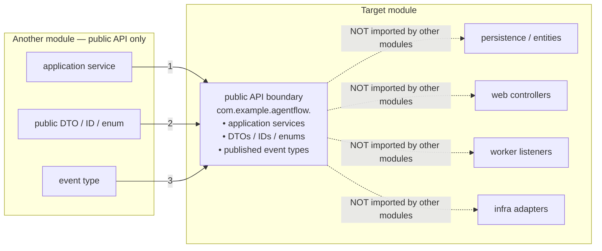

# Module API Map — AgentFlow bounded contexts

> **Status:** Accepted
> **Owner:** engineering
> **Task:** `S02-04`
> **Upstream reference:** `AGENTFLOW_ARCHITECTURE_AND_PLAN.md` (§4.2, §5, §6, §7,
> §9) · `docs/architecture/module-map.md` (owners, dependency direction) ·
> `docs/domain-glossary.md` (canonical concept → shape → module) · root
> `AGENTS.md` (dependency rules, package layout, invariants) ·
> `apps/agentflow-app/AGENTS.md` (one module per table, `com.example.agentflow.<module>`)
> **Purpose:** the *public API* of every module — the application services,
> published event types and permitted DTOs through which modules, and the
> external clients, talk to AgentFlow; and the **internal packages** that must
> never be imported by another module. It is the concrete counterpart to the
> module map (`docs/architecture/module-map.md`): that document says *who owns*
> each table and rule, this one says *how another module reaches it* — only
> through the public boundary listed here.

---

## Scope

This document answers the Sprint 2 acceptance criterion for `S02-04`:

> Other modules must not need to import repositories or entities directly.

Every module exposes a **public API boundary** (its root package): the
application services (use cases), the event types it publishes, and the DTOs /
IDs / enums other modules and clients may reference. Everything else —
`persistence` repositories and entities, `web` controllers, Kafka `worker`
listeners, and infrastructure adapters — lives in an **internal package** that is
listed explicitly and is **not** part of the public API.

The package layout that enforces this (root `AGENTS.md`, applied by
`S02-07`) is:

```
com.example.agentflow.<module>/            ← public API boundary (this map)
├── domain/          pure model + invariants        internal
├── application/     use cases, transactions         PUBLIC application services + DTOs
├── web/             controllers + API DTOs          internal (public only via contracts/openapi)
├── persistence/     repositories, mappers, SQL       internal
└── worker/          Kafka listeners                 internal
```

A consumer of a module uses **only** its `application` services and public DTOs
/ events. Importing another module's `persistence`, `web`, `worker` or
`domain` types is the dependency-rule breach the architecture test
(`S02-08`/`S02-09`) rejects.

---

## Module public APIs

Each table lists:

- **Public application services** — the use cases other modules/clients invoke.
- **Published event types** — the versioned topics/envelopes this module
  produces (`agentflow.*.vN`); cross-referenced to `docs/architecture/events/README.md`.
- **Permitted public types** — DTOs, IDs and enums other modules may reference.
- **Internal packages** — the packages of this module that are **not** part of
  its public API and must not be imported.

### `identity` — tenant context, authorization policy

| Section | Contents |
|---|---|
| Public application services | `TenantContextResolver` — resolve tenant + verified actor **only** from the verified security context (HTTP `SecurityContext`) or a stored event re-checked against PostgreSQL; never from body/query/Kafka headers. `ClaimsToAuthoritiesMapper` — S04-04, the single place that maps the verified JWT's role claims into Spring Security authorities, validated against the `Permission` catalogue (deny-by-default, idempotent). `AccessMatrix` — S04-08, the endpoint access matrix (`EndpointRule`: HTTP `method` + Ant `pathPattern` under `/api/v1` → single required `Permission`); the single source of truth for the endpoint↔permission mapping consumed by `SecurityConfiguration` (least privilege, default-deny). `TenantService` — tenant lifecycle: create tenant, get tenant, set tenant `status`. |
| Published event types | none (the tenant is the trusted source; the `audit` module records the verified actor). |
| Permitted public types | `TenantContext` (`tenantId`, `actor` — the immutable value threaded explicitly through
  application services; `requiredScopes` is layered on by `TenantScope` in S04-07), `TenantSummaryDto`
  (`id`, `slug`, `status`), `Permission` (S04-04 catalogue, the single source of truth for authority ids
  used by `ClaimsToAuthoritiesMapper`, the S04-08 endpoint access matrix and the Keycloak realm roles):
  `workflow:read`, `workflow:write`, `workflow:activate`, `document:read`, `document:write`,
  `run:execute`, `run:approve`, `ops:dlq`. |
| Internal packages | `persistence.TenantRepository`, security `KeycloakOidcAdapter`, `web` controllers. |

### `agentcatalog` — agents, model policy, tool allowlist

| Section | Contents |
|---|---|
| Public application services | `AgentProfileService` — create/activate agent profiles, pin the active version (`unique (tenant_id, name, version)`; active version immutable). `ToolPolicyService` — model policy, tool allowlist, tool risk classes; the allow/deny check. `ToolRegistryService` — deterministic in-memory registry; reject duplicate `id`/`version` and any dynamic registration by the LLM or user. |
| Published event types | none. |
| Permitted public types | `AgentProfileDto` (`id`, `tenantId`, `name`, `modelProvider`, `modelName`, `toolPolicyRef`, `budgetPolicyRef`, `version`, `status`), `ToolDescriptorDto` (`id`, `name`, `version`, `requiredScopes`, `timeoutMs`, `riskClass`, `approvalRequired`), `ToolRiskClass` (enum: `READ_ONLY`, `WRITE`, `EXTERNAL_SIDE_EFFECT`), `PolicyRef`. |
| Internal packages | `persistence.AgentProfileRepository`, `persistence.ToolDefinitionRepository`, model-policy internals. |

### `workflowdefinition` — versioned graph, validation, activation

| Section | Contents |
|---|---|
| Public application services | `WorkflowDefinitionService` — create/list/get a definition (`unique (tenant_id, name)`). `WorkflowVersionService` — create a version (`graph_json` + checksum), get version; activated version is immutable. `GraphValidationService` — validate the DSL/graph: allowed typed node types, no cycles, no arbitrary user code (`ADR-005`). |
| Published event types | none (activation is local; the mutation is audited). |
| Permitted public types | `WorkflowDefinitionDto` (`id`, `tenantId`, `name`, `description`), `WorkflowDefinitionPageDto` (`items[]`, `page`, `size`, `totalElements`, `totalPages`, `hasNext`, `hasPrevious`) — the list page (S03-14), `WorkflowVersionDto` (`id`, `workflowId`, `version`, `graphJson`, `checksum`, `status`), `GraphValidationResult` (`valid`, `violations[]`), node-type enum (`RETRIEVE_CONTEXT`, `LLM_PLAN`, `TOOL_CALL`, `HUMAN_APPROVAL`, `LLM_EVALUATE`, `FINALIZE`). |
| Internal packages | `persistence.WorkflowDefinitionRepository`, `persistence.WorkflowVersionRepository`, graph-model internals. |

### `workflowexecution` — run/step state machine, lease, approvals

| Section | Contents |
|---|---|
| Public application services | `RunService` — create run (idempotent via `idempotencyKey`), get run (status/history/result/events), cancel. `RunStateMachineService` — the **single** transition service: conditional update + optimistic lock + `workflow_events` record in one transaction; transitions never set from a controller/listener. `LeaseService` — atomic claim, heartbeat, release with `lease_epoch` fencing; recovery job for expired leases. `ApprovalService` — approval lifecycle, `payload_fingerprint` binding, idempotent `approve`/`reject` decision (`run:approve`). `IdempotencyKeyService` — create-run idempotency. `StepHandler` — the execution SPI **port** owned by this module (`S02-03` edge 14–17). |
| Published event types | `agentflow.workflow.run-requested.v1` (key `tenantId:runId`, API/outbox → worker) · `agentflow.workflow.step-ready.v1` (key `tenantId:runId`, engine → worker) · `agentflow.workflow.run-cancelled.v1` (key `tenantId:runId`) · `agentflow.workflow.run-finished.v1` (key `tenantId:runId`, worker → downstream). |
| Permitted public types | `RunDto` (`runId`, `tenantId`, `workflowVersionId`, `status`, `attempt`, `nextActionAt`), `StepDto` (`runId`, `stepKey`, `status`, `attempt`, `inputHash`), `RunStatus` / `StepStatus` enums, `CreateRunRequest` (`idempotencyKey`), `CancelRunRequest`, `ApprovalDto` (`id`, `tenantId`, `runId`, `stepKey`, `status`, `payloadFingerprint`, `expiry`), `ApprovalDecision` (`run:approve`). |
| Internal packages | `persistence.RunRepository`, `persistence.StepRepository`, `persistence.ApprovalRepository`, `worker.*` Kafka listeners, recovery scheduler. |

### `toolexecution` — typed tool registry, permission/budget check, results

| Section | Contents |
|---|---|
| Public application services | `ToolExecutionService` — permission/budget check → invoke → JSON Schema result validation; never dynamic registration. `ToolRegistryService` — resolve a tool by name/version, expose its risk class and required scopes. |
| Published event types | none (tool allow/deny/execute is written to the audit trail, not published as a domain event). |
| Permitted public types | `ToolExecutionContext` (minimal, tenant-scoped: `tenant`, `actor`, `run`, `step`, `correlationId` — no secrets), `ToolExecutionResultDto` (validated result + schema version), `ToolExecutionOutcome` (enum: `ALLOWED`, `DENIED`, `EXECUTED`). Implements the `StepHandler` port (depends on `workflowexecution` only to implement that port). |
| Internal packages | per-tool adapters, tool infrastructure adapters. |

### `knowledgebase` — documents, access policy, tenant/ACL-filtered search, citations

| Section | Contents |
|---|---|
| Public application services | `KnowledgeBaseService` — create/list/get a knowledge base (`unique (tenant_id, name)`). `DocumentService` — upload (store object to object storage + outbox `object_key` + `sha256`), get document, lifecycle (`UPLOADED → QUEUED → PROCESSING → INDEXED`). `RetrievalService` — tenant/ACL-filtered vector (pgvector) + FTS hybrid search with the tenant/ACL predicate **inside** the query (before top-k); builds citations only from real retrieved chunks — empty retrieval reports `InsufficientEvidence`, never invented citations. |
| Published event types | none (the `indexed` event is published by `ingestion`). |
| Permitted public types | `KnowledgeBaseDto` (`id`, `tenantId`, `name`, `status`), `DocumentDto` (`id`, `tenantId`, `objectKey`, `mimeType`, `sizeBytes`, `sha256`, `status`, `pipelineVersion`), `ChunkDto` (`id`, `pageFrom`, `pageTo`, `score`, `content` redacted), `CitationDto` (`documentId`, `chunkId`, page/section, `score`), `SearchRequest`, `SearchResult` (`chunks[]`, `citations[]`), `InsufficientEvidence` (error marker). |
| Internal packages | `persistence.*` repositories, object-storage (`Garage`) client. |

### `ingestion` — extract → chunk → embed → index, retry, idempotency

| Section | Contents |
|---|---|
| Public application services | `IngestionService` — extract (Tika/PDFBox) → chunk → embed (via the `ai` embedding port) → index (PostgreSQL + pgvector + FTS); retries; ingestion idempotency keyed by `tenant_id + sha256 + pipeline_version`. |
| Published event types | `agentflow.document.ingestion-requested.v1` (key `tenantId:documentId`, API/outbox → ingestion worker) · `agentflow.document.indexed.v1` (key `tenantId:documentId`, ingestion worker → API/workflow consumers). |
| Permitted public types | `IngestionStatusDto` (`documentId`, `status`, `pipelineVersion`), `IngestionEventKey` (`tenantId`, `documentId`). |
| Internal packages | extractors/chunkers, `worker.*` Kafka listener (consumer of `ingestion-requested`), embedding adapters (depend on the `ai` embedding port). |

### `ai` — model provider adapter, planner, validation gate, finalizer

| Section | Contents |
|---|---|
| Public application services / ports | `ChatModelPort` / `EmbeddingPort` — single provider adapter behind a port (a second provider is an isolated later change). `Planner` — schema-constrained structured output; a **planner**, never an authorization authority (`ADR-006`). `ValidationGate` — server-side DAG / permission / tool / budget / step-limit check before execution; cyclic / over-limit / unknown plans never reach the executor. `Executor` — runs only validated steps through the tool registry. `Finalizer` — writes the result with citations and cost metrics; terminal state. |
| Published event types | none (the run terminal state publishes through `workflowexecution` / outbox). |
| Permitted public types | `PlannerPlanDto` (typed JSON plan from allowed node types only), `PlanValidationResult` (`valid`, `violations[]`), `ModelProviderRef` (`modelProvider`, `modelName`). |
| Internal packages | provider-specific adapters, prompt templates (`resources/ai.*`). |

### `usage` — token/cost metering, budgets, quotas

| Section | Contents |
|---|---|
| Public application services | `UsageMeteringService` — record a token/cost measurement (`estimated` vs provider-reported, cost is `NUMERIC`/Decimal, never float). `BudgetService` — budget reservation that blocks the next operation when exceeded, settled idempotently; per-tenant quota / concurrency accounting in PostgreSQL (Redis only for auxiliary rate limiting). |
| Published event types | none. |
| Permitted public types | `UsageRecordDto` (`id`, `tenantId`, `runId`, `stepRunId`, `provider`, `model`, `inputTokens`, `outputTokens`, `estimatedCost`, `currency`), `BudgetDto` (`tenantId`, `period`, `maxRuns`, `maxTokens`, `maxCost`), `BudgetCheckResult` (`allowed`, `reason`). |
| Internal packages | `persistence.UsageRepository`, `persistence.BudgetRepository`. |

### `audit` — security/business audit events, immutable append-only history

| Section | Contents |
|---|---|
| Public application services | `AuditService` — write an immutable append-only record (actor, tenant, action, resource, outcome, correlationId, redacted metadata) in one transaction or via a controlled outbox. |
| Published event types | none. |
| Permitted public types | `AuditEvent` — the immutable, append-only value type persisted as one `audit_events` row (`id`, `tenantId`, `actorSubject`, `action`, `resourceType`, `resourceId`, `outcome`, `correlationId`, `metadataRedacted`, `createdAt`), plus the `AuditAction` / `AuditResourceType` / `AuditOutcome` enums. All four live in the `domain` package (the value types are the only public surface the `workflowdefinition`/`toolexecution` modules cross, together with the `AuditService` port). |
| Internal packages | `persistence.AuditRepository`. |

### `messaging` — outbox, inbox, envelope/versioning, publisher/consumer, DLQ

| Section | Contents |
|---|---|
| Public application services / ports | `OutboxPort` — write domain state and the outbox record in one transaction; idempotent publish by `event_id`. `InboxPort` — consumer-side dedup written in the same transaction as the business change, implemented by `InboxDedupService` (S06-10): a single transaction that claims an event by inserting its `(consumer_name, event_id)` row (the composite `PRIMARY KEY` rejects a duplicate delivery), runs the business change in the same transaction, and on success marks the row `PROCESSED` (fenced to `PENDING`). A transient failure rolls the whole claim-and-change transaction back, so nothing is marked `PROCESSED` and the event is re-delivered for a fresh claim; a bounded local retry (default `agentflow.inbox.max-attempts=3`; a single savepoint re-rolled before each attempt, S06-10) retries the change per attempt, rolling the partial change back while the claim row is kept, then records the row `FAILED` (never `PROCESSED`) for the retry / DLQ policy (S06-11). `InboxConsumerAction` — the functional interface a consumer passes as the business change; `InboxConsumeResult` — the `OTHER_CLAIMED` / `PROCESSED` / `FAILED` outcome returned; `InboxMessage` — the `(consumer_name, event_id, status, attempts, next_attempt_at, last_error, outcome, processed_at, created_at)` row model. `OutboxPublisherService` — the `S06-07` polling publisher: drains the transactional outbox in bounded, oldest-first batches without holding a database transaction across a network call; claims rows atomically (`UPDATE ... SET status = 'CLAIMED', publish_attempts = publish_attempts + 1, claimed_at = now() WHERE id = ANY(?) AND status IN ('PENDING', 'CLAIMED', 'FAILED') AND (status <> 'CLAIMED' OR claimed_at <= now() - (INTERVAL '1 second' * ?))` — a live publisher claims PENDING/FAILED rows; a CLAIMED row is only re-claimed after the stale-claim timeout — so two concurrent publishers never claim the same row) and publishes each claimed row through the transport-agnostic `MessageDeliverer` port, recording `SENT` / bounded-retry `FAILED` (never exactly-once, invariant 6). Configurable via `AgentFlowProperties.Outbox.Publisher` (`batch-size`, `max-attempts`, `base-delay-seconds`, `max-delay-seconds`, and `claim-timeout-seconds` — the window after which a `CLAIMED` row is considered stale and re-published). `MessageDeliverer` — the outbound delivery port (the Kafka adapter is wired in `S06-09`); optional, so a poll with no adapter is a no-op. It reports `DELIVERED` (broker confirmed the envelope), `TRANSIENT_FAILURE` (retry at a bounded-backoff instant), `AMBIGUOUS` (the broker did not confirm — re-publish at a bounded-backoff instant: duplicate-but-not-loss, S06-08) and `PERMANENT_FAILURE` (held terminal for the DLQ, `S06-11`). `EventPublisher` / `EventConsumer` — publish/consume the versioned envelope. `DlqService` — dead-letter for investigation, not unbounded retry. `WorkflowEventService` — append a run/step transition to the append-only history (glossary §6, `workflow_events`) and replay a run's event history (`historyByRun`) so the run's state can be reconstructed (S05-09). The append is transactional with the state change (S05-11); the service has no transaction of its own and fails loudly when no database is configured (S01-02). |
| Published event types | **Owner of all `agentflow.*` topics.** The six from `AGENTFLOW_ARCHITECTURE_AND_PLAN.md` §7: `run-requested`, `step-ready`, `run-cancelled`, `run-finished` (key `tenantId:runId`); `ingestion-requested`, `indexed` (key `tenantId:documentId`). |
| Permitted public types | `EventEnvelope` (`eventId`, `eventType`, `schemaVersion`, `occurredAt`, `tenantId`, `aggregateType`, `aggregateId`, `correlationId`, `causationId`, `payload`), `TopicName` / `EventType` (versioned `…vN`), `EventKey` (`tenantId:<aggregateId>`), `WorkflowEvent` (the append-only domain fact persisted as one `workflow_events` row: `id`, `tenantId`, `runId`, `stepRunId`, `eventType` (TEXT), `payloadRedacted`, `occurredAt`) — the durable run/step history, distinct from the Kafka envelope. |
| Internal packages | Kafka publisher/consumer implementations, `application.OutboxPublisherService` (the `S06-07` polling publisher) and its `MessageDeliverer` delivery port, `application.InboxDedupService` (S06-10) and its `InboxConsumerAction` / `InboxConsumeResult`, poller, DLQ routing, broker config, `domain.InboxMessage`, `persistence.InboxMessageRepository`, `persistence.InboxMessageRowMapper`, `persistence.OutboxEventRepository`, `persistence.OutboxEventRowMapper`, `persistence.WorkflowEventRepository`, `persistence.WorkflowEventRowMapper`. |

### `observability` — cross-cutting meters, traces, structured JSON logging

| Section | Contents |
|---|---|
| Public surface | `MeterRegistry` wiring, trace/correlation attribute helpers, structured JSON logging with secret masking. Not a domain module — it offers cross-cutting helpers consumed by every module. |
| Published event types | none. |
| Permitted public types | bounded metric names (category labels only, never `tenantId`/`runId`/`userId`/`documentId`), `traceId`/`spanId` in logs/traces. |
| Internal packages | OpenTelemetry / Micrometer adapters. |

---

## How this map satisfies the acceptance criterion



A plain-language caption: *the solid arrows are the only sanctioned ways for
another module (or client) to reach a target module — through its public API
boundary: an application service, a permitted DTO/ID/enum, or a published event
type. The dashed arrows are forbidden: no module imports another module's
`persistence` repositories/entities, `web` controllers, `worker` Kafka listeners
or infra adapters. That is exactly what the architecture test (`S02-08`/`S02-09`)
enforces — the boundary here, and the dependency table in
[`module-map.md`](./module-map.md), are the same rule described twice.*

The three public surfaces map to the module map's ownership:

- **Application services** are where a module's business rules live; they are
  the only entry point that applies the tenant/ACL check, the state machine,
  the lease/fencing, the tool allowlist, the budget or the validation gate —
  the rule is owned and enforced by one module, reached by all through its port.
- **Published event types** are the cross-process boundary (Kafka). They are
  versioned (`topic.vN`), envelope-wrapped, and `tenantId` carries only for
  routing/correlation — the consumer still re-checks ownership against
  PostgreSQL. The `messaging` module owns the envelope and topic namespace.
- **Permitted DTOs / IDs / enums** are the canonical identifiers from the domain
  glossary (`runId`, `documentId`, `ToolDescriptor`, `Citation`, …). They are
  API/presentation types, distinct from persistence objects (`apps/` AGENTS.md:
  "API DTO ≠ persistence object").

---

## Verification

This is a **documentation-only** change (`S02-04`), so there is no `./gradlew
check` gate to point to. It is verified by:

- **Cross-references resolve.** Every relative link in this file points to a
  document that exists (the module map, the glossary, the system context, the
  `docs/` and `contracts/` indexes) or is marked `⚠ planned` for a not-yet-
  created doc (`docs/architecture/events/README.md`, `S06`) and is not linked.
- **Owner consistency.** The module → concept → table/owner triples match
  `docs/architecture/module-map.md` (S02-03) and the glossary's §13 authority
  table (one concept — one name).
- **Dependency-rule coverage.** The internal packages listed for each module are
  exactly the types the architecture test (`S02-08`/`S02-09`) forbids other
  modules from importing; the boundary diagram encodes this as the acceptance
  criterion.
- **`git diff --check`** passes (no trailing whitespace / whitespace errors).

---

## Related

- [`module-map.md`](./module-map.md) — bounded contexts, ownership, allowed
  dependency edges (the *who owns* counterpart to this *how to reach* map).
- [`domain-glossary.md`](../domain-glossary.md) — canonical concept → shape →
  module; the DTOs, IDs and enums here are anchored to it.
- [`system-context.md`](./system-context.md) — C4 Level 1: externals, trust
  boundaries, trust flows.
- Domain glossary §1 — **Tenant context** / §2 — **Permission scope**: the
  tenant context and JWT claim → permission-scope mapping that every public
  service above enforces (permission scope never replaces the per-resource
  tenant/ownership check).
- **`events/README.md`** — event catalogue, topics, partition keys, envelope
  fields, retry/DLQ (`⚠ planned`, `S06`).
- `contracts/openapi/` — machine-readable `/api/v1` OpenAPI contract (S03-12),
  generated deterministically from the running application and checked in;
  request/response schemas are added per endpoint as it is implemented
  (S03-13+), and the scheme for the secured endpoints is declared now.
- `AGENTFLOW_ARCHITECTURE_AND_PLAN.md` — Sprint 2, `S02-04`.
