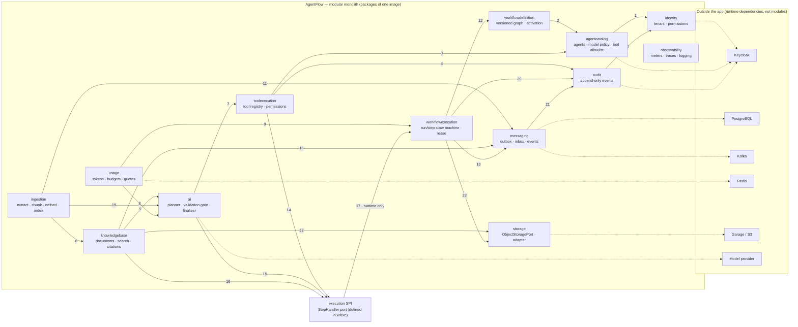

# Module Map — AgentFlow bounded contexts

> **Status:** Accepted
> **Owner:** engineering
> **Task:** `S02-03`
> **Upstream reference:** `AGENTFLOW_ARCHITECTURE_AND_PLAN.md` (§4, §4.2, §6,
> Sprint 2) · `docs/domain-glossary.md` (concept → owner, §13) · root
> `AGENTS.md` (dependency rules & invariants) · `apps/agentflow-app/AGENTS.md`
> (one module per table)
> **Purpose:** the C4 Level 2 *module map* of AgentFlow — the bounded contexts,
> the responsibility of each, the direction of the allowed dependencies, and the
> single owner of every table and every business rule. It is the ground truth
> the architecture tests (S02-08/S02-09) check against, and the counterpart to the
> C4 Level 1 *system context* (`system-context.md`) above and the threat model
> (`docs/threat-model/`) below.

---

## Scope

This document answers two questions the Sprint 2 gate requires:

1. **Ownership of data.** Every table has exactly one owning module — another
   module may *read* a table through its public API, but only one module may
   own it, write its migrations, and define its schema.
2. **Ownership of behaviour.** Every business rule / invariant has exactly one
   owning module. Cross-cutting rules are owned by one module for the *definition*
   of the rule and applied (enforced) everywhere the rule reaches.

Tables and their owners are anchored to the canonical identifiers in the domain
glossary (`docs/domain-glossary.md`, §13). The package-by-feature skeleton (`S02-07`) now lives in
`apps/agentflow-app/src/main/java/com/example/agentflow/<module>/`; each table moves into a
migration owned by its owner (S03), and the owner recorded here is the authority for the migration
name and comment too (`apps/agentflow-app/AGENTS.md`).

---

## Bounded contexts

A plain-language caption: *the thirteen packages sit behind the trusted
AgentFlow boundary (Level 1). The solid arrows are the only allowed compile-time
dependencies between modules — every other dependency (Keycloak, PostgreSQL,
Kafka, Redis, object storage, the model provider) is a runtime dependency of
exactly one package, not a module edge. The dashed feedback arrow is the one
sanctioned exception: `workflowexecution` owns the `StepHandler` execution port,
and the packages that execute steps (`toolexecution`, `ai`, `knowledgebase`)
depend on that port so the orchestrator never depends on them back. `storage` is
the one module that owns **bytes**: its root package is the provider-neutral
contract, its internal packages are the Garage adapter, and the domain modules
that store or read objects (`knowledgebase`, `workflowexecution`) use only the
root contract — never the adapter or the AWS SDK.*

---

## Module responsibilities

From the plan's logical modules (§4.2). "Outgoing" lists the module's real
dependencies that are not another app module (its runtime dependencies); the
allowed `module -> module` edges are the numbered arrows above and the table in
[Dependency direction](#dependency-direction).

| Module | Responsibility | Outgoing deps |
|---|---|---|
| `identity` | tenant context, claims → permissions mapping, the trusted source of tenant | Keycloak (OIDC/JWT), Spring Security |
| `agentcatalog` | agent profiles, model policy, tool allowlist, tool risk classes | `identity`, PostgreSQL |
| `workflowdefinition` | versioned workflow graph, DSL/graph validation, activation | `agentcatalog` |
| `workflowexecution` | run/step state machine, lease + fencing, recovery, idempotency keys, approvals, `StepHandler` port | `common` (error taxonomy, fingerprint, redaction), `workflowdefinition`, messaging (outbox/inbox), `audit` (approval decisions, arrow 20), `storage` (public contract — large-payload checkpoints, arrow 23) |
| `toolexecution` | typed tool registry (in-memory `ToolRegistry`; register at startup, deduplicate on `name`/`version`, no dynamic registration), permission/budget check, timeout, JSON Schema-validated results | `agentcatalog`, `audit`, `workflowexecution` (SPI) |
| `knowledgebase` | document metadata, access policy, tenant/ACL-filtered chunk search, citations | `ai` (embedding port: chunk embedding `S10-12`, query embedding `S10-14`), `messaging` (outbox, `S10-06`), `storage` (public contract — upload/read object bytes) |
| `ingestion` | extract → chunk → embed → index, retry, ingestion idempotency | `knowledgebase`, messaging, `ai` (embedding port, arrow 19); object bytes via `knowledgebase`'s `DocumentPayloadStore` — never `storage` directly |
| `storage` | provider-neutral `ObjectStoragePort` contract (object references/metadata, checksums) — in code at `S07-06B` — and the Garage adapter that implements it (`S07-06C` put + `S07-06D` get + `S07-06E` head/list/delete landed, `S07-06F`/`S07-06H` pending); owns the physical objects in Garage · contract [`object-storage.md`](./object-storage.md) (`S02-19`) · consistency/security/lifecycle policy [ADR-024](../adr/ADR-024-object-storage.md) (`S02-20`) — both consumers (`knowledgebase`, `workflowexecution`) use the contract, never the adapter | `AWS SDK for Java v2` (external), Garage S3 API (external); **no app-module dependencies** — no imports from another module, ever |
| `ai` | model provider adapter, Planner, validation gate, executor, finalizer | `toolexecution` (tool port), `workflowexecution` (SPI), model provider |
| `usage` | token/cost metering, budget reservation + settlement, quotas | `ai`, `workflowexecution` |
| `audit` | security/business audit events, immutable append-only history | `common` (redaction), `identity` |
| `messaging` | outbox, inbox, event envelope/versioning, publisher/consumer, DLQ | `common` (redaction), PostgreSQL, Kafka, `audit` (DLQ inspection audit, arrow 21) |
| `observability` | domain meters, trace attributes, correlation, structured JSON logging + secret masking | `common` (redaction), Micrometer, OpenTelemetry |

---

## Data ownership — tables and owners

One owning module per table. The `workflow_definition_versions`,
`workflow_runs`, `approvals`, `audit_events` tables and the activated workflow
version are **immutable** once written (a new version replaces a change); the
owner is responsible for forward-only migrations only.

| Table | Owning module | Notes |
|---|---|---|
| `tenants` | `identity` | `(id, slug, status, created_at)`; the tenant is the unit of separation |
| `agent_profiles` | `agentcatalog` | `unique (tenant_id, name, version)`; active version immutable |
| `tool_definitions` | `toolexecution` | `tenant_id` nullable for global tools |
| `workflow_definitions` | `workflowdefinition` | `unique (tenant_id, name)` |
| `workflow_definition_versions` | `workflowdefinition` | `unique (workflow_id, version)`; `graph_json` + checksum, immutable when activated |
| `workflow_runs` | `workflowexecution` | `unique (tenant_id, idempotency_key)`; lease/fencing fields |
| `workflow_step_runs` | `workflowexecution` | `unique (run_id, step_key, attempt)`; `output_ref` (large-payload checkpoint, `S07-07`) points at an object in Garage — the row keeps only the reference/checksum/size, the bytes live in `storage` |
| `workflow_events` | `messaging` | append-only domain facts |
| `outbox_events` | `messaging` | DB outbox; state + outbox record in one transaction |
| `inbox_messages` | `messaging` | PK `(consumer_name, event_id)`; dedup in the same transaction as the business change |
| `knowledge_bases` | `knowledgebase` | `unique (tenant_id, name)` |
| `documents` | `knowledgebase` | metadata row; payload stays in object storage (`object_key` + `sha256`) — the bytes are owned by `storage`, the row is owned by `knowledgebase` |
| `document_chunks` | `knowledgebase` | `unique (document_id, chunk_index, pipeline_version)`; embedding + tenant filter; `search_vector` (generated `tsvector`, FTS index) |
| `approvals` | `workflowexecution` | immutable-payload-bound pause point; `payload_fingerprint` binds the decision |
| `usage_records` | `usage` | money is `NUMERIC`; `estimated` vs provider-reported |
| `tenant_budgets` | `usage` | reservation that blocks the next operation when exceeded |
| `audit_events` | `audit` | append-only; no secrets, no full prompts |

> The `common` package is a **non-ownership** home for shared primitives
> (IDs, `Clock`, the error taxonomy, secret redaction) — by rule it holds no
> business logic and owns no business table. See "Cross-cutting" below.

---

## Business-rule ownership — invariants and rules

Every invariant in the root `AGENTS.md` and every rule in the glossary has one
owning module. For cross-cutting rules the owner defines the rule; every module
that touches the relevant data **applies** it (the definition has one owner, the
enforcement is everywhere).

| Business rule / invariant | Owning module | Where it is applied |
|---|---|---|
| Tenant context — tenant only from the verified security context, never from body/query/Kafka | `identity` | every module on every read/write/search/event |
| Claims → permissions mapping; permission scope (`workflow:read`, …) | `identity` | every module on every side effect |
| Tenant scope enforcement — `(tenant_id, resource_id)` read, tenant filter is part of the query | `identity` (policy) | every module (re-checked against PostgreSQL by workers) |
| Agent profile versioning + immutability; which model an agent uses | `agentcatalog` | `workflowexecution` pins the agent via the definition |
| Tool registry + allowlist + risk class; unknown tool/risk denied by default | `toolexecution` | at every tool call; never dynamic by the model/user |
| Tool permission, budget, timeout, JSON Schema result validation | `toolexecution` | before/after each call |
| Workflow definition versioning + activation; activated version never changes | `workflowdefinition` | `workflowexecution` runs a pinned version |
| Workflow DSL / graph validation; allowed typed node types; no cycles, no user code | `workflowdefinition` | at create/validate/activate |
| Run/step state machine — transitions only through the single transition service | `workflowexecution` | never from a controller/listener |
| Lease / fencing / heartbeat / recovery (`lease_epoch`) | `workflowexecution` | every worker write |
| Idempotency key (create-run) | `workflowexecution` | `POST /api/v1/workflows/{id}/runs` |
| Approval lifecycle + fingerprint binding (`run:approve`, `Idempotency-Key`) | `workflowexecution` | decision written to the audit trail |
| Cost budget reservation + settlement; quota/concurrency accounting | `usage` | before expensive calls; Redis only for auxiliary rate limiting |
| At-least-once delivery + idempotency (no end-to-end exactly-once promise) | `messaging` | outbox, inbox, commit/ack gap |
| Event envelope + versioning; DLQ for investigation | `messaging` | every producer/consumer |
| Document lifecycle + tenant-scoped object-key convention | `knowledgebase` | ingestion/RAG |
| Retrieval tenant/ACL filter **before** top-k; citations only from real chunks | `knowledgebase` | every RAG call; empty retrieval reports "insufficient evidence" |
| Object storage contract + physical-object ownership | `storage` | every byte storage (`knowledgebase` for documents, `workflowexecution` for large-payload checkpoints); `storage` never parses document state — it only moves bytes |
| Extract → chunk → embed → index pipeline; ingestion idempotency (`tenant_id + sha256 + pipeline_version`) | `ingestion` | on upload/re-upload |
| AI: untrusted planner, server-side validation gate, executor, result with citations | `ai` | before every execution |
| Append-only audit immutability; no secrets/full prompts | `audit` | every audited action |
| Structured JSON logging + secret masking; `traceId`/`spanId` | `observability` | everywhere (via the encoder/masker) |
| Error taxonomy + retryability (retry only for transient classes) | `common` (taxonomy) | every module classifies its own errors by it |
| No high-cardinality IDs/labels in metrics (`tenantId`, `runId`, …) | `observability` | every meter |
| Secrets management — never in Git, build args, logs, metrics, traces, prompts | cross-cutting | every module; governance via `identity`/security |

---

## Storage ownership and boundaries

`storage` is a logical module (the 13th bounded context): a provider-neutral
`ObjectStoragePort` contract plus the Garage adapter that implements it. The
contract is fixed in [`object-storage.md`](./object-storage.md) (`S02-19`) — the
five operations, the value types, the stream-ownership and idempotency rules and
the provider-neutral error policy. It is the **single owner** of both the contract
and the adapter — one module owns one responsibility, and the adapter is an internal
implementation detail of that module, never a shared dependency. Nothing outside
this module may reach the bytes.

**What storage owns.**

- The provider-neutral contract: `ObjectStoragePort` (`put` / `get/openStream` /
  `head` / paginated `list` / `delete`), the request/response value types, and
  `ObjectReference` (bucket, key, content type, size, SHA-256) — the contract
  lives in the `storage` root package (its public API boundary).
- The Garage adapter (`GarageS3Adapter`): the one class family that talks to the
  AWS SDK for Java v2 / Garage S3 API.
- The physical objects in Garage: no other module may read or write them — every
  object access flows through the contract, and metadata lives in the consuming
  module's PostgreSQL rows, never in the object itself (no secrets, no document
  text, no PII in object metadata).

**What storage never owns.**

- No tables, no repositories, no status state machine: the document lifecycle is
  `knowledgebase`'s, the checkpoint/`output_ref` lifecycle is `workflowexecution`'s.
  `storage` never parses a document, a step outcome or a run state — it moves
  bytes and reports what happened.
- No metadata rows of any kind: `documents` (owned by `knowledgebase`) and
  `workflow_step_runs.output_ref` (owned by `workflowexecution`) carry the
  ref + checksum + size; the bytes live in Garage, owned by `storage`.

**Allowed consumers — and the only ones.** `knowledgebase` (document originals:
upload/read/delete of the object behind a `documents` row) and
`workflowexecution` (large-payload checkpoint outputs, the `S07-07` path). Both
consume the public contract through their own application services — for
`knowledgebase` the `DocumentPayloadStore` opt-in read port and the upload path;
for `workflowexecution` the checkpoint adapter. **No other module** may depend on
`storage`: `ingestion` reads the object bytes through `knowledgebase`'s
`DocumentPayloadStore` (never through `storage` directly), and every other
module is a non-consumer (it has nothing to store). These are the only two
sanctioned edges into `storage`.

**Dependency direction and the adapter boundary.** The consumer → `storage` edges
are the only arrows *into* `storage`. `storage` depends on nothing in the
application — not even imported from another module (the contract is
provider-neutral and `storage` itself has no application dependencies). The
adapter sub-package (`com.example.agentflow.storage.adapter`) is internal to the
module: no other module may import it or any AWS SDK / Garage class — not at
compile time, not as a transitive reference. The architecture test
(`StorageBoundaryTest`) enforces this: a domain module importing the adapter, the
AWS SDK, or a Garage type fails `./gradlew check`. `storage`'s root package never
imports the adapter or AWS SDK either — the public contract is provider-neutral.

**Metadata vs. bytes (the ownership split).** The metadata row is owned by the
consuming module; the object is owned by `storage`:

| Object kind | Metadata row (owner) | Bytes (owner) |
|---|---|---|
| Document original | `documents` (`knowledgebase`): `object_key`, `sha256`, `size_bytes`, `mime_type`, `pipeline_version` | `storage` (Garage) |
| Workflow large-payload checkpoint | `workflow_step_runs.output_ref` (`workflowexecution`): ref + checksum + size + `output_schema_version` | `storage` (Garage) |

The object key is always server-generated and tenant-scoped (`knowledgebase`
generates it for documents; `workflowexecution` for checkpoint artifacts);
`storage` stores what it is told. The tenant scope is enforced by the owning
module against PostgreSQL *before* the port is called — the adapter never
decides access, it only moves bytes (the storage access policy is fixed in
[`ADR-024`](../adr/ADR-024-object-storage.md), `S02-20`; the adapter's `put` and `get` paths landed
with `S07-06C`/`S07-06D`, the remaining operations with `S07-06E`…`S07-06H`).

---

## Dependency direction

The numbered arrows in the diagram are the **only** allowed compile-time `module -> module`
edges, as tabulated below. They follow the plan's §4.2 "outgoing dependencies"
column and the glossary's ownership, plus the ADR-recorded later edges (18, `ADR-015`;
19, `ADR-016`; 20, `ADR-018`), the storage ownership edges (22, 23 — `S02-18`) and the
`S12-11` DLQ audit edge (21, `ADR-022`). Everything else is a runtime dependency of
a single package (Keycloak, PostgreSQL, Kafka, Redis, object storage, the
model provider) and is **not** a module edge.

| # | Edge | Why |
|---|---|---|
| 1 | `agentcatalog -> identity` | an agent profile carries the tenant/permission context |
| 2 | `workflowdefinition -> agentcatalog` | a definition pins which agent/model it uses |
| 3 | `toolexecution -> agentcatalog` | tool allowlist and risk class live in the agent catalogue |
| 4 | `toolexecution -> audit` | tool allow/deny/execute is an audited action |
| 5 | `knowledgebase -> ai` | the embedding port is owned by `ai` |
| 6 | `ingestion -> knowledgebase` | ingestion indexes into the knowledge base |
| 7 | `ai -> toolexecution` | the Planner's tool calls go through the tool port |
| 8 | `usage -> ai` | usage meters the AI provider cost |
| 9 | `usage -> workflowexecution` | usage records a run's tokens/cost |
| 10 | `audit -> identity` | the audit event carries the verified actor/tenant |
| 11 | `ingestion -> messaging` | ingestion is driven by outbox/inbox events |
| 12 | `workflowexecution -> workflowdefinition` | a run executes a pinned, validated version |
| 13 | `workflowexecution -> messaging` | a run/step transition publishes through the outbox port |
| 18 | `knowledgebase -> messaging` | the upload enqueues `ingestion-requested` through the transactional outbox port (S10-06; ADR-015) |
| 19 | `ingestion -> ai` | the pipeline embeds chunk sets through the neutral embedding port (`EmbeddingGenerationService`; S10-12; ADR-016) |
| 20 | `workflowexecution -> audit` | the human-approval decision is written to the append-only audit trail in the same transaction as the decision (S11-04; ADR-018) |
| 21 | `messaging -> audit` | the DLQ inspection audit is written through the public `AuditService` port — a `READ` on the operator `DLQ` resource (S12-11; ADR-022) |
| 22 | `knowledgebase -> storage` | the document object is stored/read/deleted through the public storage contract — the metadata row stays in PostgreSQL (`S02-18`) |
| 23 | `workflowexecution -> storage` | large-payload checkpoint outputs are externalized through the public storage contract (`S07-07`; `S02-18`) |
| 14–16 | `toolexecution -> workflowexecution`, `ai -> workflowexecution`, `knowledgebase -> workflowexecution` | **the execution SPI**: these packages implement the `StepHandler` port that `workflowexecution` owns (open decision §4) |
| 17 | `workflowexecution -> toolexecution/ai/knowledgebase` | **runtime only**, via the SPI (never a compile edge) |

### The execution SPI is the only feedback path (no cycles)

`workflowexecution` orchestrates tool, AI and knowledge-base steps, but it must
**not** depend on those packages at compile time or the graph cycles (`S02-09`,
root `AGENTS.md` dependency rules). The resolution (plan open decision §4.2.3):

- `workflowexecution.executor` defines a narrow `StepHandler<StepType>` port.
- `toolexecution`, `ai` and `knowledgebase` provide the implementation and
  depend on `workflowexecution` **only** to implement that port.
- `workflowexecution` selects the handler at runtime (a registry keyed by node
  type). The dependency for orchestration is therefore the **reverse** of the
  compile edge: the implementers depend on the port owner, and the orchestrator
  stays independent.

### Consequences

- A new `module -> module` edge requires an ADR (root `AGENTS.md`; ADR for a new
  dependency between modules).
- The architecture test (`S02-08`/`S02-09`, ArchUnit or Spring Modulith) rejects
  any edge outside the table above and any cycle through `StepHandler`.
- Domain modules never import another module's `web` controllers, Kafka
  listeners or infrastructure classes — only the root package's public API.

---

## Cross-cutting packages

- **`common`** — shared primitives with no business logic: IDs, `Clock`, the
  error taxonomy (`S02-10`), secret redaction. It owns no business table and is
  not an escape route for business rules.
- **`observability`** — meters, trace attributes, the trace/log conventions and the
  structured JSON logging / secret masking. Owns the metric catalogue and the
  "no high-cardinality labels" rule. (The one trace-context builder consumed across the
  messaging boundary — `MessagingTracing` — lives in `messaging.application`; the conventions
  and the catalogue stay here.)

---

## How this map is verified

- **Architecture tests (S02-08/S02-09).** An artificial violation of the
  dependency table (`ArchitectureBoundaryTest`, `S02-08`) or a created cycle
  (`NoCyclicModuleDependenciesTest`, `S02-09`) fails `./gradlew check` — the test
  is the enforcement, not a code review note. `S02-08` rejects any compile edge
  outside the table above; `S02-09` additionally rejects any cycle in the compile
  graph, so even a newly added (table-allowed) edge that would close a loop is
  caught.
- **Storage boundary (S02-18).** `StorageBoundaryTest` rejects a direct import of
  the Garage adapter (`com.example.agentflow.storage.adapter.*`) or of AWS SDK /
  Garage classes by any domain module, and rejects the storage root package
  importing the adapter or AWS SDK — the contract stays provider-neutral while
  the adapter stays private. Both are enforced at `./gradlew check`.
- **Table ownership in migrations.** Every table belongs to one module; this is
  obvious from the migration name/comment (`apps/agentflow-app/AGENTS.md`).
- **Glossary consistency (§13).** The concept → owner table in the domain
  glossary matches this owner table; a divergence is the same drift the glossary
  forbids (one concept — one name).
- **One source of truth.** `docs/AGENTS.md` links to this map instead of
  restating ownership; a change to a module, package, table, event or permission
  updates this doc, the matching `contracts/` and the relevant `AGENTS.md`.

---

## Related

- [`system-context.md`](./system-context.md) — C4 Level 1: externals, trust boundaries, trust flows.
- [`domain-glossary.md`](../domain-glossary.md) — canonical names; concept → owner (§13) matches this map.
- [`docs/threat-model/README.md`](../threat-model/README.md) — assets, attacker goals, mitigations (tenant isolation, prompt injection, SSRF).
- **`durable-execution.md`** — run/step state machine, lease, recovery.
- [`error-taxonomy.md`](./error-taxonomy.md) — error classes and retryability (S02-10).
- **`kafka-topics.md`** — topics, partition keys, topics & partition keys (`S06-02`).
- **`events/README.md`** — event catalogue, topics, partition keys, envelope, at-least-once +
  idempotency, retry/DLQ and the safe-contract-change rules (`S06-16`).
- `AGENTFLOW_ARCHITECTURE_AND_PLAN.md` — Sprint 2, `S02-03`.
