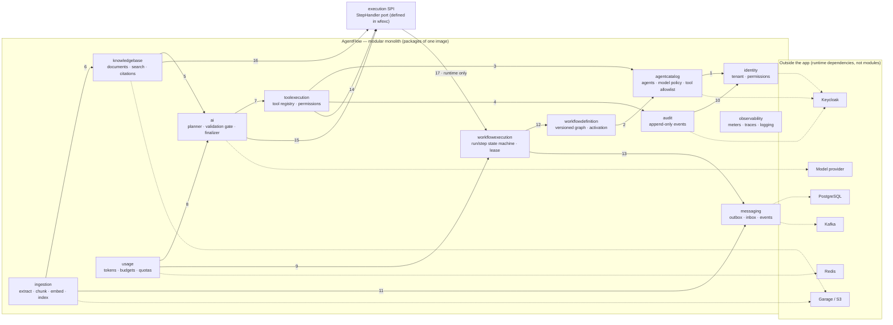

# Module Map — AgentFlow bounded contexts

> **Status:** Accepted
> **Owner:** engineering
> **Task:** `S02-03`
> **Upstream reference:** `AGENTFLOW_ARCHITECTURE_AND_PLAN.md` (§4, §4.2, §6,
> Sprint 2) · `docs/domain-glossary.md` (concept → owner, §13) · root
> `AGENTS.md` (dependency rules & invariants) · `apps/agentflow-app/AGENTS.md`
> (one module per table)
> **Purpose:** the C4 Level 2 *module map* of AgentFlow — the bounded contexts,
> the responsibility of each, the direction of the allowed dependencies, and the
> single owner of every table and every business rule. It is the ground truth
> the architecture tests (S02-08/S02-09) check against, and the counterpart to the
> C4 Level 1 *system context* (`system-context.md`) above and the threat model
> (`docs/threat-model/`) below.

---

## Scope

This document answers two questions the Sprint 2 gate requires:

1. **Ownership of data.** Every table has exactly one owning module — another
   module may *read* a table through its public API, but only one module may
   own it, write its migrations, and define its schema.
2. **Ownership of behaviour.** Every business rule / invariant has exactly one
   owning module. Cross-cutting rules are owned by one module for the *definition*
   of the rule and applied (enforced) everywhere the rule reaches.

Tables and their owners are anchored to the canonical identifiers in the domain
glossary (`docs/domain-glossary.md`, §13). When the package-by-feature skeleton
is built (`S02-07`) the tables move into migrations that one module owns; the
owner recorded here is the authority for the migration name and comment too
(`apps/agentflow-app/AGENTS.md`).

---

## Bounded contexts

A plain-language caption: *the twelve packages sit behind the trusted
AgentFlow boundary (Level 1). The solid arrows are the only allowed compile-time
dependencies between modules — every other dependency (Keycloak, PostgreSQL,
Kafka, Redis, object storage, the model provider) is a runtime dependency of
exactly one package, not a module edge. The dashed feedback arrow is the one
sanctioned exception: `workflowexecution` owns the `StepHandler` execution port,
and the packages that execute steps (`toolexecution`, `ai`, `knowledgebase`)
depend on that port so the orchestrator never depends on them back.*

---

## Module responsibilities

From the plan's logical modules (§4.2). "Outgoing" lists the module's real
dependencies that are not another app module (its runtime dependencies); the
allowed `module -> module` edges are the numbered arrows above and the table in
[Dependency direction](#dependency-direction).

| Module | Responsibility | Outgoing deps |
|---|---|---|
| `identity` | tenant context, claims → permissions mapping, the trusted source of tenant | Keycloak (OIDC/JWT), Spring Security |
| `agentcatalog` | agent profiles, model policy, tool allowlist, tool risk classes | `identity`, PostgreSQL |
| `workflowdefinition` | versioned workflow graph, DSL/graph validation, activation | `agentcatalog` |
| `workflowexecution` | run/step state machine, lease + fencing, recovery, idempotency keys, `StepHandler` port | `workflowdefinition`, messaging (outbox/inbox) |
| `toolexecution` | typed tool registry, permission/budget check, timeout, JSON Schema-validated results | `agentcatalog`, `audit`, `workflowexecution` (SPI) |
| `knowledgebase` | document metadata, access policy, tenant/ACL-filtered chunk search, citations | `ai` (embedding port), object storage |
| `ingestion` | extract → chunk → embed → index, retry, ingestion idempotency | `knowledgebase`, messaging |
| `ai` | model provider adapter, Planner, validation gate, executor, finalizer | `toolexecution` (tool port), `workflowexecution` (SPI), model provider |
| `usage` | token/cost metering, budget reservation + settlement, quotas | `ai`, `workflowexecution` |
| `audit` | security/business audit events, immutable append-only history | `identity` |
| `messaging` | outbox, inbox, event envelope/versioning, publisher/consumer, DLQ | PostgreSQL, Kafka |
| `observability` | domain meters, trace attributes, correlation, structured JSON logging + secret masking | Micrometer, OpenTelemetry |

---

## Data ownership — tables and owners

One owning module per table. The `workflow_definition_versions`,
`workflow_runs`, `approvals`, `audit_events` tables and the activated workflow
version are **immutable** once written (a new version replaces a change); the
owner is responsible for forward-only migrations only.

| Table | Owning module | Notes |
|---|---|---|
| `tenants` | `identity` | `(id, slug, status, created_at)`; the tenant is the unit of separation |
| `agent_profiles` | `agentcatalog` | `unique (tenant_id, name, version)`; active version immutable |
| `tool_definitions` | `toolexecution` | `tenant_id` nullable for global tools |
| `workflow_definitions` | `workflowdefinition` | `unique (tenant_id, name)` |
| `workflow_definition_versions` | `workflowdefinition` | `unique (workflow_id, version)`; `graph_json` + checksum, immutable when activated |
| `workflow_runs` | `workflowexecution` | `unique (tenant_id, idempotency_key)`; lease/fencing fields |
| `workflow_step_runs` | `workflowexecution` | `unique (run_id, step_key, attempt)` |
| `workflow_events` | `messaging` | append-only domain facts |
| `outbox_events` | `messaging` | DB outbox; state + outbox record in one transaction |
| `inbox_messages` | `messaging` | PK `(consumer_name, event_id)`; dedup in the same transaction as the business change |
| `knowledge_bases` | `knowledgebase` | `unique (tenant_id, name)` |
| `documents` | `knowledgebase` | metadata row; payload stays in object storage (`object_key` + `sha256`) |
| `document_chunks` | `knowledgebase` | `unique (document_id, chunk_index, pipeline_version)`; embedding + tenant filter |
| `approvals` | `workflowexecution` | immutable-payload-bound pause point; `payload_fingerprint` binds the decision |
| `usage_records` | `usage` | money is `NUMERIC`; `estimated` vs provider-reported |
| `tenant_budgets` | `usage` | reservation that blocks the next operation when exceeded |
| `audit_events` | `audit` | append-only; no secrets, no full prompts |

> The `common` package is a **non-ownership** home for shared primitives
> (IDs, `Clock`, the error taxonomy, secret redaction) — by rule it holds no
> business logic and owns no business table. See "Cross-cutting" below.

---

## Business-rule ownership — invariants and rules

Every invariant in the root `AGENTS.md` and every rule in the glossary has one
owning module. For cross-cutting rules the owner defines the rule; every module
that touches the relevant data **applies** it (the definition has one owner, the
enforcement is everywhere).

| Business rule / invariant | Owning module | Where it is applied |
|---|---|---|
| Tenant context — tenant only from the verified security context, never from body/query/Kafka | `identity` | every module on every read/write/search/event |
| Claims → permissions mapping; permission scope (`workflow:read`, …) | `identity` | every module on every side effect |
| Tenant scope enforcement — `(tenant_id, resource_id)` read, tenant filter is part of the query | `identity` (policy) | every module (re-checked against PostgreSQL by workers) |
| Agent profile versioning + immutability; which model an agent uses | `agentcatalog` | `workflowexecution` pins the agent via the definition |
| Tool registry + allowlist + risk class; unknown tool/risk denied by default | `toolexecution` | at every tool call; never dynamic by the model/user |
| Tool permission, budget, timeout, JSON Schema result validation | `toolexecution` | before/after each call |
| Workflow definition versioning + activation; activated version never changes | `workflowdefinition` | `workflowexecution` runs a pinned version |
| Workflow DSL / graph validation; allowed typed node types; no cycles, no user code | `workflowdefinition` | at create/validate/activate |
| Run/step state machine — transitions only through the single transition service | `workflowexecution` | never from a controller/listener |
| Lease / fencing / heartbeat / recovery (`lease_epoch`) | `workflowexecution` | every worker write |
| Idempotency key (create-run) | `workflowexecution` | `POST /api/v1/workflows/{id}/runs` |
| Approval lifecycle + fingerprint binding (`run:approve`, `Idempotency-Key`) | `workflowexecution` | decision written to the audit trail |
| Cost budget reservation + settlement; quota/concurrency accounting | `usage` | before expensive calls; Redis only for auxiliary rate limiting |
| At-least-once delivery + idempotency (no end-to-end exactly-once promise) | `messaging` | outbox, inbox, commit/ack gap |
| Event envelope + versioning; DLQ for investigation | `messaging` | every producer/consumer |
| Document lifecycle + tenant-scoped object-key convention | `knowledgebase` | ingestion/RAG |
| Retrieval tenant/ACL filter **before** top-k; citations only from real chunks | `knowledgebase` | every RAG call; empty retrieval reports "insufficient evidence" |
| Extract → chunk → embed → index pipeline; ingestion idempotency (`tenant_id + sha256 + pipeline_version`) | `ingestion` | on upload/re-upload |
| AI: untrusted planner, server-side validation gate, executor, result with citations | `ai` | before every execution |
| Append-only audit immutability; no secrets/full prompts | `audit` | every audited action |
| Structured JSON logging + secret masking; `traceId`/`spanId` | `observability` | everywhere (via the encoder/masker) |
| Error taxonomy + retryability (retry only for transient classes) | `common` (taxonomy) | every module classifies its own errors by it |
| No high-cardinality IDs/labels in metrics (`tenantId`, `runId`, …) | `observability` | every meter |
| Secrets management — never in Git, build args, logs, metrics, traces, prompts | cross-cutting | every module; governance via `identity`/security |

---

## Dependency direction

The arrows `1`–`13` in the diagram are the **only** allowed compile-time
`module -> module` edges. They follow the plan's §4.2 "outgoing dependencies"
column and the glossary's ownership. Everything else is a runtime dependency of
a single package (Keycloak, PostgreSQL, Kafka, Redis, object storage, the
model provider) and is **not** a module edge.

| # | Edge | Why |
|---|---|---|
| 1 | `agentcatalog -> identity` | an agent profile carries the tenant/permission context |
| 2 | `workflowdefinition -> agentcatalog` | a definition pins which agent/model it uses |
| 3 | `toolexecution -> agentcatalog` | tool allowlist and risk class live in the agent catalogue |
| 4 | `toolexecution -> audit` | tool allow/deny/execute is an audited action |
| 5 | `knowledgebase -> ai` | the embedding port is owned by `ai` |
| 6 | `ingestion -> knowledgebase` | ingestion indexes into the knowledge base |
| 7 | `ai -> toolexecution` | the Planner's tool calls go through the tool port |
| 8 | `usage -> ai` | usage meters the AI provider cost |
| 9 | `usage -> workflowexecution` | usage records a run's tokens/cost |
| 10 | `audit -> identity` | the audit event carries the verified actor/tenant |
| 11 | `ingestion -> messaging` | ingestion is driven by outbox/inbox events |
| 12 | `workflowexecution -> workflowdefinition` | a run executes a pinned, validated version |
| 13 | `workflowexecution -> messaging` | a run/step transition publishes through the outbox port |
| 14–16 | `toolexecution -> workflowexecution`, `ai -> workflowexecution`, `knowledgebase -> workflowexecution` | **the execution SPI**: these packages implement the `StepHandler` port that `workflowexecution` owns (open decision §4) |
| 17 | `workflowexecution -> toolexecution/ai/knowledgebase` | **runtime only**, via the SPI (never a compile edge) |

### The execution SPI is the only feedback path (no cycles)

`workflowexecution` orchestrates tool, AI and knowledge-base steps, but it must
**not** depend on those packages at compile time or the graph cycles (`S02-09`,
root `AGENTS.md` dependency rules). The resolution (plan open decision §4.2.3):

- `workflowexecution.executor` defines a narrow `StepHandler<StepType>` port.
- `toolexecution`, `ai` and `knowledgebase` provide the implementation and
  depend on `workflowexecution` **only** to implement that port.
- `workflowexecution` selects the handler at runtime (a registry keyed by node
  type). The dependency for orchestration is therefore the **reverse** of the
  compile edge: the implementers depend on the port owner, and the orchestrator
  stays independent.

### Consequences

- A new `module -> module` edge requires an ADR (root `AGENTS.md`; ADR for a new
  dependency between modules).
- The architecture test (`S02-08`/`S02-09`, ArchUnit or Spring Modulith) rejects
  any edge outside the table above and any cycle through `StepHandler`.
- Domain modules never import another module's `web` controllers, Kafka
  listeners or infrastructure classes — only the root package's public API.

---

## Cross-cutting packages

- **`common`** — shared primitives with no business logic: IDs, `Clock`, the
  error taxonomy (`S02-10`), secret redaction. It owns no business table and is
  not an escape route for business rules.
- **`observability`** — meters, trace attributes, correlation helpers and the
  structured JSON logging / secret masking. Owns the metric catalogue and the
  "no high-cardinality labels" rule.

---

## How this map is verified

- **Architecture tests (S02-08/S02-09).** An artificial violation of the
  dependency table or a created cycle fails `./gradlew check` — the test is the
  enforcement, not a code review note.
- **Table ownership in migrations.** Every table belongs to one module; this is
  obvious from the migration name/comment (`apps/agentflow-app/AGENTS.md`).
- **Glossary consistency (§13).** The concept → owner table in the domain
  glossary matches this owner table; a divergence is the same drift the glossary
  forbids (one concept — one name).
- **One source of truth.** `docs/AGENTS.md` links to this map instead of
  restating ownership; a change to a module, package, table, event or permission
  updates this doc, the matching `contracts/` and the relevant `AGENTS.md`.

---

## Related

- [`system-context.md`](./system-context.md) — C4 Level 1: externals, trust boundaries, trust flows.
- [`domain-glossary.md`](../domain-glossary.md) — canonical names; concept → owner (§13) matches this map.
- [`docs/threat-model/README.md`](../threat-model/README.md) — assets, attacker goals, mitigations (tenant isolation, prompt injection, SSRF).
- **`durable-execution.md`** — run/step state machine, lease, recovery (`⚠ planned`, `S07-17`).
- **`error-taxonomy.md`** — error classes and retryability (`⚠ planned`, `S02-10`).
- **`kafka-topics.md` / `events/README.md`** — topics, partition keys, event catalogue (`⚠ planned`, `S06`).
- `AGENTFLOW_ARCHITECTURE_AND_PLAN.md` — Sprint 2, `S02-03`.
