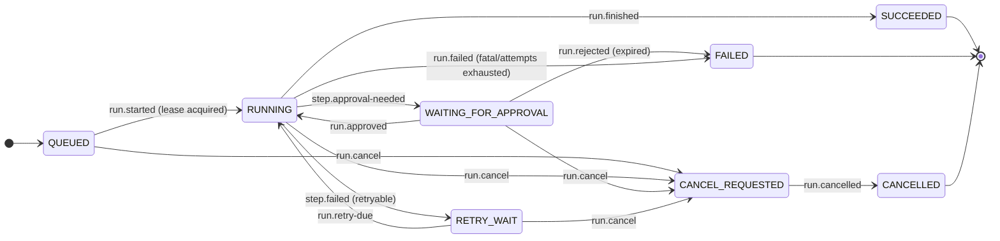

# Run State Machine — AgentFlow

> **Status:** Accepted
> **Owner:** `workflowexecution`
> **Task:** `S05-01`
> **Upstream reference:** `AGENTFLOW_ARCHITECTURE_AND_PLAN.md` (Sprint 5) ·
> `docs/domain-glossary.md` §5 (canonical run/step states and shapes) ·
> `docs/architecture/module-map.md` (state machine ownership, `ADR-002`…`ADR-004`) ·
> `docs/architecture/error-taxonomy.md` (retryable vs permanent, `cancellation` = 202)
> **Purpose:** the run-level state machine of `workflowexecution` — the set of run
> states, which of them are terminal, the transitions between them, and the event
> or command that triggers each one with its guard condition. This is the design
> that S05-01 formalizes; the Java enum and its `allowedTransition` logic are the
> downstream implementation (`S05-10`).

---

## 1. Run states

A run is one execution of a pinned workflow version against an input. Its lifecycle
is `QUEUED → RUNNING → SUCCEEDED`/`FAILED`/`CANCELLED`, with
`WAITING_FOR_APPROVAL`, `RETRY_WAIT` and `CANCEL_REQUESTED` as intermediate states
(`docs/domain-glossary.md` §5).

| State | Terminal | Meaning |
|---|---|---|
| `QUEUED` | No | The run was created and awaits a worker to claim it. |
| `RUNNING` | No | A worker holds the lease and is executing steps. |
| `WAITING_FOR_APPROVAL` | No | A `HUMAN_APPROVAL` node stopped the run; the worker lease is released while it waits. |
| `RETRY_WAIT` | No | A step failed with a retryable error; the run is in backoff before it is retried. |
| `SUCCEEDED` | **Yes** | Every step completed successfully. |
| `FAILED` | **Yes** | A step failed permanently, or a retry budget was exhausted, or an approval was rejected. |
| `CANCEL_REQUESTED` | No | Cancellation was requested; the run will move to `CANCELLED` once draining completes. |
| `CANCELLED` | **Yes** | The run was cancelled. |

Three terminal states: `SUCCEEDED`, `FAILED`, `CANCELLED`. A run never leaves a
terminal state (the transition table has no outgoing edge from any of them).

## 2. State diagram

A plain-language caption: *a new run starts `QUEUED`; a worker claims it (`run.started`)
and moves it to `RUNNING`. `RUNNING` branches into the two working pauses — a
human-approval gate (`WAITING_FOR_APPROVAL`) and a retry backoff (`RETRY_WAIT`) — and
into the two terminal outcomes, `SUCCEEDED` when every step completes and `FAILED`
on a permanent failure. Any of the four non-terminal states can be cancelled into
`CANCEL_REQUESTED`, which then completes to the terminal `CANCELLED`.*

## 3. Transition table

Each transition below names the triggering **event/command** and the **condition**
(guard) that permits it. This is the S05-01 acceptance criterion — every transition
is driven by an explicit event or command, never by an assignment.

| # | From | To | Triggering event / command | Condition (guard) |
|---|---|---|---|---|
| 1 | `QUEUED` | `RUNNING` | `run.started` (event; the executor claims the run and acquires the lease) | A worker atomically claims a `QUEUED` run and receives a lease (`lease_owner`, `lease_until`, incremented `lease_epoch`). |
| 2 | `RUNNING` | `WAITING_FOR_APPROVAL` | `step.approval-needed` (event; a `HUMAN_APPROVAL` node reached) | A step reached a human-approval boundary. The worker lease is released while the run waits. |
| 3 | `WAITING_FOR_APPROVAL` | `RUNNING` | `run.approved` (event; approval decision, scope `run:approve`) | The pending approval was **approved** — idempotent, keyed by `Idempotency-Key`. |
| 4 | `WAITING_FOR_APPROVAL` | `FAILED` | `run.rejected` (event; approval decision *reject* or *expired*) | The pending approval was rejected or expired. Rejecting blocks the side effect, so the run fails rather than completes. |
| 5 | `RUNNING` | `RETRY_WAIT` | `step.failed` (event; a retryable transient error) | A step failed with a retryable error and `attempt < maxAttempts` (`error-taxonomy.md`, transient class). |
| 6 | `RETRY_WAIT` | `RUNNING` | `run.retry-due` (event; the scheduler fires on `next_action_at`) | The retry backoff elapsed and a worker re-claims the run. |
| 7 | `RUNNING` | `SUCCEEDED` | `run.finished` (event; all steps completed) | Every step in the run reached `SUCCEEDED` (reconciled with step-state aggregation, `S05-02`). |
| 8 | `RUNNING` | `FAILED` | `run.failed` (event; fatal / attempts exhausted) | A step failed permanently, `attempt >= maxAttempts`, or a non-retryable error occurred (`error-taxonomy.md`, permanent class). |
| 9 | `QUEUED` | `CANCEL_REQUESTED` | `run.cancel` (command; `POST /api/v1/runs/{runId}/cancel`) | The caller cancels a `QUEUED` run that has not yet started. |
| 10 | `RUNNING` | `CANCEL_REQUESTED` | `run.cancel` (command) | The caller cancels a `RUNNING` run; the worker drains/interrupts pending work. |
| 11 | `WAITING_FOR_APPROVAL` | `CANCEL_REQUESTED` | `run.cancel` (command) | The caller cancels an approval-paused run. |
| 12 | `RETRY_WAIT` | `CANCEL_REQUESTED` | `run.cancel` (command) | The caller cancels a run in retry-backoff. |
| 13 | `CANCEL_REQUESTED` | `CANCELLED` | `run.cancelled` (event; cancellation completes) | Pending steps drained/interrupted and the lease released. |

### Design notes on the transitions

- **Cancellation is two-phase and one-way.** A cancel never completes the run
  instantly; it first moves to `CANCEL_REQUESTED` (a visible "cancellation in
  flight" signal for the worker and recovery job) and then to the terminal
  `CANCELLED`. `CANCEL_REQUESTED` has a single outgoing edge (`→ CANCELLED`); there
  is no un-cancel in the MVP, so a cancelled run is final.
- **`WAITING_FOR_APPROVAL` can end in two ways.** An approved gate resumes the run
  (`run.approved`); a rejected or expired gate fails it (`run.rejected`, guard 4),
  because the blocked side effect must not execute.
- **Terminal states are absorbing.** Guards 1–13 list no transition *out of*
  `SUCCEEDED`, `FAILED` or `CANCELLED`; the Java enum models them as terminal so a
  second transition on the same run is a domain error (`S05-10`).

## 4. Interaction with the wider system

- **Run state is also reconciled against steps.** The transitions above are the
  primary driver, but the run terminal states (`SUCCEEDED`/`FAILED`) are also
  derived from step aggregation (`S05-02`): a run cannot be `SUCCEEDED` while a step
  is `RUNNING`, and cannot be `FAILED` while a step can still be retried. The single
  transition service makes both consistent (`S05-11`).
- **State changes through one service.** Every transition goes through the single
  transition service — a conditional update (`AND version = :expectedVersion`,
  optimistic lock → `409 Conflict`) plus one `workflow_events` row, in the same
  transaction (`ADR-002`…`ADR-004`). A controller or Kafka listener never sets the
  status directly (`S05-11`).
- **Each transition is a durable fact.** A run/step transition appends a
  `workflow_events` row (append-only, `messaging`) and publishes through the outbox
  port (`ADR-004`). The transition history lets a run's state be replayed
  (`S05-09`), and the retry/cancel transitions are observable for recovery.
- **Lease and fencing govern the working transitions.** Only the current lease owner
  may move a run (`lease_epoch` check on every write). A `RUNNING → RETRY_WAIT`,
  `RUNNING → WAITING_FOR_APPROVAL` or `RUNNING → SUCCEEDED/FAILED` issued by a stale
  worker is fenced (`workflowexecution` lease/fencing).
- **Retry and retry classification** follow the error taxonomy: only transient
  classes route through `RETRY_WAIT` (guards 5–6); permanent classes go straight to
  `FAILED` (guard 8).
- **The enum is the single definition.** The Java `WorkflowRunState` enum
  (`workflowexecution.domain`, `S05-10`) holds exactly these constants and classifies
  the three terminal states; the transition table is its documentation. The state
  diagram and table here are the source the enum implements — if they drift, the
  enum is wrong.

## 5. Related

- **Step states** — the analogous step-level state machine is documented in the
  step-state specification ([`step-state-machine.md`](step-state-machine.md), `S05-02`);
  run states are reconciled against it (§4).
- **Lease, fencing and recovery** — covered by `durable-execution.md`
  (`⚠ planned`, `S07-17`).
- **Workflow DSL and graph validation** — the node types, IDs, edges and DAG
  constraints a run executes are in `docs/workflows/dsl-v1.md` (`S05-17`).
- **The pure state machine** — the enum and its `allowedTransition` logic
  (`workflowexecution.domain`, DB-free, unit tested) are implemented in `S05-10`.
- **Transition service** — the single point where transitions are applied with the
  optimistic lock and the append-only event in `S05-11`.
