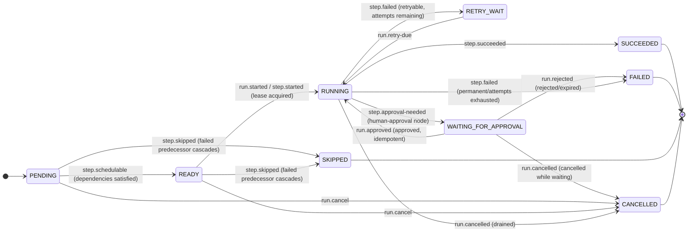

# Step State Machine — AgentFlow

> **Status:** Accepted
> **Owner:** `workflowexecution`
> **Task:** `S05-02`
> **Upstream reference:** `AGENTFLOW_ARCHITECTURE_AND_PLAN.md` (Sprint 5, `S05-02`; §8.1 data model) ·
> `docs/domain-glossary.md` §5 (canonical run/step states and shapes) ·
> `docs/architecture/run-state-machine.md` (run machine, `S05-01`, reconciled against this) ·
> `docs/architecture/error-taxonomy.md` (retryable vs permanent → `RETRY_WAIT` vs `FAILED`) ·
> `docs/architecture/module-map.md` (state machine ownership, `ADR-002`…`ADR-004`)
> **Purpose:** the step-level state machine of `workflowexecution` — the set of step states,
> which of them are terminal, the transitions between them, and the event or command that
> triggers each one with its guard condition. This is the design that `S05-02` formalizes; it
> also defines the rules that aggregate step states into the run state (the acceptance
> criterion). The Java `WorkflowStepState` enum (`workflowexecution.domain`, `S05-10`) is the
> downstream implementation.

---

## 1. Step states

A step is a single node execution within a run (`workflow_step_runs`, glossary §5). Its
lifecycle is `PENDING → READY → RUNNING → SUCCEEDED`, with `RETRY_WAIT`, `WAITING_FOR_APPROVAL`,
`SKIPPED` and `CANCELLED` as the alternative/terminal paths.

| State | Terminal | Meaning |
|---|---|---|
| `PENDING` | No | The step exists but has not been scheduled — it is waiting on its upstream dependencies (a parallel fan-out) or, for a root node, it is not yet released to the scheduler. |
| `READY` | No | All dependencies completed and the step is scheduled; it awaits a worker claiming it. |
| `RUNNING` | No | A worker holds the lease and is executing the step. |
| `WAITING_FOR_APPROVAL` | No | A `HUMAN_APPROVAL` node stopped the step; the run's lease is released while it awaits a human decision. Mirrors the run-level pause (`S05-01`). |
| `RETRY_WAIT` | No | The step failed with a retryable error; it is in backoff before a re-claim. |
| `SUCCEEDED` | **Yes** | The step completed successfully and its output reference was persisted. |
| `FAILED` | **Yes** | The step failed permanently, its retry budget was exhausted, or a policy check rejected it. |
| `SKIPPED` | **Yes** | The step will not execute — either a failed predecessor cascades the skip, or a conditional edge predicate was false (see §3). |
| `CANCELLED` | **Yes** | The step was cancelled while draining. |

Four terminal states for a step: `SUCCEEDED`, `FAILED`, `SKIPPED`, `CANCELLED`. A step never
leaves a terminal state (the transition table has no outgoing edge from any of them). The five
working states are `PENDING`, `READY`, `RUNNING`, `RETRY_WAIT`, `WAITING_FOR_APPROVAL`.

## 2. State diagram



A plain-language caption: *a new step starts `PENDING`; once its upstream dependencies
`SUCCEEDED` it becomes `READY` and a worker claims it (`step.started`, lease acquired) and moves
it to `RUNNING`. `RUNNING` ends in `SUCCEEDED`, or in `RETRY_WAIT` on a retryable error and back
to `RUNNING` on a retry, or in `FAILED` on a permanent failure, or — at a `HUMAN_APPROVAL` node —
in `WAITING_FOR_APPROVAL`, where the run's lease is released while a human decides and the step
resumes (`run.approved`) or fails (`run.rejected`). A step whose predecessor failed
is `SKIPPED`; any not-yet-started step (`PENDING`/`READY`) goes straight to `CANCELLED` and a
started step is cancelled after it drains.*

## 3. Transition table

Each transition below names the triggering **event/command** and the **condition** (guard) that
permits it.

| # | From | To | Triggering event / command | Condition (guard) |
|---|---|---|---|---|
| 1 | `PENDING` | `READY` | `step.schedulable` (event; the scheduler observes dependencies) | All upstream steps are `SUCCEEDED` (for a root node, immediately when the run starts). A parallel fan-out node becomes `READY` only when every parent is `SUCCEEDED`. |
| 2 | `READY` | `RUNNING` | `run.started`/`step.started` (event; a worker claims the step and acquires the lease) | A worker atomically claims a `READY` step and receives a lease (`lease_epoch` incremented). |
| 3 | `RUNNING` | `SUCCEEDED` | `step.succeeded` (event; the step completed) | The step completed and its output reference was persisted (`step.output_ref`). |
| 4 | `RUNNING` | `RETRY_WAIT` | `step.failed` (event; a retryable transient error) | The step failed with a retryable error and `attempt < maxAttempts` (`error-taxonomy.md`, transient class). |
| 5 | `RETRY_WAIT` | `RUNNING` | `run.retry-due` (event; the scheduler fires on `next_action_at`) | The retry backoff elapsed and a worker re-claims the step. |
| 6 | `RUNNING` | `FAILED` | `step.failed` (event; permanent) / `run.failed` | The step failed permanently, `attempt >= maxAttempts`, or a non-retryable error occurred (`error-taxonomy.md`, permanent class). |
| 7 | `PENDING` / `READY` | `SKIPPED` | `step.skipped` (event; a failed predecessor) | A step this one depends on reached `FAILED` (cascade) so it cannot run. See design note below. |
| 8 | `PENDING` / `READY` | `CANCELLED` | `run.cancel` (command; `POST /api/v1/runs/{runId}/cancel`) | The caller cancels a run whose step has not started draining; the step never ran. |
| 9 | `RUNNING` | `CANCELLED` | `run.cancelled` (event; cancellation completes) | The step's in-flight work was interrupted/drained and the lease released. |
| 10 | `RUNNING` | `WAITING_FOR_APPROVAL` | `step.approval-needed` (event; a `HUMAN_APPROVAL` node reached) | A step reached a human-approval boundary; the run also pauses (`S05-01`) and its lease is released. |
| 11 | `WAITING_FOR_APPROVAL` | `RUNNING` | `run.approved` (event; approval decision, scope `run:approve`) | The pending approval was **approved** — idempotent, keyed by `Idempotency-Key`; the step resumes. |
| 12 | `WAITING_FOR_APPROVAL` | `FAILED` | `run.rejected` (event; approval decision *reject* or *expired*) | The pending approval was rejected or expired. The blocked side effect must not execute, so the step fails. |
| 13 | `WAITING_FOR_APPROVAL` | `CANCELLED` | `run.cancelled` (event) | The run was cancelled while the step waited (its lease was already released). |

### Design notes on the transitions

- **Cancellation is two-phase for a step too.** A cancel moves a started step
  `RUNNING → CANCELLED` after draining/interruption; a not-yet-started step
  `PENDING`/`READY → CANCELLED` directly. `CANCELLED` is terminal; there is no un-cancel in the
  MVP, so a cancelled step is final.
- **`SKIPPED` has two causes.** (a) **Cascade** — a failed predecessor means a dependent step
  cannot run, so it is `SKIPPED` and the run is `FAILED`. This is the cause modelled here.
  (b) **Conditional guard** — a predecessor `SUCCEEDED` but the step's edge predicate was false,
  so the step is skipped without failing the run. Guard/conditional skips that do not fail the
  run are handled at scheduling; in this spec they are flagged as a refinement (see §5's
  aggregation, where a `SKIPPED` from a cascade drives `FAILED`).
- **Terminal states are absorbing.** Guards 1–13 list no transition *out of*
  `SUCCEEDED`, `FAILED`, `SKIPPED` or `CANCELLED`; the Java enum models them as terminal so a
  second transition on the same step is a domain error (`S05-10`).

## 4. Run-state aggregation

The run state is the primary driver, but its terminal states are **derived** from step
aggregation — a run cannot be `SUCCEEDED` while a step is `RUNNING`, and cannot be `FAILED` while
a step can still be retried. The single transition service makes both consistent (`S05-11`).

Aggregation is a **fold over the step-state multiset** of the run:

```
runState = aggregate( { step.status : step ∈ run.steps } )
```

The rules:

- **`RUNNING → SUCCEEDED`** is permitted **iff** every step is `SUCCEEDED` and no step is in a
  working state (`PENDING`/`READY`/`RUNNING`/`RETRY_WAIT`/`WAITING_FOR_APPROVAL`) and no step is
  `CANCELLED`. I.e. every step reached `SUCCEEDED`.
- **`RUNNING → FAILED`** is permitted when any step reached a terminal failure: a step `FAILED`
  (permanent/attempts exhausted), or a step `SKIPPED` via a failed-predecessor cascade (which
  implies an upstream permanent failure).
- **`RUNNING → CANCELLED`** is permitted once all non-terminal steps have drained to `CANCELLED`
  (or the `run.cancel` command is processed on a safe boundary); a step still `RUNNING`/
  `RETRY_WAIT`/`WAITING_FOR_APPROVAL` must be cancelled first.
- **Cancellation precedence.** A safe-boundary `cancel` wins over a pending retry: a step in
  `RETRY_WAIT` moves to `CANCELLED`, not back to `RUNNING` (`error-taxonomy.md`: `cancellation`
  short-circuits retries).

Concretely (reconciled with the run transition table, `run-state-machine.md` §3):

- Guard 7 (`RUNNING → SUCCEEDED: run.finished`) — "*every step reached `SUCCEEDED`*" is the step
  aggregation.
- Guard 8 (`RUNNING → FAILED: run.failed`) — "*a step failed permanently / attempts exhausted*"
  is the step aggregation.
- Guard 13 (`CANCEL_REQUESTED → CANCELLED: run.cancelled`) — "*pending steps drained and the
  lease released*" is the step aggregation.

## 5. Determinism of aggregation (acceptance criterion)

**Acceptance:** *the order of duplicate events does not change the final aggregation result.*

Aggregation is an **idempotent, order-independent fold** over the step-state multiset, where the
multiset is read from PostgreSQL (the source of truth, `ADR-002`). Two properties make the
acceptance criterion hold by construction:

1. **Order-independence.** The fold reads a *set* of step states, not an event log. Whether the
   events arrive as A→B or B→A, the resulting step-state multiset is identical, so `aggregate`
   yields the same run state.
2. **Idempotency.** Re-delivery of an event does not change the multiset:
   - Events are deduplicated by `event_id` in the outbox/inbox (`ADR-003`, at-least-once +
     idempotency); the business change and its inbox record write in the same transaction.
   - A step transition is applied through the single transition service (`S05-11`): a conditional
     update (`AND version = :expectedVersion`, optimistic lock → `409 Conflict`) plus one
     `workflow_events` row, in the same transaction. A transition out of a terminal state is
     rejected by the state machine (`S05-10`), so a duplicate `step.succeeded` on an
     already-`SUCCEEDED` step is a no-op — the multiset is unchanged.
   - The `attempt` is persisted **before** the external call (`ADR-003`); an ambiguous outcome
     marks the attempt and never flips a terminal state.

Therefore the final aggregated run state is a function of the *committed* step states only, never
of how many times or in what order their events were observed. We make **no exactly-once claim**:
an event may be delivered more than once, but idempotency plus terminal-state guards make the
aggregation invariant.

## 6. Reconciliation — the eight-state enumeration vs the glossary

This spec models **nine** step states — the eight enumerated in the `S05-02` task text plus a
step-level `WAITING_FOR_APPROVAL`. That extra state is **required** for the step machine to stay
consistent with the run machine (`S05-01`):

- The run-level `WAITING_FOR_APPROVAL` (`RUNNING → WAITING_FOR_APPROVAL: step.approval-needed`)
  **releases the run's lease** while a human decides. A step cannot stay `RUNNING` there — a
  worker holding a step would contradict the released lease and be fenced — so the approval-
  paused step must leave `RUNNING`. Parking it in `WAITING_FOR_APPROVAL` is the only consistent
  choice.
- The domain glossary §5 and the plan's §8.1 data model both list this step-level state, so the
  nine-state set is the one already fixed by the authoritative sources; the `S05-02` task text
  omits it in a condensed enumeration, but the acceptance criterion (aggregation determinism) is
  unaffected by the state count.
- Adopting it is a state-set decision already made by the glossary/§8.1, not a new contract or
  invariant change, so no ADR is required. The approval pause is modelled once, at the step
  level, and synchronized with the run level (`S05-01`).

## 7. Interaction with the wider system

- **Reconciled with the run machine.** This spec is the step-level counterpart of
  [`run-state-machine.md`](run-state-machine.md) (`S05-01`); run terminal states are derived from
  step aggregation (§4) so the two never disagree. The single transition service enforces
  consistency (`S05-11`).
- **State changes through one service.** Every step transition goes through the single
  transition service — a conditional update (`AND version = :expectedVersion`, optimistic lock →
  `409 Conflict`) plus one `workflow_events` row, in the same transaction (`ADR-002`…`ADR-004`). A
  controller or Kafka listener never sets the status directly (`S05-11`).
- **Lease and fencing govern the working transitions.** Only the current lease owner may move a
  step (`lease_epoch` check on every write). A stale worker's `RUNNING → SUCCEEDED`/`FAILED`/
  `RETRY_WAIT` is fenced. Lease/fencing/recovery are covered by the planned
  `durable-execution.md` (`⚠ planned`, `S07-17`).
- **Retry vs permanent.** Only transient classes route through `RETRY_WAIT` (guards 4–5);
  permanent classes go straight to `FAILED` (guard 6), per [`error-taxonomy.md`](error-taxonomy.md).
- **The enum is the single definition.** The Java `WorkflowStepState` enum (`workflowexecution.domain`,
  `S05-10`) holds exactly these constants and classifies the four terminal states; the transition
  table is its documentation. If the enum and this table drift, the enum is wrong.

## 8. Related

- **Run states** — the run-level machine this reconciles with ([`run-state-machine.md`](run-state-machine.md), `S05-01`).
- **Lease, fencing and recovery** — `durable-execution.md` (`⚠ planned`, `S07-17`).
- **The pure state machine** — the enum and its `canTransitionTo` logic (`workflowexecution.domain`, DB-free, unit tested) in `S05-10`.
- **Transition service** — the single point where transitions are applied with the optimistic lock and the append-only event (`S05-11`).
- **Retry vs permanent** — [`error-taxonomy.md`](error-taxonomy.md).
- **Canonical names** — [`docs/domain-glossary.md`](../domain-glossary.md) §5.
