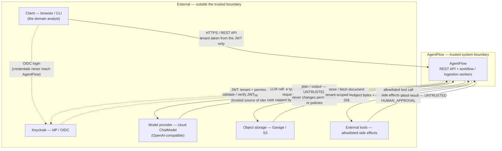

# System Context — AgentFlow

> **Status:** Accepted · **Owner:** engineering · **Task:** `S02-02`
> **Upstream reference:** `AGENTFLOW_ARCHITECTURE_AND_PLAN.md` (Sprint 2, `S02-02`)
> **Purpose:** the C4 Level 1 *system context* of AgentFlow — every external
> actor and system, the trust boundary around AgentFlow, and the directions of
> trust for the secrets and documents that cross it. This is the top-level
> context diagram that the architecture index links to; the module map
> (`docs/architecture/module-map.md`) and threat model
> (`docs/threat-model/`) go one level deeper.

---

## Context diagram

A plain-language caption: *the domain analyst works through a Client, is
authenticated by Keycloak (which is the only trusted source of tenant and
permission scopes), and talks to AgentFlow over HTTPS. AgentFlow calls a
cost-capped cloud model, stores documents in object storage, and invokes
allowlisted external tools — every output that crosses the trusted boundary is
treated as untrusted.*

---

## Legend

| Line | Meaning |
|---|---|
| solid `-->` | HTTPS / REST API and normal request/response traffic |
| dashed `-.->` | OIDC / JWT — identity and the trusted secret token |
| colour (see below) | output that crosses the boundary as **untrusted** content |

---

## External actors and systems

| Actor / system | Role with AgentFlow | Trust direction |
|---|---|---|
| **Client** (browser / CLI) | The domain analyst; starts logins, uploads, runs, approvals and queries. | Input is untrusted. The **tenant is never read from the request** — only from the verified JWT (`ADR-007`). |
| **Keycloak** (IdP / OIDC) | Authenticates the user, issues the JWT bearing `tenant_id` and permission scopes (`workflow:read`, `document:read`, `run:approve`, …). | **Trusted source of identity.** AgentFlow validates the issuer, audience and signature; credentials travel Client ↔ Keycloak only, never to AgentFlow. |
| **Model provider** (cloud ChatModel, OpenAI-compatible) | Receives a schema-constrained *plan request* and returns a plan. | **Untrusted planner.** Output is validated server-side (`ADR-006`) and can never change permissions, policies or allowlists. Cost is capped by the budget. |
| **Object storage** (Garage / S3) | Holds the original documents; the DB keeps only a ref + `SHA-256` checksum. | Large payloads leave the trusted DB; the object key is tenant-scoped and the checksum drives ingestion idempotency. |
| **External tools** (allowlisted side effects) | Registered, schema-validated actions with a risk class; side-effecting ones pause at a `HUMAN_APPROVAL` node. Results are **untrusted** input. | Calls are permission- and budget-checked before execution; tool credentials come from secret management, not from the model or request. |

Internal infrastructure — PostgreSQL (+ pgvector/FTS), Kafka and Redis — lives
**inside** the trusted boundary; it is the persistence/messaging layer, not an
external dependency of the context diagram.

---

## Trust boundaries and flows

- **The boundary.** Everything outside `AgentFlow` is untrusted. The single
  trusted input is the validated Keycloak JWT; there is no other path to a
  tenant, and another tenant's resource is indistinguishable from a missing one
  (`404`/`403`).
- **Secrets.** Credentials go Client ↔ Keycloak only. Keycloak hands AgentFlow a
  JWT (tenant + permission scopes), which is the *only* secret AgentFlow trusts
  for identity. Model and tool secrets are injected from secret management and
  never logged, never sent to the model, and never come from the request.
- **Documents.** The client uploads to AgentFlow, which stores the object in
  object storage under a tenant-scoped key and writes one DB row; on retrieval,
  tenant/ACL-filtered fragments are sent to the model as untrusted content.
  Large payloads never live in the database.
- **AI output.** The model proposes a plan; a server-side validation gate decides
  what is allowed. The model is never an authorization authority, and generated
  documents/fragments are content, not policy.

---

## Related

- [`product-scope`](../product-scope.md) — MVP boundaries and the one persona that drives them.
- [`domain-glossary`](../domain-glossary.md) — canonical names for the concepts that cross this boundary.
- [`threat-model/README.md`](../threat-model/README.md) — assets, attacker goals and mitigations (prompt injection, tenant isolation, SSRF, log leaks).
- **`architecture/module-map.md`** — the C4 Level 2 that decomposes AgentFlow into its bounded contexts, owners and dependency direction (S02-03).
- [`AGENTFLOW_ARCHITECTURE_AND_PLAN.md`](../../AGENTFLOW_ARCHITECTURE_AND_PLAN.md) — the target backlog (`S02-02`).
