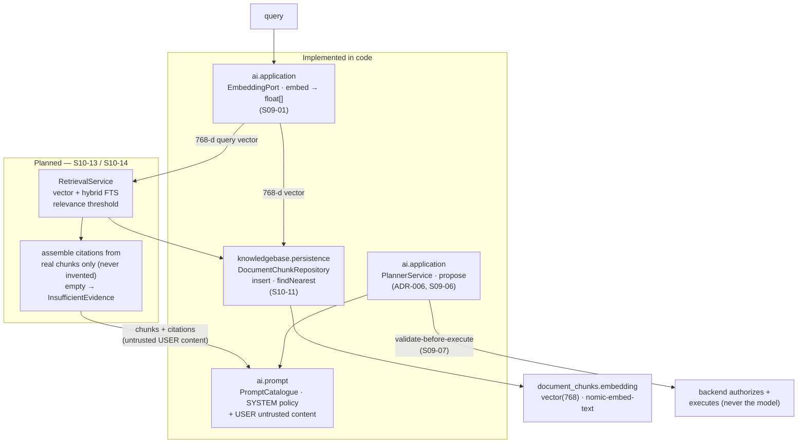

# `docs/rag/` — grounding answers in a tenant-scoped knowledge base

This document describes **retrieval-augmented generation (RAG)** in AgentFlow: how a model's
answer is grounded in a tenant's own indexed documents instead of the model's training data. It
separates what the code does today from what the plan fixes later, so a reader never mistakes a
planned step for an implemented one.

The shared terms live in [`domain-glossary.md`](../domain-glossary.md) (§7: *Retrieval*, *Citation*,
*Embedding*); the module boundaries that own each step live in
[`architecture/module-map.md`](../architecture/module-map.md) and
[`architecture/module-api.md`](../architecture/module-api.md).

> One source of truth: this document links to the classes and the other docs; it does not copy
> their behaviour. When a statement here and a linked document disagree, the code is the final word.

## What RAG is for AgentFlow

RAG has two directions that run at different times:

1. **Indexing (writing vectors).** A document is extracted and chunked (`ingestion`, `S10-09`), each
   chunk is embedded into a fixed-size vector (`ai` embedding port), and the chunk *and* its vector
   are written to the owning table (`knowledgebase`).
2. **Retrieval (reading vectors).** A user query is embedded the same way and matched against the
   tenant's stored vectors; the closest chunks are pulled back and fed to the model as *context*,
   and every claim the model makes is attributed to a real retrieved chunk (a *citation*).

Both directions are bound by three invariants that shape every line of the pipeline (see
*Invariants* below).

## The pipeline (implemented vs. planned)

The diagram separates the two. **Implemented** steps exist in code (`S10-11` storage + query
primitive, `S09` planner). **Planned** steps (`S10-13` / `S10-14`) are described in prose below and
are *not* yet in the code.

## Invariants that shape retrieval

- **Tenant isolation is in the query, not a post-filter (invariant 1).** The tenant comes only from
  the verified security context. The nearest-neighbour query puts `WHERE tenant_id = ?` *first*,
  before the distance ordering and the limit, so another tenant's chunk can never surface as a
  "close" match. A cross-tenant retrieval result set is empty, exactly as a cross-tenant lookup of
  any other resource is (`[ADR-007](../adr/ADR-007-tenant-isolation.md)`).
- **The model is an untrusted planner, and retrieved content is untrusted (invariant 7).** A model
  can never change its own permissions, policies or allowlist (`ADR-006`); retrieved document
  fragments are *prompt-injection surface* and are sent to the model as untrusted `USER` content,
  never as policy. Only **real retrieved chunks** are cited; an empty retrieval reports
  *insufficient evidence*, never an invented citation.
- **PostgreSQL is the source of truth (invariant 2).** The vector lives in the owning table with
  the chunk — there is no side table and no cache standing in for a missing run.
- **No secrets in observability (invariant 8).** The injected untrusted content (retrieved
  fragments) is never logged, hashed or otherwise exposed by the prompt layer; only the prompt
  *policy* version is observable.

## Implemented: the storage + query primitive (`S10-11`)

`S10-11` owns the two things the glossary calls *retrieval* that a database can do directly:

- **Storage** — `document_chunks.embedding`, a fixed-dimension `vector(768)` on the table `S10-10`
  created (migration `V3_3_20`, owner `knowledgebase`). The dimension is pinned here so the column
  rejects any embedding of a different width at the database layer — a mismatched insert fails,
  never a post-check. The column is **nullable**: a chunk is created during ingestion (`S10-09`)
  and may be indexed only later (`S10-13`), so a row can predate its vector; `vector(768)` still
  fixes the width of anything stored. The 768 dimensions belong to the `nomic-embed-text` model,
  whose id is pinned on `knowledge_bases.embedding_model` (`S10-05`).
- **The query primitive** — `knowledgebase.persistence.DocumentChunkRepository` (plain
  `JdbcTemplate` on Spring Data JDBC, `ADR-009`; registered only when a `DataSource` exists, so the
  app boots without a database). It does two things:
  - `insert(...)` persists a chunk row together with its 768-d embedding, bound as a pgvector text
    literal (`[v1,v2,…,vN]`, the PostgreSQL-array syntax pgvector 0.8.x parses) cast `::vector`.
  - `findNearest(tenantId, query, limit)` returns the closest chunks for one tenant in ascending
    distance order — `WHERE tenant_id = ? ORDER BY embedding <=> ?::vector LIMIT ?`. The stored
    vector is **not** selected, so no `vector` column needs a driver type adapter.

This adapter is the *primitive*; it persists and reads rows. It is **not** a retrieval service — it
does not combine vector with full-text search, apply a relevance threshold, or build citations
(those are the `S10-13` / `S10-14` layer, below).

## Embedding production (`S10-12` / `S10-13`)

A chunk's vector is produced through the neutral outbound port `ai.application.EmbeddingPort`
(embeddings are one `embed(EmbeddingRequest)` returning `float[]` per input; `ADR-014`). The
`ingestion` module produces the chunk set (`S10-09`), and the embedding generation service
(`S10-12`, `ingestion.application.embed.EmbeddingGenerationService`) batches the chunk texts to the
port (`agentflow.ingestion.embedding.batch-size`), preserves input order across batches and
validates every response (one vector per text, uniform width) before returning the aggregated
`EmbeddingBatchResult`. Provider rate limits and transient faults are retried by the `ai`
resilience layer (`ai.provider.ResilientEmbeddingModel` over `ProviderResiliencePolicy`), never by
the caller. The indexing path (`S10-13`) drives this service and writes the chunk row and its
vector in one step through `DocumentChunkRepository.insert`. The provider adapter is the only code
that knows the embedding SDK.

## Planned: the retrieval + grounding layer (`S10-13` / `S10-14`)

The following is the target the glossary §7 and `module-api.md` name; it is **not yet in the code**
(no `RetrievalService`, no `InsufficientEvidence`, no `CitationDto`, `SearchRequest`, `SearchResult`
or `ChunkDto`). This section describes those steps so the RAG guide is complete, not because they
run today.

- **Retrieval (`RetrievalService`).** Calls `DocumentChunkRepository.findNearest` for the vector
  half and a full-text search for the text half, then *hybrid* combines the two, applies a
  relevance threshold on top of the nearest-neighbour ordering, and scopes everything to one
  tenant. (Currently only the vector half exists; `document_chunks` has no FTS index yet.)
- **Citations.** Builds each citation from a *real* retrieved chunk — the response-field set the
  glossary names (`documentId`, `chunkId`, page/section, `score`). An empty retrieval returns
  `InsufficientEvidence`; the model never invents a citation.
- **Grounding the model.** Feeds the retrieved chunks and their citations to the planner as the
  untrusted `USER` content. The planner (`S09-06`) already separates a fixed `SYSTEM` policy from a
  single untrusted `USER` message (`ai.prompt.PromptCatalogue`); the retrieval layer is what fills
  that `USER` message with retrieved fragments. A model reference is never execution and never
  permission — the backend re-checks the tool registry and the caller's scopes before any step runs
  (`S09-07`).

## Verification

- **Implemented (`S10-11`).** The storage + query primitive is covered by the integration test
  `apps/agentflow-app/src/integrationTest/java/com/example/agentflow/knowledgebase/persistence/DocumentChunkRepositoryIT.java`
  (4 tests) and by `MigrationsTest` (the pgvector extension and the `embedding vector(768)` column)
  on `pgvector/pgvector:0.8.6-pg18` — the exact image Compose and Testcontainers use, never `H2`
  (`AGENTS.md`). `:apps:agentflow-app:check` is green (unit + architecture + formatting + OpenAPI).
- **Planned (`S10-13` / `S10-14`).** The retrieval + grounding layer must add its own integration
  tests on the same real-PostgreSQL image, covering the mandatory negative scenarios from
  `AGENTS.md`: tenant isolation (a cross-tenant query returns empty), prompt injection in a
  retrieved document, and **empty retrieval without invented citations**. These tests are a
  requirement of that step, not a claim about `S10-11`.

## Ownership and references

| Step | Owns | See |
|---|---|---|
| `embedding` column + nearest-neighbour primitive | `knowledgebase` | `DocumentChunkRepository`, migration `V3_3_20` |
| Embedding production (`float[]`) | `ai` | `EmbeddingPort` (`ADR-014`) |
| Planner (propose; never execute), prompt separation | `ai` | `PlannerService`, `PromptCatalogue` (`ADR-006`) |
| Citation value object | `toolexecution` | `Citation` (`S08-06`) |
| Planned retrieval service, citations, hybrid FTS | `knowledgebase` | `module-api.md`, glossary §7 |

- [`domain-glossary.md`](../domain-glossary.md) §7 — *Retrieval*, *Citation*, *Embedding* (shared
  terms, one concept — one name).
- [`architecture/module-map.md`](../architecture/module-map.md) — bounded contexts and owners.
- [`architecture/module-api.md`](../architecture/module-api.md) — the public API per module,
  including the planned retrieval types.
- [`architecture/document-lifecycle.md`](../architecture/document-lifecycle.md) — the
  `UPLOADED → QUEUED → PROCESSING → INDEXED` lifecycle a chunk and its embedding ride on.
- [`adr/ADR-006-untrusted-planner.md`](../adr/ADR-006-untrusted-planner.md),
  [`adr/ADR-007-tenant-isolation.md`](../adr/ADR-007-tenant-isolation.md),
  [`adr/ADR-009-…`](../adr/ADR-009-single-persistence-spring-data-jdbc.md) — the planner, tenant
  isolation and persistence invariants.
