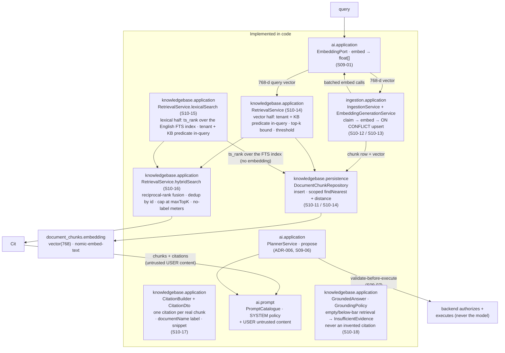

# `docs/rag/` — grounding answers in a tenant-scoped knowledge base

This document describes **retrieval-augmented generation (RAG)** in AgentFlow: how a model's
answer is grounded in a tenant's own indexed documents instead of the model's training data. It
separates what the code does today from what the plan fixes later, so a reader never mistakes a
planned step for an implemented one.

The shared terms live in [`domain-glossary.md`](../domain-glossary.md) (§8: *Retrieval*, *Citation*,
*Embedding*); the module boundaries that own each step live in
[`architecture/module-map.md`](../architecture/module-map.md) and
[`architecture/module-api.md`](../architecture/module-api.md).

> One source of truth: this document links to the classes and the other docs; it does not copy
> their behaviour. When a statement here and a linked document disagree, the code is the final word.

## What RAG is for AgentFlow

RAG has two directions that run at different times:

1. **Indexing (writing vectors).** A document is extracted and chunked (`ingestion`, `S10-09`), each
   chunk is embedded into a fixed-size vector (`ai` embedding port), and the chunk *and* its vector
   are written to the owning table (`knowledgebase`).
2. **Retrieval (reading vectors).** A user query is embedded the same way and matched against the
   tenant's stored vectors; the closest chunks are pulled back and fed to the model as *context*,
   and every claim the model makes is attributed to a real retrieved chunk (a *citation*).

Both directions are bound by three invariants that shape every line of the pipeline (see
*Invariants* below).

## The pipeline (implemented vs. planned)

The diagram separates the two. **Implemented** steps exist in code (`S10-11` storage + query
primitive, `S10-12` embedding batching, `S10-13` the indexing path, `S10-14` the tenant/ACL-
filtered vector retrieval service, `S10-15` the lexical (full-text) half over the PostgreSQL FTS
index, `S10-16` the hybrid rank fusion, `S10-17` citation assembly from real retrieved chunks only,
`S10-18` the no-evidence policy, `S09` planner).

## Invariants that shape retrieval

- **Tenant isolation is in the query, not a post-filter (invariant 1).** The tenant comes only from
  the verified security context. The nearest-neighbour query puts `WHERE tenant_id = ?` *first*,
  before the distance ordering and the limit, so another tenant's chunk can never surface as a
  "close" match. A cross-tenant retrieval result set is empty, exactly as a cross-tenant lookup of
  any other resource is (`[ADR-007](../adr/ADR-007-tenant-isolation.md)`).
- **The model is an untrusted planner, and retrieved content is untrusted (invariant 7).** A model
  can never change its own permissions, policies or allowlist (`ADR-006`); retrieved document
  fragments are *prompt-injection surface* and are sent to the model as untrusted `USER` content,
  never as policy. Only **real retrieved chunks** are cited; an empty retrieval reports
  *insufficient evidence*, never an invented citation.
- **PostgreSQL is the source of truth (invariant 2).** The vector lives in the owning table with
  the chunk — there is no side table and no cache standing in for a missing run.
- **No secrets in observability (invariant 8).** The injected untrusted content (retrieved
  fragments) is never logged, hashed or otherwise exposed by the prompt layer; only the prompt
  *policy* version is observable.

## Implemented: the storage + query primitive (`S10-11`)

`S10-11` owns the two things the glossary calls *retrieval* that a database can do directly:

- **Storage** — `document_chunks.embedding`, a fixed-dimension `vector(768)` on the table `S10-10`
  created (migration `V3_3_20`, owner `knowledgebase`). The dimension is pinned here so the column
  rejects any embedding of a different width at the database layer — a mismatched insert fails,
  never a post-check. The column is **nullable**: a chunk is created during ingestion (`S10-09`)
  and may be indexed only later (`S10-13`), so a row can predate its vector; `vector(768)` still
  fixes the width of anything stored. The 768 dimensions belong to the `nomic-embed-text` model,
  whose id is pinned on `knowledge_bases.embedding_model` (`S10-05`).
- **The query primitive** — `knowledgebase.persistence.DocumentChunkRepository` (plain
  `JdbcTemplate` on Spring Data JDBC, `ADR-009`; registered only when a `DataSource` exists, so the
  app boots without a database). It does two things:
  - `insert(...)` persists a chunk row together with its 768-d embedding, bound as a pgvector text
    literal (`[v1,v2,…,vN]`, the PostgreSQL-array syntax pgvector 0.8.x parses) cast `::vector`.
  - `findNearest(tenantId, knowledgeBaseId, query, limit)` returns the closest chunks for one
    tenant inside one knowledge base in ascending distance order — `WHERE c.tenant_id = ? AND
    d.knowledge_base_id = ? AND c.embedding IS NOT NULL ORDER BY c.embedding <=> ?::vector LIMIT ?`
    (the collection scope and the NULL-embedding exclusion are the `S10-14` evolution of the
    primitive). The cosine distance is selected as a plain `float8` column; the stored vector is
    **not** selected, so no `vector` column needs a driver type adapter.

This adapter is the *primitive*; it persists and reads rows. The retrieval service that drives it
(`S10-14`, below) adds the collection scope, the top-k bound and the relevance threshold on top.
The service also exposes the lexical half — `RetrievalService.lexicalSearch` over the S10-15 FTS
index, mirroring `findNearest` with `c.tenant_id = ?` and `d.knowledge_base_id = ?` before the
`@@` match and the limit — but the two halves still return independently. The fusion (`S10-16`) is
implemented, below; the citation layer (`S10-17`) is implemented below too; the no-evidence policy
(`S10-18`) is implemented below it. The indexing path that writes through it is `S10-13`,
implemented.

## Embedding production (`S10-12` / `S10-13`)

A chunk's vector is produced through the neutral outbound port `ai.application.EmbeddingPort`
(embeddings are one `embed(EmbeddingRequest)` returning `float[]` per input; `ADR-014`). The
`ingestion` module produces the chunk set (`S10-09`), and the embedding generation service
(`S10-12`, `ingestion.application.embed.EmbeddingGenerationService`) batches the chunk texts to the
port (`agentflow.ingestion.embedding.batch-size`), preserves input order across batches and
validates every response (one vector per text, uniform width) before returning the aggregated
`EmbeddingBatchResult`. Provider rate limits and transient faults are retried by the `ai`
resilience layer (`ai.provider.ResilientEmbeddingModel` over `ProviderResiliencePolicy`), never by
the caller. The indexing path (`S10-13`) drives this service and persists each chunk row with its
vector through `knowledgebase.application.ChunkIndexingService` — an `ON CONFLICT` upsert on the
`(document_id, chunk_index, pipeline_version)` unique key, so a redelivered event never duplicates
a chunk. The provider adapter is the only code that knows the embedding SDK.

## Implemented: the vector retrieval service (`S10-14`)

`knowledgebase.application.RetrievalService` is the read entry point: `search(tenantId,
knowledgeBaseId, SearchRequest)` resolves the collection's pinned `embedding_model`, embeds the
query through the `ai` `EmbeddingPort`, and returns the closest chunks as `ChunkDto`s inside a
`SearchResult` — with the access predicate inside the query and both bounds applied on top:

- **Tenant *and* collection scope, in the query.** `DocumentChunkRepository.findNearest` runs
  `WHERE c.tenant_id = ? AND d.knowledge_base_id = ?` (a `documents` join) before the distance
  ordering and the limit — a post-filter is never permitted, so another tenant's or another
  collection's chunk can never surface, no matter how close its embedding; a cross-tenant
  knowledge base is indistinguishable from a missing one and simply retrieves nothing. Rows with a
  `NULL` embedding (created, not yet indexed) are excluded, so an unindexed chunk never appears
  with a bogus zero distance.
- **Bounded.** A missing `topK` falls back to `agentflow.retrieval.default-top-k` (10), a caller
  `topK` is clamped to `max-top-k` (50), and candidates whose cosine distance exceeds `threshold`
  (0.5) are dropped. The distance arrives as a plain `float8` column computed in SQL — the stored
  `vector` is still never read back.
- **Opt-in seams.** With no database or no embedding provider the service still constructs (S01-02
  / `ADR-014`) and fails loudly at call time; the wiring lives in
  `knowledgebase.application.config.RetrievalConfiguration`.

The public vocabulary (`SearchRequest`, `SearchResult`, `ChunkDto`) is what the citation layer
extends, and the fragment text is untrusted content — never logged (invariants 7/8).

## Implemented: hybrid fusion (`S10-16`)

`RetrievalService.hybridSearch` runs the vector half (`S10-14`, `findNearest`) and the lexical half
(`S10-15`, `lexicalSearch`) independently and fuses the two partial results. The vector half runs
only when an embedding provider is configured (the `ai` `EmbeddingPort`); the lexical half runs over
the S10-15 FTS index whenever one is present, so a tenant without a model still returns the closest
chunks by `ts_rank` — the two halves are deliberately independent so neither is a single point of
failure. The fusion is score-based over *ranks*: each partial result is position-ranked, each chunk
receives `1 / (K + rank)` per half it appears in (reciprocal-rank fusion, K=1), the fused ids are
deduplicated by id, and the result is capped to `maxTopK`. The raw cosine distance and `ts_rank`
numbers are never compared or averaged — two incompatible score scales, so only their ranks combine.
An empty retrieval (both halves empty) returns an empty `SearchResult`; the model never invents a
citation (`S10-18`). The fused ids map back to their `ChunkDto`s; no metric carries a tenant,
document id, or chunk text (invariant 9; chunk content is untrusted, invariant 7/8).

## Implemented: citations (`S10-17`)

This is the implementation the glossary &sect;8 and `module-api.md` name for the citation
response-field set. It is implemented on top of the hybrid fusion (`S10-16`); the vector half
(`S10-14`), the lexical half (`S10-15`) and the hybrid fusion (`S10-16`) are described above.

- **Citations (`S10-17`).** Builds one `CitationDto` per *real* retrieved chunk through the pure
  `knowledgebase.application.CitationBuilder.cite(SearchResult)` (no Spring, no database, no I/O —
  the `knowledgebase` counterpart of `RankFusion`), extended with the parent document's display
  name (`documentName`) and the fragment text (`snippet`) the planner / finalizer renders next to an
  answer. The response-field set is `documentId`, `chunkId`, `documentName`, `pageFrom` / `pageTo`,
  `score` and `snippet`.
- **Only real retrieved chunks are cited.** `CitationBuilder.cite` maps each retrieved `ChunkDto` to
  one `CitationDto` in the retrieved order the retrieval halves already ranked, and never emits a
  citation for a chunk the caller cannot see: an empty `SearchResult` yields an empty list, and every
  citation's `chunkId()` resolves to the same tenant- and collection-scoped chunk the retrieval
  returned (invariant 1 — the two halves' predicates run inside the SQL, so a citation cannot point
  at another tenant's document). The retrieval entry point `RetrievalService#citations(tenantId,
  knowledgeBaseId, SearchRequest)` wires the two together over the hybrid half (`hybridSearch`); it
  throws `IllegalArgumentException` on a null argument and `IllegalStateException` when no database
  is configured (S01-02).
- **Untrusted vs. trusted fields.** `snippet` is untrusted document text (invariant 7 — prompt
  injection surface): it is fed to the model only as `USER` content and never logged, hashed or
  written to logs, metrics or traces (invariant 8). `documentName` is the trusted parent document's
  safe, sanitised display name (its `filename`, resolved by the repository join on the vector and
  lexical reads — S10-14 / S10-15), so a citation is built from each row without a second lookup.
- **Grounding the model.** `RetrievalService#citations` feeds the retrieved chunks and their
  citations to the planner as the untrusted `USER` content. The planner (`S09-06`) already separates
  a fixed `SYSTEM` policy from a single untrusted `USER` message (`ai.prompt.PromptCatalogue`); the
  retrieval layer is what fills that `USER` message with retrieved fragments. A model reference is
  never execution and never permission — the backend re-checks the tool registry and the caller's
  scopes before any step runs (`S09-07`).

## Implemented: no-evidence policy (`S10-18`)

- **No-evidence policy (`S10-18`).** `knowledgebase.application.GroundedAnswer` is the sealed
  no-evidence decision the module reports for an RAG call: either one `Grounded` to the real
  retrieved citations (each resolving to a chunk the caller can see — invariant 1) or one
  `InsufficientEvidence` (carrying the call's `searchId`) when there is nothing to ground in. Sealed
  on purpose, so a consumer is exhaustive without a `default` branch and cannot invent a third
  outcome (a fabricated citation for an empty result). `knowledgebase.application.GroundingPolicy`
  is the pure, DB-free policy that decides from the citations: any non-empty retrieval grounds by
  default (`minimum-citations = 0`), and a higher bar can require *that many* or more chunks — the
  effective bar is `max(1, minimum-citations)`, so `0 = any non-empty`, `N >= 1 = N or more`.
  `RetrievalService#groundedAnswer(tenantId, knowledgeBaseId, SearchRequest, UUID)` is the entry
  point that runs the hybrid retrieval + citation layer + policy as one tenant-scoped call: an empty
  (or below the `minimum-citations` bar) retrieval reports `InsufficientEvidence(searchId)`, never
  an invented citation. The `minimum-citations` bar (configured under `agentflow.retrieval.*`,
  default `0`) keeps the policy honest when a single weakly-relevant chunk is returned. The
  `citations` the policy reads are already tenant- and collection-scoped, so the policy never
  invents a source; the retrieved fragments are untrusted content, fed to the model as `USER`
  content only (invariant 7). `S10-17` does the retrieval-ground work (returning the empty
  `SearchResult`); `S10-18` decides what to *report* for it — the two steps are distinct, both
  implemented.

## Verification

- **Implemented (`S10-11`).** The storage + query primitive is covered by the integration test
  `apps/agentflow-app/src/integrationTest/java/com/example/agentflow/knowledgebase/persistence/DocumentChunkRepositoryIT.java`
  (4 tests) and by `MigrationsTest` (the pgvector extension and the `embedding vector(768)` column)
  on `pgvector/pgvector:0.8.6-pg18` — the exact image Compose and Testcontainers use, never `H2`
  (`AGENTS.md`). `:apps:agentflow-app:check` is green (unit + architecture + formatting + OpenAPI).
- **Implemented (`S10-13`).** The indexing path is covered by
  `apps/agentflow-app/src/integrationTest/java/com/example/agentflow/ingestion/IngestionIndexingIT.java`
  (8 tests) on the same `pgvector/pgvector:0.8.6-pg18` image: a redelivered ingestion event
  creates no duplicate logical chunks, the SKIP/UPDATE redelivery policy is honored, and a
  transient provider fault leaves the document requeued with the event held.
- **Implemented (`S10-14`).** The vector retrieval layer is covered by
  `apps/agentflow-app/src/integrationTest/java/com/example/agentflow/knowledgebase/application/RetrievalServiceIT.java`
  (7 tests) and the reworked
  `apps/agentflow-app/src/integrationTest/java/com/example/agentflow/knowledgebase/persistence/DocumentChunkRepositoryIT.java`
  (10 tests: the S10-14 collection/scope/threshold/top-k/NULL-embedding probes plus the S10-15
  lexical probes) on the same image, driving the real service, repositories and Flyway-migrated
  schema with a deterministic in-memory embedding port: the S10-14 acceptance — a cross-tenant query
  returns empty even when the foreign chunks carry *identical* embeddings — plus the knowledge-base
  scope, the relevance threshold, the top-k cap and the NULL-embedding exclusion.
- **Implemented (`S10-15`).** The lexical half is covered by
  `apps/agentflow-app/src/integrationTest/java/com/example/agentflow/knowledgebase/application/RetrievalServiceTest.java`
  (lexical probes — the unit suite is now 16) and by the same
  `DocumentChunkRepositoryIT.java` lexical probes (the full suite is now 10): a `english` FTS query
  finds the exact term `retention` and an ID-like token `555566667777` in the corpus, and is
  tenant- and collection-scoped; `MigrationsTest` asserts the `document_chunks_search_idx` index and
  the generated `search_vector` `tsvector` (`is_generated = 'ALWAYS'`) with its `S10-15` COMMENT.
- **Implemented (`S10-16`).** The hybrid fusion is covered by
  `apps/agentflow-app/src/integrationTest/java/com/example/agentflow/knowledgebase/application/RetrievalServiceIT.java`
  (a query matching in both halves returns a deduplicated, capped set ordered by fused rank; the
  lexical half alone serves the no-embedding-provider case; the fused result and its metrics carry
  no tenant, document id, or chunk text) and by
  `apps/agentflow-app/src/test/java/com/example/agentflow/knowledgebase/application/RetrievalServiceTest.java`
  (6 fusion probes over the deterministic in-memory corpus, plus a meter assertion that the fusion
  counters and Timer exist with zero tenant/document labels).
- **Implemented (`S10-17`).** The citation layer is covered by the DB-free unit suites —
  `CitationDtoTest` (4) and `CitationBuilderTest` (4, the one-citation-per-chunk / empty-result /
  resolves-to-same-chunk / null-contract probes), plus `ChunkDtoTest` (4) / `SearchResultTest` (4) /
  `RetrievalServiceTest` (22) which now assert `documentName` propagates through `search` /
  `hybridSearch` — all JUnit-XML-verified (`failures="0" errors="0" skipped="0"`);
  `:apps:agentflow-app:check` green. The acceptance — **each citation resolves to the calling
  tenant's own source fragment** — is pinned by one new probe in
  `RetrievalServiceIT` (`citations_resolve_to_the_calling_tenants_own_fragment`, 1 test: the built
  citation carries the parent `filename`, resolves to the calling tenant's own chunk, and a
  cross-tenant retrieval yields an empty list). It is compiled and ready to run but needs
  PostgreSQL/Testcontainers, which are not available in this environment.
- **Implemented (`S10-18`).** The DB-free policy + result are covered by the unit suites —
  `GroundedAnswerTest` (7: the two sealed variants, the `Grounded` defensive copy / null guard, the
  `InsufficientEvidence` null guard) and `GroundingPolicyTest` (7: the `0 = any non-empty` default,
  the `N >= 1` bar, the empty / below-bar gap, the null-argument guards). The integration acceptance —
  `groundedAnswer` grounds in the calling tenant's own fragments and reports `InsufficientEvidence`
  (with the call's `searchId`) for an empty / cross-tenant retrieval, never an invented citation — is
  pinned by one new probe in `RetrievalServiceIT`
  (`groundedAnswer_grounds_in_the_calling_tenants_own_evidence_or_reports_a_gap`, on the same
  `pgvector/pgvector:0.8.6-pg18` image), driving the real service + repositories over
  Flyway-migrated schema. The citation layer (`S10-17`) returns the empty `SearchResult` unchanged;
  `S10-18` reports it as `InsufficientEvidence` — distinct steps, both implemented.
  `RetrievalServiceIT` (11) / `RetrievalServiceTest` (30) are JUnit-XML-verified
  (`failures="0"` `errors="0"` `skipped="0"`); `:apps:agentflow-app:check` green.

## Ownership and references

| Step | Owns | See |
|---|---|---|
| `embedding` column + nearest-neighbour primitive | `knowledgebase` | `DocumentChunkRepository`, migration `V3_3_20` |
| FTS lexical index + lexical retrieval half | `knowledgebase` | `DocumentChunkRepository`, `RetrievalService.lexicalSearch`, migration `V3_3_21` |
| Embedding production (`float[]`) | `ai` | `EmbeddingPort` (`ADR-014`) |
| Indexing pipeline (claim → embed → idempotent upsert) | `ingestion` | `IngestionService`, `EmbeddingGenerationService`, `knowledgebase.application.ChunkIndexingService` (`S10-12` / `S10-13`) |
| Vector + lexical retrieval (tenant/ACL-filtered, bounded) | `knowledgebase` | `RetrievalService` (`S10-14` / `S10-15`) |
| Hybrid fusion (dedup, cap, reciprocal-rank; no-label meters) | `knowledgebase` | `RetrievalService.hybridSearch` (`S10-16`) |
| Planner (propose; never execute), prompt separation | `ai` | `PlannerService`, `PromptCatalogue` (`ADR-006`) |
| Citation value object | `toolexecution` | `Citation` (`S08-06`) |
| Citations + no-evidence policy | `knowledgebase` | `module-api.md`, glossary §8 |

- [`domain-glossary.md`](../domain-glossary.md) §8 — *Retrieval*, *Citation*, *Embedding* (shared
  terms, one concept — one name).
- [`architecture/module-map.md`](../architecture/module-map.md) — bounded contexts and owners.
- [`architecture/module-api.md`](../architecture/module-api.md) — the public API per module,
  including the citation types (`CitationDto`, `CitationBuilder`) and the no-evidence types
  (`GroundedAnswer`, `GroundingPolicy`) the retrieval layer extends.
- [`architecture/document-lifecycle.md`](../architecture/document-lifecycle.md) — the
  `UPLOADED → QUEUED → PROCESSING → INDEXED` lifecycle a chunk and its embedding ride on.
- [`adr/ADR-006-untrusted-planner.md`](../adr/ADR-006-untrusted-planner.md),
  [`adr/ADR-007-tenant-isolation.md`](../adr/ADR-007-tenant-isolation.md),
  [`adr/ADR-009-…`](../adr/ADR-009-single-persistence-spring-data-jdbc.md) — the planner, tenant
  isolation and persistence invariants.
