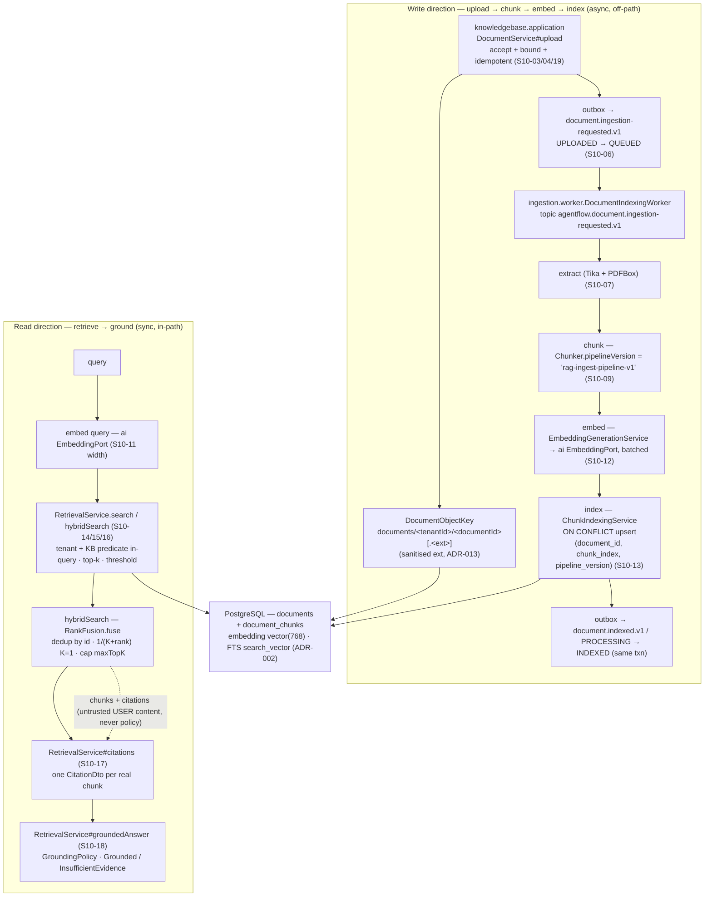

# RAG Pipeline — AgentFlow

> **Status:** Implemented (anchored to the runtime, not the plan)
> **Owner:** `knowledgebase` (retrieval, citation, grounding) with `ingestion` (upload → chunk → embed → index) and `ai` (embeddings through the ADR-014 `EmbeddingPort`). The document lifecycle the whole pipeline rides on is owned by `knowledgebase` (`S10-01`).
> **Task:** `S10-11` … `S10-18` (the implemented pipeline). The implemented-vs-planned split lives in the [`docs/rag/` README](README.md) — read it before treating any step as done or planned.
> **Upstream reference:** `AGENTFLOW_ARCHITECTURE_AND_PLAN.md` (Sprint 10, `S10-11` … `S10-18`) ·
> `docs/domain-glossary.md` (§7: *Retrieval*, *Chunk*, *Citation*, *Embedding*, *Knowledge base*) ·
> `docs/architecture/module-map.md` (`knowledgebase` owns `documents` / `document_chunks`; `ingestion` indexes into it through `messaging` events; `ai` owns the embedding port) ·
> `docs/architecture/document-lifecycle.md` (the `UPLOADED → QUEUED → PROCESSING → INDEXED` lifecycle) ·
> `docs/architecture/events/README.md` (the `ingestion-requested` / `indexed` topics) ·
> `docs/evaluation/rag/` (the eval that compares retrieval changes) ·
> [`adr/ADR-002`](../adr/ADR-002-postgres-source-of-truth.md), [`adr/ADR-006`](../adr/ADR-006-untrusted-planner.md), [`adr/ADR-007`](../adr/ADR-007-tenant-isolation.md), [`adr/ADR-009`](../adr/ADR-009-single-persistence-spring-data-jdbc.md), [`adr/ADR-013`](../adr/ADR-013-s3-object-storage-garage.md), [`adr/ADR-014`](../adr/ADR-014-opt-in-ports.md) (persistence, planner, tenant isolation, object storage, the opt-in embedding seam).
> **Purpose:** the end-to-end RAG pipeline **as it runs today** — upload → chunk → embed → index → retrieve → ground — anchored to the current code (`RetrievalService`, `CitationBuilder`, `GroundingPolicy`, the `ingestion` worker), not the plan's target state. The two directions run at different times: indexing writes vectors (`ingestion` + `ai`), retrieval reads them (`knowledgebase`).

---

## 1. The pipeline as it runs

RAG has two directions. Indexing is **write, async, off the request path**; retrieval is **read, synchronous, in the request path**. Both are bound by the same tenant-isolation and untrusted-content invariants.



The write side is a state machine (`document-lifecycle.md`): a document is `UPLOADED` while its bytes sit in object storage, then `QUEUED` once the `ingestion-requested` event is enqueued, `PROCESSING` while a worker holds the lease, and `INDEXED` (terminal) when every chunk is persisted. `FAILED` (permanent / retry budget exhausted) and the two-phase `DELETE_REQUESTED → DELETED` are the failure and deletion terminal states. The read side is a single tenant-scoped `RetrievalService` call that returns ranked chunks, one citation per chunk, and a grounding decision.

## 2. The write direction — upload → chunk → embed → index

### 2.1 Upload and the accept/bound layer (`S10-03` / `S10-04` / `S10-19`)

`knowledgebase.application.DocumentService#upload` is the only writer of `documents.status` on this path. It runs in three stages:

1. **Validate.** `DocumentUploadValidator` accepts the file and bounds it before anything is written — size (`agentflow.ingestion.max-upload-bytes`), MIME type + magic bytes, and a `sha256` content hash. A rejected file is a `400`, never a stored object.
2. **Store under a server-owned key.** The object bytes go to Garage (S3) at a `DocumentObjectKey` of the canonical shape `documents/<tenantId>/<documentId>[.<ext>]`. The `<ext>` is taken from a **fixed sanitised set** (`pdf`, `txt`, `md`, `rtf`, `html`, `csv`, `json`, `xml`, `png`, `jpg`, `jpeg`, `gif`), never from the client filename, so an attacker cannot smuggle a dangerous suffix (for example `.jsp` / `.php`) into the object path (`S10-04` — path-traversal negative tests). The stored `mime_type` is the source of truth for the payload's type.
3. **Commit + enqueue.** The `documents` metadata row (status `UPLOADED`) and the `document.ingestion-requested.v1` outbox record are written in **one transaction** (`ADR-002`), and the upload API returns `202 Accepted` with the new document.

Two `S10-19` idempotency rules live here:

- **Duplicate upload by content.** The idempotency key is `(tenant_id, sha256)` (plan §8.2). `documentRepository.findByTenantAndSha256(tenantId, sha256)` runs a tenant-scoped lookup (invariant 1 — the `tenant_id` predicate is part of the query, so another tenant's content-identical payload is indistinguishable from a missing one and yields a fresh upload); when the owning document exists it is returned as `DocumentDto(id, knowledgeBaseId, status)` with **no new row and no new event** — a re-upload of identical content is absorbed, never treated as exactly-once (invariant 3). The `sha256` column is *indexed, not unique* (the `(tenant_id, sha256)` index already exists from `V3_3_18`), so a `pipeline_version` change still reindexes as a new document.
- **Manual retry of `FAILED`.** `DocumentService#retryFailed(tenantId, documentId, createdBy)` re-checks the document is tenant-owned (`findByTenantAndId` ⇒ `404` otherwise), rejects a document not in the terminal `FAILED` state (`400`), releases it to `QUEUED` (`DocumentTransitionService#releaseFailedToQueued` — guarded by `status = 'FAILED'`, clears the stale `error_code`/`error_summary` and bumps the optimistic `version`), and re-enqueues a fresh `document.ingestion-requested.v1` (a new event id, so it is not a duplicate of the original already-consumed request) — all in the same transaction. `503` without a database.

### 2.2 Extraction → chunking → embedding → indexing (`S10-07` … `S10-13`)

`ingestion.worker.DocumentIndexingWorker` polls the `agentflow.document.ingestion-requested.v1` topic (manual offset commit only after a durable inbox outcome) and drives the full pass inside the inbox transaction:

1. **Claim.** A guarded conditional claim (`UPLOADED` / `QUEUED`, plus `INDEXED` under the `update` redelivery policy) makes sure exactly one worker moves a document out of a claimable state — a lease, fenced by `lease_epoch` (`durable-execution.md`).
2. **Payload.** The object bytes come through the opt-in `knowledgebase` read port `DocumentPayloadStore` (a port, not a Garage client — it fails loudly at call time, `ADR-014`).
3. **Extract & chunk.** Tika + PDFBox parse the object; `ingestion.application.chunk.Chunker` produces deterministic fragments tagged with a pipeline version. The chunker's `pipelineVersion()` is `"rag-ingest-pipeline-v1"` — the identity of the chunking config that produced the set.
4. **Embed.** `EmbeddingGenerationService` (`S10-12`) batches the chunk texts to the `ai` `EmbeddingPort` (`agentflow.ingestion.embedding.batch-size`, default 32), preserves input order across batch boundaries, and validates one vector per text with a uniform width before trusting the response. Provider rate limits / transient faults are retried by the `ai` resilience layer (`ResilientEmbeddingModel`), never by the caller. The `ai` → `ingestion` compile edge is the narrowest recorded (`ADR-016`): only the `ai.application` port contract, never `ai.provider`.
5. **Index.** `ChunkIndexingService` persists each chunk row with its 768-d embedding. The write is a **database guard, not a post-check**: `ON CONFLICT` on the S10-10 unique key `(document_id, chunk_index, pipeline_version)` under the configured redelivery policy (`agentflow.ingestion.indexing.redelivery-policy`, `skip` default / `update` overwrite) — so **a repeated ingestion event never creates duplicate logical chunks** (`S10-13` acceptance).
6. **Complete.** `PROCESSING → INDEXED` via the conditional `DocumentTransitionService` plus the `document.indexed.v1` outbox record (`agentflow.document.indexed.v1`) in the same transaction — invariant 3. A cross-module `knowledgebase` writer applies the transition when it consumes `document.indexed` through its inbox (deduplicated), and a crash rolls everything back.

A redelivery or a retuned pipeline re-indexes under the new identity rather than being a no-op on an already-`INDEXED` document.

### 2.3 Reindex on pipeline-version change (`S10-19`)

`IngestionService#index` records the trigger the schema declares: it computes `reindexOnVersionChange = !chunker.pipelineVersion().equals(document.pipelineVersion())` and claims the document for indexing when that is true (or when the redelivery policy is `update`), so a retuned chunking/embedding pipeline re-embeds the chunks under the new version. `complete(...)` / `indexedPayloadJson(...)` thread the just-completed `pipeline_version` through, and `DocumentTransitionService#markIndexed` / `DocumentRepository#markIndexed` record it (with a `null`/blank guard) so the document always reflects the pipeline version backing it.

## 3. The read direction — retrieve → ground

The read half is `knowledgebase.application.RetrievalService`. Every method takes `(tenantId, knowledgeBaseId, …)` from the verified security context (never from the body, query or headers — invariant 1) and returns plain values, not persistence objects.

### 3.1 The two retrieval halves

- **Vector half (`S10-14`).** `RetrievalService.search` (and the vector read behind `hybridSearch`) resolves the collection's pinned `embedding_model` through the tenant-scoped `KnowledgeBaseRepository` (a cross-tenant knowledge base is indistinguishable from a missing one ⇒ miss, invariant 1), embeds the query through the `ai` `EmbeddingPort`, and matches it against the stored `vector(768)` chunks via `DocumentChunkRepository.findNearest`. The predicate `WHERE c.tenant_id = ? AND d.knowledge_base_id = ? AND c.embedding IS NOT NULL` runs **before** the distance ordering and the `LIMIT` — never a post-filter — so another tenant's chunk can never surface as a "close" match. The stored `vector` is never read back (cosine distance is a plain `float8` column computed in SQL — no pgvector-jdbc).
- **Lexical half (`S10-15`).** `RetrievalService.lexicalSearch` runs over the PostgreSQL `english` FTS index (generated `search_vector` `tsvector` + `GIN` index `V3_3_21`). The keyword is tokenised with `plainto_tsquery('english', ?)` — not a caller-supplied `tsquery` — so an untrusted search string can never become a malformed operator (invariant 7). The same `(tenant_id, knowledge_base_id)` predicate runs before the `@@` match and the limit. This half needs **no** embedding provider, so a tenant without a model still returns the closest chunks by `ts_rank`.

### 3.2 Hybrid fusion (`S10-16`)

`RetrievalService.hybridSearch` runs the two halves independently and fuses them with the pure `RankFusion.fuse` (no Spring, no database, no I/O — the `knowledgebase` counterpart of `CitationBuilder`). It ranks each partial result by position, gives each chunk `1 / (K + rank)` per half it appears in (reciprocal-rank fusion, K=1), deduplicates by chunk id, and caps the result at `max-top-k`. The raw cosine distance and `ts_rank` numbers are **never** compared or averaged — two incompatible score scales, so only their ranks combine. The list is ordered deterministically (fused score desc, then best rank asc, then chunk id) so a fixed query set always yields the same ordered result. It touches **chunk ids only** — the untrusted document text never reaches the fusion (invariants 7/8). No embedding provider ⇒ the hybrid degrades to the lexical half alone (still deduplicated and capped).

The retrieval is bounded in configuration, not code (`agentflow.retrieval.*`, validated): a missing `topK` falls back to `default-top-k` (10), a caller `topK` is clamped to `max-top-k` (50), and candidates whose cosine distance exceeds `threshold` (0.5, bounded to `[0.0, 2.0]`) are dropped. The result carries each chunk's `(documentId, pageFrom, pageTo, score, content)` as the public `ChunkDto` / `SearchResult`.

### 3.3 Citations (`S10-17`)

`RetrievalService#citations` builds one `CitationDto` (fields: `documentId`, `chunkId`, `documentName`, `pageFrom`, `pageTo`, `score`, `snippet`) per *real* retrieved chunk through the pure `CitationBuilder.cite(SearchResult)`, in the retrieved order the halves already ranked. It never emits a citation for a chunk the caller cannot see: an empty `SearchResult` yields an empty list, and every citation's `chunkId()` resolves to the same tenant- and collection-scoped chunk the retrieval returned (invariant 1 — the two halves' predicates run inside the SQL). `documentName` is the trusted parent document's display name (resolved from a single `documents` join on both the vector and lexical reads); `snippet` is **untrusted document text** (invariants 7/8) — it is fed to the model only as `USER` content and never logged, hashed or written to logs, metrics or traces. The method throws `IllegalArgumentException` on a null argument and `IllegalStateException` when no database is configured (S01-02).

### 3.4 Grounding / the no-evidence policy (`S10-18`)

`RetrievalService#groundedAnswer(tenantId, knowledgeBaseId, SearchRequest, UUID)` runs hybrid retrieval + citations + policy as one tenant-scoped call and returns the sealed `GroundedAnswer` — either one `Grounded` to the real retrieved citations, or one `InsufficientEvidence` carrying the call's `searchId` (correlation only, never the query text). `knowledgebase.application.GroundingPolicy` is the pure, DB-free policy that decides from the citations: the effective bar is `max(1, minimum-citations)`, so `0` (the `DEFAULT` the service falls back to) means *any non-empty retrieval grounds* and an empty retrieval is an evidence gap; any value `>= 1` means *the retrieval must return at least that many chunks*. The `citations` the policy reads are already tenant- and collection-scoped, so the policy never invents a source — an empty (or below-bar) retrieval reports `InsufficientEvidence`, never an invented citation.

## 4. Invariants that shape both directions

- **Tenant isolation is in the query, not a post-filter (invariant 1, `ADR-007`).** The `tenant_id` predicate is the first `WHERE` clause on every `document_chunks` read — before the distance ordering (vector) and before the `@@` match (lexical) — so another tenant's chunk is indistinguishable from a missing one and a cross-tenant retrieval is empty. The tenant comes only from the verified security context on the read path, and is re-checked against PostgreSQL on the write path (invariant 2); never from the body, query or Kafka headers.
- **PostgreSQL is the source of truth (invariant 2, `ADR-002`).** The `vector(768)` lives in the owning `document_chunks` table with the chunk — no side table and no cache standing in for a missing document. Losing Redis must not lose a run.
- **At-least-once + idempotency (invariant 3).** State and the outbox record share one transaction; the worker acks a Kafka offset only after the durable inbox outcome; the `ON CONFLICT` upsert makes a redelivery a no-op on an already-indexed document. No exactly-once is promised anywhere.
- **The model and retrieved content are untrusted (invariants 7/8, `ADR-006`).** Retrieved fragments are prompt-injection surface: sent to the model as untrusted `USER` content, never as policy; only real retrieved chunks are cited. The model never changes permissions, policies or allowlists.
- **No high-cardinality identifiers in metrics (invariant 9).** On a successful fusion the service records, on three meters with **no** tenant / document / chunk-text label, the call count (`agentflow.knowledgebase.retrieval.hybrid`, `Counter`), the raw half-result count (`agentflow.knowledgebase.retrieval.half-results`, `Counter`) and the latency in seconds (`agentflow.knowledgebase.retrieval.duration`, `Timer`). The meters are opt-in (`MeterRegistry`, `null` ⇒ "no shared registry" ⇒ a throwaway `SimpleMeterRegistry`, never a crash).

## 5. The evaluation command (`S10-20`)

To compare a retrieval change (a retuned threshold, a fusion change, a new chunking or embedding pipeline) on a **fixed** set, AgentFlow ships a deterministic, DB-free eval runner — `knowledgebase.evaluation.RagEvalRunner` — that drives the **production** `RetrievalService` over a fixed fixture corpus (`RagEvalCorpus.baseline()`) and scores every case on `recall@1/3/5/10` against the reference chunks, citation correctness (one citation per retrieved chunk, every citation resolving to an owned corpus chunk with the exact document / page metadata) and the expected evidence verdict. It runs the real path, not a parallel one: hybrid fusion (`S10-16`), the citations (`S10-17`) and the `GroundingPolicy#DEFAULT` (`S10-18`).

**Why it needs no model, key or network.** The corpus embeds the deterministic `RagEvalEmbedding` — a hashed bag of words (alphanumeric tokens, lowercased, a small stopword set removed, length ≥ 3) mapped into the same `vector(768)` space. Two texts that share content words land close; unrelated texts sit at the maximum cosine distance `1.0`. The caller wires the `ai` `EmbeddingPort` to it in the test, and an opt-in run against a real provider follows the same runner with a provider-backed `RetrievalService`.

**Run it.**
```bash
./gradlew :apps:agentflow-app:test --tests 'com.example.agentflow.knowledgebase.evaluation.*'
```
The suite (`RagEvalRunnerTest`, 7 tests, JUnit-XML-verified, DB-free) asserts the baseline passes end to end (full recall at the target depth, correct citations, the expected evidence verdict for every case), the foreign decoy (a chunk worded to vectorise maximally close to a question) is never retrieved, the off-topic question reports an evidence gap, and the rendered report is byte-stable across runs.

**The recorded baseline** (`docs/evaluation/rag/corpus.md`) — diff against this to see any regression:
```text
rag-eval baseline: 15/15 cases passed
PASS a-model-resolution refs=1 retrieved=3 recall@1=1.00 recall@3=1.00 recall@5=1.00 recall@10=1.00 citations=correct evidence=as-expected
PASS a-cross-tenant-empty refs=1 retrieved=2 recall@1=1.00 recall@3=1.00 recall@5=1.00 recall@10=1.00 citations=correct evidence=as-expected
PASS a-tenant-predicate-placement refs=1 retrieved=1 recall@1=1.00 recall@3=1.00 recall@5=1.00 recall@10=1.00 citations=correct evidence=as-expected
PASS a-lexical-tokenisation refs=1 retrieved=1 recall@1=1.00 recall@3=1.00 recall@5=1.00 recall@10=1.00 citations=correct evidence=as-expected
PASS a-hybrid-fusion refs=1 retrieved=2 recall@1=1.00 recall@3=1.00 recall@5=1.00 recall@10=1.00 citations=correct evidence=as-expected
PASS a-distance-threshold refs=1 retrieved=1 recall@1=1.00 recall@3=1.00 recall@5=1.00 recall@10=1.00 citations=correct evidence=as-expected
PASS a-insufficient-evidence refs=1 retrieved=2 recall@1=1.00 recall@3=1.00 recall@5=1.00 recall@10=1.00 citations=correct evidence=as-expected
PASS b-cycle-count refs=1 retrieved=1 recall@1=1.00 recall@3=1.00 recall@5=1.00 recall@10=1.00 citations=correct evidence=as-expected
PASS b-reorder-point refs=1 retrieved=1 recall@1=1.00 recall@3=1.00 recall@5=1.00 recall@10=1.00 citations=correct evidence=as-expected
PASS b-quarantine refs=1 retrieved=2 recall@1=1.00 recall@3=1.00 recall@5=1.00 recall@10=1.00 citations=correct evidence=as-expected
PASS b-fifo refs=1 retrieved=1 recall@1=1.00 recall@3=1.00 recall@5=1.00 recall@10=1.00 citations=correct evidence=as-expected
PASS c-uptime refs=1 retrieved=4 recall@1=1.00 recall@3=1.00 recall@5=1.00 recall@10=1.00 citations=correct evidence=as-expected
PASS c-incident refs=1 retrieved=1 recall@1=1.00 recall@3=1.00 recall@5=1.00 recall@10=1.00 citations=correct evidence=as-expected
PASS c-recovery refs=1 retrieved=3 recall@1=1.00 recall@3=1.00 recall@5=1.00 recall@10=1.00 citations=correct evidence=as-expected
PASS x-no-evidence refs=0 retrieved=0 recall@1=1.00 recall@3=1.00 recall@5=1.00 recall@10=1.00 citations=correct evidence=as-expected
```
The corpus (`docs/evaluation/rag/corpus.md`) is three synthetic, third-party-free sample documents (thirteen owned chunks across `agentflow-retrieval-runbook.md` / `warehouse-inventory-policy.md` / `q3-platform-uptime-report.md`) plus one **foreign decoy** chunk; the fixture identities, the questions, and the "the decoy only stays out because the tenant predicate runs inside the query" case are all pinned there.

## 6. How the pieces fit — module ownership

| Step | Owns | Type | Task |
|---|---|---|---|
| Upload accept/bound + idempotent duplicate / retry | `knowledgebase` | `DocumentService`, `DocumentUploadValidator`, `DocumentRepository` | `S10-03` / `S10-04` / `S10-19` |
| Object-key generation (server-owned, sanitised ext) | `knowledgebase` | `DocumentObjectKey` | `S10-04` |
| Upload enqueue (`UPLOADED → QUEUED`) | `knowledgebase` | `DocumentTransitionService` + outbox | `S10-06` |
| Extraction + deterministic chunking | `ingestion` | `DocumentIndexingWorker`, `Chunker` | `S10-07` / `S10-09` |
| Embedding production (batched, resilient) | `ai` → `ingestion` | `EmbeddingPort`, `EmbeddingGenerationService` | `S10-12` (`ADR-016`) |
| Idempotent indexing + indexed event | `ingestion` / `knowledgebase` | `IngestionService`, `ChunkIndexingService`, `DocumentTransitionService` | `S10-13` |
| `vector(768)` storage + nearest-neighbour primitive | `knowledgebase` | `DocumentChunkRepository`, migration `V3_3_20` | `S10-11` |
| Tenant/ACL-filtered vector retrieval | `knowledgebase` | `RetrievalService.search` | `S10-14` |
| Lexical (FTS) retrieval half | `knowledgebase` | `RetrievalService.lexicalSearch`, migration `V3_3_21` | `S10-15` |
| Hybrid reciprocal-rank fusion | `knowledgebase` | `RetrievalService.hybridSearch`, `RankFusion` | `S10-16` |
| Citations from real chunks | `knowledgebase` | `CitationDto`, `CitationBuilder` | `S10-17` |
| No-evidence / grounding policy | `knowledgebase` | `GroundedAnswer`, `GroundingPolicy` | `S10-18` |
| The eval that compares retrieval changes | `knowledgebase` (internal package) | `RagEvalRunner`, `RagEvalCorpus`, `RagEvalEmbedding` | `S10-20` |

Every read is tenant- and collection-scoped inside the query; every state change goes through the single transition service; the `ai` embedding port is the only compile edge into `ai`, and it is opt-in (`ADR-014`).

## 7. The documented gap — what the plan targets that isn't in code yet

The S10 RAG pipeline is **implemented end to end** for what it does today: upload, chunking, embedding, idempotent indexing, hybrid retrieval, citations, and the no-evidence grounding policy — all unit- and integration-tested (`:apps:agentflow-app:check` green; `RetrievalServiceIT`, `IngestionIndexingIT`, `MigrationsTest` on `pgvector/pgvector:0.8.6-pg18`).

The concrete, verifiable boundary between "implemented" and "planned" right now is the **wiring to an end-to-end answer endpoint**. The retrieval, citation and grounding methods live in `knowledgebase.application.RetrievalService` as application services — exercised by the eval runner and by the unit / integration suites — but there is **no `knowledgebase.web` controller yet** that exposes a single `POST …/answers` endpoint driving the model with `groundedAnswer`'s output. The planner separation (`ai.PlanterService`, `PromptCatalogue`, `ADR-006`) exists, and the retrieval layer is what fills the untrusted `USER` message — but the endpoint that stitches query → retrieve → ground → model → grounded answer into one HTTP call is a follow-up, not part of the S10 deliverable. Where the plan points beyond the implemented set, the authoritative split is the implemented-vs-planned diagram in the [`docs/rag/` README](README.md), not this section.

## 8. Related documents

- **[`docs/rag/README.md`](README.md)** — the implemented-vs-planned split, the invariant-shaped retrieval diagram, and the per-task implementation notes (`S10-11` … `S10-18`).
- **[`docs/architecture/document-lifecycle.md`](../architecture/document-lifecycle.md)** — the `UPLOADED → QUEUED → PROCESSING → INDEXED` (+ `FAILED` / `DELETE_REQUESTED` / `DELETED`) state machine the write direction drives.
- **[`docs/architecture/module-map.md`](../architecture/module-map.md)** / **[`docs/architecture/module-api.md`](../architecture/module-api.md)** — owners and public-API boundaries per module.
- **[`docs/domain-glossary.md` §7/§8](../domain-glossary.md)** — *Retrieval*, *Chunk*, *Citation*, *Embedding*, *Knowledge base*.
- **[`docs/evaluation/rag/README.md`](../evaluation/rag/README.md)** / **[`docs/evaluation/rag/corpus.md`](../evaluation/rag/corpus.md)** — the eval command, the fixed corpus, and the recorded baseline rendering.
- **[`docs/devlog/sprint-10-document-ingestion.md`](../devlog/sprint-10-document-ingestion.md#s10-20--rag-evaluation-corpus-p1)** — the per-task changelog; the newest sections sit at the top.
- **The code** — `RetrievalService`, `CitationBuilder`/`CitationDto`, `GroundedAnswer`/`GroundingPolicy`, `RankFusion`, the `ingestion` worker, and `knowledgebase.evaluation.*`.
