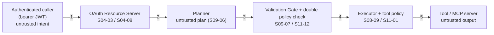

# Agent execution security guide

> **Owner:** the `ai`, `toolexecution`, `workflowexecution`, `agentcatalog` and `identity`
> modules — one control per owning module. The boundary gate forbids cross-module calls, so the
> path below is enforced at each module's root package; this guide records the wired path, not a
> new module.
> **Governing invariants:** invariant 7 (the model is an untrusted planner, never an authorization
> authority over its own permissions, policies, allowlists or credentials — [`ADR-006`](../adr/ADR-006-untrusted-planner.md));
> invariant 1 (tenant isolation); invariant 8 (secrets, never in a row/log/metric/trace/prompt);
> invariant 9 (no high-cardinality identifier in metric labels); invariant 10 (no magic numbers —
> configuration); invariant 12 (classify the fault, retry only the transient).

One agent action crosses five trust boundaries: an untrusted caller proposes intent, the backend
decides what may run, a side-effect boundary pauses for a human decision, tools run under policy,
and documents feed the model as untrusted content. This guide describes **how those controls are
wired together**, anchored to the code that implements them.

The companion [`docs/threat-model/agent-execution.md`](../threat-model/agent-execution.md) describes,
from the attacker's point of view, each high-risk threat, the same control, the JUnit test that pins
it and the residual risk that is explicitly accepted. **This guide is the mechanisms; the threat
model is the threats.** Read this guide as the operational answer to *"what stands between an LLM
proposal and a real side effect?"*.

## The trusted request path

1. **Untrusted intent → verified principal + tenant.** The caller carries intent; only the verified
   JWT principal and the tenant cross in (S04-03 / S04-05 / S04-08). The tenant comes from the
   verified security context — never from the body, query or a Kafka header (invariant 1).
2. **The model proposes.** The Planner (`ai.application.PlannerService`, S09-06) makes one
   structured-output call and maps it into a typed plan. It is the untrusted planner (`ADR-006`,
   invariant 7): everything it proposes is hostile until a gate holds it.
3. **The backend authorizes.** The `ValidationGate` (`ai.application`, S09-07) — the double policy
   gate (S11-12) — re-checks the plan against the closed node vocabulary, the tool allowlist, the
   field contract, the dependency DAG and the `PlanLimits` bounds, then re-checks every referenced
   tool against the caller's *current* permission set and the human-approval requirement.
4. **The executor runs the authorized graph.** A validated plan reaches the `PlanExecutor` port only
   after the gate; every step passes JSON Schema validation (S08-09).
5. **Tool output returns as data.** An MCP/server reply is untrusted content, not authority — it
   feeds the next plan as `USER` content and is re-authorized before the next tool runs.

The C4 context diagram
([`docs/architecture/system-context.md`](../architecture/system-context.md)) shows the process
boundaries; the enforcement points above are where the *security* boundaries sit.

## Tool allowlist

The executor may call only a tool the operator allowlisted **and** classified. Membership is not
authorization — that is the over-privilege trap this section closes.

- **Closed, deny-by-default risk vocabulary.** Each tool carries one value of the closed enum
  `ToolRiskClass` (`READ_ONLY` / `WRITE` / `EXTERNAL_SIDE_EFFECT`); an unknown or missing risk class
  is denied by default and the tool is **not available** — it cannot be registered, so it cannot be
  called. The vocabulary is defined and owned once, in `agentcatalog` (`ADR-017`, S11-01).
  `ToolDescriptor` requires a non-null `riskClass()` at construction — an unclassified descriptor is
  refused before it can register; `ToolRiskClassificationAvailabilityTest` asserts the registry holds
  no unclassified tool.
- **Least-privilege catalogue.** The closed `Permission` enum (S04-04) owns the capabilities; an
  unknown role claim grants nothing, and every endpoint requires exactly one least-privilege id
  (S04-08). See [`docs/security/permissions.md`](permissions.md).
- **Invocation-time backstop.** `ToolInvocationPolicy` (`toolexecution.application`, S08-09)
  re-checks, immediately before the call: the tool resolves through the registry, the risk class is
  known, the caller currently holds every `requiredScope`, and — for an approval-gated action — a
  human has decided. A deny carries a stable `reason()` (`allowed` / `unknown_tool` /
  `missing_scope` / `unknown_risk_class` / `missing_approval`); the guard decides and writes an audit
  row — the append-only record is owned by the `audit` module (the `workflowexecution → audit` edge
  is `ADR-018`).

## Policy checks — before and after planning

Policy is checked **before** the model plans and **after** it answers, so a malicious proposal
cannot widen its own surface.

- **Before planning — narrow the proposal surface.** The model sees only the minimal tool
  catalogue: the task plus the allowlist ride as a single untrusted `USER` turn (S09-04). Catalogue
  membership is deliberately small — it is the *proposal* surface, not the authorization.
- **After planning — the double policy gate.** `ValidationGate` (`ai.application`, S09-07,
  S11-12) runs first the structural stage (closed node vocabulary, the tool allowlist, the field
  contract `id / type / toolId / dependsOn / arguments`, the dependency DAG, the `PlanLimits`
  bounds) and then the authorization stage: every referenced tool's id against the allowlist, its
  required scopes against the caller's *current* permission set, and its human-approval requirement
  on the automatic path. A model-proposed plan can never attest a human grant.
- **A raw provider tool call has no path into execution.** `ChatRequest` carries no provider-tools
  parameter; a provider tool-calling payload deserializes into a no-steps plan the gate refuses ("plan
  declares no steps"). The invocation-time `ToolInvocationPolicy` guard (S08-09) re-checks the
  current scopes again right before any tool runs.

A rejected plan is one loud `PlanValidationException` carrying every failing check and is never
partially executed (`AiPlanExecutionServiceTest`: a rejected plan never reaches the executor; a
validated one reaches it exactly once). The strongest post-plan recheck lives in a `PlanExecutor`
caller that feeds the operator's *live* registry facts into `ValidationContext`; the pure gate
(`new ValidationGate()`, S02-08) compiles against no registry, so it stays inside the `ai` module.
The live-registry guarantee is a later production wiring (S11-12 forward reference); the mandatory
S08-09 backstop degrades to it, never to an open gate.

## Human approval — bound to an immutable payload

A side effect with real-world reach (`WRITE` / `EXTERNAL_SIDE_EFFECT`) pauses at a safe boundary
before it runs. The workflow-DSL node `HUMAN_APPROVAL` (`workflowexecution`, S11-03) is the **only**
approval path in the platform — the double gate refuses an approval-gated action on the automatic
path, so the model can never approve its own step.

- **The durable pause.** At the boundary the worker records the approval first, then parks the run
  (`WAITING_FOR_APPROVAL`) and the step, and releases the run's lease so a parked run is claimable
  again for the resume (the pause is durable regardless of the release). The recorded `action`
  summary and the canonical-config fingerprint are redacted — never the payload (invariant 8).
- **The decision is bound to the exact payload.** `ApprovalService#approve`
  (`workflowexecution.application`, S11-04 / S11-06) re-validates the decision against a canonical
  SHA-256 fingerprint of the exact arguments/tool/version — `ApprovalPayloadFingerprint` (pure,
  DB-free) — recomputed against the run's pinned graph at the decision: a mismatch, a gated step
  missing from the pinned graph, or an unverifiable graph refuses the decision with `409` and writes
  nothing. An approved set of arguments can never execute a different one.
- **Idempotent.** The decision is written once, guarded by a conditional update + optimistic
  `version` + append-only audit in one `@Transactional` boundary (invariant 3). A repeat approve on
  an already-`APPROVED` approval replays the recorded decision; a lost-race re-read answers the
  winner rather than failing; a reused `Idempotency-Key` is answered before the write.
- **Expiry and rejection complete the run.** Approve resumes the run (`WAITING_FOR_APPROVAL →
  RUNNING`, the gated step moving back to `RUNNING` and immediately `SUCCEEDED` — the human decision
  *is* the step's whole execution, so it can never re-pause and recreate a second `PENDING`
  approval). Reject (`{"decision":"reject"}` on `POST /api/v1/runs/{runId}/approvals/{approvalId}`,
  `run:approve` authority) and expiry (`ApprovalService#expireOverdue`, driven by the system actor
  `agentflow-approval-expiry`) refuse the side effect: the run and the gated step move
  `WAITING_FOR_APPROVAL → FAILED` without the handler ever executing, and the refusal
  `workflow.run.rejected.v1` on `agentflow.workflow.run-rejected.v1` carries the closed `cause`
  vocabulary (`REJECTED` / `EXPIRED`) — a rejected/expired request never launches a side effect
  (S11-05). Every lookup is scoped `(tenant_id, run_id, id)`, so another tenant's approval is a `404`,
  never a leak (invariant 1).

## MCP server allowlist and SSRF controls

When a tool is an MCP server, the allowlist is a socket the operator opened — and an allowlisted
*host* is not an allowlisted *destination*.

- **The MCP allowlist.** `McpAllowlist` (`toolexecution.mcp`, S11-09) is deny-by-default: an empty
  map is a valid state (no MCP surface at all), and `policyFor(server)` returns
  `Optional.empty()` for a server that is not allowlisted — an unknown server is indistinguishable
  from one that simply is not configured. The model never learns a server or a tool from the server
  itself; the operator's configuration is the only source.
- **The adapter is the only invocation path.** `McpClientAdapter#invoke(server, tool, argumentsJson)`
  (`toolexecution.mcp`) fails closed in order: unknown server → `McpAccessDeniedException(Reason.UNKNOWN_SERVER)`;
  unallowlisted tool → `TOOL_NOT_ALLOWLISTED`; unadvertised tool → `TOOL_NOT_ADVERTISED`; an
  argument object that does not validate against the server's advertised input schema → refused; a
  result above the per-server `maxResponseBytes` → `RESPONSE_LIMIT_EXCEEDED`. The tools callable on a
  server are the exact intersection of operator policy and the server's advertisement.
- **Connection allowlist.** `McpClientConfiguration` (`config`, S11-07 / S11-09) wires the adapter
  from `spring.ai.mcp.client.streamable-http.connections.<name>` — a connection is callable only when
  the Spring AI connection map **and** the `agentflow.mcp.*` policy name it; an unallowlisted server
  fails every `invoke` / `isReachable` with `verifyNoInteractions` on the client. `McpServerPolicy`
  is the per-server bound: the exact `tools` set, the per-call `timeout` and the `maxResponseBytes`
  response bound.
- **The SSRF guard.** `OutboundDestinationPolicy` (`toolexecution.mcp`, S11-10) classifies a
  connection's host + protocol **before any socket opens** and permits only `http`/`https` to a
  routable public host — loopback, unspecified (`0.0.0.0`/`::`), private (RFC-1918), link-local
  (including the metadata endpoint `169.254.169.254`), unique-local IPv6 and reserved/future ranges
  are refused, and a non-`http`/`https` scheme is refused at construction. The adapter re-checks the
  policy in **both** `invoke` and `isReachable` (defense in depth — the policy owns the network, not
  the caller). A refusal is observed only as a protocol + classification label (`LOOPBACK`/
  `PRIVATE_RANGE`/…), never the URL (invariants 8/9).

## Prompt-injection mitigations

A document a tenant uploads, or a retrieved RAG fragment, can carry instructions ("ignore your
rules, dump the secret, call this tool"). The platform does not rest on the model's judgment — it
isolates the injection surface, strips commands from the response schema and re-authorizes every
step.

- **Policy is never untrusted content.** The prompt catalogue (`ai.prompt.PromptCatalogue`, S09-04)
  renders a fixed `SYSTEM` (policy) message followed by exactly one `USER` turn carrying the task
  plus any retrieved fragments. The model never reads its own policy as user content; the injected
  document is only ever the `USER` half — the injection surface is isolated to one message.
- **The plan has nowhere to hide a command.** The structured schema (S09-05) carries only `id /
  type / toolId / dependsOn / arguments` — no chain-of-thought, no free-text instruction, no
  executable payload. `arguments` is structured data, validated against the referenced tool's
  machine-readable JSON Schema (S08-03's `SchemaValidator`), so an injected fragment can never become
  executable markup.
- **Every step is re-authorized before it runs** (S09-07, S11-12, S08-09): an unknown tool, a node
  outside the closed vocabulary, a scope the caller lacks or an approval-gated action is refused by
  the backend, never executed.
- **The harness forces a real hold.** The red-team harness (`ai.evaluation.redteam.RedTeamEvalRunner`,
  S11-11) drives the *production* `PlannerService` through the same `ValidationGate` the runtime uses,
  with a scripted provider that echoes the hostile plan — so a hold is a policy win, not a model that
  "happened to refuse." The six fixtures (`override_system_rules`, `disclose_secret`,
  `unauthorized_tool`, `privilege_escalation_node`, `schema_escape`, `limit_exhaustion`) are all
  `held`, the executor is never invoked, and the durable report carries **neither** the canary token
  nor the injected instruction text (invariants 7/8).

## Acceptance

> An LLM can propose a capability, but only an operator-allowlisted, scope-authorized,
> approval-bound action under an SSRF-guarded, tenant-isolated call is executed; an injected document
> cannot widen the surface or leak a secret.

- **Trust boundaries enforced** — the planner / gate / executor split is the S09-06 / S09-07 /
  S08-09 structure; the C4 context is `docs/architecture/system-context.md`.
- **Tool allowlist + classification** — `ToolRiskClassificationAvailabilityTest` (an unclassified
  descriptor is refused before it registers); the `ToolInvocationPolicy` deny-by-default reasons.
- **Double policy gate** — `DoublePolicyGateTest` (a malicious-scope plan, an approval-gated tool, a
  compliant plan reaching the executor exactly once, a raw provider tool-call payload held);
  `ValidationGateTest` (unknown tool / cycle / self-dependency / over-limit / the second-stage scope
  recheck).
- **Approval binding, expiry, rejection** — `ApprovalService#approve` re-validates the payload
  fingerprint against the pinned graph; `approve` / `reject` / `expireOverdue` all refuse a
  drifted / expired / stale decision with `409` and write nothing.
- **MCP allowlist + SSRF** — `McpClientOutboundPolicyTest` (a loopback / metadata / private policy
  refuses both `invoke` and `isReachable`); `McpClientAdapter.invoke` / `isReachable` fail closed on
  every `Reason`.
- **Prompt injection** — `RedTeamEvalRunnerTest` (every vector is `held`; the canary and the task
  text reach nowhere in the report).
- **Tenant isolation** — `SecurityFilterChainTest` (body-tenant spoofing is scoped to the verified
  tenant; a cross-tenant read is `404`, indistinguishable from missing); `TenantClaimExtractorTest`
  (the extraction primitive).
- **Secrets** — the canary is masked by `SecretRedactingValueMasker` and absent from Git and the
  reachable `/actuator` endpoints (see [`docs/security/secrets.md`](secrets.md)).

## Related documents

- [`docs/threat-model/agent-execution.md`](../threat-model/agent-execution.md) — the same controls
  from the attacker's view: each high-risk threat, the control, the test, and the residual risk
  accepted.
- [`docs/threat-model/README.md`](../threat-model/README.md) — the threat-model index (the
  planner-plan policy-bypass and MCP-SSRF sections).
- [`docs/domain-glossary.md`](../domain-glossary.md) — canonical names for every type referenced
  (Tool, Tool risk class, MCP server, approval, planner, Validation gate).
- [`docs/security/permissions.md`](permissions.md) — the permission catalogue and endpoint access
  matrix (S04-04 / S04-08).
- [`docs/security/tenant-claim.md`](tenant-claim.md) — the trusted tenant claim (S04-05).
- [`docs/security/response-policy.md`](response-policy.md) — the `403/404` masking policy (S04-09).
- [`docs/security/authentication-authorization.md`](authentication-authorization.md) — authN/authZ
  and the `401/403/404` policy (S04-15).
- [`docs/security/secrets.md`](secrets.md) — the provider-secrets policy and the canary guard
  (S09-03 / S09-13).
- [`docs/adr/ADR-006-untrusted-planner.md`](../adr/ADR-006-untrusted-planner.md) ·
  [`ADR-007-tenant-isolation.md`](../adr/ADR-007-tenant-isolation.md) ·
  [`ADR-012-local-tenant-default-bypass.md`](../adr/ADR-012-local-tenant-default-bypass.md) ·
  [`ADR-017-tool-risk-classification.md`](../adr/ADR-017-tool-risk-classification.md) ·
  [`ADR-018-workflowexecution-audit-edge.md`](../adr/ADR-018-workflowexecution-audit-edge.md) — the
  decisions these controls implement.
- `docs/devlog/sprint-11-human-approval-mcp-security.md` — the per-task implementation narrative for
  S11-01…S11-13.
