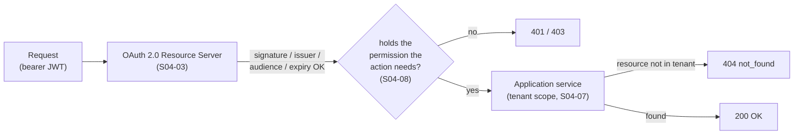

# Authentication and authorization (S04-15)

> Owner: the `identity` module (claims → authorities, tenant claim) and the `config` package
> (Resource Server + `SecurityFilterChain`). Implementation:
> `com.example.agentflow.config.SecurityConfiguration`,
> `.../identity/application/ClaimsToAuthoritiesMapper`,
> `.../identity/application/TenantClaimExtractor`,
> `.../identity/application/authorization/AccessMatrix`,
> `.../identity/domain/Permission`.
> Governing invariants: 1 (tenant isolation) and 7 (AI as an untrusted planner); ADRs
> `ADR-007` (tenant isolation), `ADR-006` (model is an untrusted planner).

This document is the **authentication/authorization guide**: who may call the AgentFlow API, how
their identity is established, and what every response says about a caller that is not allowed. It
ties together the pieces Sprint 4 put in place — the OAuth 2.0 Resource Server (`S04-03`), the
claims-to-authorities mapper and the permission catalogue (`S04-04`), the tenant claim (`S04-05`),
the tenant scope (`S04-07`), the endpoint access matrix (`S04-08`), the `401/403/404` masking
policy (`S04-09`) — into one picture, and links to the executable local-login walkthrough in
[`docs/runbooks/local-auth.md`](../runbooks/local-auth.md) (`S04-14`).

---

## At a glance

A request passes three layers before it reaches a controller:

1. **Authentication (authn).** The OAuth 2.0 Resource Server
   (`SecurityConfiguration.securityFilterChain`, `NimbusJwtDecoder`) verifies the bearer JWT:
   signature, issuer, audience, expiry. A missing, expired, tampered or mis-issued token is
   rejected with `401` at the security layer.
2. **Authorization by capability (authz).** The verified token's role claims are mapped to
   authorities and checked against the **permission catalogue** (`Permission`, `S04-04`) and the
   **endpoint access matrix** (`AccessMatrix`, `S04-08`). A valid token without the right
   permission gets `403`.
3. **Authorization by resource (tenant scope).** The application resolves the resource by
   `(tenant_id, resource_id)`. A resource that belongs to another tenant is masked as missing and
   returns `404`, never `403` (`S04-09`).

---

## Authentication — proving the caller

AgentFlow is an **OAuth 2.0 Resource Server**. Every caller proves identity with a bearer JWT
issued by Keycloak (the OIDC identity provider). There are two local flows; the exact `curl`
commands live in the [local-auth runbook](../runbooks/local-auth.md) (`S04-14`). This section
describes *what each flow is for* and *what the Resource Server checks*.

| Flow | Client | Grant | Who | Leaves a secret? |
|---|---|---|---|---|
| Machine-to-machine | `agentflow-service` (confidential) | Client Credentials | A service, a script, a test harness calling the API without a signed-in user | Client secret (kept in the git-ignored `.env`, never committed) |
| User login | `agentflow-web` (public SPA) | Authorization Code + PKCE | A human in a browser | Nothing — no client secret; the code is exchanged with the PKCE verifier |

Keycloak (`quay.io/keycloak:26.8.1`, the `identity` Compose profile) imports the realm
declaratively from
[`infra/compose/keycloak/realm-agentflow.json`](../../infra/compose/keycloak/realm-agentflow.json)
(`S01-15`) and stamps both token kinds with the `agentflow-api` audience via the realm
`fixed-audience` mapper (`S04-03`).

### What the Resource Server validates

`SecurityConfiguration` builds the standard `NimbusJwtDecoder` from the configured issuer
(`S04-03`). The JWK set is fetched **lazily on first decode** (never at startup), so the context
boots without a reachable Keycloak. A token must pass **all** of:

1. **Signature** — signed by the issuer; the public keys are resolved from the OIDC discovery
   document's `jwk_set_uri` (falling back to `jwks_uri` for Keycloak).
2. **Issuer** — `iss` must equal `agentflow.security.issuer-uri` (`AGENTFLOW_KEYCLOAK_ISSUER_URI`).
3. **Audience** — `aud` must contain `agentflow-api` (`agentflow.security.audience`); this is the
   "which resource server is this token for" check.
4. **Expiry** — `exp` must not be in the past.

A token that fails any check is rejected with `401 Unauthorized` before the request reaches a
controller. This closes the API by default until a Keycloak issuer is configured.

### Configuration

Both the issuer and the audience come from the environment; the defaults in
`application.yml` are non-production placeholders.

| Key | Value | Source |
|---|---|---|
| `agentflow.security.issuer-uri` | Keycloak realm URL (e.g. `http://localhost:8083/realms/agentflow` locally) | `${AGENTFLOW_KEYCLOAK_ISSUER_URI}`; defaults differ per profile (`application-local.yml`, `application.yml`, `application-kubernetes.yml`) |
| `agentflow.security.audience` | `agentflow-api` (fixed) | `application*.yml` |

The local `.env` (git-ignored) sets `AGENTFLOW_KEYCLOAK_ISSUER_URI` to the local Keycloak
(`http://localhost:8083/realms/agentflow`, the `KC_HTTP_PORT` from `docker-compose.yml`). No
secrets live in Git — the local Client Credentials secret is a rotation placeholder in
`.env.example` (see the runbook).

---

## Authorization — what the caller may do

### Claims → authorities (S04-04)

`ClaimsToAuthoritiesMapper` is the **single** place that turns a verified token's role claims into
Spring Security authorities. Spring Security wires it into the `JwtAuthenticationConverter` that
the secured chain uses, so every entry point — HTTP controllers, Kafka listeners, scheduled jobs —
derives the principal's authorities from the same catalogue; controllers never parse the JWT
themselves.

Rules:

- **Deny by default.** A role claim grants an authority **only** if its value is one of the
  catalogue ids (`Permission.ids()`). An unknown role claim is dropped.
- **Idempotent.** The same id always maps to the same authority, and duplicate role claims collapse
  to one.
- **Trusted input only.** The token is read after the Resource Server has verified it. This mapper
  never derives the **tenant** — tenant comes from the trusted security context only (`S04-05`/`S04-06`).

It accepts the two Keycloak role shapes: **client-scoped roles** (`resource_access.<client>.roles`)
and **realm roles** (a flat top-level `roles` claim).

### The permission catalogue (S04-04)

The catalogue is the closed enum `Permission` in the `identity` module. Each constant is one
permission; its `id()` is the literal token shared by the mapper, the endpoint matrix and the
Keycloak realm, so the three agree on what a permission *is*.

| Constant | `Permission.id()` | Grants |
|---|---|---|
| `WORKFLOW_READ` | `workflow:read` | Read a workflow definition (list / get). |
| `WORKFLOW_WRITE` | `workflow:write` | Create or edit a workflow definition draft. |
| `WORKFLOW_ACTIVATE` | `workflow:activate` | Activate an immutable workflow version. |
| `DOCUMENT_READ` | `document:read` | Read a document or search the knowledge base (citations only from real chunks). |
| `DOCUMENT_WRITE` | `document:write` | Upload a document to the knowledge base. |
| `RUN_EXECUTE` | `run:execute` | Create a run, read run status/steps/result and cancel it. |
| `RUN_APPROVE` | `run:approve` | Approve or reject a human-approval step. |
| `OPS_DLQ` | `ops:dlq` | Inspect and reprocess dead-letter queue messages. |

The catalogue is **closed**: a role claim that is not one of these ids is ignored by the mapper and
denied by the endpoint matrix (`S04-08`), so nobody can silently gain a capability by issuing a
token with an undocumented role. Extend it here only. The model is an **untrusted planner**
(`ADR-006`): it may propose a plan but never changes this catalogue or the tool allowlist.

> **Realm convergence (follow-up).** The Keycloak realm in `realm-agentflow.json` currently assigns
> the realm roles `workflow:read`, `workflow:write`, `workflow:approve`, `knowledge:read` and
> `tenant:admin`. The mapper grants authority only for the catalogue ids above, so the
> `workflow:approve` / `knowledge:read` / `tenant:admin` roles are currently **dropped** until the
> realm converges on the closed catalogue (a later follow-up). Assign the caller the catalogue
> roles (`workflow:read`, `workflow:write`, …) to see a working local token.

The endpoint access matrix (`AccessMatrix`, next to the catalogue in the `identity` module) maps
each `/api/v1` action to the single least-privilege permission it needs; the secured chain applies
it with default-deny. See [`docs/security/permissions.md`](./permissions.md) (`S04-04`/`S04-08`)
for the full matrix and the add-an-endpoint procedure.

---

## Tenant resolution (S04-05 / S04-06)

The **tenant** is the unit of data separation (`ADR-007`). `TenantClaimExtractor` reads the tenant
id from the verified JWT's `tenant_id` claim — a mapped Keycloak claim present **only** when the
caller has a tenant membership. By the time it runs, the Resource Server has already validated the
token, so the claim is trusted.

| Verified JWT | `tenant_id` claim | Result |
|---|---|---|
| member of a tenant | present, valid UUID | tenant resolved, request scoped to that tenant |
| member of a tenant | present, not a UUID | **deny** (malformed — treated as absent) |
| not a member of any tenant | absent | **deny** — no authorized tenant |

`tenant_id` is **never** taken from the request body, query parameter, or Kafka header (invariant 1):
those are untrusted. For async workers, which have no HTTP `SecurityContext`, the tenant comes from
the stored run's `tenant_id` re-read from PostgreSQL (`S04-06`), never from the Kafka envelope.

---

## The `401` / `403` / `404` policy (S04-09)

| Response | Meaning | Who |
|---|---|---|
| `401` | The caller is **unknown** — missing, invalid, expired, or wrongly-issued credential. | Anyone without a verified token. |
| `403` | The caller is **known but lacks the capability** for the *action* (missing `scope`, tool policy denial). | A verified caller calling an endpoint they are not permitted to use. |
| `404` | The *resource* is **not present in the caller's tenant** — this **includes another tenant's resource**, masked as missing. | Any verified caller that has the capability but requests a resource not `(tenant_id, resource_id)`-scoped to them. |

A foreign resource is masked as missing (`404 not_found`, never a distinguishing `403`) so a caller
cannot probe a guessed UUID and learn that another tenant owns a resource with that id — the
information-leak closure of invariant 1. The `tenant_id` comes only from the verified security
context, so spoofing it changes nothing and cannot turn a `404` into a `403`.

See [`docs/security/response-policy.md`](./response-policy.md) (`S04-09`) for the full policy and
the write-path (`409`) reasoning.

---

## Actuator restrictions (S04-11)

Only the liveness/readiness probes are reachable without a token:

- `GET /actuator/health`, `/actuator/health/**` and `/actuator/info` are `permitAll` in the secured
  chain, for the orchestrator probes.
- The HTTP exposure allow-list (`management.endpoints.web.exposure.include`) exposes only `health`
  and `info`; every other endpoint (`env`, `configprops`, `beans`, `mappings`, `loggers`, dumps) is
  **not** exposed and answers `404` anonymously.
- Every other management endpoint still requires a bearer token
  (`anyRequest().authenticated()`); metrics scrape is reachable only on the internal network.

No secrets, real credentials, or high-cardinality identifiers (`tenantId`, `runId`, `userId`,
prompts) appear in metrics, logs, or Actuator output (invariant 9).

---

## Security invariants

- **Tenant comes only from the verified security context** — never from body/query/Kafka headers
  (invariant 1, `ADR-007`).
- **Least privilege.** Every `/api/v1` action requires exactly one catalogue permission; default-deny
  for anything not explicitly listed (`S04-08`).
- **The catalogue and the allowlist are server-owned.** The model is an untrusted planner (`ADR-006`);
  it may propose a plan but never changes permissions, policies, or allowlists.
- **Deterministic responses.** A foreign-or-missing resource always answers the same `404
  not_found`; a probe cannot distinguish them (`S04-09`).
- **No secrets in Git, config, or telemetry.** The local Client Credentials secret is a rotation
  placeholder in `.env.example`; the realm import is declarative and reproducible.

---

## Related

- [`docs/runbooks/local-auth.md`](../runbooks/local-auth.md) (`S04-14`) — the executable local-login
  walkthrough: the m2m (`agentflow-service`) and user (`agentflow-web`) flows, the exact `curl`/token
  commands without real secrets, and issuer/audience troubleshooting.
- [`docs/security/tenant-claim.md`](./tenant-claim.md) (`S04-05`) — how `tenant_id` rides on the
  verified token and the "no membership → deny" contract.
- [`docs/security/permissions.md`](./permissions.md) (`S04-04`/`S04-08`) — the permission catalogue
  and the endpoint access matrix.
- [`docs/security/response-policy.md`](./response-policy.md) (`S04-09`) — the `401/403/404` masking
  policy.
- [`docs/adr/ADR-007-tenant-isolation.md`](../adr/ADR-007-tenant-isolation.md) — tenant isolation by
  default; the model is an untrusted planner (`docs/adr/ADR-006-untrusted-planner.md`).
- **`S04-13`** — the HTTP-boundary security regression suite proving the tenant-spoofing and
  cross-tenant-read criteria through the live bearer-token chain.

---

## Verification

- **Catalogue / mapper / matrix** — unit tests: `PermissionTest`, `ClaimsToAuthoritiesMapperTest`,
  `AccessMatrixTest`, `TenantClaimExtractorTest`.
- **HTTP boundary** — `SecurityFilterChainTest` drives the real `SecurityFilterChain` on the
  `secured-test` profile (a `workflow:read` caller reading another tenant's resource gets `404`; a
  body-carried `tenant_id` is ignored).
- **Local run** — bring up Keycloak (`docker compose --profile identity up -d`) and PostgreSQL,
  then follow [`docs/runbooks/local-auth.md`](../runbooks/local-auth.md) to issue a token and hit a
  secured endpoint.
- **Config** — the issuer/audience keys are validated typed properties (`AgentFlowProperties`);
  `docker compose config` validates the Compose stack; no secrets are committed.
