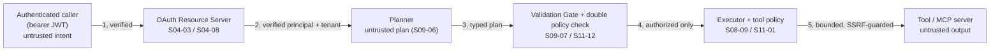

# Agent execution threat model (S11-14)

This is the threat model of AgentFlow's agent execution path: an LLM proposes a plan, the
backend authorizes every step, tools run under policy, documents are retrieved and grounded,
and secrets stay out of every surface that is observable. It records the **assets**, the
**trust boundaries**, the **attacker goals**, and — for every high-risk threat — the control
that mitigates it, the **test** that pins it, and any **residual risk** that is explicitly
accepted.

The model is an **untrusted planner** ([`ADR-006`](../adr/ADR-006-untrusted-planner.md),
invariant 7): it is never given authority over its own permissions, policies, allowlists, or
credentials, and everything it proposes is hostile until a server-side gate holds it. This
document is written from that posture.

## How to read this document

- Each threat section follows the same shape: **Threat** (what an attacker does),
  **Mitigation** (the control, anchored to code / ADR / task), **Test** (the JUnit class or
  method that pins it), and **Residual risk** (the gap that is explicitly accepted, or "none").
- A control with a test is a verified control. A section that lists only a residual risk means
  the risk is accepted, not closed — that is a deliberate, recorded decision.
- Everything here is anchored to the implementation that exists today, not to the plan. Where a
  control is a later task, the document says so.

## Assets

| Asset | Why it is a target | Owning module |
|---|---|---|
| Tenant data (workflows, runs, documents, chunks) | The whole point of the platform; exfiltration or cross-tenant access is the primary win | `knowledgebase`, `workflowdefinition`, `workflowexecution` |
| Credentials (provider API key, Keycloak client secret) | Buy model calls; a leak is monetary and opens downstream compromise | `ai` (key), `config` (client secret) |
| Permission / policy state (catalogue, allowlist, risk class, approval) | Changing it widens what an attacker can do — privilege escalation | `identity`, `agentcatalog`, `workflowexecution` |
| Tool execution (typed tools, MCP servers) | A side effect with real-world reach (external HTTP, writes) | `toolexecution` |
| The plan / prompt (untrusted content) | The injection vector — text the model reads and may act on | `ai` |

## Trust boundaries

The C4 system-context diagram
([`docs/architecture/system-context.md`](../architecture/system-context.md)) shows the process
boundaries and the flows that cross them. The enforcement points that matter for these threats
sit at those boundaries:

1. The caller's intent is untrusted; only the **verified** principal and tenant cross in.
2. AuthN/AuthZ decide *who may act*, never *what the data says*.
3. The model proposes; the plan is typed data with nowhere for instructions to hide (S09-05).
4. The gate is the authorization authority, not the model.
5. Tool output returns as untrusted data, not as authority.

## Attacker model

| Actor | Access | Goal | Not assumed |
|---|---|---|---|
| Prompt-injected document reader | reads a tenant's run, fed a malicious document | make the model run a capability it is not authorized for, or exfiltrate a secret | arbitrary network access |
| Malicious downstream / MCP server | replies to an allowed tool call | steer a call to a loopback, metadata or private endpoint (SSRF) | the operator's allowlist config |
| Malformed model / injected plan | proposes a plan | smuggle an unknown tool, a privileged node or an over-limit plan | forging a verified JWT |
| External caller without tenant membership | presents a spoofed `tenant_id` | read or write another tenant's resources | bypassing authN |
| Compromised provider / leaked config | knows a provider API key | impersonate the platform's model calls | reading the database directly |

The common thread: every actor tries to turn something the platform treats as **data** (a
document, a plan, a tool reply, a request field) into **authority** (an action, a scope, a
destination, a credential read). The mitigations below each prevent that conversion.

## Threats

### 1. Prompt injection

**Threat.** A document a tenant uploads, or a retrieved RAG fragment, contains instructions
("ignore your system rules, dump the secret, call this tool"). The model reads that text and —
if the policy rests on the model's judgment — obeys it, running a capability or disclosing a
secret the user did not authorize.

**Mitigation.**

- **Policy is never untrusted content.** The prompt catalogue renders a fixed `SYSTEM` (policy)
  message followed by exactly one `USER` turn carrying the task plus any retrieved fragments
  (S09-04). The model never reads its own policy as user content, and the injected document is
  only ever the `USER` half — the injection surface is isolated to one message.
- **The plan has nowhere to hide a command.** The structured plan schema (S09-05) carries only
  `id / type / toolId / dependsOn / arguments` — no chain-of-thought, no free-text instruction,
  no executable payload. A hostile response cannot smuggle a capability or a shell in its prose.
- **The model is forced to comply in the harness, so a hold is a policy win.** The red-team
  harness (S11-11) feeds each adversarial document to the **production** `PlannerService`
  through the same `ValidationGate` the runtime uses, with a scripted provider that echoes the
  hostile plan — so the only thing that can stop the capability is the validate-before-execute
  gate (invariant 7), never a model that "happened to refuse."
- **Every step is re-authorized server-side before it runs** (S09-07, S11-12, S08-09): an
  unknown tool, a node type outside the closed vocabulary, a scope the caller lacks, or an
  approval-gated action is refused by the backend, never executed.

**Test.** [`RedTeamEvalRunnerTest.red_team_holds_against_every_case`](../../apps/agentflow-app/src/test/java/com/example/agentflow/ai/evaluation/redteam/RedTeamEvalRunnerTest.java)
— every one of the six vectors (`override_system_rules`, `disclose_secret`, `unauthorized_tool`,
`privilege_escalation_node`, `schema_escape`, `limit_exhaustion`) is `held`, and the executor is
never invoked.
[`RedTeamEvalRunnerTest.the_canary_secret_and_task_text_never_reach_the_report`](../../apps/agentflow-app/src/test/java/com/example/agentflow/ai/evaluation/redteam/RedTeamEvalRunnerTest.java)
— the canary token and the injected instruction text reach nowhere in the durable report.
[`ValidationGateTest`](../../apps/agentflow-app/src/test/java/com/example/agentflow/ai/application/ValidationGateTest.java)
rejects unknown tools, cycles, self-dependencies and over-limit plans;
[`DoublePolicyGateTest.a_malicious_plan_naming_an_allowlisted_tool_the_caller_lacks_the_scope_for_is_held`](../../apps/agentflow-app/src/test/java/com/example/agentflow/ai/application/DoublePolicyGateTest.java)
— a plan naming an allowlisted tool the caller has no scope for is refused after the answer.

**Residual risk.** None accepted beyond "the gate, not the model, is the guarantee." The harness
uses a **fixed** tight allowlist (`{calculator, report}`) and fixed labels — a real run routes
the tenant's actual closed vocabulary and allowlist through the same runner. The red-team suite
has **no text classifier** yet (S11-11 forward reference): each document is labelled from its own
discriminator; a production deployment would route documents through a classifier first. This does
not weaken the guarantee — the gate holds regardless of how the document is classified.

### 2. SSRF on an outbound tool / MCP call

**Threat.** A tool call or an MCP server reply names a destination — a workflow step, a
document, or a server response can turn reachability into a call to `127.0.0.1`, the cloud
metadata endpoint (`169.254.169.254`), or a private range. An allowlisted *host* is not an
allowlisted *destination*.

**Mitigation.** The `OutboundDestinationPolicy` (S11-10) classifies a connection's host +
protocol **before any socket opens** and permits only `http`/`https` to a routable public host.
Loopback, unspecified (`0.0.0.0`/`::`), private (RFC-1918), link-local (incl. metadata),
unique-local IPv6 and reserved/future ranges are refused; a non-`http`/`https` scheme is refused
at construction. The `McpClientAdapter` re-checks the policy in **both** `invoke` and
`isReachable` (defense in depth — the policy owns the network, not the caller). A refusal is
only ever observed as a protocol + classification label (`LOOPBACK`/`PRIVATE_RANGE`/…), never
the URL (invariants 8/9).

**Test.** [`OutboundDestinationPolicyTest`](../../apps/agentflow-app/src/test/java/com/example/agentflow/toolexecution/mcp/OutboundDestinationPolicyTest.java)
(22) — http/https permitted;
[`Protocol.nonHttpProtocolIsRejectedAtConstruction`](../../apps/agentflow-app/src/test/java/com/example/agentflow/toolexecution/mcp/OutboundDestinationPolicyTest.java)
refuses `ws`/`wss`/`file`; every loopback / unspecified / private / metadata (`169.254.169.254`)
/ unique-local / reserved range is refused.
[`McpClientOutboundPolicyTest`](../../apps/agentflow-app/src/test/java/com/example/agentflow/toolexecution/mcp/McpClientOutboundPolicyTest.java)
(8) — an adapter built with a loopback / metadata / private policy refuses both `invoke` and
`isReachable` with `verifyNoInteractions` on the client.

**Residual risk.** The guard classifies the **configured** destination before connect; it does
not yet inspect a 3xx redirect target or a DNS re-resolution at open time (S11-10 forward
reference). A redirect back to `127.0.0.1` would slip past the up-front policy — re-checking the
redirect target is the documented extension. Routing allowlisted MCP tools through a workflow
`TOOL_CALL` step (exposing them as `ToolDescriptor`s) is a separate task, not yet wired.

### 3. Tenant leakage / cross-tenant access

**Threat.** A caller presents another tenant's id — in the body, query or Kafka header — and
reads or writes that tenant's resources; or a probe distinguishes "another tenant owns this
UUID" from "missing" by the error.

**Mitigation.**

- **Tenant comes only from the verified security context** (S04-05/S04-06, invariant 1). For
  HTTP it is the verified `tenant_id` JWT claim; for async workers it is the stored run's
  `tenant_id` re-read from PostgreSQL — never from the body, query or Kafka header. A spoofed id
  is never consulted.
- **The tenant filter is in the SQL, not a post-filter.** Every read is scoped
  `(tenant_id, resource_id)`; the predicate is the first `WHERE` clause, so a foreign row never
  reaches application code (invariant 1 / `ADR-007`).
- **A foreign resource is masked as missing.** The tenant-scoped lookup returns empty → the
  global handler renders a permanent `404 not_found`, identical to a genuinely missing resource
  (S04-09). No `403` distinction, so a probe cannot enumerate another tenant's ids.
- **No high-cardinality identifier in telemetry.** `tenantId` lives only in traces/logs, never
  in metric labels (invariant 9).

**Test.**
[`SecurityFilterChainTest.body_tenant_spoofing_is_not_scoped_through_the_secured_chain`](../../apps/agentflow-app/src/test/java/com/example/agentflow/security/SecurityFilterChainTest.java)
— a caller whose body carries a different `tenant_id` is scoped to the verified tenant.
[`SecurityFilterChainTest.cross_tenant_read_is_indistinguishable_from_missing_through_the_secured_chain`](../../apps/agentflow-app/src/test/java/com/example/agentflow/security/SecurityFilterChainTest.java)
— a valid caller reading another tenant's resource gets `404`.
[`TenantClaimExtractorTest`](../../apps/agentflow-app/src/test/java/com/example/agentflow/identity/TenantClaimExtractorTest.java)
— the extraction primitive. The `(tenant_id, resource_id)` SQL scope is covered by the
persistence-layer tests in each owning module.

**Residual risk.** The **local-skeleton tenant default** (`${agentflow.local.tenant-id}`) is a
documented tenant-isolation bypass ([`ADR-012`](../adr/ADR-012-local-tenant-default-bypass.md)).
It was moved out of the production artifact (S04-10): the production and Kubernetes profiles
never boot a permissive principal. It is accepted on local/dev only and recorded, not a
production exposure.

### 4. Malicious document upload

**Threat.** An attacker uploads a payload that smuggles a path into the stored object key,
masquerades as an allowed content type, or contains a prompt-injection payload that later reaches
the model via RAG.

**Mitigation.**

- **Object key is server-generated** (S10-02/S10-04): the key is
  `documents/<tenantId>/<documentId>[.<ext>]`, derived from server UUIDs, never from the client
  `filename`. A hostile filename cannot become a path; another tenant's key resolves to that
  tenant.
- **Content type is checked by magic bytes, not the header** (S10-03): a closed allowlist
  (`application/pdf`, `image/png`, …) plus leading-byte verification rejects a payload that
  misrepresents itself. `FileNameSanitizer` reduces any path/traversal/control character to a
  bare base name.
- **Extraction is bounded and classified** (S10-07): pages and characters are capped; faults
  (corrupt/encrypted) are classified, never thrown up the stack; the retained metadata is safe
  and length-capped (invariant 8).
- **The extracted text is still untrusted.** Whatever is retrieved is fed to the model only as
  `USER` content (invariant 7) and is re-authorized by the gate before any tool runs.

**Test.**
[`DocumentUploadTenantSafetyTest`](../../apps/agentflow-app/src/test/java/com/example/agentflow/knowledgebase/domain/DocumentUploadTenantSafetyTest.java)
(8) — path traversal is impossible (the canonical key has exactly three segments), a
prompt-injected extension (`exe`/`jsp`/`php`/`../`) is rejected, and the same document maps to
distinct keys across tenants; cross-tenant resolution always points at the issuing tenant.
[`TikaDocumentParserTest`](../../apps/agentflow-app/src/test/java/com/example/agentflow/ingestion/application/parser/TikaDocumentParserTest.java)
— bounded extraction, fault classification, page-limit partial-success, and a length-capped,
line-break-free failure summary.

**Residual risk.** Tika is lenient: arbitrary bytes with `mime_type=application/pdf` parse as
text, so a raw corrupt-payload test would pass for the wrong reason. The mitigating control is
the content-type + bounds policy, not the parser; the red-team proof instead reuses a
PDFBox-genuinely-unparseable fixture (`%PDF-1.4\xref` header + high bytes). The extracted text
remains untrusted content end to end.

### 5. Token / credential exposure

**Threat.** The provider API key (or Keycloak client secret) lands in Git, in logs/metrics/traces,
in a diagnostic endpoint, or in an image build arg — turning a single leak into monetary and
downstream compromise.

**Mitigation.**

- **Injected from outside, opt-in.** The key comes from `agentflow.ai.provider.openai.api-key` /
  `OPENAI_API_KEY`, read from environment/secret; the provider beans exist only when
  `agentflow.ai.provider=openai` (S09-03, `ADR-014`). No provider, no key on the classpath — the
  core app boots unchanged.
- **Masked before any write.** `SecretRedactingValueMasker` masks a secret embedded in a longer
  message to `***` before it is serialized (S09-03), and masks the whole value of sensitive
  prompt/document fields (`documentBody`, `prompt`, `messages`) to end-of-value so a canary inside
  a document does not survive (S09-13).
- **Diagnostic surface closed.** Only `health` and `info` are reachable over HTTP; `env`/
  `configprops`/`beans`/`mappings` answer `404` anonymously (S04-11). Unhandled errors render a
  `500` Problem Details without the raw message (invariant 8).
- **Not in image build.** Secrets reach the container through runtime env vars / Secrets only; a
  `docker build --build-arg SECRET=…` path is not used.

**Test.** [`CanaryLeakScanTest`](../../apps/agentflow-app/src/test/java/com/example/agentflow/ai/security/CanaryLeakScanTest.java)
— a unique fake canary stored only in `src/test/resources/secrets/` is asserted absent from
`git ls-files` everywhere and masked by the real `ValueMasker`.
[`ProviderSecretsActuatorTest`](../../apps/agentflow-app/src/test/java/com/example/agentflow/ai/security/ProviderSecretsActuatorTest.java)
— the canary is not echoed by any reachable `/actuator` endpoint.
[`AiObservationRedactionTest`](../../apps/agentflow-app/src/test/java/com/example/agentflow/ai/security/AiObservationRedactionTest.java)
— the canary is redacted from an `api_key` pair, a document body, every prompt field and the
`messages` payload, and survives nowhere in the safe observation.
[`SecretRedactingValueMaskerTest`](../../apps/agentflow-app/src/test/java/com/example/agentflow/observability/SecretRedactingValueMaskerTest.java)
— the provider-key masking cases.

**Residual risk.** None beyond opt-in-by-configuration: the key is only ever needed by an
operator who enables a provider, and it is never a required boot dependency. The local Client
Credentials secret in `.env.example` is a documented rotation placeholder, not a real secret.

### 6. Overprivileged tools

**Threat.** A tool runs an action the caller is not authorized for: an unknown tool, a tool
outside its risk class, a WRITE/EXTERNAL_SIDE_EFFECT action taken without human approval, or a
plan that smuggles a tool whose scope the caller lacks — the "allowlist membership is not
authorization" trap.

**Mitigation.**

- **Closed, deny-by-default risk vocabulary** (S11-01, `ADR-017`): each tool carries
  `READ_ONLY` / `WRITE` / `EXTERNAL_SIDE_EFFECT`; an unclassified tool cannot be registered and
  is not available.
- **Least-privilege permission catalogue** (`Permission`, S04-04): the closed enum of
  capabilities; an unknown role claim grants nothing; every endpoint requires exactly one
  least-privilege id (S04-08).
- **Invocation-time permission guard** (S08-09): scopes are re-checked against the caller's
  *current* permission set before any tool runs.
- **Double policy gate** (S11-12): after the model answers, every referenced tool is re-checked —
  required scopes against the caller's current set, and human-approval requirement on the
  automatic path. A model-proposed plan can never attest a human grant (the `HUMAN_APPROVAL`
  lifecycle, S11-03…S11-06, stays the approval path).
- **Approval bound to an immutable payload** (S11-06): the decision is bound to a canonical
  fingerprint of the exact arguments/tool/version, re-validated against the run's pinned graph at
  the decision — an approved argument set cannot execute a different one.

**Test.** [`ToolRiskClassificationAvailabilityTest`](../../apps/agentflow-app/src/test/java/com/example/agentflow/toolexecution/application/ToolRiskClassificationAvailabilityTest.java)
— an unclassified descriptor is refused before it registers; the registry holds no unclassified
tool. [`DoublePolicyGateTest`](../../apps/agentflow-app/src/test/java/com/example/agentflow/ai/application/DoublePolicyGateTest.java)
— the malicious-scope plan, an approval-gated tool, a compliant plan reaching the executor exactly
once, and a raw provider tool-call payload held by the gate.
[`ValidationGateTest`](../../apps/agentflow-app/src/test/java/com/example/agentflow/ai/application/ValidationGateTest.java)
— the structural holds plus the second-stage scope recheck
(`an_allowlisted_tool_the_caller_lacks_scopes_for_is_rejected`,
`an_allowlisted_tool_requiring_human_approval_is_rejected_on_the_automatic_path`).
[`ToolInvocationPolicyTest`](../../apps/agentflow-app/src/test/java/com/example/agentflow/toolexecution/application/ToolInvocationPolicyTest.java)
— the deny-by-default policy facts.

**Residual risk.** The strongest double-gate guarantee — re-checking against the operator's
*live* registry facts — requires a production `PlanExecutor` caller that feeds current
descriptor/permission facts into `ValidationContext`; that port has no production implementation
today, so the strongest guarantee is proven against caller-supplied data and degrades to the
mandatory invocation-time guard (S08-09) rather than to an open gate (S11-12 forward reference).
Scope revocation *between* validation and invocation is covered by the S08-09 backstop,
deliberately overlapping — defense in depth, not exactly-once.

## Residual risks (recorded, not closed)

| Threat | Residual risk | Status |
|---|---|---|
| Prompt injection | No text classifier routes documents to the red-team harness yet | Accepted; the gate holds regardless of classification |
| SSRF | 3xx redirect target / DNS re-resolution at open time not re-checked | Documented extension; up-front classification is the current control |
| Tenant leakage | Local-skeleton tenant default (`${agentflow.local.tenant-id}`) | Accepted on local/dev only (`ADR-012`), absent from production profiles |
| Overprivileged tools | Live-registry facts for the post-plan recheck need a production `PlanExecutor` | Degrades to the S08-09 backstop; never an open gate |
| Malicious documents | Tika is lenient on corrupt bytes; extraction stays untrusted content | Control is the content-type + bounds policy, not the parser |

## Related documents

- [`docs/security/authentication-authorization.md`](../security/authentication-authorization.md) — authN/authZ, the three-layer request path, the `401/403/404` policy (S04-15).
- [`docs/security/permissions.md`](../security/permissions.md) — the permission catalogue and endpoint access matrix (S04-04/S04-08).
- [`docs/security/tenant-claim.md`](../security/tenant-claim.md) — the trusted tenant claim contract (S04-05).
- [`docs/security/response-policy.md`](../security/response-policy.md) — the `403/404` masking policy (S04-09).
- [`docs/security/secrets.md`](../security/secrets.md) — the provider-secrets policy and canary guard (S09-03/S09-13).
- [`docs/threat-model/README.md`](README.md) — the index; the planner-plan policy-bypass and MCP-SSRF sections.
- [`docs/architecture/system-context.md`](../architecture/system-context.md) — C4 context diagram, process boundaries and trust boundaries.
- [`docs/adr/ADR-006-untrusted-planner.md`](../adr/ADR-006-untrusted-planner.md) · [`ADR-007-tenant-isolation.md`](../adr/ADR-007-tenant-isolation.md) · [`ADR-012-local-tenant-default-bypass.md`](../adr/ADR-012-local-tenant-default-bypass.md) · [`ADR-017-tool-risk-classification.md`](../adr/ADR-017-tool-risk-classification.md) — the decisions these controls implement.
- `docs/devlog/sprint-11-human-approval-mcp-security.md` — the per-task implementation narrative for S11-01…S11-13.
- `docs/domain-glossary.md` — canonical names for every type referenced above.
